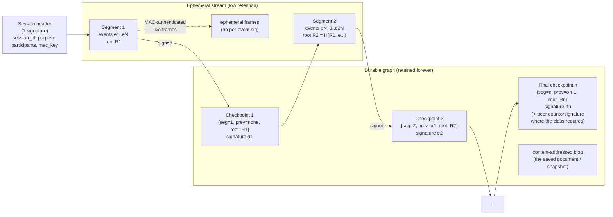

# Ephemeral live data vs the chained event graph — retention and intermittent signing — investigation

**Date:** 2026-10-29 · **Issue:** [#2034](https://github.com/developing-today/code/issues/2034) (LIST 9a) · **Epic:** [#2056](https://github.com/developing-today/code/issues/2056) (ID platform expansion, 2026-10-28 directive)
**Scope:** Should every keystroke, cursor move, backspace and game input become a signed, permanently retained entry in the ID event graph? What retention does each class of stream need, what does an *intermittent* (checkpointed) signature chain actually prove and give up, and how are live views rebuilt from a low-retention stream plus durable checkpoints?
**Method:** Read the ID codebase as it exists today (`pkgs/id/src/...`, with file:line evidence below) and its design docs under `pkgs/id/doc/`. No GitHub issues or PRs were filed; this file is the deliverable. Every claim is labelled **grounded** (with a citation) or **proposed**.

---

## TL;DR verdict

**Adopt a two-tier model: keep the per-author signed hash chain (`ChainExt`) exactly as it is for durable facts, and move keystroke-, cursor- and input-class traffic out of it entirely, onto an ephemeral per-session stream that is authenticated once by a session-header signature and closed by *intermittent segment checkpoints* (every N events or T seconds, plus on commit/blur) — never a signature per event.** The durable graph keeps only the checkpoints, the content-addressed blobs they name, and the events a class genuinely needs to be independently verifiable forever. The single biggest risk is **equivocation and selective withholding by the relay that carries the live stream**: an intermittent chain proves what the *signer* committed to at each checkpoint, but it cannot prove that two recipients saw the same live stream between checkpoints, nor that an intermediate checkpoint was ever shown to anyone — so anything where a dispute between two parties is the point (money, match results, contract-like chat) must keep per-event or per-transaction signing and cannot rely on the checkpoint alone.

| Question in #2034                                    | Verdict                                                                                                                                                                                                                                                       |
| ---------------------------------------------------- | ------------------------------------------------------------------------------------------------------------------------------------------------------------------------------------------------------------------------------------------------------------ |
| Does every keystroke need a signature + permanent timestamp? | **No — and the codebase already does not do that.** Live collaborative editing (`web/collab.rs`) carries steps and cursors as unsigned `MessagePack` frames over a WebSocket; only the *saved revision* becomes a signed `document.put` event (`local_events.rs`). The world journal (`world/mod.rs`) keeps a bounded, trimmed in-memory event list and a compactable JSONL journal. The "sign every keystroke" cost is a hypothesis, not current behaviour. |
| Is "very low retention for keystroke-class streams" enough? | **Yes, if the durable checkpoint carries the state transition.** Live streams are already bounded today: `WorldLimits::retained_events = 1024`, cursors dropped 5 min after disconnect, doc state dropped 1 h after the last client leaves. What is missing is the *signed checkpoint* that makes the low-retention stream auditable after the fact. |
| Is intermittent signing (initial + final signature) enough? | **Not as stated — "initial + final" is too weak.** A bare final signature over a hash chain proves ordering *within* the segment but proves nothing about *when* each element happened and lets the relay truncate the tail before the final signature arrives. **Segment checkpoints** (a signed running hash / Merkle root every N events or T seconds) fix the truncation and timing gap at a signature cost proportional to segments, not events. |
| What does a checkpoint prove?                         | The signer attests: "this segment's ordered delta, from state *Sₙ₋₁*, produced state *Sₙ*; here is its root." It gives up: per-event third-party non-repudiation, provable exact timing of each event, and any guarantee that an unseen intermediate checkpoint exists. |
| How are live views rebuilt?                           | From the durable checkpoint (a signed snapshot/state root) plus the ephemeral stream since that checkpoint. A late joiner or reconnecting peer loads the latest checkpoint and rebases; a partitioned peer reconciles at the next checkpoint boundary. The live stream is authenticated cheaply by a per-session capability/MAC key issued inside the session-header signature, so no per-keystroke signature is needed. |

---

## 1. What the current event graph actually is (grounded)

The ID event graph is a **per-author signed append-only chain**, built on p2panda's `Header<ChainExt>`.

- **One signed header per event.** `pkgs/id/src/chain.rs:1-16` describes it: "Every event is a p2panda `Header<ChainExt>`. p2panda's header already gives each author a chain: the author's key, a sequence number, and a backlink to the previous event." The domain tag `id.events.v1` is a signed field (`chain.rs:30`).
- **The extension carries the semantics.** `ChainExt` (`chain.rs:97-118`) holds `kind`, `group`, `after` (the author's causal frontier, ≤ `MAX_AFTER = 32`, `chain.rs:33`), and optional `tag` / `document` / `removes`.
- **The event ID is BLAKE3 over the signed bytes.** `chain.rs:263` ("the operation ID: BLAKE3 over `bytes`, signature included") and `chain.rs:305`. Receivers call `decode` (`chain.rs:321-342`), which verifies the signature with `verify_strict` and re-encodes to check canonical CBOR — so every accepted event is individually signed and hash-addressed.
- **Signing is one signature per event.** `chain.rs:282-309` `sign()` builds the header, signs it, and returns `{id, bytes, header}`.
- **Storage is a redb database of every verified event.** `pkgs/id/src/event_store/mod.rs:4-23` lists the tables (`events`, `hashes`, `chains`, `forks`, `groups`, `proof_ids`, `proof_headers`, `waiting`, `meta`; plus `actions` and `applied` at `mod.rs:108-112`). Format string `id.events.store.v8` (`mod.rs:83`). There is **no TTL, expiry, compaction or garbage collection for the event store** — a ripgrep for `ttl|retention|compact|expire|prune|evict` over `pkgs/id/src` finds hits only in the *world journal* and the *waiting pool*, never in `event_store` (grounded; see §2).
- **A second, parallel signed chain exists for accounts.** `pkgs/id/src/artifact.rs:1-24`: signed artifacts are "one append-only chain per author", naming the author's Ed25519 key, a per-author sequence number and the hash of the artifact before it; verified with Ed25519 + SHA-256. Design record: `pkgs/id/doc/2026-10-10T04-58-36Z_design_signed_artifacts/…md` (friend envelopes, home servers, cross-world access — all originator-signed so no server is the authority).
- **Local writes sign one event per action.** `pkgs/id/src/local_events.rs:1-18`: "`id doc` and `id claim` act through `LocalEvents`. Each action signs one event with the node's key, names every other author's head as its `after`, and ingests the event…" So a document save is one signed event; a tag is one signed event.
- **Not everything is signed.** The group log (`pkgs/id/src/groups/log.rs:1-12`) is explicitly unsigned: "Events are not signed here. The caller names the author, and the log is trusted as the file the node keeps. Signature checks belong to the event store." Membership (`membership/mod.rs:1-19`) consumes events the store has already verified (signature, encoding, `after` closure). Seitan invites (`seitan/mod.rs:1-16`) sign a joiner's *accept* message, checked once at admission.
- **Sync moves the whole graph.** `event_sync.rs:1-26` (`/id-sync/1` range sync: reconcile, then exchange events; the receiver re-verifies each), `log_sync.rs:1-26` (`LogSync` sends each author's applied prefix), and `sync_method.rs:1-30` (the crossover rule between them). This is the **sync amplification** cost: more signed events = more to reconcile and transfer.

**Where per-keystroke chain entries would hurt (grounded reasoning):**

1. **Hash-chaining cost.** Each event's `id` is BLAKE3 over bytes that include the signature (`chain.rs:263`), and each event carries `seq_num` + `backlink` (`chain.rs:1-16`). Per keystroke means a serialized backlink dependency per keystroke per author — a typing burst of 200 keys is 200 dependent hashes.
2. **Signature cost.** `sign()` produces one Ed25519 signature per event (`chain.rs:282-309`); verification is `verify_strict` on every received event (`chain.rs:321-342`). Ed25519 signing/verification per keystroke is the dominant cost and the dominant CPU-battery cost on a client.
3. **Storage.** `events` stores every accepted event's bytes forever (`event_store/mod.rs:6-8`), with no compaction path today. A typing session becomes permanent, unreclaimable rows.
4. **Sync amplification.** `LogSync` sends each chain's applied prefix and range sync reconciles differences (`log_sync.rs:1-26`, `sync_method.rs:1-30`). N× more events means N× more reconcile and transfer, and the crossover rule (`CROSSOVER_PER_THOUSAND = 35`, `sync_method.rs:30`) shifts toward the more expensive method.
5. **Replay.** Every keystroke becomes a re-applicable signed object. Replaying a keystroke stream into a document/state consumer is only bounded by the consumer's own idempotency; the graph itself will happily carry and serve it forever.

---

## 2. The live streams that already exist (grounded)

The codebase **already separates live from durable**, so this investigation is about formalising and signing the seam, not inventing one.

**2a. Collaborative editing (`pkgs/id/src/web/collab.rs`).** The module header (`collab.rs:1-55`) documents a `MessagePack` wire protocol: `[1, version, steps, clientID]` (client steps), `[2, steps, clientIDs]` (broadcast update), `[3, version]` (ack), `[4, clientID, head, anchor, name?, idleSecs?]` (cursor position), `[6, clientID]` (cursor removed), `[7, hash, name]` (new version saved). **Cursors and in-flight steps are unsigned and never enter the event graph.** Timeouts are explicit: WebSocket closed after 30 minutes of inactivity, cursor removed 5 minutes after disconnect, document state cleaned up 1 hour after the last client disconnects (`collab.rs:50-54`). A save is a *separate* action: `notify_saved` / `[7, hash, name]` (`collab.rs:348-350, 455`) tells clients a new version exists, and the saved revision is what `LocalEvents` signs into the event store as a `document.put` (`local_events.rs:1-18`, `documents.rs:32-50`). The collaborative-cursor design doc (`pkgs/id/doc/2026-03-20T05-30-00Z_feature_collaborative_cursor_enhancements/…md:15-33`) confirms cursors are ephemeral UI state with age-based fading, not persisted facts.

**2b. World runtime (`pkgs/id/src/world/`).** The world authority commits versioned `WorldEvent`s (`world/mod.rs:314-323`): a monotonic `sequence`, a `participant_id`, and a `kind`. `WorldEventKind` (`world/mod.rs:328-354`) is `Chat(String)`, `Input(Vec<u8>)` ("opaque input for a future game/world module"), `System { event }` ("capability results, ticks, presence… never sequenced, never broadcast"), and `ProgramInstalled`. The **retained-events buffer is bounded and trimmed**: `WorldLimits::retained_events` (`world/mod.rs:67`, default `1024` at `world/mod.rs:92`), and the core trims the buffer to that bound (`world/core.rs:375, 1015, 1128`). Chat history is served *from this bounded buffer* (`pkgs/id/doc/2026-10-16T17-00-00Z_feature_chat_history/…md`: "History comes from the retained-events buffer… already bounded by `WorldLimits::retained_events`"), clamped to `MAX_CHAT_HISTORY_LINES = 64` (`world_caps.rs:92`). Other bounds: `chat_bytes = 2048`, `input_bytes = 16 KiB`, `snapshot_bytes = 512 KiB`, `checkpoint_every = 1000` (`world/mod.rs:86-99`).

**2c. The world journal is the durable side of the world (`pkgs/id/src/world_store.rs`).** `JournalEntry` (`world/mod.rs:474-545`) records `Created`, `Issued` (capability, with `expires_at`, `uses`, `used`), `Revoked`, `BuilderInstalled`, `Forked`, `Committed { event }`, `System`, `Checkpoint`. It is a JSONL file that is **compacted by atomic rewrite** — "sibling temp file, fsync, rename — the `compact` machinery" (`world_store.rs:159-160, 200-240`), with a documented failure mode ("a crash could resurrect the old journal and lose later appends: refuse them", `world_store.rs:239-240`). This is the existing precedent for the checkpoint/compaction shape this investigation proposes to generalise.

**2d. Waiting pool.** Events held awaiting dependencies expire after a cap — `WaitingLimits` with `max_age_ms` (`waiting.rs:54-77`), and the Phase 1 design record states the deployed caps: **256 per author, 7 days** (`pkgs/id/doc/2026-10-11T22-25-52Z_phase_1_events_storage/…md`, P1.5). So the graph already discards some events on a clock; it just has no *auditable* checkpoint where it does.

**2e. Relay/sync metadata.** DHT records have a TTL ("A record already published stays on the DHT until its TTL ends", `dht.rs:11`); relay envelopes/outbox (`envelope_net.rs`, `envelope_outbox.rs`) are transport, not graph content.

---

## 3. Data-class table

Legend: **[G]** = grounded in code today (citation) · **[P]** = proposed here. "Signing granularity" = the smallest unit that must carry a signature for the class's own threat model.

| Class | Volume / latency profile | Who must verify it | Required retention | Required signing granularity | Who stores it | Loss consequence |
| --- | --- | --- | --- | --- | --- | --- |
| **Identity / key material & membership** (account keys, friend envelopes, group ops, home-server declarations, invites) | Tiny volume, low rate, write-once | Every server that accepts a connection; every member for group ops | **Forever** (portability requires it) **[G]** `artifact.rs:1-24`, `doc/…design_signed_artifacts`; group ops via `membership/mod.rs:1-19` | **Per artifact / per membership op**, signed by the acting key **[G]** `artifact.rs:1-24`, `chain.rs:282-309` | Every home server + every member's store; replicated **[G]** design doc ("replicated across servers") | Identity or membership becomes unverifiable; portability and access decisions break. Unacceptable. |
| **Signed durable documents / posts / notes** (`document.put` / `document.remove`, tags) | Low–moderate volume, human-paced (a save, not a keystroke) | Any reader; any world that accepts the document | **Forever, or per-document policy** (content-addressed blob may be unpinned) **[P]**; events are currently permanent **[G]** `event_store/mod.rs:6-8` | **Per save / per revision** (one signed event per action) **[G]** `local_events.rs:1-18` | Author's store + replicas via `/id-sync/1` **[G]** `event_sync.rs:1-26` | A revision becomes unverifiable or disappears from history. High but per-document recoverable. |
| **Money / currency transfers** | Low volume, strict ordering, high stakes | Both counterparties; any auditor; an independent ledger | **Forever** (financial record) | **Per transfer**, signed by the payer; ledger is separately authoritative **[G]** currency design: `doc/2026-10-28T23-34-15Z_investigation_tigerbeetle_currency_backend/…md` (TigerBeetle is the settlement core; "TigerBeetle never sees the signature") | TigerBeetle cluster (balances) + ID graph (signed claims) **[G]** same doc | Double-spend / repudiation / unreconcilable books. Unacceptable. |
| **Game match records & audits** | Low volume per match; audit/netcode log is high-volume | Opponent, witnesses, adjudicator | **Match result: forever. Netcode/audit log: bounded (proposed 30–90 days) then a checkpoint hash is kept** **[P]** | **Result: per-match mutual attestation** (see [#2037](https://github.com/developing-today/code/issues/2037)); **audit log: segment checkpoints** **[P]** | Result in the graph; audit blob optionally pinned, else dropped **[P]** | Result loss = no adjudication; audit loss = weaker cheating evidence, acceptable after the window. |
| **Chat messages** | Moderate volume, human-paced, bursty | Channel members | **Per-channel policy; default durable for IRC-style channels, bounded (proposed 90 days) for high-chatter live channels** **[P]**; world chat already bounded to a 1024-event buffer for *history reads* **[G]** `world/mod.rs:67,92`; `world_caps.rs:92` | **Per message** for durable channels (one signed event) **[G]** `chain.rs:282-309`; **segment checkpoints** for live/low-retention channels **[P]** | Members' stores; world journal for world chat **[G]** `world_store.rs` | Durable: lost history. Live: lost recent context only. |
| **Presence / typing / cursor / keystroke / pointer live streams** | **Very high volume, sub-second latency** (a cursor update every few ms while moving) | Peers in the same session only, in real time | **Seconds to minutes; none after the session ends** **[G]** cursors dropped 5 min after disconnect, doc state 1 h after last client (`collab.rs:50-54`); world `Input`/`Chat` trimmed to 1024 (`world/core.rs:375`) | **No per-event signature.** One **session-header signature** at join, then a per-session MAC; **segment checkpoints** on commit/blur/interval **[P]** (see §5) | The session relay/host in memory only; nothing durable unless a checkpoint is written **[G]/[P]** | Nothing recoverable that matters — the durable checkpoint already captured the state transition. Acceptable. |
| **Media blobs** (images, video, audio, pdf; `DocumentRef.content` is a BLAKE3 hash) | Large bytes, low rate | Any reader; hash-verified | **By pin/reference policy** — content-addressed, so retention is "who pins it" **[G]** `documents.rs:43-50`; blob transport via iroh **[G]** `artifact.rs:1-24` | **None of its own** — the referencing signed event commits to the hash **[G]** `documents.rs:46-47` | Whoever pins it; BitTorrent-style retrieval is a separate investigation ([#2050](https://github.com/developing-today/code/issues/2050)) | Unpinned blob becomes unfetchable, but the *fact* that it existed (its hash in a signed event) survives. |
| **Relay / sync metadata** (DHT records, envelope routing, outbox) | High volume, short-lived | Peers during transfer only | **Short — TTL-bounded** **[G]** `dht.rs:11` | **None** — transport, not graph content **[G]** `envelope_net.rs`, `envelope_outbox.rs` | Relays/peers transiently | Routing retried; no permanent record intended. |

---

## 4. What an intermittent-signature chain proves — and gives up

### The precise guarantee

For a segment *n* bounded by checkpoints *n−1* and *n*, an intermittent chain with the shape proposed in §5 gives:

> **The signer attests that: the state at checkpoint *n−1* was *Sₙ₋₁*; the ordered delta *Dₙ* it is signing is entirely of its own making; applying *Dₙ* to *Sₙ₋₁* yields the state at checkpoint *n*, *Sₙ*; and *Dₙ* has root *Rₙ*.** The chain of checkpoints (each naming the previous checkpoint's signature/hash) attests that *S₀ → S₁ → … → Sₙ* is one continuous history by one signer.

It does **not** claim: that any individual event inside *Dₙ* happened at a provable wall-clock time; that a third party ever saw *Dₙ* before *Sₙ*; or that no *other* checkpoint exists at a higher sequence (the relay can withhold).

### Attack surface

| Attack | What it exploits | Mitigation | Acceptable for… |
| --- | --- | --- | --- |
| **Truncation by the relay** | A relay drops the tail of the live stream before the final signature/checkpoint arrives, so a recipient's view ends earlier than the signer's. | Sign checkpoints on an **interval (T seconds)** as well as on commit, so the tail is bounded by T; the signer's own copy is authoritative. | Acceptable for keystrokes/presence (the tail is milliseconds of UI state). **Not** acceptable for a game result or a payment — those keep per-event signing. |
| **Reordering by the relay** | A relay permutes events inside a segment; a per-event chain would catch this, a single root over an *unordered* set would not. | Make the segment root a **running hash over the ordered log** (each element commits to the previous), so any permutation changes the root. | Acceptable *if* the root is order-committing; otherwise not acceptable anywhere. |
| **Equivocation between two recipients** | The signer (or relay) shows recipient A one segment and recipient B another from the same sequence range. | Checkpoints must be **chained to the previous checkpoint** and, where it matters, **countersigned by the peer** at the boundary (two-sided checkpoint) or published to a witness. | Acceptable for presence/cursor. **Not** acceptable for money, match results, or anything where two parties can dispute — those need the peer's counter-signature. |
| **Selective withholding of an intermediate checkpoint** | The signer withholds checkpoint *n* and later signs *n+1* naming *n−1* as its predecessor, hiding *Dₙ*. | Require each checkpoint to name its **immediate predecessor** (a gap is a provable fault); optionally make checkpoints **append-only published** to a home server. | Acceptable for live streams if gaps are detectable and the *final* checkpoint is authoritative. Not acceptable where an audit trail is required. |
| **Replay of a sub-chain into another context** | A segment from session X is replayed into session Y, or an old segment is replayed as new. | Bind every segment to a **session header** (session ID, participants, purpose, start time) and a **monotonic checkpoint sequence**; reject a segment whose header or predecessor does not match. | Never acceptable — replay must always be refused; this is cheap to prevent. |
| **Dispute where the loser repudiates mid-stream** | A player disconnects before the final checkpoint, then denies the moves made after the last checkpoint. | For match-class data, sign the **match result as a mutual attestation** ([#2037](https://github.com/developing-today/code/issues/2037)) and make the last checkpoint before disconnect binding; the audit log ([#2038](https://github.com/developing-today/code/issues/2038)) supplies the evidence. | Acceptable only with the mutual final attestation; the checkpoint alone is not enough. |

### Verdict per class

- **Keystroke / cursor / presence:** checkpoint-only is fine. There is no adversarial dispute worth the signature cost, and the durable checkpoint already captures the state that matters.
- **Game matches:** checkpoint for the *live play*, **mutual final attestation** for the *result*. The live stream is evidence, not the verdict.
- **Chat:** per-message signing for durable channels (the message *is* the fact); checkpoints only for explicitly-live/low-retention channels.
- **Money:** never checkpoint-only. Per-transfer signature plus the independent ledger.

---

## 5. Signing-chain proposal

### Shape

1. **Session header (one signature per session).** At join, the session owner signs a header: `{ session_id, purpose, participants[], started_at, nonce, mac_key_commitment }`. This is the *initial signature*. It also issues a **per-session MAC key** (derived from the header nonce and a shared secret, or an ephemeral key the header commits to) so every subsequent live frame is authenticated with a cheap MAC — no per-frame signature.
2. **Segments.** The live stream is cut into segments on **N events** (e.g. 256) **or T seconds** (e.g. 2 s) **or on commit/blur** (a document save, a window blur, a match end), whichever comes first.
3. **Segment root.** Each segment's root is a **running hash** (or Merkle root) over the *ordered* segment elements, seeded from the previous checkpoint's root, so ordering and continuity are committed.
4. **Segment checkpoint (one signature per segment).** The owner signs `{ session_id, segment_seq, prev_checkpoint, first_event_seq, last_event_seq, event_count, root, started_at, ended_at }`. **Each checkpoint names the previous checkpoint's signature/hash**, forming the intermittent chain.
5. **Final / commit signature.** The last checkpoint of a session (on save, blur, disconnect, or match end) is the *final signature*. Where the class demands it, the counterparty **countersigns** it (two-sided checkpoint).

### Mermaid



### Wire / record fields (proposed)

```
SessionHeader {
  session_id:      Hash            // BLAKE3 of the header bytes
  purpose:         String          // "doc-edit" | "world-play" | "match" | "chat-live"
  participants:    [PubKey]
  started_at:      u64             // unix ms
  nonce:           [u8; 32]
  mac_key:         [u8; 32]        // or a commitment to a derived key
  signature:       Ed25519         // by the session owner
}

SegmentCheckpoint {
  session_id:      Hash
  segment_seq:     u64             // monotonic, no gaps
  prev_checkpoint: Option<Hash>    // hash of the previous checkpoint bytes (None for seg 0)
  first_event_seq: u64
  last_event_seq:  u64
  event_count:     u32
  root:            Hash            // running hash / Merkle root over ordered segment
  started_at:      u64
  ended_at:        u64
  owner:           PubKey
  signature:       Ed25519
  peer_signature:  Option<Ed25519> // countersignature where the class requires it
}

LiveFrame {
  session_id: Hash
  seq:        u64
  mac:        [u8; 16]   // MAC under the session's mac_key over (session_id, seq, payload)
  payload:    Bytes      // the keystroke / cursor / input
}
```

The checkpoint is written **into the durable event graph as a normal signed event** (a new `ChainExt.kind`, e.g. `session.checkpoint`, with the checkpoint body referenced by hash) so it inherits the existing chain, storage and sync — no new transport. The `LiveFrame`s are never graph events.

### How a verifier walks it

1. Verify the **session header** signature; derive/obtain the MAC key.
2. For each **checkpoint** in `segment_seq` order: verify the signature, verify `prev_checkpoint` equals the previous checkpoint's hash (a gap is a provable fault), and verify `root` recomputes from the segment's ordered elements if they are available.
3. If the segment bytes were discarded (low retention), the checkpoint still proves the signer's attestation of the state transition; a verifier who has the two endpoint states can re-derive and compare.
4. For classes needing dispute resistance, require `peer_signature` on the final checkpoint.

---

## 6. Live-view reconstruction

A live view (collaborative document, cursor field, game state) is rebuilt from **the latest durable checkpoint + the ephemeral stream since it**.

- **Late joiner.** Loads the newest `SegmentCheckpoint` for the session (or the newest signed snapshot blob it names), sets its state to `Sₙ`, then subscribes to `LiveFrame`s with `seq > last_event_seq`. This mirrors today's `collab.rs` Init message `[0, version, doc, mode]` (`collab.rs:8`) and the world snapshot frame (`snapshot_bytes = 512 KiB`, `world/mod.rs:73`; "a client rebases its cursor on the snapshot, it does not need every retained event").
- **Reconnecting peer.** On reconnect it presents the last checkpoint it holds; the relay sends the segments after that checkpoint (or just the newest checkpoint plus live frames if the peer accepts state-rebase). Because checkpoints are chained and sequence-numbered, the peer can prove it is not being shown a truncated history.
- **Partitioned peer.** While partitioned it receives nothing; on heal it reconciles at the next checkpoint boundary: it accepts the newest checkpoint, and if it needs to *prove* what it saw, it holds its own last verified checkpoint as evidence. This is the same reconcile-then-exchange shape as `/id-sync/1` (`event_sync.rs:1-26`), but at segment granularity.
- **Cheap authentication of the live stream.** The session header signs a `mac_key` (or a commitment to one). Every `LiveFrame` carries a MAC under that key (`LiveFrame.mac`), so the relay cannot forge frames without the key and no per-keystroke Ed25519 signature is needed. When the key is rotated, a new session header (and thus a new initial signature) is issued. This is the "per-session capability/mac key issued by the session header signature" the issue asks for.
- **What the durable graph keeps.** Only checkpoints (and any class-specific durable events). The ephemeral `LiveFrame`s live in the relay/host's memory and are dropped on the existing timeouts (`collab.rs:50-54`).

---

## 7. Retention policy proposal

Numbers are **proposed** unless a citation says grounded. "Compactor" = who may delete/trim.

| Class | Retention (proposed unless **[G]**) | Compactor | ID-graph implication after compaction |
| --- | --- | --- | --- |
| Identity / key material & membership | Forever **[G]** (`artifact.rs`, design doc) | Nobody | Unchanged — all events kept. |
| Durable documents / posts / notes | Events forever; **blob retention by pin policy** **[P]** | Blob owner / pin manager | Unchanged; a `document.remove` already exists (`documents.rs:35`, `chain.rs:115-117`). |
| Money / currency | Forever | Nobody (ledger is authoritative) | Unchanged; graph holds signed claims, TigerBeetle holds balances. |
| Game match record | Result **forever**; audit log **30–90 days** **[P]** | Match participants / adjudicator | After the window: the audit blob is dropped; a **checkpoint event + hash + signature + optional blob reference** remains. |
| Chat | Durable channels forever; live channels **90 days** **[P]** | Channel policy | After the window: segment checkpoints remain; message bodies dropped. |
| Presence / cursor / keystroke / pointer | **Session lifetime only** **[G]** cursors 5 min post-disconnect, doc state 1 h post-last-client (`collab.rs:50-54`); world buffer 1024 events **[G]** (`world/mod.rs:67,92`) | The relay/host, on the existing timeouts | After the session: only the **checkpoint events** (root + signature + predecessor link) remain, plus any snapshot blob the final checkpoint names. |
| Media blobs | Pin policy **[P]** | Pinner | Hash survives in the referencing signed event (`documents.rs:46-47`). |
| Relay / sync metadata | TTL **[G]** (`dht.rs:11`) | Relay | None — never graph content. |

**The compacted-segment residue (proposed):** exactly one durable `session.checkpoint` event per segment — carrying `session_id`, `segment_seq`, `prev_checkpoint`, `root`, `event_count`, time bounds, signature, and an optional content-addressed **audit blob reference** for classes that want the raw segment retained elsewhere. That is the whole permanent cost of a live stream: *O(segments)*, not *O(keystrokes)*.

---

## 8. Follow-on work

Each is a candidate issue; each names its tier. **The PoC must not be built into the permanent feature before a review round** (program rule, [#2056](https://github.com/developing-today/code/issues/2056)).

1. **`id: design: session header + segment checkpoint event kind`** — scope: define `SessionHeader`, `SegmentCheckpoint`, and a new `ChainExt.kind` (`session.checkpoint`) with canonical-CBOR encoding, golden vectors, and a verifier walk; wire it into `chain.rs`/`event_store` as an ordinary signed event. **This is the design input for everything below.**
2. **`id: PoC: intermittent-signature live stream for collaborative editing`** — scope: a throwaway prototype that runs `collab.rs` steps/cursors through a session header + MAC-authenticated frames + 2-second/256-event checkpoints, and demonstrates reconstructing a late joiner from a checkpoint. **PoC — must not be merged into the permanent feature before review.**
3. **`id: feature: checkpointed live sessions with per-session MAC authentication`** — scope: the production form of (2) once reviewed: session lifecycle, key rotation, timeouts, and checkpoint emission on commit/blur/disconnect, for collaborative editing and the world runtime.
4. **`id: feature: live-view reconstruction from checkpoints (late joiner, reconnect, partition heal)`** — scope: the join/reconnect/reconcile paths and their tests, for both `collab.rs` documents and `world/` sessions.
5. **`id: feature: retention and compaction for the event store`** — scope: the first real retention/compaction path in `event_store` (today it has none), gated per class, leaving checkpoint events + hashes as residue; must preserve fork proofs and the waiting pool.
6. **`id: investigate: mutual (two-sided) checkpoints for match results and chat disputes`** — scope: the `peer_signature` variant and when a class must require it, feeding [#2037](https://github.com/developing-today/code/issues/2037) and [#2038](https://github.com/developing-today/code/issues/2038).

---

## 9. Open questions for the synthesis issue

- Does the durable `session.checkpoint` need to be a *graph event* at all, or can it be a parallel signed artifact (`artifact.rs` shape) referenced from the graph? Both exist today; the synthesis should pick one.
- What is the right default segment size/interval per class, and does it need to be world-configurable like `WorldLimits` (`world/mod.rs:59-99`)?
- Does the session-header MAC key belong in the header (public commitment) or be derived per session from a long-term key? What happens on key rotation mid-session?
- For chat, which channels are "durable" vs "live"? Is that a per-channel policy object, and who may change it?
- How do checkpoints interact with the existing fork proofs and the waiting pool (`event_store/mod.rs:12-22`, `waiting.rs`)? A compaction that drops events must not break `after` resolution.
- Should the peer countersignature be mandatory for any class by default, and does that change the relay model (the peer must be online at the checkpoint boundary)?
- Is there a role for a witness/notary server for high-value checkpoints, and does that conflict with "servers accept all signed objects" ([#2030](https://github.com/developing-today/code/issues/2030))?
