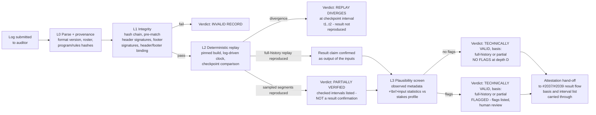

# Match audit — netcode log format, replay validation, and cheating signals — investigation

**Date:** 2026-10-29 · **Issue:** developing-today/code#2038 (LIST 10b)
**Question owner:** Drew's "ID match attestation + audit" directive (LIST 10)
**Scope:** A match's full netcode-level log (every key up/down, low-level
state-machine detail) can be recorded and sent to an AUDITOR who replays it.
Investigate: (1) log format and size, (2) deterministic replay requirements,
(3) the metadata competitive play needs to distinguish a *technically-valid*
state machine from *actually-valid* gameplay (speedrunning, competitive FPS).
**Deliverable asked for:** audit pipeline sketch + metadata list.
**Sibling / consumer:** #2037 (match-result attestation investigation) is the
other input; the gated synthesis #2039 ("match attestation + audit v1") merges
both. This doc is an input to that synthesis, not the v1 design itself.
**Method:** ID codebase as it exists today (`pkgs/id`: journaled worlds,
sandboxed Roc/Wasm programs, `src/world/clock.rs`, `src/event_store/`),
standard deterministic-replay / demo-file practice from existing games
(frame-locked input logs, checkpoint hashing), and anti-cheat reasoning about
what replay can and cannot prove. No code was built; nothing here is a
permanent feature.

---

## TL;DR verdict

**Replay audit is a strong fit for ID — because ID worlds are already
journaled, sandboxed programs — but replay alone proves only the weakest
claim people want from it.**

| Claim | What replay actually proves |
|---|---|
| "This log is authentic" | **Provable**, if the log is hash-chained and signed, and its header pins the exact program build. Cheap, do this first. |
| "The game would technically play this way" | **Provable**, if — and only if — the world program is deterministic under replay (fixed tick, seeded RNG, no wall-clock or float nondeterminism leaking in). ID's clock abstraction is the right seam; determinism is a property we must *engineer and test for*, not one we have today by default. |
| "The result follows from these inputs" | **Provable** as a corollary: replay reproduces the checkpoint hashes and the final state, so the recorded result is the result of the recorded inputs under the pinned rules. |
| "A human really played this, fairly" | **Not provable by replay, ever.** A bot, a tool-assisted run, or a spliced log can all be technically valid. This claim comes only from *metadata observed by someone other than the player* (peer/relay/witness-observed latency, connection path, timing) plus statistical screening — and even then the honest verdict is "flagged / not flagged", never "proven fair". |

**Bottom line:** build the audit in three layers with three different
strengths of verdict — L1 *authentic + replay-valid* (cryptographic,
certain), L2 *rule-valid* (the replayed state machine accepted every
operation), L3 *plausibility-screened* (metadata + statistics, probabilistic).
Conflating L3 with L1 is how audit systems overclaim and lose trust. The
pipeline sketch in §5 keeps the layers separate end to end.

Two hard prerequisites before any of this means anything:

1. **Determinism work in the world runtime** (fixed-tick input mapping,
   seeded/versioned RNG, a replay mode driven by the existing world clock).
   Without it, replay diverges and every verdict is noise.
2. **Observed, not self-reported, metadata.** A ping value the player's own
   client writes into its own log is worthless as evidence. Latency, IP, and
   connection path must be countersigned by a peer, relay, or witness —
   which is exactly the witness role #2037 investigates, so the two
   investigations meet there.

---

## 1. Where ID stands today (grounding)

Facts from the current tree that shape this design:

- **Worlds are sandboxed programs with a journal.** `pkgs/id` runs Roc/Wasm
  world programs (examples: `examples/tic-tac-toe`, `examples/territory`,
  `examples/roc-world`) over an event/journal substrate
  (`src/event_store/`: ingest, claims, sync, resolve). A match log is
  therefore not a new kind of object: it is a *delimited, exportable slice of
  the journal* for one match, plus the inputs that arrived from outside it.
- **Time already has a seam.** `src/world/clock.rs` exists precisely so
  "schedule and tick tests run without sleeping": the world core reads time
  decisions (ticks, expiries) from a clock abstraction. That is the exact
  injection point a replay mode needs — replay = same core, clock driven by
  the log instead of the wall.
- **Program provenance exists as a concern already** (see the
  `doc/2026-10-16…_feature_world_module_provenance` notes): pinning *which
  build* of a world program produced a state is already an ID problem, and
  the audit header (§2) simply consumes a program hash.
- **There is no real-time game in ID yet.** The examples are turn-based or
  slow-tick. So the format must be designed at the journal/input layer —
  tick-indexed inputs, not game-specific packets — and validated first on a
  turn-based example, with the FPS/speedrun cases treated as *sizing and
  metadata requirements*, not as the first implementation target. Anyone who
  designs this format around a hypothetical FPS engine first will get both
  wrong.

---

## 2. Log format

### 2.1 Structure

A match log is a single append-only, hash-chained stream in five parts:

```
HEADER      match_id, world/program id + program build hash, rules/config hash,
            tick rate, RNG algorithm id + seed commitment, genesis (initial
            state hash or full initial state), player roster (ID public keys
            + roles), start tick, format version, per-player header
            signatures over the header hash (taken before the first input
            tick — see design rules)
INPUTS      per-tick input records, delta-encoded, grouped into blocks
            (recommend one block per tick second); each block =
            block header (first tick, record count) + records
            (tick delta varint, player slot, input payload: key up/down
            transitions, buttons bitmask, aim/analog values) + one
            running chain hash H(prev_block_hash ‖ block_bytes); optional
            2–4 B per-record CRC for corruption, not tamper, detection
EVENTS      non-input journal events that affect the match (join/leave,
            pause, capability grants, relay path changes) — same chain
CHECKPOINTS every N ticks (recommend N = tick_rate, i.e. 1 s): tick +
            state hash; every M checkpoints (recommend M = 60): full state
            snapshot, so replay can start mid-log and auditors can spot-check
FOOTER      final tick, final state hash, result claim (as data, not as
            verdict), the RNG seed reveal (plaintext seed, checked against
            the header's seed commitment), per-player signatures over
            (header hash ‖ final chain hash ‖ seed reveal), optional
            witness/relay countersignatures over the metadata section (§4)
```

Design rules that matter:

- **Hash chain over everything, in order.** Each block carries
  `H(prev_block_hash ‖ block_bytes)` (and checkpoints/events chain the same
  way). Splicing, reordering, or truncating the log breaks the chain; the
  footer signatures bind both ends. This is what makes L1 (authenticity)
  cheap and certain.
- **The header is signed before play, not only bound at the end.** Each
  player signs the header hash *before the first input tick*; those
  signatures travel in the log's prologue and in the sealed metadata, and
  the auditor verifies them before it accepts anything downstream. Footer
  signatures over `header hash ‖ final chain hash` alone are insufficient:
  a participant who controls log assembly can swap the header — the seed
  commitment, the program build hash — after seeing opponent inputs,
  regenerate the chain and checkpoints, and then collect footer signatures
  on the rewritten log. With a pre-signed header, a seed reveal in the
  footer that does not match the commitment in the signed header is an L1
  failure, not a judgement call.
- **Inputs are tick-indexed, never wall-clock-indexed.** Wall-clock times
  live only in the metadata section. The state machine consumes inputs at
  tick boundaries; anything that happened "between ticks" is normalized to
  a tick by the *recording* side, under a stated rule, so the auditor
  replays the same normalization.
- **The payload is game-defined bytes; the envelope is not.** The format
  does not standardize what "aim" means. It standardizes identity, order,
  integrity, checkpoints, and provenance — the parts an auditor needs
  regardless of game.
- **Checkpoints are the audit accelerator, compared in order.** State hash
  every second lets an auditor find the *first divergent checkpoint interval*
  without replaying from genesis, and lets a light auditor verify a sampled
  segment instead of the whole match (matters for §5's tiered audit). The
  search is a **prefix scan, not a binary search**: checkpoint equality is not
  monotonic, because replayed and recorded states can diverge and later
  reconverge (a position differs for a few ticks and returns to the same
  place). A matching midpoint therefore does *not* prove the interval before
  it is clean, and a binary search that assumes it would skip the first
  divergence. Replay compares checkpoints in ascending tick order until the
  first mismatch, then replays that single checkpoint interval at full
  resolution. Because the log commits to state hashes only at checkpoints,
  replay can name the **first mismatching checkpoint interval**, not an
  intra-interval tick: two different divergences inside one interval are
  indistinguishable to the comparison. Naming the exact tick would require
  per-tick state commitments, which the format deliberately does not require —
  add them only if tick-level attribution is needed for a dispute. Where
  checkpoints are sparse, a cumulative replay-history commitment (each
  checkpoint hashing the run of checkpoints before it) restores a monotone
  predicate — but that is an optimization the format does not need to require.
  Note also what the chain does and does not do here: it authenticates the
  *submitted* checkpoints, it does not prove that replay reproduced their
  prefixes — only the replay comparison does that.
- **Result is a claim inside the log, not a property of it.** The footer
  records what the participants say happened; the auditor's replay either
  reproduces it or doesn't. (How a reproduced result becomes an *attested*
  result is #2037/#2039's question, not this doc's.)

### 2.2 Size

Inputs dominate; everything else is noise by comparison. Two recording
styles:

| Style | When | Size math |
|---|---|---|
| **Event-based** (record transitions only: key down/up, button change) | Turn-based, strategy, most keyboard play — inputs are sparse | ~4–10 B per transition (tick delta varint + player + code; chain hash amortized over a block, see below). A busy human produces ~2–6 transitions/s → **~50–200 KB per player-hour**, worst case low single-digit MB. Chess/turn-based: KBs per match, total. |
| **Frame-based** (record every tick's full input state) | Analog aim/sticks, where "no change" is itself information | Fixed record ≈ 8 B/tick/player (tick implicit, buttons 2 B, aim 2×i16, misc), **excluding** the chain hash. At 60 Hz: **≈1.7 MB per player-hour raw**; delta+RLE compression on real play typically cuts this 3–10×. A 5v5, 45-minute FPS match ≈ 10 players × 0.75 h × 1.7 MB ≈ **13 MB raw, ~2–5 MB compressed** — emailable, trivially storable. |

**Chain-hash overhead is amortized, not per record.** The 4–8 B record
figures above are the input payload only. A naive format that stores a
32-byte hash on every record would add 32 B/record — for the 10-player,
60 Hz, 45-minute example that is 1,620,000 × 32 B ≈ **51.8 MB of
effectively incompressible hash**, larger than everything else combined and
enough to invalidate the "2–5 MB compressed match" conclusion. The format
therefore chains **per block, not per record**: records are grouped into
blocks (recommend one block per tick second, 60 ticks), and each block
carries one chain hash `H(prev_block_hash ‖ block_bytes)`; the block hash is
the unit the footer signs and the unit checkpoints reference. Overhead
becomes 32 B per block per player ≈ 32 B/s → ≈ 86 KB per player-hour
(≈ 0.9 MB for the 10-player, 45-minute match), which is noise next to the
13 MB input payload, and a block is self-delimiting so a torn tail is
detectable. Splicing, reordering, or truncation at *block* granularity
still breaks the chain; a tamperer who edits inside a block must recompute
that block's hash and every later one, exactly as before. If per-record
tamper-evidence is wanted, add a 2–4 B per-record CRC (integrity against
corruption, not against a rewriter) — never a full hash per record.

Checkpoints: 32 B state hash per second ≈ 115 KB/hour; full snapshots are
game-sized and sparse (1/minute), the only term that can dominate — for big
worlds, snapshot *hashes* every minute and full snapshots on demand instead.

**Conclusion on size: a non-issue.** Even the worst realistic case
(frame-based FPS) is single-digit MB per match. Anyone proposing to sample
or truncate the input log "for size" is trading away auditability to save
megabytes; don't.

---

## 3. Deterministic replay requirements

Replay validity (L1/L2) holds only if same header + same inputs ⇒ same
checkpoints, bit for bit, on the auditor's machine. Requirements, in the
order they will bite:

1. **Fixed timestep simulation.** The state machine advances in ticks of a
   stated duration; rendering/interpolation never feeds back into state.
2. **All external input enters only as log records.** Network arrivals,
   local keys, timers — everything is mapped to tick-indexed records at
   ingest. If any code path reads a sensor, socket, or clock directly,
   replay diverges there first. ID's journal discipline already pushes
   this way; the audit makes it a *tested invariant*, not a habit.
3. **Clock through the existing abstraction.** `src/world/clock.rs` is the
   seam: live mode reads wall/monotonic time, replay mode reads the log.
   Any world-program-visible time must come through it.
4. **Seeded, versioned RNG.** Seed committed in the header (hash of seed
   revealed in the footer and covered by the footer signature; the header
   itself is signed by each player before the first input tick, so players
   can't grind seeds against a known opponent log mid-match), algorithm
   identified by id+version. "Whatever the runtime does" is not an RNG spec.
5. **Float discipline.** The dangerous one for Roc/Wasm worlds. Options, in
   descending order of safety: (a) fixed-point/integer simulation for
   anything competitive; (b) strict IEEE semantics with NaN
   canonicalization and no fast-math, verified by cross-platform replay
   tests; (c) accept platform-scoped validity ("valid on the pinned
   runtime build") and say so in the verdict. Wasm helps (near-determined
   semantics) but does not make (b) free — this needs an explicit decision
   in the synthesis, with a test: replay a recorded log on two different
   architectures and diff every checkpoint hash.
6. **Program + rules pinned by hash.** Header carries the world program
   build hash and config/rules hash; the auditor runs *that* build in the
   sandbox, never "latest". A rules patch mid-season must not retro-
   invalidate old logs.
7. **Replay is read-only and total.** The auditor's run produces checkpoint
   hashes and a reproduced final state — nothing else. If replay can fail
   "sometimes" (timeouts, resource limits), the verdict vocabulary needs
   `inconclusive`, and long matches need checkpoint-resume (§2.1) so a
   resumed replay is still a full verification.

**Test that proves the property** (proposed follow-on, §6): record a real
session of an existing example world (tic-tac-toe for v0; a tick-driven
example for the clock paths), replay it on a second machine/architecture,
assert every checkpoint hash matches. Until that test exists and passes,
every audit claim in this doc is aspirational — the synthesis should treat
determinism verification as the gating first build, ahead of any auditor
UI or pipeline polish.

---

## 4. Metadata: separating technically-valid from actually-valid

Replay validates the *log*. Competitive validity is a claim about the
*play* — that a human, on that connection, in that place, produced those
inputs in real time. The evidence for it is metadata, and the first rule
is provenance:

> **Self-reported metadata is decoration. Evidence-grade metadata is
> observed and countersigned by a party other than the player** — a peer,
> a relay the traffic actually traversed, or the witness of #2037.

### 4.1 The metadata list (deliverable)

Per player, per match. `O` = observed/countersigned, `S` = self-reported
(usable as a consistency check against observed data, never alone).

| Field | O/S | What it catches / enables |
|---|---|---|
| ID public key + roster slot | O (roster is mutual) | Binds log to identities; prerequisite for everything in #2037. |
| Observed source IP (by relay/peer/witness) | O | Ban-evasion and account-sharing checks; region/latency plausibility (claimed region vs observed RTT floor); "known IP" continuity across a season. **Sensitive:** see privacy note below. |
| RTT samples over the match (per ~5 s: min/median/p95, jitter, loss) | O | Latency plausibility: inputs that consistently anticipate events faster than the observed RTT + human reaction allows; mid-match connection switching (VPN hop shows as a step change); distinguishes "lag" claims from input anomalies. |
| Connection path (direct P2P / which relay / relay hops) | O | Explains RTT; a path change mid-match is itself an event in the log (§2.1 EVENTS). |
| Clock offset/skew estimate vs observer | O | Detects timestamp manipulation on the recording side; bounds how much a player could backdate inputs. |
| Join / leave / reconnect / pause events with observer ticks | O | Splice cover: a "disconnect" exactly spanning an anomalous segment is a classic log-editing alibi; the events are in the chain so they can't be quietly dropped either. |
| Client build hash + input device class (kbd/mouse, controller, touch) | S (build hash becomes O if the witness challenges the client) | Tool-assistance screening context: device class sets the plausible input statistics (e.g. analog smoothness vs mouse flicks); build hash pins the recording code. |
| Input timing microstructure (derived from the log itself: inter-input intervals, reaction latencies to in-game events) | derived | The statistical screen of §4.2 — derived, so it inherits the log's authenticity, but its *interpretation* is probabilistic. |
| Coarse session context (matchmaking bracket, tournament id, stakes) | S/O | Sets the screening threshold: casual play gets authenticity checks only; prize play gets the full screen. Audit depth should scale with stakes, not be uniform. |

**Privacy note (a real design constraint, not boilerplate):** observed IP
is the most sensitive field here and the one Drew's directive explicitly
names ("known IP"). Recommendation for the synthesis: the *public* log
carries a **keyed pseudonym** — a season-scoped HMAC of the IP under a
secret key held by the auditor/witness, never in the public log — so
continuity checks work without disclosure. A plain salted hash is not
enough: the IPv4 space is only 2^32 candidates, so anyone holding the
season salt can hash every address once and recover the IP behind a
published value without opening the sealed metadata; even a "public"
season salt offers no protection against that enumeration. The full IP
lives only in an auditor-sealed metadata section, encrypted to the
auditor/witness keys, opened only when an audit is actually invoked.
Competitive integrity does not require publishing every player's IP
forever, and a design that does will (rightly) be refused by players.

### 4.2 Cheating signals the screen looks for

None of these is proof. Each is a *flag with a false-positive rate*, and
the pipeline (§5) reports them as flags, not verdicts of guilt.

- **Superhuman reaction distribution:** not one fast reaction — a
  *distribution* with no human tail (e.g. sustained sub-100 ms responses
  to events that were not predictable from prior state).
- **Frame-perfect sequences — only as a *pre-quantization* signal, never
  from tick-quantized records.** In a log recorded per §2.1, every input is
  normalized to a tick boundary before storage and records keep only the
  tick, not sub-tick arrival time, so honest human inputs also land exactly
  on boundaries with zero observable jitter. A "zero jitter on tick
  boundaries" test run over the stored records would flag normal recordings
  by construction. The signal is therefore defined on a **separately
  observed, higher-resolution input-arrival series** (recorder event-loop
  timestamps or witness observation, retained in the sealed metadata of §4.1
  precisely for this test), and is restricted to patterns that remain
  distinguishable after quantization: long runs of exact-boundary inputs
  *combined with* response latencies that are impossibly uniform or that
  react to events before observed one-way delivery timing allowed
  them to be known (§4.2, third bullet). Where only tick-quantized records exist, this flag is
  reported as `INCONCLUSIVE — no sub-tick timing`, not as a positive.
- **Aim/input geometry anomalies:** snap-to-target angular velocities,
  correction patterns that track information the player could not have
  had yet when it could first have reached them (wallhack/aimbot tell).
  **Correction (Codex review, PR #2252):** observed RTT is *not* a lower
  bound on one-way event delivery — paths are asymmetric (a 10 ms
  observer-to-player leg plus a 190 ms return leg yields a 200 ms RTT,
  yet an honest player can receive the event and produce an input after
  ~110 ms including reaction time). The "reacted before the event could
  have arrived" inference is therefore valid only from **independently
  observed event-delivery and input-arrival timestamps with conservative
  one-way bounds** (witness/relay observation, §4.1 metadata), never from
  RTT alone; with only RTT samples this flag is reported
  `INCONCLUSIVE — no one-way delivery timing`, like the tick-quantized
  case above.
- **Entropy collapse:** input streams that are statistically too regular
  (macro/script) or identical across matches/accounts (replayed or shared
  input streams wearing different identities — the hash chain makes the
  *logs* differ; the input *content* comparison still catches reuse).
- **Splice and edit attempts:** chain breaks, checkpoint mismatch, footer
  signature failures — these are not flags, they're L1 failures:
  cryptographic, certain, match invalid as a record.
- **Metadata inconsistency:** claimed region vs RTT floor, IP continuity
  breaks mid-season, clock skew that conveniently only ever favors the
  player. Individually explainable; jointly damning.

And the symmetric duty: **the screen must also exonerate.** A technically
valid log with clean metadata should close accusations, not leave a cloud.
"No flags at the stakes-appropriate depth" is a positive result and the
pipeline should say it in those words.

---

## 5. Audit pipeline sketch (deliverable)



Properties the sketch is enforcing:

- **`<basis>` is not optional: every L3 outcome and the hand-off inherit
  it from L2.** It is `full-history` when L2 replayed the complete
  history, and `PARTIALLY VERIFIED — intervals <list>` when L2 verified
  sampled segments. The L3 node is shared by both replay paths, so
  relabeling the boxes alone is not the fix: the qualifier and the *same
  interval list* must travel with both L3 outcomes and with the
  attestation hand-off record. A sampled-only result that reaches
  #2037/#2039 labeled plainly `TECHNICALLY VALID` would be read by a
  consumer — which sees the label, not the audit history — as a result
  confirmation, which the tiered-depth rule below says it is not.
- **Cheap layers first, and each layer's verdict is final for its claim.**
  L1 failure ends the audit — there is nothing to replay if the record
  itself is tampered. L2 divergence ends it differently: the log is
  authentic but the claimed result is not what the inputs produce.
- **Tiered depth at L2/L3.** Full replay for disputes and prize matches;
  checkpoint-sampled segment replay for routine spot checks (possible
  only because §2.1 put snapshots in the log); L3 screen depth scales
  with the stakes field in the metadata. **Correction (Codex review,
  PR #2252):** the two depths produce *different verdicts*. Sampled
  replay success is `PARTIALLY VERIFIED — intervals <list>`: it does not
  establish that the snapshots follow from genesis, or that the final
  result follows from the full input history — a signed log can carry a
  fabricated snapshot after an invalid transition and still reproduce
  every sampled segment outside it (L1 authenticates the submitted
  bytes, not their state-machine validity). `Result claim confirmed` is
  reserved for replay covering the complete history, or an independently
  verified prefix plus full replay of the remainder.
- **The auditor is a role, not a server.** Anyone with the log and the
  pinned build can re-run L0–L2 — public verifiability is the point of
  doing this in ID instead of on a central server. L3's sealed metadata
  is the only part restricted to the designated auditor/witness.
- **Verdict vocabulary is closed and honest** (the verdict boxes above,
  plus `PARTIALLY VERIFIED — intervals <list>` and
  `INCONCLUSIVE — <missing input>`). In particular there is no
  "PROVEN FAIR" verdict, and "FLAGGED" names the flags and their
  false-positive context instead of pronouncing cheating. A
  `TECHNICALLY VALID` verdict is always written with its basis
  (`full-history`, or the `PARTIALLY VERIFIED` qualifier and interval
  list); the bare form does not exist.
- **Hand-off, not absorption:** the audit output (verdict + evidence
  references + the L2 basis and interval list) is an *input* to the
  attestation flow of #2037/#2039, which decides what the result means for
  records, rankings, and currencies. The auditor decides nothing about
  prizes or bans.

---

## 6. Risks, open questions, proposed follow-on slices

**Risks / honest limits**

- **Determinism may be the whole project.** If Roc/Wasm world programs
  can't be made bit-deterministic across architectures without heroic
  float discipline (§3.5), L2 degrades to "valid on the pinned runtime",
  which is still useful but must be labeled as such everywhere.
- **Anti-cheat is an arms race; audit is not prevention.** This system
  raises the cost of cheating (you must fake a consistent log *and*
  consistent observed metadata) and makes disputes decidable after the
  fact. It does not stop a sophisticated in-match cheat that produces
  human-plausible inputs in real time. Say so wherever the feature is
  described.
- **Metadata collection cuts against ID's P2P/offline grain.** Observed
  metadata requires *someone* observing — fine for witnessed/relayed
  competitive play, absent for a purely offline match. Offline matches
  can still produce L1/L2-valid logs; their L3 is permanently
  `INCONCLUSIVE — no observed metadata`, and the attestation design
  (#2039) must decide what that's worth rather than pretending otherwise.

**Open questions for the synthesis (#2039)**

1. Float policy (§3.5): fixed-point mandate for competitive worlds, or
   pinned-runtime validity?
2. Sealed-metadata key management: who holds auditor keys, rotation, and
   what happens to old sealed sections.
3. Stakes profiles: who defines the screening depths, and are they part
   of the rules hash (recommended: yes — changing the screen shouldn't
   silently re-judge old matches).
4. Sampling policy for routine L2 spot checks: random, accuser-chosen, or
   checkpoint-hash-committed selection (so neither side picks the segment
   after seeing the log)?

**Proposed buildable slices** (for #2039 to adopt or cut — deliberately
*not* filed as separate issues here, so the synthesis owns the set):

1. **Determinism proof:** replay harness over the existing world clock —
   record a session of an existing example world, replay cross-machine,
   assert checkpoint hashes. *Gates everything else.*
2. **Log format v0 + reference exporter** for one turn-based example
   (tic-tac-toe): header/inputs/checkpoints/footer as §2, signatures from
   the players' ID keys.
3. **Verifier CLI:** L0–L2 for v0 logs, closed verdict vocabulary.
4. **Observed-metadata capture:** relay/witness-side RTT + path + IP-hash
   records countersigned into the metadata section (only once a witness
   role exists to observe — depends on #2037's design).

---

## 7. Acceptance mapping (for the reviewer)

- ✅ Log format and size investigated — §2 (structure, hash chain,
  checkpoints, worked size math for turn-based → FPS).
- ✅ Deterministic replay requirements — §3 (seven requirements, the
  float problem named, the cross-architecture test that proves it).
- ✅ Metadata competitive play needs — §4.1 (the list, with observed vs
  self-reported provenance and the IP privacy treatment).
- ✅ Technically-valid vs actually-valid — §0 table, §4.2, §5 verdict
  vocabulary: replay proves the first; only observed metadata +
  statistics speak to the second, and only probabilistically.
- ✅ Audit pipeline sketch — §5 (layered, tiered, closed verdicts,
  attestation hand-off).
- ⏳ Follow-on routing — synthesis #2039 is the named consumer and stays
  gated on #2037; proposed slices in §6 are its input, not pre-filed
  issues. Nothing here is presented as a permanent feature; slice 1 is a
  proof-of-determinism, and building *on* it waits for the #2039 review
  round.
