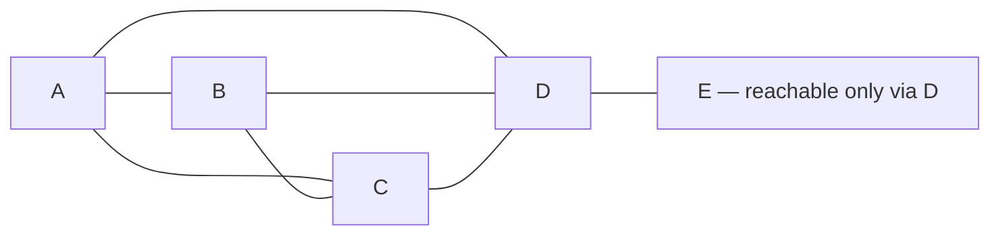

# Multi-hop relay and P2P media paths — investigation

**Date:** 2026-10-29 · **Issue:** #2035 (LIST 9b) · **Program:** ID platform expansion, epic #2056
**Question owner:** Drew's 2026-10-28 directive, item 9 (protocol messaging & relay)
**Scope:** Nothing in ID's design should prevent future P2P text, voice
(Ventrilo/Discord-like), video calls, or screen sharing — and traffic should NOT
all hairpin through a central server; a relay exists only as an optional privacy
proxy. Investigate multi-hop fan-out (a group of four plus a fifth reachable only
through one member), and very large messages / chunking (is wire-level chunking
even needed when QUIC/Iroh streams handle breakup?).
**Deliverable:** relay model + chunking verdict (this doc). The synthesis that
consumes this investigation is #2036 (ID messaging/relay protocol v1), gated on
this + #2034 (ephemeral live data vs the chained event graph).
**Method:** `pkgs/id` source and design docs on current `main` (24901e7b),
`pkgs/id/Cargo.toml` dependency set, iroh-gossip / iroh-blobs crate docs
(docs.rs, versions as pinned in the repo), RFC 9221 (QUIC DATAGRAM).

---

## TL;DR verdicts

1. **Three different things are all called "relay" in ID today; only one of them
   is this issue.** (a) The *Iroh infrastructure relay* (n0 preset, home relay,
   relay kit) is a per-connection NAT-traversal fallback — it forwards encrypted
   QUIC packets for one connection pair and is already ID's default. (b) The
   *bridging peer* — an application-level group member who forwards messages to
   members the sender cannot reach — **does not exist yet and is the real subject
   of this investigation**. (c) The *privacy relay* — a deliberate hairpin that
   hides peer IPs from each other — is a policy mode layered on (a) or (b),
   opt-in per session, never the default path. Conflating (a) and (b) is the
   main design trap: (a) cannot fan out, cannot see group membership, and cannot
   store-and-forward.
2. **Adopt iroh-gossip (already a dependency) as the fan-out substrate for the
   chained/permanent message class, and specify the bridge role on top of it —
   do not build a new flooding protocol.** iroh-gossip implements epidemic
   broadcast trees (HyParView membership + PlumTree dissemination): a topic
   swarm already delivers a broadcast to peers the sender has no direct
   connection to, via intermediate swarm members, with duplicate suppression
   and tree repair. What it does *not* know is ID's group membership, signing,
   and chain rules — those stay ID's layer, exactly as gossip is used today
   only for peer-discovery announcements (`pkgs/id/src/commands/peers.rs`).
3. **Relay validity rests on the origin signature alone; the hop chain is an
   audit record, not a trust input.** A relayed message carries the origin's
   signature over (content, prev-references, group, sequence). Each relay
   appends a signed hop record (relay ID, previous hop, wall-clock receipt
   time) *outside* the signed envelope. A relay can delay or withhold — an
   availability fault, mitigated by duplicate paths and range-sync catch-up —
   but cannot forge, alter, or re-attribute a message. Receivers dedupe by
   message ID and ignore later copies.
4. **Media never goes through the gossip tree and never hairpins by default.**
   Voice/video/screen-share use direct peer connections (QUIC datagrams for
   live media packets, streams for control). Small groups (≤ ~6) use a full
   mesh. When a member is reachable only through a bridge, the bridge acts as a
   *selective forwarder* of already-encrypted media packets — it routes on a
   cleartext header (session, sender, packet seq) and cannot read payloads
   (group key held by endpoints only). A central-server hairpin exists only in
   privacy-relay mode (verdict 1c), at a stated latency/bandwidth cost.
5. **Chunking verdict: no wire-level chunking protocol is needed — QUIC already
   does it — but two application-level size problems remain, and both already
   have an in-repo answer.** (i) *Transport segmentation:* QUIC streams are
   reliable ordered byte streams with flow control; a sender writes any length
   and QUIC segments, retransmits, and reassembles. Inventing message chunking
   under a stream would duplicate the transport. (ii) *ID's own 1 MiB frame
   cap* (`MAX_FRAME_BYTES`, `pkgs/id/src/frames.rs:20`): an object that must
   travel as one framed message and exceeds the cap needs the checked-chunk
   split/join ID already built for MLS welcomes
   (`pkgs/id/src/encryption/welcome.rs`, `CHUNK_PAYLOAD_BYTES`) — reuse it,
   don't design a second one. (iii) *Large payloads generally should not travel
   inside messages at all:* the message carries a BLAKE3 hash reference and the
   payload moves via iroh-blobs (already a dependency), which does verified
   streaming in 16 KiB chunk groups, range requests, resume, and
   multi-provider download. The one place application packetisation *is*
   required is live media over QUIC datagrams: a datagram is a single packet
   (RFC 9221, not fragmentable, ~1200 B safe payload), so the media layer —
   not the messaging layer — must emit codec-sized packets. That is standard
   RTP-style packetisation, not "chunking" of messages.

---

## 1. Current state on `main` (verified 2026-10-29)

| Fact | Evidence |
|---|---|
| Transport stack is Iroh 1.x over QUIC; endpoint policy centralised (`RelayPolicy::N0` default, `--no-relay` disables) | `pkgs/id/Cargo.toml` (`iroh = "1"`); `pkgs/id/src/connectivity.rs`; doc `2026-10-11T11-08-42Z_feature_n0_relay_default` |
| Iroh infra relays are the default fallback; a self-host relay kit exists (Cloudflare Tunnel / VPS modes, QAD ordering) | doc `2026-10-12T08-58-59Z_phase_3_sync_relays` (P3.5, P3.6, P3.8); doc `2026-10-12T21-22-53Z_phase_7_connectivity` (P7.1) |
| Event sync is **pairwise** range reconciliation (`/id-sync/1`): two peers reconcile, then each sends the events the other lacks; ingest verifies signatures and refuses tampered events | `pkgs/id/src/event_sync.rs` module docs; `SYNC_INTERVAL` 30 s offer cadence |
| iroh-gossip 0.101 is a dependency but is used **only for peer-discovery announcements**, not message fan-out | `pkgs/id/Cargo.toml` (`iroh-gossip = { version = "0.101", features = ["net"] }`); `pkgs/id/src/commands/peers.rs` |
| iroh-blobs 0.103 and iroh-docs 0.101 are dependencies | `pkgs/id/Cargo.toml` |
| Framing is length-prefixed with a hard 1 MiB cap; several call sites enforce it | `pkgs/id/src/frames.rs:20` (`MAX_FRAME_BYTES = 1024 * 1024`) |
| App-level checked chunking above the frame cap already exists for MLS welcomes (split into headered chunks, joiner reassembles in order, one-chunk fast path) | `pkgs/id/src/encryption/welcome.rs`; tests in `pkgs/id/src/encryption/tests.rs` (~L816–890) |
| Chunked flights under the frame cap were already needed once at bootstrap (512 KiB budget under the 1 MiB stream cap) | phase-3 doc, P3.1c |

**Gap statement, narrowed (Codex review, PR #2246):** for *stored* events,
eventual transitive delivery already exists and must not be treated as
absent: `EventStore::sync_entries`
(`pkgs/id/src/event_store/sync.rs`) enumerates all stored event hashes
without filtering by origin, so C->D followed by D->E range sync already
delivers C's event to E with no C-E connection, and the web-enabled serve
loop reconciles periodically with discovered peers
(`pkgs/id/src/commands/serve.rs`, the `/id-sync/1` offer loop). What is
missing is **immediate, group-aware live fan-out with hop metadata**: no
mechanism pushes member C's message to member E promptly when E is only
connected to member D, and nothing records the bridge path. That live
fan-out gap — not eventual transitive delivery — is what #2035 asks to
close.

## 2. The relay model

### 2.1 Topology and roles

Model the group as a *visibility graph*: nodes are members, an edge A–B means
"A currently holds a working Iroh connection to B" (direct, or via an Iroh
infra relay — from the application layer both are just "a connection").
Drew's example: {A, B, C, D} mutually visible; E visible only to D.



- **Sender fan-out (multicast-equivalent = send to each).** To publish, a
  sender transmits the message once per visible neighbour — exactly Drew's
  formulation. There is no group address and no central fan-out point.
- **Bridge.** A member that receives a message and has neighbours who (to its
  knowledge) have not seen it forwards it onward "in the same manner" —
  fan-out to its own visible neighbours, excluding the neighbour it arrived
  from. In the example, D is E's bridge for every other member's traffic, and
  E's bridge outbound. Bridging is a *role any member can take*, not a server:
  it emerges from the visibility graph and disappears when a direct edge
  appears (E comes into direct reach of A → A sends directly; D's copies are
  deduped away).
- **No permanent bridges.** Bridge selection is per-message and opportunistic
  (whoever is connected to both sides forwards), not an elected office. If
  two members both bridge to E, E receives duplicates and dedupes (§2.3) —
  wasted bytes, not an error. If the only bridge goes offline, chained-class
  messages are not lost: they are part of the signed event graph, and E
  reconciles on reconnect via the existing pairwise range sync. Live-class
  messages (§2.5) are simply lost, which is correct for live data.

### 2.2 Substrate: iroh-gossip's broadcast tree, ID's semantics on top

PlumTree (iroh-gossip's dissemination) already implements the mechanics of
§2.1 over a topic swarm: eager push along a spanning tree built from
HyParView partial views, lazy-push `IHAVE` announcements to repair missed
messages, duplicate suppression. Building a second flooding layer beside it
would re-implement tree maintenance, loop avoidance, and repair.

The division of labour for protocol v1 (#2036):

| Layer | Owns |
|---|---|
| iroh-gossip | Swarm membership (HyParView), broadcast-tree fan-out, duplicate suppression, missed-message repair |
| ID messaging layer | Group membership (who may speak/read — gossip topics are open to anyone who knows the topic ID, so the topic ID is a capability at most, never the access control), origin signing, prev-hash chaining, hop records, dedupe by message ID as the *semantic* check behind gossip's transport dedupe, ingest verification (same posture as `event_sync`: verify, refuse tampered) |

Three cautions the synthesis must resolve:

- **Topic ≠ group.** A gossip topic is a swarm, not an authorisation domain.
  Non-members who learn a topic ID can inject unsigned/garbage broadcasts;
  ingest must drop anything not signed by a current group member (and the
  abuse-controls budgets of #2032/#2033 apply at ingest, before relaying —
  a member must not relay traffic it would not accept itself).
- **Gossip delivery is eventual, not ordered.** That is safe for the chained
  class precisely because of chaining (§2.4). It is the wrong tool for media
  (§3) and for ephemeral live data that needs sender-order (§2.5).
- **Stock gossip forwards before ID ingest can approve (Codex review,
  PR #2246).** iroh-gossip's protocol pushes a received broadcast to eager
  peers on receipt; the application's receive event is not a
  forwarding-approval callback. So signature/membership checks in ID's
  receive handler **cannot** enforce "do not relay what you would not
  accept" (§2.2, first caution) against stock gossip, and ID hop records
  and the hop cap (§2.3) cannot be appended or enforced on those automatic
  forwards either — invalid traffic from a non-member who knows the topic
  still propagates. Protocol v1 therefore owes one of: (a) a
  validation/forwarding extension or patch to the substrate that gates
  eager push on ID's verify step, or (b) a revised forwarding design in
  which gossip supplies swarm membership/repair only and ID-controlled
  forwarding carries the traffic. Presenting application ingest above
  stock gossip as sufficient is not an option.

### 2.3 The relayed-message envelope

```
message_id      = BLAKE3(canonical bytes of the complete signed envelope below,
                       excluding only the mutable hop chain)
signed envelope (origin signature covers all of it):
    origin_id, group_id, origin_seq
    prev[]            — hashes of the origin's previous messages / graph heads
    class             — chained | ephemeral (§2.5)
    content_hash      — or inline content, if small
    blob_ref?         — BLAKE3 hash when the payload travels via iroh-blobs (§4)
hop chain (unsigned-by-origin, appended per relay, each hop self-signed):
    [ { relay_id, prev_hop_id, received_at } … ]
```

Rules:

- **Validity = origin signature + group membership at send time.** Nothing in
  the hop chain can make an invalid message valid or a valid one invalid.
  This is Drew's "proxies are noted in the chain, validity rests on
  signatures/trust", made precise.
- **The hop chain is for audit and loop control, not trust.** Uses: (1) loop
  prevention — a member never forwards a message whose hop chain already
  contains it; (2) a hard hop cap (suggested default **4**) bounding worst-case
  latency and amplification; (3) latency accounting (§2.6); (4) post-hoc audit
  (matches the LIST 10 audit pattern: a third party can replay who handled
  what). A relay that strips the hop chain harms audit, not validity — the
  next relay starts a fresh chain and the message still verifies.
- **Dedupe identity covers the full signed envelope (Codex review,
  PR #2246).** `message_id` hashes the complete canonical signed envelope
  — the same posture as `pkgs/id/src/chain.rs`, where an event's ID is
  `Hash::digest` of its complete header bytes — and excludes only the
  unsigned, mutable hop chain. Two envelopes from one origin with the same
  group, sequence, and content but different `prev[]` therefore get
  **different** IDs: the second is not deduped away, so downstream members
  can observe the fork, matching the event store's rule of retaining
  conflicting headers as fork proofs that freeze the author's chain
  (`pkgs/id/src/event_store/mod.rs`).
- **Dedupe is by `message_id`, at every member, before relaying.** Seen-set
  retention only needs to cover the gossip repair window for the chained
  class (the graph itself is the long-term record) and seconds for the
  ephemeral class.
- **A relay never modifies the signed envelope.** Any re-framing a relay
  needs (e.g. the payload exceeds a frame cap on its next hop) happens below
  the envelope, via the existing checked-chunk split/join (§4), and is
  invisible to verification.

### 2.4 Ordering: the chain does the work

Chained-class messages name their predecessors (`prev[]`), so arrival order
over multi-hop paths does not matter for correctness: a receiver that gets
message *n+1* before *n* holds it (or notes the gap) and fetches *n* — from
the neighbour who sent *n+1*, any other neighbour, or later range sync. This
is Drew's "ordering is mostly safe because messages chain by previous
messages", and it is the same property the event graph already relies on in
pairwise sync. The relay layer therefore needs **no sequencing, no vector
clocks, no global order** — causal order falls out of the chain, and
concurrent messages from different origins are concurrent in the graph, which
the graph model already accepts.

### 2.5 Two classes through the same fan-out

Following #2034's split (its investigation is the companion input to #2036):

- **Chained (permanent).** Text messages, graph events. Fan out via gossip;
  relays additionally act as store-and-forward points: a bridge that holds a
  chained message for an offline member delivers it on reconnect (in practice
  this is just range sync with the bridge as the peer — no new mechanism).
- **Ephemeral (live).** Typing indicators, cursor positions, keystroke
  streams, presence. Same fan-out shape, different contract: per-origin
  sequence number, **no** prev-chaining, **no** store-and-forward, TTL of
  seconds, receivers drop out-of-window packets. A bridge forwards ephemeral
  traffic only while all parties are connected; it never queues it. Signing
  can be intermittent (session key signed once, packets MAC'd/sequenced
  under it) — the details are #2034's subject; the relay layer only needs to
  know the class so it can refuse to store-and-forward ephemeral traffic.

### 2.6 Latency budget and path quality

Each bridge hop costs roughly one one-way trip on that leg plus process/queue
time on the bridge; a two-hop path roughly doubles the one-way latency of the
worse leg. Consequences baked into the model:

- **Prefer direct.** Fan-out always tries direct edges first; bridging is the
  fallback for reachability, never a routing preference. (Contrast with
  privacy mode, §3.3, where the hairpin is chosen on purpose.)
- **Hop cap 4** (default) keeps worst-case chained-message latency bounded;
  chained traffic tolerates it.
- **Time-sensitive traffic (games, media) gets a tighter rule:** at most
  **1 bridge hop**, and the session should surface "you are playing via a
  relay through \<member\>" the way games surface ping — a bridged path with a
  slow leg is a known, displayed property, not a silent degradation. If no
  ≤1-hop path exists, the session still works — at the latency it has. Drew's
  note that "proxy latency matters for time-sensitive games" is a display and
  path-selection requirement, not a blocker.
- **Bridge load is a real cost** (bandwidth + battery on a member's machine).
  Relaying is a favour inside a trust set: members relay for groups they
  belong to, subject to the per-ID/per-group budgets from the abuse-controls
  work (#2032/#2033) — a member can cap or refuse relay duty, at the price of
  the partition that causes. Protocol v1 should carry the cap; the policy
  defaults are #2033's.

## 3. Media paths (voice / video / screen share)

The requirement is *do not preclude*, with no central hairpin as the default.

### 3.1 Small groups: direct mesh

For voice/video/screen-share, each sender sends its media directly to each
other participant over their existing Iroh connection — QUIC datagrams
(RFC 9221) for media packets (unreliable, un-ordered, congestion-controlled;
late audio is worthless, so retransmission is the wrong default), a QUIC
stream for session control (join/leave, mute, codec negotiation). A full mesh
is O(n²) connections but each connection already exists for messaging; the
practical ceiling is sender uplink (n−1 copies of the stream), fine to
~6 participants for audio, fewer for video — the same shape as classic
Ventrilo/Discord-in-a-browser P2P calls.

### 3.2 Bridged media: a member as selective forwarder

When E is reachable only via D, D forwards E's media: D holds connections to
both sides and relays datagram packets between them, routing on a small
cleartext header (session ID, origin ID, packet sequence). Media payloads are
encrypted under a group/session key held only by call participants — D routes
ciphertext and learns only metadata (who is in a call with whom, packet
sizes/timing), the standard SFU trust position, except the "SFU" is a group
member's own machine rather than Drew's server. One bridge hop only (§2.6);
a second hop means the session degrades to audio or drops to chained/async
media (recorded clips as blobs) rather than stacking forwarding latency.

### 3.3 Privacy-relay mode (the only hairpin)

Opt-in per session: all of a session's traffic — messaging fan-out root and
media alike — routes through one chosen relay (a member's always-on machine,
a self-host Iroh relay from the P7.1 kit, or in the limit a server Drew runs)
so participants see only the relay's address, never each other's.
**Isolation requirement (Codex review, PR #2246):** routing traffic
through the relay does not by itself deliver that promise. QUIC address
discovery exposes a peer's direct addresses to the peers it connects to
(documented in `pkgs/id/src/invites/mod.rs`), and the checked-in
`research-round2/iroh-allowlist/RESULTS.md` distinguishes relay-only
transports (`clear_ip_transports`) from merely filtering published
addresses. This mode therefore requires one of: (a) direct transports and
candidate exchange disabled for the session (relay-only transport
posture), or (b) application-level proxy connections under which
participants never connect to one another at all. Without one of those,
the proposed privacy mode can expose exactly the IPs it promises to hide.
Costs,
stated so the choice is informed: +1 leg of latency on every packet, all
session bandwidth concentrated on the relay, relay learns session metadata
(not content). This mode *is* Drew's "optional privacy proxy" — a mode, not
the architecture.

### 3.4 What media needs from the messaging layer

Only three things: (1) the visibility graph and bridge discovery (§2.1) so a
session knows its paths before it starts; (2) session setup/teardown as
chained-class messages (signed, auditable: who was called, who joined);
(3) the class flag so ephemeral/media traffic is never store-and-forwarded.
Media itself is not messages and must not be modelled as graph events.

## 4. Large messages and the chunking verdict

### 4.1 The three size problems, kept separate

| Problem | Where it lives | Answer |
|---|---|---|
| A byte stream longer than one packet | QUIC transport | **Already solved.** QUIC segments streams into packets, retransmits losses, enforces flow control, reassembles in order. No ID-level chunking on streams — answering Drew's question directly: yes, QUIC/Iroh streams handle the breakup. |
| An object longer than ID's 1 MiB frame cap that must travel *as a message* | ID framing (`frames.rs`) | **Solved in-repo, reuse it.** The MLS-welcome checked chunking (`encryption/welcome.rs`: headered chunks, bounded header budget, in-order joiner, one-chunk fast path) is the pattern; P3.1c's chunked flights are the second precedent. Protocol v1 should generalise this one implementation rather than add a third. |
| A genuinely large payload (image, file, recording, world snapshot) | Message design | **Don't put it in the message.** The message carries `blob_ref` (BLAKE3 hash); the payload moves via iroh-blobs: verified streaming (receiver detects corruption within a 16 KiB chunk group), range requests, resume after interruption, fetch from *any* member who has it — including a bridge, which is how E receives a large file from A without A–E connectivity: E pulls the blob from D, who pulled it from A, each hop verified against the same root hash. |

### 4.2 Datagrams are the exception that proves the rule

QUIC datagrams (the media path, §3) are single packets: not fragmented, not
retransmitted, not flow-controlled (RFC 9221). Anything sent as a datagram
must already fit ~1200 B on the wire. So the media layer packetises (one
codec frame or frame-slice per datagram, sequence-numbered) — but that is a
property of the media codec layer, not a messaging chunking protocol, and it
must not leak into the chained/ephemeral message design.

### 4.3 Verdict

**No new wire-level chunking protocol.** Protocol v1 (#2036) should state:
streams for anything reliable (QUIC does segmentation); the existing checked
chunk split/join as the single sanctioned way to pass an over-cap object
through a framed channel; blob references for payloads; datagram-sized
packetisation confined to the media layer.

## 5. Risks and open questions for the synthesis (#2036)

1. **Gossip swarm sizing.** HyParView/PlumTree parameters in iroh-gossip are
   tuned for larger swarms; ID groups are small (≤ dozens). Verify fan-out
   and repair behaviour at n=5 with one bridge-only member — this is the
   PoC's core test (follow-up issue filed with this investigation).
2. **Topic discovery for groups.** Members must find the group's topic and
   bootstrap peers without a central rendezvous; candidates: derive the topic
   from the group ID and bootstrap from known member addresses + the existing
   gossip discovery topic. Synthesis decision.
3. **Bridge + abuse interaction.** Forwarding amplifies whatever ingest
   accepts; relay-side rate/budget enforcement points need #2033's design.
   Until then, the safe default is: relay only for groups you belong to,
   only traffic that passes your own ingest.
4. **Metadata exposure.** Bridges and privacy relays learn social-graph and
   timing metadata. The design accepts this (noted in the chain, per Drew);
   protocol v1 should say so plainly so no one later mistakes hop records for
   a privacy feature.
5. **Media group keys.** §3.2 assumes a participant-only session key with a
   forwarder outside the key. Key distribution/rotation on join/leave is a
   design of its own (the MLS machinery in `pkgs/id/src/encryption/` is the
   obvious substrate) — flagged here, owned by the media work when it comes,
   not by protocol v1.

## 6. Routing / follow-on

- **#2036 (messaging/relay protocol v1 synthesis)** stays gated until #2034
  also lands; this investigation is its relay-side input. A note to that
  effect is posted on #2036.
- **Follow-up PoC issue filed with this investigation:** a five-node bridge
  PoC (four mutually visible members + a fifth reachable only through one
  bridge) demonstrating chained-message fan-out over iroh-gossip with hop
  records and dedupe, and measuring one-hop bridged latency. Explicitly
  gated on #2036's review — a PoC built on an unreviewed protocol would be
  making the protocol's decisions itself, which the program forbids.
- **No code changes in this investigation.** Nothing here builds the permanent
  feature; the relay model is a design input, and the media sections are
  constraint-setting ("do not preclude") rather than a media design.

---

*Sources: `pkgs/id` source as cited inline (frames.rs, event_sync.rs,
welcome.rs, peers.rs, connectivity.rs, Cargo.toml); repo design docs
`2026-10-11T11-08-42Z_feature_n0_relay_default`,
`2026-10-12T08-58-59Z_phase_3_sync_relays`,
`2026-10-12T21-22-53Z_phase_7_connectivity`; iroh-gossip 0.101 crate docs
(epidemic broadcast trees, HyParView + PlumTree); iroh-blobs design notes
(BLAKE3 verified streaming, 16 KiB chunk groups, range/resume); RFC 9221
(QUIC DATAGRAM). Companion investigations: #2040 (TigerBeetle), #2044
(Cloudflare Workers fit), #2034 (ephemeral vs chained, in progress).*
