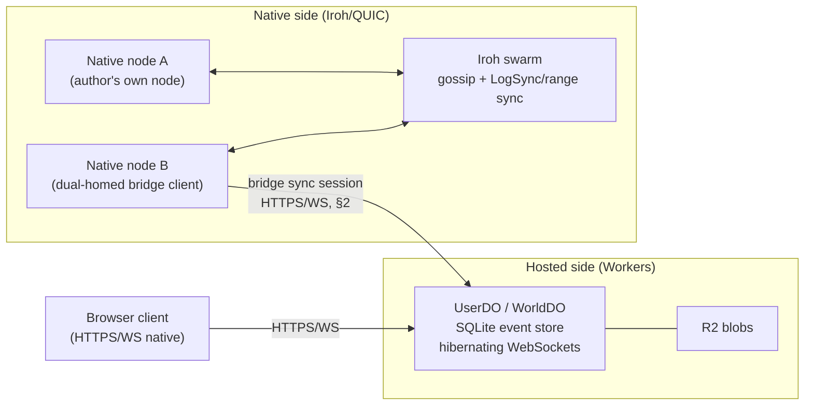

# Investigation: Bridge Semantics — Hosted (HTTPS/WS) Edition Syncing with Native Iroh Nodes

- **Date:** 2026-10-29
- **Issue:** developing-today/code#2058 (ID program wave-1, epic #2056)
- **Source question:** open question 2 of the Cloudflare Workers fit investigation
  (#2044, merged in PR #2067 as
  `doc/2026-10-28T23-34-14Z_investigation_cloudflare_workers_fit/`): the Workers
  edition speaks signed objects/graph/journals over HTTPS/WebSocket; native nodes
  speak Iroh/QUIC. Design the bridge.
- **Method:** the Workers-fit investigation for platform facts (cited there, not
  re-derived here); the current `pkgs/id` source for protocol facts — every
  load-bearing claim below names its file. Architecture judgments are labelled
  as conclusions.

## Verdict up front

**The bridge is a sync peer, not a translator and not a proxy.** ID's trust and
ordering model already lives entirely in the signed event layer, above
transport: every event is a signed p2panda header (`pkgs/id/src/chain.rs`,
domain tag `id.events.v1`) carrying its author's key, a per-author sequence
number, a backlink to the author's previous event, and an `after` causal
frontier. The envelope transport says it in one line
(`pkgs/id/src/envelope_net.rs`): "The payload's signature is what makes it
trusted, not the iroh node that delivered it."

That means the seam needs **no new semantics** — only a new transport for the
existing sync sessions, plus explicit rules for the three places where the
hosted side's shape (a serialized, single-threaded Durable Object) tempts a
designer into inventing semantics the native side does not have:

1. **No bridge-assigned ordering.** The bridge never sequences, timestamps, or
   re-numbers events. Per-author order is the author's chain; cross-author
   order is causal (`after`) or undefined — exactly as native.
2. **No bridge-held trust.** The bridge verifies signatures exactly as any
   receiving store does (`chain.rs` `decode`: canonical CBOR, `verify_strict`,
   operation ID = BLAKE3 of the received bytes) and can refuse, delay, or
   withhold — but cannot forge, alter, or re-sign. Custodial signing keys stay
   rejected (Workers-fit §4.3).
3. **No authoritative snapshot.** The hosted store runs the same ingest,
   waiting, fork-proof, and resolve rules as a native store
   (`pkgs/id/src/event_store/`). It is a replica with a different disk, not a
   source of truth.

With those three rules, ordering, conflict, replay, and trust semantics across
the seam are *the native semantics*, and the remaining work is transport
engineering plus the open questions in §8.

## 1. Who bridges

Three roles exist; only the first two are required for v1.

- **The hosted endpoint itself (required).** A UserDO (or WorldDO for shared
  worlds) terminates HTTPS/WebSocket sync sessions and runs the store side of
  them against its SQLite tables. It never initiates Iroh connections — it
  cannot (§2.2 of the Workers-fit investigation: no UDP in Workers) — so on the
  hosted side the bridge is *passive*: it answers sessions, and it can dial
  *out* over WebSocket to a native node that exposes an HTTPS/WS endpoint.
- **A dual-homed native node (required).** Any native node that adds the
  HTTPS/WS transport can initiate bridge sessions to a DO, in both directions
  of data flow (push its missing events, pull the DO's). This is the general
  bridge: no special bridge service exists. A user's own node bridging to their
  own UserDO is the common case; any peer may bridge for any graph it is
  allowed to read, because the events are self-verifying.
- **A third-party relay bridge (optional, later).** A native node may bridge on
  behalf of others as store-and-forward (the LIST 9 optional privacy-relay role,
  #2036/#2035). It is a courier under §5's trust rules: trusted for
  *availability only, never for content*. It is not needed for v1 and must not
  become a required hop — direct dual-homed bridging is the v1 path.

**Conclusion:** "who bridges" is *whoever is dual-homed*, with the DO as the
always-reachable passive endpoint. There is no bridge operator role in the
trust model, and no bridge-specific identity.

## 2. The bridge sync session (transport shape)

Native sync today (`pkgs/id/src/log_sync.rs`, `pkgs/id/src/sync_method.rs`):
the initiator sends a `Request` naming the topic and its chosen method; the
responder `Answer`s agree/refuse and never chooses for the session. Method
choice is measured, not habitual: `LogSync` when the estimated difference
exceeds ~3.5% of the chain count or the peer is unbootstrapped, range sync
otherwise. Arrival order is the write path — arrivals go to an ingest worker
that verifies and stores in batches (`ingest_batch`, one write transaction per
batch); a refused event is counted and does not end the session.

The bridge session keeps this shape verbatim, with transport substitutions:

| Native session element | Bridge equivalent |
|---|---|
| Iroh stream pair on `SYNC_ALPN` | One hibernating WebSocket per session to the DO (frames batched, Workers-fit §1.3) |
| `Request`/`Answer` + method choice | Identical messages and the identical 3.5% crossover rule — the rule is about set difference vs. chain count, not about transport |
| Ingest worker + `ingest_batch` | Identical; on the DO side a batch is one SQLite transaction (which is also the write-cost unit — batching is doubly rewarded, Workers-fit §5) |
| One deadline per session stage | Identical; plus the DO's CPU-per-invocation cap, so a bridge session must be *resumable mid-session* (§4) |
| Gossip for live propagation | WebSocket fan-out from the DO to connected subscribers (hosted leg only); native gossip unchanged native-side |

Two bridge-only additions, both transport-level, neither semantic:

- **Session resumption token.** A bridge session interrupted by DO eviction,
  hibernation wake, or a dropped socket resumes from the last acknowledged
  per-author positions (the same `(author, seq)` positions the store already
  tracks) instead of restarting the method negotiation. Positions are already
  the store's own bookkeeping, so this adds no new state — only carrying them
  in the resume frame.
- **Blob leg separation.** Events sync as above; blob *bytes* never travel in
  the event session. The DO side serves/fetches them from R2 by hash over
  plain HTTPS (Workers-fit §3.3); a native peer fetches them the same way it
  would from any HTTP mirror. The event layer already treats blobs as
  content-addressed references, so this changes no semantics.

## 3. Ordering semantics across the seam

- **Per-author order is total and transport-independent.** An author's events
  form one chain: sequence number + backlink (`chain.rs`). An event whose
  predecessor is missing is not applied out of order — it waits (the store's
  waiting rows, `event_store/waiting_rows.rs`, with caps; `log_sync.rs`:
  a refusal past a fork point or over the waiting caps is counted, the batch
  goes on). A bridge that delivers events scrambled, duplicated, or late
  produces waiting rows and catch-up, never a different history.
- **Cross-author order is causal only.** The `after` frontier (max 32 hashes,
  `chain.rs` `MAX_AFTER`) is the only cross-author ordering the system has.
  Tag semantics depend on exactly this and nothing more: a `tag.clear` removes
  only claims in its causal past (`pkgs/id/src/tag_claims.rs`, observed-remove).
  Because `after` is signed into the header, a bridge cannot fabricate or
  strip causality without invalidating the signature.
- **Arrival order is not semantics.** Two stores that received the same event
  set in different orders converge to the same applied set and the same live
  claims (the two folds in `tag_claims.rs` — reference and compacted — already
  prove order-independence of the fold for one store; the bridge adds no new
  fold). Any design that needs a global order across the seam (e.g. "the DO
  saw it first") is asking for something ID does not have natively either, and
  must get it from an application-level mechanism (e.g. world-journal
  serialization, §8 Q2), not from the bridge.
- **Wall-clock time is not an ordering input.** Nothing in the header chain
  orders by receipt time; the bridge must not introduce receipt-time ordering
  (e.g. DO `received_at` as a tiebreak), because a native store replaying the
  same set would then diverge from the hosted store.

## 4. Conflict semantics across the seam

- **Forks are per-author and already handled.** Two signed events from one
  author at one sequence number are a fork. The store keeps the applied prefix
  up to the fork point and records a fork proof (the two conflicting headers)
  keyed by fork point (`event_store/mod.rs`: `forks`, `proof_ids`,
  `proof_headers` tables). Fork handling is identical on both sides of the
  seam because it is a property of the signed bytes.
- **The one real seam hazard: fork blindness of `LogSync`.** `log_sync.rs`
  states it plainly: "`LogSync` sends each author's applied prefix… `LogSync`
  compares heights, not heads, so it cannot see a fork." Native peers recover
  via range sync and the proof exchange. A bridge that only ever ran
  height-comparison sessions could carry a forked prefix indefinitely while
  both sides report "in sync". **Rule: bridge relationships must run the
  proof-carrying exchange (range sync / proof exchange) on a cadence, not
  only `LogSync`** — at minimum on first bootstrap (already the unbootstrapped
  case), after any session that counted a refusal, and periodically
  thereafter. The cadence value is an open question (§8 Q1), the requirement
  is not.
- **The DO's single-writer serialization does not prevent forks.** It
  serializes *writes to one store*; an author signs on their own key from any
  device. An author's native node and their browser client can fork the
  author's chain across the seam exactly as two native devices can. The DO
  must therefore run the genuine fork machinery, not a "last writer wins by
  arrival" shortcut — a shortcut here is the single most likely place a hosted
  implementation would silently diverge from native semantics.
- **Conflicts above the event layer are unchanged.** Documents and tags
  resolve by their existing causal rules (§3); membership/group rules read the
  same applied set. The bridge defines no merge policy of its own.

## 5. Replay and journal interop

- **The journal is the event set.** Replay = ingest the signed events into an
  empty store under the normal rules (per-author contiguity, waiting caps,
  fork proofs, resolve). There is no second journal format for the hosted
  edition: the DO's SQLite schema mirrors the native store's tables
  (`events` by `(author, seq)`, `chains` applied-prefix rows, `forks`,
  `proof_ids`, `proof_headers`), so export/import between editions is a table
  scan, not a translation.
- **Replay must be incremental on the hosted side.** Workers CPU caps
  (Workers-fit §2) forbid replaying a long journal in one invocation; replay
  proceeds in `ingest_batch`-sized chunks across invocations/alarms, with the
  store's own `(author, seq)` positions as the progress cursor — the same
  cursor as §2's resumption token. A native store imposes no chunking; the
  *result* must be identical, and that identity is testable (§9).
- **DO point-in-time recovery is not journal replay.** SQLite bookmarks
  (30-day window, Workers-fit §1.2) are an operator disaster-recovery tool for
  the hosted copy only. They must never be presented as, or substituted for,
  the signed journal: a bookmark restore that rolls the DO's store back
  behind its peers is safe precisely because re-sync under §2/§4 restores the
  set from peers — the journal lives in the swarm, not in one store.
- **Bootstrap direction is symmetric.** A fresh UserDO bootstraps from any
  dual-homed native node; a fresh native node bootstraps from the user's
  UserDO. Neither is a seed of last resort; both are replicas joining by the
  same session.

## 6. Trust model end to end

- **Signatures are the trust model; transport adds none and removes none.**
  Verification on receipt is the native `decode` path (canonical CBOR,
  `verify_strict`, BLAKE3 over received bytes). TLS on the hosted leg protects
  *privacy in transit* and authenticates the *endpoint the client dialed* —
  it is not what makes an event trustworthy, and a bridge session over a
  compromised or malicious relay still cannot inject a forged event.
- **What a bridge (or relay) CAN do:** withhold events, delay them, reorder
  arrival, refuse service, and observe metadata (who syncs what topic, when,
  how much). It cannot forge, alter, or undetectably suppress *to a peer that
  also syncs elsewhere*: per-author chain heads and `after` frontiers make
  gaps visible — a withheld event shows up as a chain that stops advancing or
  a frontier referencing hashes the receiver lacks. Withholding is therefore
  an availability attack with evidence, not an integrity attack. Detection
  thresholds (when is a quiet chain "withheld" vs. "idle") are an open
  question (§8 Q6).
- **Allowed-writer filtering is a view rule, not a bridge rule.** Per the LIST 7
  trust model, stores accept all validly-signed objects; a user's views count
  only their allowed writer set. The bridge enforces nothing here — the DO
  stores what it is given (subject to its owner's storage/abuse budgets,
  Workers-fit §6) and projections apply writer sets, on both editions alike.
- **Identity binding is out of the bridge's scope — deliberately.** Google
  `sub` → ID key binding (Workers-fit §4.3) decides which DO is "yours"; the
  bridge protocol is key-agnostic and works for any graph a peer may read.
  Binding/recovery work is already routed (#2258, from #2045) and does not
  block bridge implementation.

## 7. Ephemeral traffic across the seam

Live, low-retention traffic (LIST 9's ephemeral tier: presence, typing,
keystroke-level streams) is **not journaled** and must not cross the bridge
as events. On the hosted leg it is plain WebSocket fan-out inside the DO; on
the native leg it is the existing live-session machinery. Where an ephemeral
stream settles into a signed result (a finished turn, a final state), only
the settled, signed object crosses as an event. The exact journal/ephemeral
boundary for chat is owned by the chat design (§8 Q3); the bridge rule is
only: *if it isn't signed, it isn't synced, and it isn't replayed.*

## 8. Open questions that block downstream designs (with owners)

| # | Question | Blocks | Owner |
|---|---|---|---|
| Q1 | Fork-proof cadence for bridge relationships: how often must the proof-carrying exchange run (vs. `LogSync`) per topic/peer class, and what does it cost in DO rows/CPU at wave-1 scale? Requirement is settled in §4; the number is not. | #2046 (serverless edition v1 — cannot freeze its sync spec without it) | #2046 design |
| Q2 | Shared worlds: is a WorldDO the serialized writer for its world's journal (a semantic choice — it *creates* a total order native worlds don't have) or a CRDT replica like every other store? (Carried from Workers-fit §8.) | #2046; world design under #2028 | #2046 design |
| Q3 | The journal/ephemeral boundary for chat: which chat traffic settles into signed events (messages? edits? reactions?) and which stays ephemeral. | #2051 (chat v1) | #2051 design, input #2049 |
| Q4 | Hosted-leg retrieval for graph-linked objects: boards/chat readers on the hosted edition pull linked objects over HTTPS from a DO/R2 only — no swarm chunk retrieval. Acceptable for v1, or does boards v1 require a native gateway for linked media? | #2054 (boards v1) | #2054 design, input #2052 |
| Q5 | Withholding detection: what evidence threshold turns "bridge/relay hasn't delivered author X's events" into an actionable alert vs. normal idleness? | #2036 (messaging/relay v1) abuse/availability story | #2036 design |
| Q6 | Bridge session auth for *read* scope: events are self-verifying, but which topics/graphs may an unauthenticated dual-homed node pull from a UserDO? (Write scope is settled — signatures; read scope is a privacy decision.) | #2046 (must state the DO's read policy) | #2046 design |

Explicitly **not** blocking: SSO→ID binding and key recovery — routed to
#2258 (from #2045); multi-hop native relay fan-out — routed to #2035/#2249,
which is the native-side relay question, distinct from this hosted seam.

## 9. Follow-on routing

- **PoC (filed with this investigation as #2276):** a bridge sync session between a
  native store and a DO-shaped SQLite store over WebSocket, reusing
  `ingest_batch` + resolve unchanged. Acceptance sketch: (a) both directions
  converge to identical applied sets and live claims; (b) a fork authored on
  each side during disconnection is detected by the proof exchange and both
  sides hold the same fork proof; (c) a withholding bridge is detected via
  chain-head/frontier evidence; (d) replay of the same journal into an empty
  hosted-shaped store and an empty native store yields identical stores.
  This is a proof of concept — per the program rule, no permanent feature is
  built on it before a review round.
- **#2046** consumes §§1–6 + Q1/Q2/Q6 as its sync chapter.
- **#2051 / #2054** consume §7 + Q3/Q4 respectively.

## Sources

- This repo, `pkgs/id/src/`: `chain.rs` (header, `ChainExt`, `after`,
  `DOMAIN_TAG`), `event_store/` (`mod.rs` tables and fork proofs,
  `ingest.rs`, `waiting_rows.rs`, `resolve.rs`), `log_sync.rs` (session shape,
  arrival-order write path, `LogSync` fork blindness), `sync_method.rs`
  (method choice, 3.5% crossover), `tag_claims.rs` (observed-remove clears),
  `envelope_net.rs` (signature-over-transport trust statement).
- Workers-fit investigation (#2044, PR #2067):
  `doc/2026-10-28T23-34-14Z_investigation_cloudflare_workers_fit/` — §1.3
  hibernation, §2 platform limits and the Iroh wall, §3 storage shape,
  §4.3 identity binding, §5 cost shape, §8 open questions.
- Issues: #2058 (this investigation), #2056 (program epic), #2046, #2051,
  #2054, #2036, #2035, #2249, #2258.
