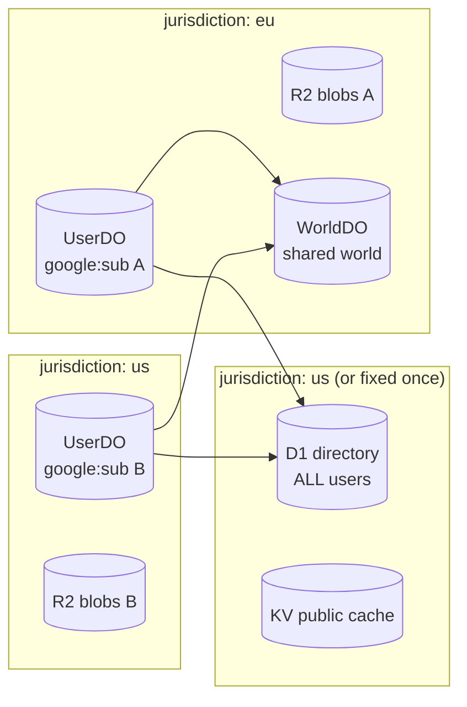

# Investigation: Durable Object jurisdiction / data-location pinning for per-user stores

- **Date:** 2026-10-29
- **Source:** open question 5 of the Cloudflare Workers fit investigation
  ([#2044](https://github.com/developing-today/code/issues/2044), doc
  `doc/2026-10-28T23-34-14Z_investigation_cloudflare_workers_fit/`), filed as issue
  [#2061](https://github.com/developing-today/code/issues/2061), child of epic
  [#2056](https://github.com/developing-today/code/issues/2056).
- **Question:** can a per-user Durable Object's storage be pinned to a jurisdiction,
  what does Cloudflare actually guarantee, and does the hosted offer need a region
  choice at signup?
- **Method:** Cloudflare's own documentation only for platform facts, every
  load-bearing claim quoted and cited with the page's own "last updated" date and
  the access date (2026-10-29). Architecture judgments are labelled **Conclusion**
  and are not vendor facts. Where no primary source exists, the item is marked
  **UNCONFIRMED** rather than assumed.

## Verdict up front

1. **Yes, a Durable Object can be pinned — to a jurisdiction, not to a country.**
   `env.MY_DURABLE_OBJECT.jurisdiction("eu")` yields a namespace whose objects
   "only run and store data within a region", and the supported values are exactly
   `eu`, `us` and `fedramp` ([DO data location](https://developers.cloudflare.com/durable-objects/reference/data-location/),
   updated 2026-06-26). There is **no** country-level pinning: you cannot promise
   "data stays in Germany", only "data stays in the EU". The guarantee is about
   where the object is created and persisted; the one part of the storage path the
   docs do not explicitly cover is SQLite's five-follower replication and its
   object-storage WAL (§1.5) — that is the item to confirm in writing, not a reason
   to doubt the feature.
2. **`locationHint` is not a residency control.** It is "a best effort and not a
   guarantee" and only the first `get()` honours it — it exists for latency, not
   compliance. Conflating the two is the single most likely compliance bug in this
   design.
3. **The pin is a one-way door.** "Durable Objects do not currently change locations
   after they are created"; KV jurisdictions "can only be set when a namespace is
   created"; R2 jurisdiction "cannot be changed" after bucket creation; D1
   jurisdictions "can only be set on database creation". For Durable Objects
   specifically the docs never use the word "immutable" — they don't have to,
   because the jurisdiction is **encoded in the ID**, so changing it means
   addressing a different, empty object. Either way, changing a user's jurisdiction
   later is a **migration** (export → new ID in the new jurisdiction → verify →
   delete), not a setting.
4. **A per-user pin is only as strong as the shared stores around it.** The hosted
   design in #2044 also uses one shared D1 directory, R2 for blobs, and KV for
   public caches, and shared "world" Durable Objects. Each of those has its own
   jurisdiction, fixed at creation, and a shared component has **one** jurisdiction
   for **all** users. Per-user residency is therefore a whole-system property, not
   a per-object flag.
5. **Signup region choice: not required to launch, required to sell residency.**
   Record the jurisdiction field at account creation from day one (it is cheap and
   cannot be retrofitted), but do not expose a user-facing choice until there is a
   customer who needs it. Default everyone to one jurisdiction and say so plainly in
   the privacy policy — as a statement about **durable** storage, with the global
   public-KV cache exception named in the same sentence (§1.3, §3.1). See §4 for the
   consequence of each answer.

---

## 1. What Cloudflare actually guarantees

### 1.1 The jurisdiction option on Durable Objects

From [Durable Objects — Data location](https://developers.cloudflare.com/durable-objects/reference/data-location/)
(last updated 2026-06-26, accessed 2026-10-29):

> "Jurisdictions are used to create Durable Objects that only run and store data
> within a region to comply with local regulations such as the GDPR or FedRAMP."

> "Workers may still access Durable Objects constrained to a jurisdiction from
> anywhere in the world. The jurisdiction constraint only controls where the
> Durable Object itself runs and persists data."

Usage is at the **namespace** level, and Cloudflare explicitly recommends it over
per-ID jurisdiction:

```js
const euSubnamespace = env.MY_DURABLE_OBJECT.jurisdiction("eu");
const euId = euSubnamespace.idFromName("google:" + sub);
const stub = env.MY_DURABLE_OBJECT.get(euId);
```

> "When specifying a jurisdiction, Cloudflare recommends you first create a
> namespace restricted to a jurisdiction… Note that it is also possible to specify a
> jurisdiction by creating an individual `DurableObjectId`… **However, Cloudflare
> does not recommend this approach.**"

| Parameter | Location |
| --------- | -------- |
| `eu`      | The European Union |
| `us`      | The United States |
| `fedramp` | FedRAMP-Moderate data centers |

Four properties of this mechanism matter for ID's design:

- **IDs are jurisdiction-scoped.** "It is possible to have the same name represent
  different IDs in different jurisdictions" — Cloudflare's own example asserts
  `idFromName("my-name") !== jurisdiction("eu").idFromName("my-name")`. So the same
  Google `sub` yields a *different* Durable Object in `eu` than in `us`. That is
  good isolation and a live correctness hazard (§4.1).
- **Mismatches fail loudly, missing pins fail open.** "You will run into an error if
  the jurisdiction on your `DurableObjectNamespace` and the jurisdiction on your
  `DurableObjectId` are different. You will not run into an error if the
  `DurableObjectNamespace` is not associated with a jurisdiction." The unrestricted
  binding is the trap: it silently accepts any ID.
- **The object can read its own jurisdiction.** `ctx.id.jurisdiction` is available
  inside the object, "preserved across `toString()` and `idFromString()`
  round-trips", and available inside alarm handlers for alarms scheduled on
  2026-03-15 or later. It is `undefined` in exactly two cases: the object was
  created in an unrestricted namespace, or its alarm was scheduled before
  2026-03-15 (rescheduling the alarm from a `fetch()`/RPC handler backfills it).
  This is the cheapest runtime assertion available (§4.2) — but note the second
  case, which would make an assertion on a legacy alarm fail open.
- **Metadata still leaves.** "A `DurableObjectId` will be logged outside of the
  specified jurisdiction for billing and debugging purposes." Residency of *data*
  is not residency of *metadata*; the Enterprise Data Localization Suite is the
  product for the latter (§1.4).

Cloudflare's 2020 launch post for the feature states the guarantee in mechanical
terms, which is the clearest sentence in the whole corpus:

> "If the user passes in a Jurisdictional Restriction, we instead encode in the ID a
> mapping to a jurisdiction, which encodes a list of data centers that adhere to the
> rules of the Jurisdictional Restriction. **We guarantee that the data center we
> select for creating the Object is in this list and that we will not migrate the
> Object to a data center that isn't in this list.**"
> — [Supporting jurisdictional restrictions for Durable Objects](https://blog.cloudflare.com/supporting-jurisdictional-restrictions-for-durable-objects/)
> (2020-12-12, modified 2026-07-15)

Two practical notes from the API surface: jurisdiction is a **code-level** control —
the `durable_objects` binding in `wrangler` has no `jurisdiction` key (unlike
`r2_buckets`, `workflows` and container `constraints`, which do) — and the `us`
jurisdiction itself is recent, announced
[2026-06-26](https://developers.cloudflare.com/changelog/post/2026-06-26-durable-objects-us-jurisdiction/).
A hosted edition that predates that changelog was effectively `eu`-or-`fedramp` only.

### 1.2 `locationHint` — latency, not residency

From the same page:

> "Location hints are the mechanism provided to specify the location that a Durable
> Object should be located regardless of where the initial `get()` request comes
> from… **Hints are a best effort and not a guarantee.** Unlike with jurisdictions,
> Durable Objects will not necessarily be instantiated in the hinted location, but
> instead instantiated in a data center selected to minimize latency from the hinted
> location."

Also: "Only the first call to `get()` for a particular Object will respect the hint",
"Durable Objects do not currently change locations after they are created", and
hints `sam`, `afr` and `me` do not spawn objects at all today (a `sam`-hinted object
lands in Eastern North America).

**Conclusion:** `locationHint` belongs in a latency discussion, never in a
compliance one. Any doc, contract or privacy policy that says "EU users' data is
kept in the EU because we pass `locationHint: 'weur'`" is wrong.

### 1.3 The rest of the per-user store: which products can be pinned

The #2044 design puts one user's data in four places — DO-SQLite (graph, journal),
R2 (blobs), the shared D1 directory, KV (public caches). Each has its own
data-location page; the guarantees are consistent but the *shapes* differ:

| Product | Jurisdiction values | Set when | Changeable | What the pin covers | Source |
| ------- | ------------------- | -------- | ---------- | ------------------- | ------ |
| **Durable Objects** | `eu`, `us`, `fedramp` | per namespace / ID, in Worker code | Not stated as "immutable"; jurisdiction is encoded in the ID, so a change is a different object | "only run and store data within a region" | [DO data location](https://developers.cloudflare.com/durable-objects/reference/data-location/) (2026-06-26) |
| **R2** | `eu`, `fedramp`, `us` | bucket creation | No — "Once an R2 bucket is created, the jurisdiction cannot be changed" | objects "stored within a specific jurisdiction"; Workers must bind the jurisdiction too | [R2 data location](https://developers.cloudflare.com/r2/reference/data-location/) (2026-08-19) |
| **KV** | `eu`, `fedramp`, `us` | namespace creation | No — "cannot be added or changed afterwards" | **durable storage only**: "KV data can be cached outside the jurisdiction location on Cloudflare's network" | [KV data location](https://developers.cloudflare.com/kv/reference/data-location/) (2026-10-02) |
| **D1** | `eu`, `fedramp`, `us` | database creation | No — "cannot be added or updated after the database exists"; jurisdiction beats a location hint | "only run and store data within a region", **and "If a jurisdiction is configured, read replicas are only created within the jurisdiction"** | [D1 data location](https://developers.cloudflare.com/d1/configuration/data-location/) (2026-10-02) |
| **Queues** | `eu`, `us`, `fedramp` | queue creation | No — "cannot add, change, or remove the jurisdiction later"; a DLQ must match its source queue | "only restricts where Queues stores and processes messages" | [Queues data location](https://developers.cloudflare.com/queues/configuration/data-location/) (2026-10-12) |
| **Workflows** | `eu`, `us`, `fedramp` | workflow creation | — | pin covers the workflow's execution, but "**A Workflow's settings are stored outside of the specified jurisdiction**" | [Workflows data location](https://developers.cloudflare.com/workflows/reference/data-location/) |
| **Containers** | `eu`, `fedramp` (**no `us`**) | `constraints.jurisdiction` in `wrangler` | — | container placement | [Wrangler configuration](https://developers.cloudflare.com/workers/wrangler/configuration/) |
| **Workers AI, Vectorize, Hyperdrive** | — | — | — | no jurisdiction control exists: no data-location page in their docs, and the DLS compatibility matrix marks Workers AI and Vectorize ✘ for Regional Services | product `llms-full.txt` greps + [DLS compatibility](https://developers.cloudflare.com/data-localization/compatibility/) (2026-10-25) |

Two details worth carrying into implementation:

- R2 jurisdiction is not transparent: the Worker binding must repeat it
  (`"r2_buckets": [{ "binding": "MY_BUCKET", "bucket_name": "...", "jurisdiction": "eu" }]`),
  and the S3 endpoint becomes jurisdiction-scoped
  (`https://<ACCOUNT_ID>.<JURISDICTION>.r2.cloudflarestorage.com`), where "you will
  not be able to access R2 resources outside of that jurisdiction". Logpush cannot
  write to a jurisdiction bucket at all; the documented workaround is the
  S3-compatible endpoint.
- FedRAMP is gated in places: R2's page notes that "Cloudflare Enterprise customers
  may contact their account team or Cloudflare Support to get access to the FedRAMP
  jurisdiction". Treat `fedramp` as an Enterprise-gated option, not a dropdown item.
  For Durable Objects no plan gating is documented at all (DOs are available on
  Free and Paid), so whether `fedramp` needs a separate entitlement is
  **UNCONFIRMED**.
- **One documentation inconsistency to know about:** the DLS compatibility matrix's
  footnote still claims D1 jurisdictional restrictions "are not supported today",
  while the D1 data-location page documents `--jurisdiction`. The data-location page
  is the specific, more recently updated source; this doc follows it.

### 1.4 What the Data Localization Suite is (and is not)

The [Data Localization Suite](https://developers.cloudflare.com/data-localization/)
(updated 2026-05-05) is "Enterprise-only paid add-on" covering **Geo Key Manager**
(where private keys are stored), **Customer Metadata Boundary** (traffic metadata,
logs and analytics stay in the chosen region) and **Regional Services** (which data
centres may decrypt and process HTTPS traffic).

It is **not** the mechanism for pinning Durable Object storage — jurisdictions are,
and they are available without DLS. Cloudflare's own DLS "how to" for Durable
Objects describes the jurisdiction subnamespace as *the* mechanism
([DLS → Durable Objects](https://developers.cloudflare.com/data-localization/how-to/durable-objects/)),
and the DLS compatibility matrix marks DO ✅ for Regional Services, ⚫️ (not
applicable) for Geo Key Manager, and 🚧 for Customer Metadata Boundary
([compatibility matrix](https://developers.cloudflare.com/data-localization/compatibility/),
updated 2026-10-25).

That last cell is the practical warning: with Customer Metadata Boundary set to the
EU, "Logs / Analytics [are] not available outside US region", and the DO metrics tab
in the dashboard does not populate. **Conclusion:** a hosted ID offer that promises
data residency needs jurisdictions (day one, free) and, if it promises *metadata*
residency too, DLS (Enterprise, contract) — and the observability story degrades when
DLS is on. These are two different line items.

### 1.5 What is not guaranteed (state these in any customer-facing text)

- **Region, not country.** Only `eu` / `us` / `fedramp`. Country-level control exists
  only at the *traffic* layer, where DLS Regional Services lists individual countries
  (Germany, France, UK, Japan, India, US states, …)
  ([region support](https://developers.cloudflare.com/data-localization/region-support/)) —
  and that is where requests are decrypted and answered, not where a Durable Object
  and its storage rest. "Germany only" for DO compute *and* storage is not a
  documented off-the-shelf capability; it needs DLS plus a contractual commitment.
  Cloudflare also carves single-country Regional Services out of its SLA: "there is
  no automatic failover if in-country capacity is unavailable".
- **The storage replication path is the weakest documented link.** The docs' promise
  is that the object "only run[s] and store[s] data within a region", and the 2020
  post guarantees the *object* is created in and never migrates out of a
  jurisdiction's data-centre list. But DO SQLite storage is not single-copy: on every
  commit, "SRS will immediately forward the change log to five 'follower' machines
  across our network… Each of a database's five followers is located in a different
  physical data center", and WAL batches/snapshots are "upload[ed] to object
  storage" ([Zero-latency SQLite storage in every Durable Object](https://blog.cloudflare.com/sqlite-in-durable-objects/)).
  **That post never mentions jurisdiction**, and no Cloudflare page states that the
  five followers or the object-storage buckets holding WAL/snapshots are confined to
  the jurisdiction. The guarantee arguably covers it; it is not spelled out. **This
  is the single item to put to Cloudflare in writing** before a customer DPA depends
  on it (follow-up C).
- **Point-in-time recovery and backups.** The DO SQLite bookmark/PITR window is a
  platform feature; whether its retained copies are jurisdiction-confined is not
  documented either way. **UNCONFIRMED.**
- **D1 read replication is fine** — this one *is* documented: "If a jurisdiction is
  configured, read replicas are only created within the jurisdiction set on database
  creation" ([D1 data location](https://developers.cloudflare.com/d1/configuration/data-location/)).
  Good, because the shared directory is the component most likely to want replicas.
- **Workflows leak settings.** A jurisdiction-pinned Workflow still has its
  "settings stored outside of the specified jurisdiction" — so a workflow's *inputs
  and outputs* can be resident while its definition is not. Relevant only if async
  work on user data is moved onto Workflows.
- **Workers AI / Vectorize / Hyperdrive.** No jurisdiction control exists. Treat any
  user content passed to them as leaving the jurisdiction.
- **Metadata leaves.** DO IDs are logged outside the jurisdiction for billing and
  debugging; KV may cache outside the jurisdiction.
- **The pin is per store, not per request.** A Worker in a jurisdiction-pinned
  store can still `fetch()` anywhere; residency is about where bytes rest, not where
  code runs. Jurisdiction is explicitly not an access control: "Workers may still
  access Durable Objects constrained to a jurisdiction from anywhere in the world."

---

## 2. The ID shape: what a per-user pin actually buys

#2044's hosted model is one SQLite-backed DO per user (`idFromName("google:" + sub)`)
that is simultaneously the user's server, database and WebSocket holder, plus:

- one **shared D1 directory** (hashed Google subject → user record, public-server
  directory, @/# name resolution),
- **R2** for content-addressed blobs,
- **KV** for public profile / discovery caches,
- **shared world DOs** for worlds with multiple participants,
- a **bridge** that syncs signed objects with native Iroh nodes over HTTPS/WS.

Mapping that onto §1.3:



Read the arrows as residency leaks: every one of them is a place where a user's
data (or a pointer to it) crosses the boundary the per-user pin promised.

**Conclusion — the three leaks that decide the design:**

1. **The shared directory is a single-jurisdiction component.** A D1 database has
   one jurisdiction for all rows. Either it holds no personal data (hashed subject
   is a pseudonymous identifier, which is still personal data under GDPR) or it is a
   documented residency exception for every user. The cheapest correct answer: pin
   it once, keep it minimal (hashed subject, public keys, public server records —
   never graph content), and say so in the privacy policy.
2. **A shared world DO has one jurisdiction, but its writers do not.** If user A
   (`eu`) and user B (`us`) write into the same world object, one of them is writing
   outside their jurisdiction. This is a *product* decision, not a platform one:
   either worlds are jurisdiction-partitioned (an `eu` world and a `us` world, no
   cross-participation), or cross-jurisdiction participation is explicit, consented
   and disclosed. It cannot be silently allowed and still be called residency.
3. **Blobs follow the user, but content addressing fights it.** R2 jurisdiction is
   per bucket and immutable, so blobs go to the user's jurisdiction bucket. A blob
   shared between an `eu` and a `us` user then exists twice (same hash, two
   buckets) or is read across a jurisdiction boundary. Deduplication is
   jurisdiction-local; budget for it.

---

## 3. Does the hosted offer need a region choice at signup?

Two honest answers, with what each costs.

### 3.1 Answer A — no choice: one jurisdiction for everyone

Pick one (almost certainly `us` for a first hosted edition), create every DO, bucket,
KV namespace and the directory in it, and state the durable-storage claim precisely:
"all hosted durable data — Durable Object state, R2 blobs and the directory — is
stored in the United States", followed by the explicit exception: **public KV
caches are global and may be served from a location outside the namespace's
jurisdiction** (§1.3; Cloudflare documents KV's data location as not
guaranteeing request-time locality). The KV exception is stated, not hidden,
and the claim is scoped to durable storage rather than to "all hosted data",
because a global-cache read would otherwise falsify an unconditional
US-only statement.

- **Buys:** no signup UX, no routing logic, no per-user migration path, one set of
  bindings, one jurisdiction to reason about. Every user's pin is real and uniform.
- **Costs:** EU customers with a residency requirement cannot be served at all —
  and "we're GDPR compliant" must then mean transfer-mechanism compliance
  (SCCs/DPF), not data localisation. Losing the EU-residency segment is the price.
- **Correct only if** the directory, blobs and worlds are all in that same
  jurisdiction — which is the simple case, and a genuinely defensible v1.

### 3.2 Answer B — a jurisdiction choice at signup

Capture `jurisdiction` at account creation, before the first DO is created, and
create the user's DO, blob bucket prefix and (if per-user) any D1 in that
jurisdiction.

- **Buys:** real EU residency for EU users; a straight answer to an EU prospect's
  security questionnaire.
- **Costs, in order of severity:**
  1. **It is irreversible per user.** DOs never move, buckets never change
     jurisdiction. A wrong or later-changed choice is an export/import migration
     with a freeze window (§4.4). The signup control must therefore be explicit and
     confirmed, not a default the user never noticed.
  2. **The shared directory becomes the weak link** (§2), so either it goes
     data-minimal or B does not actually deliver what it claims.
  3. **Worlds need partitioning** (§2.2), which is a product-visible change: an
     `eu` user may not be able to join a `us` world.
  4. **Two of everything** operationally: bindings, buckets, dashboards, runbooks,
     and a jurisdiction dimension on every query and metric.
  5. **FedRAMP is not a third consumer choice** — it is an Enterprise contract and a
     separate deployment, not a dropdown item.

### 3.3 Recommendation

**Record the field now, expose the choice later.** Concretely:

- Add `jurisdiction` to the user record at account creation (default `us`, policy
  constant), and make it **immutable** in the app layer from the first DO creation.
- Derive every per-user artifact from the stored `(jurisdiction, subject)` pair —
  never from the subject alone (§4.1).
- Keep the shared directory data-minimal and pinned once; document it as the single
  residency exception.
- Ship the user-facing choice only when a customer needs it. Because the field and
  the routing exist, turning the choice on is a UI change plus a per-jurisdiction
  ops checklist — not a data migration.
- Do **not** launch with the promise "your data stays in your country". Launch with
  the Answer A wording — durable data (DO state, R2 blobs, directory) stored in the
  United States, with the global public-KV cache exception disclosed alongside it —
  even while the field exists internally. The exception travels with the wording
  everywhere it is repeated (docs, security questionnaires, the privacy policy),
  never as a footnote only a lawyer sees.

This is the answer to the issue's second acceptance criterion: the offer does not
*need* a region choice to exist, but the *system* needs the jurisdiction dimension
before the first DO is created, or the choice can never be offered cheaply.

---

## 4. Consequences for the hosted edition's design

### 4.1 Derive IDs from `(jurisdiction, subject)`, never from `subject` alone

Because `idFromName("google:" + sub)` differs per jurisdiction, a routing bug that
drops the jurisdiction does not error — it creates a **second, empty user store** in
the default jurisdiction, and the user sees an empty account. The failure is silent,
which is exactly the class of bug that costs data.

- Store `jurisdiction` in the directory record; read it before every ID derivation.
- Derive via one function (`userObjectId(sub, jurisdiction)`), with no default
  argument — a missing jurisdiction should be a type error, not a fallback.
- `ctx.id.jurisdiction` is available inside the object: assert it equals the user
  record's jurisdiction on every entry point that touches identity, and fail closed.

### 4.2 Bind the restricted namespace, not the bare one

The unrestricted binding accepts any ID, including one from another jurisdiction
(the docs' "you will not run into an error if the `DurableObjectNamespace` is not
associated with a jurisdiction"). Prefer explicit subnamespaces
(`env.USERS.jurisdiction("eu")`) selected by the stored jurisdiction, so a
mismatched ID throws instead of working.

### 4.3 Blobs, caches and queues follow the same rule

- R2: one bucket per jurisdiction (jurisdiction is per bucket and immutable), bound
  with the `jurisdiction` field repeated in `wrangler` config. Content-addressed
  keys stay identical across buckets; dedupe is jurisdiction-local.
- KV: only public, non-personal caches (its data may be cached outside the
  jurisdiction anyway); never a personal graph cache.
- Queues: if used for async work on user data, the queue must be created in the
  matching jurisdiction, and its DLQ with it.

### 4.4 The migration path is a product feature, not an ops script

Since nothing moves, a jurisdiction change is: copy and verify the user's R2
blobs into the destination jurisdiction's bucket → export the user's graph +
journal → create the DO in the target jurisdiction → import → verify
hashes/signatures → switch the directory record → delete the old object and
the source blobs that no other account in the source jurisdiction still
references (see the shared-blob rule below). That is a freeze-window operation on a live
account. Consequences:

- **Blobs are copied first, and verified, or the import references bytes that
  are not there.** The graph and journal hold content-addressed *references*
  to R2 objects (§3.3 of #2044), and the bucket is per-jurisdiction and
  immutable, so importing the DO into another jurisdiction restores the
  references without their content. Copy every object reachable from the
  exported graph before anything is deleted: enumerate the referenced hashes
  from the export, copy each into the destination bucket, re-hash the copies
  and compare (same content address ⇒ byte-identical), and only then switch
  the directory record. A missing or mismatched object aborts the migration
  with the account still on the origin jurisdiction — the copy step is
  additive, so aborting is always safe; the delete step is not, so it runs
  last and only after the destination has served the account successfully
  (recommend one full read-back of the migrated account before deleting).
  Note the interaction with dedup: because blob dedup is jurisdiction-local
  (§2.3), the destination bucket must be sized for the full copy, not for the
  incremental bytes.
- **A copied source blob is not automatically a deletable source blob.**
  Content-addressed keys are identical for every account in the jurisdiction
  and dedupe is jurisdiction-local (§4.3), so the same hash the migrated
  account references may also be referenced by other accounts that are not
  moving. Deleting it on the strength of the migrated account's destination
  read-back alone would make those accounts' attachments unavailable.
  Source deletion is therefore conditional: before deleting a source
  object, sweep the remaining accounts' exported graphs in the source
  jurisdiction for the hash; delete only hashes with no remaining
  references, and leave shared hashes to shared-blob garbage collection
  (a reference-count or mark-and-sweep pass over the bucket), never to the
  migration itself.
- the directory record needs a `jurisdiction_pending` state and a migration flag,
- the bridge protocol (#2044 §7) must tolerate a user's object id changing,
- signed objects are transport- and location-independent, so signatures survive the
  move unchanged — the migration is a copy, not a re-signing.

### 4.5 What this does *not* change

The rest of the #2044 design stands: DO-SQLite as the per-user store, hibernating
WebSockets, blobs in R2, one shared D1 directory, signature-verified bridging. The
jurisdiction dimension is additive — one stored field, one routing function, one
assertion inside the object, and an honest privacy policy.

---

## 5. Proof of concept — recommended, not built here

The mechanics worth verifying before the design is treated as settled are small and
all observable from a single deployed Worker (no credentials were available in this
investigation's environment, and building on an unreviewed design is out of scope
per the issue's working pattern):

1. `idFromName(name)` vs `jurisdiction("eu").idFromName(name)` produce different IDs
   (the docs assert it; confirm it in this account).
2. `ctx.id.jurisdiction` reads back `eu` inside the object, including from an alarm
   (and confirm the `undefined` cases: unrestricted namespace, pre-2026-03-15 alarm).
3. A mismatched namespace/ID pair throws; an unrestricted namespace silently accepts
   a foreign ID (the failure mode §4.2 guards against).
4. Export from an `eu` object and import into a `us` object: signatures still verify
   (migration path §4.4).

The vendor-guarantee questions in §1.5 (SRS follower placement, PITR retention,
`fedramp` entitlement) are not PoC-shaped — they are a support/contract question and
belong in the same follow-up as a written ask, not in code.

Filed as follow-up C.

---

## 6. Follow-up work (filed from this investigation)

| # | Issue | Why |
| - | ----- | --- |
| A | `id: design: jurisdiction-aware per-user store routing` | The buildable core: `jurisdiction` on the user record, `userObjectId(sub, jurisdiction)`, restricted-namespace binding, `ctx.id.jurisdiction` assertion, R2 bucket-per-jurisdiction, directory residency note. |
| B | `id: investigate: cross-jurisdiction shared worlds and federation` | §2.2: a world DO has one jurisdiction; participants elsewhere write across the boundary. Needs a product decision (partition vs consented cross-participation) before worlds ship hosted. |
| C | `id: PoC: verify DO jurisdiction mechanics and vendor guarantees` | §5 mechanics, plus a written ask to Cloudflare for the two UNCONFIRMED residency items that a DPA would depend on: whether the SRS five-follower replication path and the object storage holding WAL/snapshots are jurisdiction-confined, and whether PITR-retained copies are (§1.5). D1 read replication is **not** in this list — it is documented as jurisdiction-respecting. |

Gated syntheses and PoCs from the parent epic stay gated on their named inputs; none
of these three depends on an unfinished synthesis — A is a design on top of this
investigation, B is an investigation, C is a small PoC.

---

## Sources (official Cloudflare documentation, accessed 2026-10-29)

- Durable Objects — Data location (jurisdictions, location hints, `ctx.id.jurisdiction`):
  https://developers.cloudflare.com/durable-objects/reference/data-location/ — page updated 2026-06-26
- Durable Objects — What are Durable Objects (location hints, where DOs live):
  https://developers.cloudflare.com/durable-objects/concepts/what-are-durable-objects/
- Durable Objects — Limits and Pricing (per-object storage/throughput, context for #2044):
  https://developers.cloudflare.com/durable-objects/platform/limits/ ·
  https://developers.cloudflare.com/durable-objects/platform/pricing/
- R2 — Data location (jurisdictions, S3 endpoints, Logpush limitation, FedRAMP gating):
  https://developers.cloudflare.com/r2/reference/data-location/ — page updated 2026-08-19
- Workers KV — Data location (durable storage only, cache may leave the jurisdiction):
  https://developers.cloudflare.com/kv/reference/data-location/ — page updated 2026-10-02
- D1 — Data location (jurisdiction immutable, beats location hint, **read replicas
  stay inside the jurisdiction**):
  https://developers.cloudflare.com/d1/configuration/data-location/ — page updated 2026-10-02
- Queues — Data location (jurisdiction immutable, DLQ must match):
  https://developers.cloudflare.com/queues/configuration/data-location/ — page updated 2026-10-12
- Workflows — Data location (settings stored outside the jurisdiction):
  https://developers.cloudflare.com/workflows/reference/data-location/
- Data Localization Suite (Enterprise add-on: Geo Key Manager, Customer Metadata
  Boundary, Regional Services):
  https://developers.cloudflare.com/data-localization/ — page updated 2026-05-05
- Data Localization Suite — compatibility matrix (DO: Regional Services ✅, Geo Key
  Manager n/a, Customer Metadata Boundary 🚧; Workers AI and Vectorize ✘ for
  Regional Services; the stale D1 footnote):
  https://developers.cloudflare.com/data-localization/compatibility/ — updated 2026-10-25
- Data Localization Suite — Durable Objects how-to (jurisdiction is the DO mechanism):
  https://developers.cloudflare.com/data-localization/how-to/durable-objects/
- Regional Services — region list and single-country SLA exclusion:
  https://developers.cloudflare.com/data-localization/region-support/ ·
  https://developers.cloudflare.com/data-localization/regional-services/
- Blog — Supporting jurisdictional restrictions for Durable Objects (the 2020
  "we will not migrate the Object to a data center that isn't in this list" guarantee):
  https://blog.cloudflare.com/supporting-jurisdictional-restrictions-for-durable-objects/ — published 2020-12-12, modified 2026-07-15
- Blog — Zero-latency SQLite storage in every Durable Object (SRS: five followers in
  five data centers, WAL/snapshots to object storage; no jurisdiction statement):
  https://blog.cloudflare.com/sqlite-in-durable-objects/
- Changelog — `us` jurisdiction for Durable Objects (2026-06-26):
  https://developers.cloudflare.com/changelog/post/2026-06-26-durable-objects-us-jurisdiction/
- Changelog — `ctx.id.jurisdiction` (2026-03-26):
  https://developers.cloudflare.com/changelog/post/2026-03-26-durable-object-id-jurisdiction/
- Durable Objects — Namespace API (`jurisdiction()` method):
  https://developers.cloudflare.com/durable-objects/api/namespace/#jurisdiction
- Wrangler configuration reference (no `jurisdiction` key on `durable_objects`;
  present for `r2_buckets`, `workflows`, container `constraints`):
  https://developers.cloudflare.com/workers/wrangler/configuration/
- Absence checks: the `llms.txt` documentation indexes for `workers-ai`, `vectorize`
  and `hyperdrive` list no data-location or jurisdiction page (checked 2026-10-29).
- Context: `doc/2026-10-28T23-34-14Z_investigation_cloudflare_workers_fit/` (#2044),
  especially §3 (per-user SQLite, D1 directory, R2/KV) and §8 (this question).
