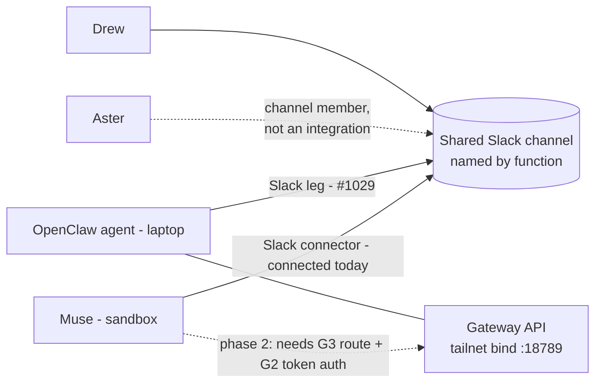

# Design: a Muse↔OpenClaw comms path that is not laptop SSH

Issue: #2023 (parent epic #2055). Source evidence: triage task 3341 verdict on
#2023 (2026-10-29T10:28Z), re-verified fresh by queue task 3381 on
2026-10-29T12:12Z. This is a design/investigation deliverable only — it does
**not** build the permanent comms feature; building follows a review round on
this doc, per the issue's own rule.

**Naming note (hard constraint, §4):** the OpenClaw-side agent picks its own
name. This doc, and everything it proposes, refers to it by role only — "the
OpenClaw agent". No name is hardcoded in any config key, channel name, or
prompt text proposed here.

## 0. Verified state (evidence)

Fresh checks, laptop via the existing SSH route, 2026-10-29T12:12Z
(triage task 3341 at 10:28–10:32Z agrees unless noted):

- Gateway is live and working locally: `GET http://127.0.0.1:18789/health` →
  `{"ok":true,"status":"live"}`; OpenClaw 2026.10.7; gateway service running
  (systemd user, pid 3104021 at check time).
- 1 agent, **15 sessions**, default `main` session active ~1h before the
  check — the OpenClaw agent already does local work today; this is not a
  cold start.
- The gateway socket binds **both** `127.0.0.1:18789` and the laptop's
  tailnet address `100.99.113.103:18789` (`ss -tlnp`), and the status
  dashboard URL is the tailnet one — while `openclaw status` reports
  **"Tailscale exposure: off"** (see gap G4).
- Status overview reports loopback gateway auth **none**; separately,
  `gateway.auth.token` is configured as a **secret reference** that the CLI
  path cannot resolve (`OPENCLAW_GATEWAY_TOKEN` missing/empty in that path;
  status degrades to read-only). See gap G2.
- `~/.openclaw/openclaw.json` has an **empty `channels` object** (triage
  3341) — no chat channels are configured at all. Channel setup is owned by
  #1029 (Slack/Telegram/WhatsApp), still open.
- Sandbox side (triage 3341): the sandbox VM is **not a tailnet node**; its
  only laptop route is an SSH CONNECT proxy, and an HTTP attempt to the
  gateway through that proxy was refused (RemoteDisconnected). Direct HTTP
  to the tailnet address from the sandbox fails. **No non-SSH
  Muse→OpenClaw route exists today.**

## 1. Setup gap list — resolution or owner for each

### G1. Zero channels configured

The `channels` object is empty: the OpenClaw agent can be reached only by
someone already on the laptop (local UI/CLI). Nothing external — chat,
webhook, or peer agent — can talk to it.

- **Resolution:** configure channels, Slack first (it is the recommended
  comms medium, §3).
- **Owner:** #1029 — already filed and open; this design consumes its Slack
  leg and does not duplicate it.

### G2. Gateway auth: remote-caller authentication must be designed, not assumed

`gateway.auth.token` exists as a secret reference, but the CLI path cannot
resolve it, and the status overview reports loopback auth as **none**. Two
different facts are entangled: (a) how a *remote* caller proves itself to
the gateway, and (b) how local tooling reads the token. Today neither is in
a state a comms design can build on: a design that says "just call the
gateway API" silently assumes (a) works.

- **Design decision:** any non-loopback use of the gateway API requires
  token authentication, with the token held only as a secret reference on
  both sides — provisioned/rotated through the existing secrets manager
  (referenced by name, never written into config files, docs, or chat) —
  and a named caller identity per consumer (Muse's gateway client is one
  caller; future consumers get their own). Loopback staying auth-none is
  acceptable **only** while loopback is genuinely local-only.
- **Consequence:** the direct-API candidate (§2) is blocked on this gap,
  not just on routing (G3). If the gateway cannot enforce token auth on
  the tailnet bind specifically, the tailnet bind must be closed (G4)
  until it can.
- **Owner:** follow-up issue filed from this doc (gateway remote-auth
  enforcement + provisioning). No credential is created or rotated by this
  design task.

### G3. The sandbox has no non-SSH route to the laptop

The sandbox VM is not a tailnet node; its CONNECT proxy is SSH-only and
refused a proxied HTTP attempt to the gateway. So even with G2 solved,
Muse (sandbox side) cannot open a TCP connection to
`100.99.113.103:18789`.

- **Resolution options, in preference order:**
  1. Join the sandbox VM to the tailnet (a Tailscale connector already
     exists in Muse's environment for exactly this class of join), giving
     the sandbox a direct route to the tailnet bind — then G2's token auth
     is the only gate.
  2. A relay on a machine that is already a tailnet node *and* reachable
     from the sandbox — strictly worse (extra hop, extra thing to own);
     take it only if (1) is refused for a stated reason.
- **Owner:** follow-up issue filed from this doc (sandbox tailnet route
  for the direct-API path). Not needed for the recommended Slack path.

### G4. "Tailscale exposure: off" vs the tailnet socket bind — which is authoritative?

Both outputs are real; they describe different layers. `openclaw status`'s
"Tailscale exposure" reports OpenClaw's own exposure feature (serve/funnel
style publishing). The **socket bind is authoritative for reachability**:
`ss` shows the gateway listening on `100.99.113.103:18789`, so any device
on the tailnet can open a connection to it today, whatever the exposure
flag says. Treating the flag as the posture would misstate the actual
attack surface.

- **Design posture wanted:** the tailnet bind is treated as *real,
  intentional exposure to the tailnet only*, and it is allowed to stay
  **only** with G2's token auth enforced on it. If G2 cannot be enforced,
  the bind goes back to loopback-only until it can. The exposure flag is
  not cited as a security property anywhere downstream of this doc.
- **Owner:** decision recorded here; enforcement rides the G2 follow-up.

### G5. No repo-side inventory of what the OpenClaw agent already owns

The agent has 15 existing sessions and an active main session doing local
work, but nothing in any repo records what those sessions own, what the
agent is already responsible for, or what would break if its config
changes. Every future OpenClaw task (including #1029's channel work)
currently starts from folklore.

- **Resolution:** a one-pass, read-only inventory — sessions, their
  apparent responsibilities, configured tools/plugins (memory-core is
  enabled per status), and recurring work — written into a repo doc and
  linked from #2023.
- **Owner:** follow-up issue filed from this doc (inventory pass;
  read-only, no config changes).

## 2. Candidate comparison

Against the verified constraints: G1 (no channels), G2 (remote auth
undesigned), G3 (no sandbox→tailnet route), G4 (tailnet bind is real
exposure), plus the program's placement context (fleet epic #2055: the
comms path is also the substrate for later placement-framework work).

| Candidate | Works today? | Blockers | Properties |
|---|---|---|---|
| **A. Direct server-to-server API** (Muse → gateway HTTP/WS on the tailnet bind) | **No** | G3 (no route from the sandbox), then G2 (token auth for remote callers) | Lowest latency, structured API, no third-party intermediary; but two gaps must close first, and it is a private 1:1 path — Aster or anyone else joins by building their own client |
| **B. Shared Slack channel** (both agents as members of one channel) | **Yes — the only candidate both sides can join today** | OpenClaw's Slack leg is unconfigured, but that is exactly #1029's first leg; Muse's Slack connector is already connected | Human-visible by default (Drew can watch and intervene in the same place), asynchronous-friendly, message history is the audit trail, zero new credentials on the Muse side; latency and format are chat-shaped, not API-shaped |
| **C. Three-way channel** (Muse + Aster + the OpenClaw agent) | Same as B | Same as B | Not a third integration: see §3.2 |

## 3. Recommendation

### 3.1 Primary path: B — a shared Slack channel, now

Adopt the shared Slack channel as **the** Muse↔OpenClaw comms path, with
these specifics:

- **One channel, named by function, not by any participant's name**
  (e.g. a comms/coordination name). The channel name must survive the
  OpenClaw agent choosing or changing its own name (§4).
- **Membership:** Drew, Muse (via its Slack connector, connected today),
  and the OpenClaw agent (via #1029's Slack leg). Aster joins as a member
  of this same channel when wanted (§3.2).
- **Protocol, kept deliberately thin for v1:** plain messages; a tasking
  message names the task, the expected reply shape, and a link to the
  tracking issue; the OpenClaw agent replies in-thread. Anything that
  needs structure grows from real use, not from this design's speculation.
- **First buildable step:** #1029's Slack leg (configure the OpenClaw
  agent's Slack channel) + create the shared channel + a round-trip smoke
  test: Muse posts a tasking message, the OpenClaw agent answers
  in-thread, Drew can see both. That smoke test is the acceptance test for
  the comms path existing at all.
- **Why not A first:** A is the better *machine* interface and the worse
  *first* step — it is blocked on two gaps (G3, G2) and produces a private
  path Drew cannot observe. B is unblocked, observable, and its history
  doubles as the audit trail the fleet's other agent-to-agent paths lack.

### 3.2 Three-way variant: Aster is a channel member, not a third integration

Candidate C collapses into B. Aster's comms with Muse already exist
(Slack #alignment, per the program notes), and a shared channel gains a
third participant by invitation, not by building a Muse↔Aster leg,
an Aster↔OpenClaw leg, and a merge rule. **Recommendation: Aster, when
wanted in the loop, is a member of the same Slack channel.** A separate
three-way integration is designed only if a concrete need appears that a
shared channel cannot express (none is known today).

### 3.3 Phase 2: direct API, when its gaps close

Once the G3 follow-up gives the sandbox a tailnet route **and** the G2
follow-up lands token-authenticated remote access, add the direct gateway
API as a second, machine-shaped path for high-volume or structured
exchanges — with the Slack channel remaining the human-visible
coordination and escalation layer. The two paths are complements, not
rivals; this doc's ordering (B now, A when unblocked) is the decision
being asked of the review round.

## 4. Name-agnosticism as a hard design constraint

The OpenClaw agent picks its own name, at some point, possibly more than
once. Therefore, in everything this design proposes and everything built
from it:

- No participant name in channel names, config keys, env var names, file
  paths, or prompt text — participants are referenced **by role**
  ("the OpenClaw agent", "the laptop agent") in prose and by stable role
  identifiers in config.
- Addressing in the channel is by mention of whoever is present, never by
  a baked-in display name in templates.
- This doc follows its own rule: the agent is named nowhere in it.

A build that hardcodes a name fails review against this section, whoever
wrote it.

## 5. Follow-ups filed from this design

- **Channels:** already owned — #1029 (Slack leg is the first buildable
  step of §3.1). Not re-filed.
- **Gateway remote-auth (G2/G4):** enforce token authentication for
  non-loopback gateway callers, provision via the secrets manager by
  reference; verify the tailnet bind requires it. Filed as a follow-up
  issue from this doc's PR pass: **#2300**.
- **Sandbox tailnet route (G3):** join the sandbox VM to the tailnet (or
  record the stated refusal and fall back to a relay design) so the
  phase-2 direct-API path has a route. Filed as a follow-up issue: **#2301**.
- **OpenClaw inventory (G5):** one read-only pass over the agent's 15
  sessions and configuration, written up as a repo doc. Filed as a
  follow-up issue: **#2302**.

No follow-up in this list builds the permanent comms feature ahead of the
review round on this doc; #1029's channel setup is the exception because
it predates this design and is its first step either way.

## 6. What this design does not decide

- The placement framework itself (which work belongs with which agent) —
  fleet epic #2055's separate design; this doc only gives it a comms
  substrate.
- OpenClaw-side session/tasking semantics (how the agent queues or
  prioritises channel taskings) — the OpenClaw agent's own design space;
  the thin v1 protocol in §3.1 is deliberately silent on it.
- Any credential creation, rotation, or channel configuration — designed
  here, executed by the owning follow-ups.
