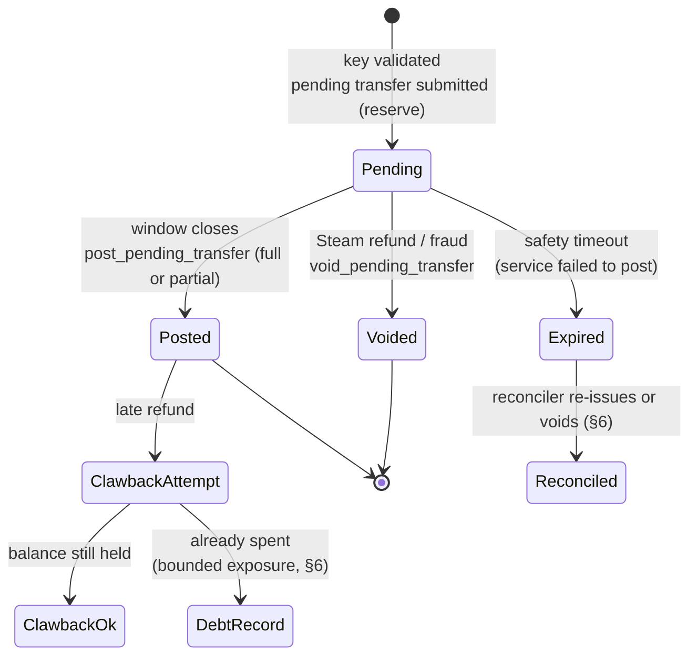

# Refundable grants via pending transfers — premium tokens that survive a refund

**Date:** 2026-10-29 · **Issue:** [#2065](https://github.com/developing-today/code/issues/2065) · **Program:** ID expansion, epic [#2056](https://github.com/developing-today/code/issues/2056)
**Feeds:** [#2043](https://github.com/developing-today/code/issues/2043) (ID currencies v1 design), [#2042](https://github.com/developing-today/code/issues/2042) (tokens for real services)
**Source finding:** [#2040](https://github.com/developing-today/code/issues/2040) TigerBeetle investigation, §5 "Corrections, refunds, revocations — the sharpest mismatch"; in-repo at
`doc/2026-10-28T23-34-15Z_investigation_tigerbeetle_currency_backend/2026-10-28T23-34-15Z_investigation_tigerbeetle_currency_backend.md`
**Method:** design pass over the #2040 findings (TigerBeetle two-phase transfer semantics, account flags, idempotency) plus the Steam refund-window policy question the intake review flagged. No new primary research was needed; every TigerBeetle claim below is the one already verified with citations in the #2040 report.

---

## TL;DR verdict

**The premise holds, with one correction that changes the product story.**

Granting premium tokens as a _pending_ (two-phase) transfer does close the clawback failure mode from #2040 — but only for refunds that arrive **while the grant is still pending**. Once a grant posts, the tokens are ordinary posted balance, spending is unrestricted, and a refund after that point is again a clawback that can fail (`exceeds_credits`). So the design is not "refunds always work"; it is **"the refund window and the vesting window are made the same window"**, which is exactly how Steam itself works. The residual exposure is a refund that arrives late, and that is a bounded, explicitly-handled case rather than the default one.

The cost is delayed usability: pending credits are not spendable posted balance (`credits_pending`, not `credits_posted`), so the user holds tokens they cannot spend until the window closes. That is the whole trade, and it is a product decision, not an engineering one — §3 surfaces it rather than defaulting it.

**Recommendation:** grant per Steam key as one pending transfer; vest (post) at window close; void on refund before close; re-issue the remainder for partial refunds (TigerBeetle cannot partially void). Window: **14 days from key redemption**, the Steam refund window, with an optional early-vest path if we ever get a trustworthy "refund window closed" signal. Partial refund after posting falls back to the bounded clawback + debt policy in §6.

---

## 1. The problem being solved, restated precisely

From #2040, in TigerBeetle's own terms:

- Posted transfers are **immutable and undeletable**. A "refund" is a new opposite transfer; a "revocation" is a clawback transfer.
- A clawback is an ordinary transfer. On a user account with `debits_must_not_exceed_credits` — which is the correct flag for a holder account — the clawback is **rejected** if the holder already spent or moved the tokens (`exceeds_credits`).
- There is **no freeze, seizure, or negative-balance forcing** primitive. Any "freeze" is our gateway refusing to submit transfers, which only binds traffic that goes through the gateway.
- A pending transfer, by contrast, **reserves** value: `debits_pending` on the source account, `credits_pending` on the destination. The reservation is released by exactly one of three outcomes: `post_pending_transfer` (all or part), `void_pending_transfer` (releases the whole hold), or `timeout` (auto-restores the whole hold). Resolution happens **at most once**; repeat attempts return `pending_transfer_already_posted` / `_voided` / `_expired`.

The mismatch the issue names is therefore structural: minting on redemption gives the user a posted, spendable balance the instant the key validates, and the refund arrives later with nothing left to take back. A pending transfer inverts that ordering — value is _promised_ at redemption and _delivered_ at window close — so the refund decision happens while the value is still revocable.

## 2. The design

### 2.1 State machine



`Pending → Posted` and `Pending → Voided` are mutually exclusive and each resolves the hold at most once — TigerBeetle enforces that, so a refund racing a vest cannot double-resolve the grant. That single property is what makes the refund path safe without a lock of our own.

### 2.2 Accounts and transfers

Per currency (ledger), as in the #2040 account factory:

| Account             | Flags                                                     | Role                                                      |
| ------------------- | --------------------------------------------------------- | --------------------------------------------------------- |
| `issuer.grant_pool` | none (issuer may go negative by policy, or be pre-funded) | debits side of every grant; holds supply                  |
| `user.<id>.premium` | `debits_must_not_exceed_credits`                          | credits side; `credits_pending` while a grant is unvested |

One grant = **one pending transfer**, not a stream of small ones:

- `flags.pending`, `amount = N`, `ledger = <premium token ledger>`, `debit_account = issuer.grant_pool`, `credit_account = user.<id>.premium`
- `code` = a dedicated grant range (e.g. `1000`), distinct from conversion/spend codes, so reporting can separate grants from ordinary movement
- `user_data_128` = the control-plane grant id; `user_data_64` = hash of the Steam key (never the key itself)
- `timeout` = window length **plus** a service slack (see §6.3) — a safety net, not the vesting trigger

Vesting is a second transfer with `flags.post_pending_transfer` + `pending_id`, `amount = N` (full) or `N' < N` (partial). Voiding is `flags.void_pending_transfer` + `pending_id`.

Reserve-time invariants are a feature here: a hold that would break `debits_must_not_exceed_credits` fails at _reserve_ time, not at posting, so a bad grant is rejected at the API boundary rather than silently failing 14 days later.

### 2.3 Control-plane record (the part TigerBeetle cannot hold)

TigerBeetle cannot express "these tokens came from Steam key K and are revocable if K is refunded" — #2040 §3 established there is no per-unit provenance. The linkage lives in our DB (#2062 control plane):

```
grant(
  id,                    -- also user_data_128 on the transfer
  steam_key_hash,        -- sha256 of the key; the key itself is not stored in the ledger
  user_id, ledger, amount,
  state,                 -- pending | posted | voided | expired | clawback_pending | clawback_settled | debt
  pending_transfer_id,   -- the reservation
  resolution_transfer_id,-- post or void transfer, once resolved
  window_started_at, window_ends_at,
  created_at, updated_at,
  attempt_count, last_error
)
```

The DB is a _projection_ with intent; TigerBeetle is the truth about money. Every state change is written intent-first, transfer-second, confirm-third, so a crash between the two leaves a reconcilable row rather than an orphaned hold (§6.3).

### 2.4 API surface (gateway, #2062)

```
POST /grants            {steam_key, user_id}      -> 202 {grant_id, state: pending, vests_at}
POST /grants/{id}/vest                            -> 200 {state: posted} | 409 already resolved
POST /grants/{id}/void    {reason}                -> 200 {state: voided} | 409 already resolved
GET  /grants/{id}                                 -> {state, amount, vests_at, resolution}
GET  /users/{id}/grants                           -> list, for the "pending tokens" UI
```

`POST /grants` is idempotent on `steam_key_hash` (a key redeems once, ever). `vest`/`void` are idempotent on `grant_id` — TigerBeetle's at-most-once resolution plus the control-plane state check make double-resolution a `409`, not a double post.

## 3. Window length — the product pin

This is the one decision in the design that is not ours to bury. The intake review on #2065 flagged it: window length trades **refund safety** against **how long a paying user stares at unusable tokens**.

| Option                                          | Refund exposure closed        | User waits       | Notes                                                                                                                                 |
| ----------------------------------------------- | ----------------------------- | ---------------- | ------------------------------------------------------------------------------------------------------------------------------------- |
| **A. 14 days** (Steam's refund window)          | Essentially all Steam refunds | Up to 14 days    | Matches the platform's own rule; the "why can't I spend this" answer is "same rule as Steam"                                          |
| B. 48 hours                                     | Refunds inside 48h only       | 2 days           | Steam allows 14 days; this leaves an 12-day hole that is _worse_ than it looks, because it is a hole nobody expects                   |
| C. Hybrid: 14 days, early vest on evidence      | Most, sooner                  | Hours to 14 days | Needs a trustworthy "refund window closed" signal; Steam does not reliably expose one, so early vest would rest on our own heuristics |
| D. No window (post immediately, clawback later) | None                          | 0                | This is the status quo the issue exists to replace                                                                                    |

**Recommendation: A (14 days), with C as a later refinement only if a real signal appears.** Rationale: A is the only option where the rule the user experiences is the same rule that protects the ledger, so the UX story and the accounting story cannot drift apart. B and C both create a window where the product _looks_ safe and is not. The recommendation is a default for the design, not a decision taken on Drew's behalf — filed as its own decision issue so it can be overridden cheaply before anything is built (see §8).

A second, smaller pin sits underneath: **what a pending grant may be spent on.** Recommendation: nothing — pending credits are not spendable, full stop. Allowing "pending tokens count for purchases" reintroduces the clawback problem through the front door.

## 4. Partial posting

TigerBeetle posts _all or part_ of a hold (`amount` on the post transfer; posting less restores the remainder), but **voiding is all-or-nothing** — there is no partial void. That asymmetry decides the semantics:

| Situation                                                                 | Handling                                                                                                                                                                                                                                                                                                                                               |
| ------------------------------------------------------------------------- | ------------------------------------------------------------------------------------------------------------------------------------------------------------------------------------------------------------------------------------------------------------------------------------------------------------------------------------------------------ |
| Full refund before vest                                                   | Void the hold. One transfer, whole grant released.                                                                                                                                                                                                                                                                                                     |
| **Partial refund before vest** (e.g. a bundle where one item is refunded) | **Void the whole hold, then issue a new pending transfer for the remainder**, linked by the same grant id lineage in the control plane and a `correction_of` field. Two transfers, both auditable; the alternative — posting the reduced amount — would leave the refunded part as a _posted_ credit we then have to claw back, i.e. the original bug. |
| Partial vest at window close by policy (e.g. grant tiers)                 | Post the vested fraction with `post_pending_transfer` `amount = N'`; the remainder is auto-restored. Only correct when the _policy_ vests partially, not when a refund reduced the grant.                                                                                                                                                              |
| Refund arrives after vest                                                 | Not a partial-posting problem — clawback path, §6.                                                                                                                                                                                                                                                                                                     |

The rule to state plainly in the implementation: **partial posting is for policy, void-and-reissue is for refunds.** Mixing them is how a refunded amount ends up posted.

## 5. What the user sees while a grant is pending

Three states are visible, and only three:

- **Pending** — "500 premium tokens from your Steam key, usable from 12 Nov". Amount shown, spend action disabled, countdown to `vests_at`. The tokens must appear in the balance area, greyed, not hidden: hiding them makes the grant feel like it failed, and the user has already paid.
- **Posted** — indistinguishable from any other premium token balance. No badge, no "vested" marker in the spend UI; the history keeps the provenance.
- **Voided** — the grant disappears from the balance with a history entry ("grant reversed — Steam purchase refunded"). Never silently.

Two details that matter more than they look:

1. **The countdown is server-authoritative** (`vests_at` from the control plane), not a client timer. A client-side timer will disagree with the ledger at exactly the moment someone cares.
2. **Spend attempts against pending balance get a specific error**, not "insufficient funds" — the distinction is the difference between a bug report and a support ticket.

## 6. Does this actually close the #2040 failure mode?

### 6.1 Side by side

|                          | Status quo (post at redemption)                           | This design (pending until window close)                                                                                |
| ------------------------ | --------------------------------------------------------- | ----------------------------------------------------------------------------------------------------------------------- |
| Refund during window     | Clawback transfer; **fails** if spent (`exceeds_credits`) | **Void the hold** — cannot fail, nothing was spendable                                                                  |
| Refund after window      | Same clawback failure                                     | Same clawback failure, but the window is now the _same_ window Steam uses, so this is the rare case, not the normal one |
| Tokens spendable         | Immediately                                               | After the window                                                                                                        |
| Ledger state on refund   | Original transfer stands + failed corrective              | Reservation released; original never posted                                                                             |
| Needs a freeze primitive | Yes (does not exist)                                      | No                                                                                                                      |

**Closed:** every refund that arrives inside the window — which is the case the issue was filed about. **Not closed, and cannot be:** a refund that arrives after the tokens posted and were spent. No ledger primitive fixes that; TigerBeetle explicitly offers none (#2040 §5).

### 6.2 Residual exposure, bounded

After vest, a late refund is a clawback. Three policies, pick one at design time:

- **Clawback then debt** (recommended): attempt the clawback; on `exceeds_credits`, mark the grant `debt`, and let the gateway refuse new grants/redemptions for that user until settled. The user's balance stays non-negative, the invariant holds, and the loss is a recorded receivable rather than an exception.
- **Unconstrained premium accounts**: allows the balance to go negative. Rejected — it weakens the invariant on precisely the accounts that matter most (#2040 §5 says the same).
- **Absorb**: treat it as cost of business. Acceptable only with a spend-rate cap that makes the per-user loss small; needs a number before it can be chosen.

Exposure is bounded by (late-refund rate × per-grant value), and both are measurable after launch — which is the argument for shipping with debt-recording and instrumenting it rather than pre-optimising.

### 6.3 Failure modes of the mechanism itself

The pending transfer introduces failure modes the posted design did not have. All are reconcilable:

| Failure                                    | Effect                                                                       | Handling                                                                                                                                                          |
| ------------------------------------------ | ---------------------------------------------------------------------------- | ----------------------------------------------------------------------------------------------------------------------------------------------------------------- |
| Service dies between reserve and vest      | Hold sits until `timeout`, then auto-restores → user's paid grant evaporates | `timeout` = window + slack (recommend +72h); reconciler sweeps `state=pending AND window_ends_at < now` and posts. `Expired` is a reconcilable state, not a loss. |
| Vest submitted twice (retry)               | Second attempt → `pending_transfer_already_posted`                           | Treat as success; confirm state from the control plane.                                                                                                           |
| Refund and vest race                       | At most one resolves; the loser gets `already_posted` / `already_voided`     | Correct by construction; log which won. If post won, fall to §6.2.                                                                                                |
| Refund arrives after the reconciler posted | Clawback path                                                                | §6.2.                                                                                                                                                             |
| Control plane and ledger drift             | Grant row says posted, ledger says pending                                   | Reconciliation job compares `pending_transfer_id` resolution against row state; drift is an alert, not a silent fix.                                              |

## 7. Interaction with the rest of the program

- **#2062 (control plane / gateway):** this design _needs_ it — grant records, key→grant linkage, the only TB client. No new capability required beyond a `grant` table and three endpoints.
- **#2063 (conversions):** pending grants interact with conversion in one place — a conversion out of a pending balance must be refused (pending credits are not spendable, §3). Conversions _of_ posted premium tokens are unaffected.
- **#2042 (tokens for real services):** this is the refund half of that investigation; the "what a token buys" half is separate and unaffected.
- **#2043 (currencies v1):** the grant state machine belongs in the v1 currency design as the canonical example of the pending primitive, and as the reason the `grant_pool`/holder account pair exists per currency.

## 8. Follow-ups filed from this design

1. **Grant service implementation** — [#2294](https://github.com/developing-today/code/issues/2294): control-plane `grant` table, the three endpoints, TB transfer codes, idempotency on `steam_key_hash`, void-and-reissue for partial refunds.
2. **Grant vesting reconciler and drift alarm** — [#2295](https://github.com/developing-today/code/issues/2295): sweep pending grants past `window_ends_at`, post with retry, alert on control-plane/ledger drift, handle `Expired`.
3. **Decision: grant refund window and pending-token spendability** — [#2296](https://github.com/developing-today/code/issues/2296): the §3 pin, filed for review with the recommendation attached rather than assumed.

## 9. Open questions

- Does a Steam key ever legitimately grant twice (replacement keys, family sharing)? If yes, the idempotency key is `(key_hash, user_id, attempt)`, not `key_hash`.
- What is the per-user grant rate limit that makes the §6.2 "absorb" policy defensible? Needs a number before launch, not after.
- Does the vest notification need to be a push (email/notification) rather than a UI poll? A 14-day wait makes "your tokens are ready" a real notification event.
- Should `issuer.grant_pool` be pre-funded or allowed to go negative? Pre-funding keeps the issuer account's invariant meaningful; going negative makes grants free but makes supply auditing weaker. Recommend pre-funded, revisit at #2043.
