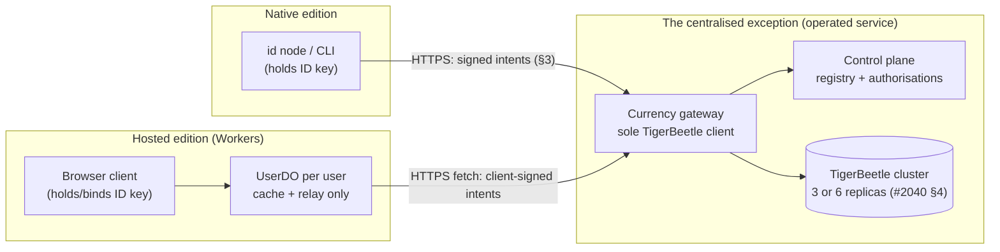

# Design: currency as the centralised exception — the hosted edition's boundary to the currency service

**Issue:** #2066 (ID program wave-1, LIST 11/12 follow-on) · **Parent epic:** #2056
**Inputs:** TigerBeetle investigation (#2040, `doc/2026-10-28T23-34-15Z_investigation_tigerbeetle_currency_backend/`);
Workers-fit investigation (#2044, `doc/2026-10-28T23-34-14Z_investigation_cloudflare_workers_fit/`)
**Sibling design:** #2062 (currency control plane — registry, account factory, gateway internals)
**Feeds:** currencies v1 synthesis (#2043)
**Status of the code (verified on `main`, 2026-10-29):** there is no currency
service yet. `pkgs/id` contains no TigerBeetle client and no ledger code
(grep for `tigerbeetle` / currency accounts over `pkgs/id` finds only the
#2040 investigation doc and README history). This design is therefore a
boundary drawn before implementation, not a description of running code.

---

## 1. The exception, stated and justified

Every other part of the ID architecture is decentralised or serverless:

- the **native edition** is a peer-to-peer Iroh node — no central server at all;
- the **hosted edition** is a Cloudflare Workers application: one Durable
  Object per user, SQLite-backed, hibernating WebSockets, idle cost ≈ zero,
  no per-user containers or standing servers (#2044 §1, §5, §7).

Currency cannot follow either pattern, for reasons that are properties of
money, not preferences:

1. **A ledger needs one total order and cross-user atomicity.** A transfer
   debits one user's account and credits another's, atomically, under balance
   invariants (`debits_must_not_exceed_credits`). Two per-user Durable Objects
   cannot transact with each other; a CRDT/graph merge cannot enforce a
   global "never spend what you do not have" invariant. Double-entry
   accounting is a consensus problem, and TigerBeetle solves it with
   Viewstamped Replication: the cluster "behaves as if it is just a single
   machine which processes the incoming requests in order" (#2040 §4).
2. **TigerBeetle physically cannot run in the hosted tier.** It is a stateful
   consensus cluster: Linux ≥ 5.6 only, one preallocated data file per
   replica on a separate disk/machine, Direct I/O, ECC memory, a persistent
   supervised single-core process per replica (#2040 §4). Workers isolates
   offer none of that — no UDP, no inbound listening, no persistent process
   or local disk, 128 MB per isolate (#2044 §2, §2.2). It also cannot run
   inside a native Iroh node per user: a ledger replicated only on its
   owner's machine provides no cross-user guarantees, and the cluster size
   is fixed at format time (#2040 §4).
3. **The database has no authentication.** "TigerBeetle does not support
   authentication. You should never allow untrusted users or services to
   interact with it directly" (#2040 §1). Every client of the ledger —
   hosted or native — must therefore pass through a gateway that verifies
   ID signatures and issuance/transfer authorisations before submitting
   anything. There is no deployment shape in which the hosted edition talks
   to TigerBeetle itself.

**The exception, precisely:** exactly one component of ID is centralised —
the **currency service**: the TigerBeetle cluster plus the control plane and
gateway designed in #2062, operated as a small always-on service. Everything
else — identity, graph, content, messaging, worlds — stays P2P or serverless.
The containment property matters as much as the exception: **if the currency
service is down, currency operations stop and nothing else does.** Balances
are the only state it owns; it holds no identity keys, no graph, no content.

This also resolves the open boundary question left by #2040 §8 ("which
tokens are TigerBeetle-backed vs graph-only claims?"): **TigerBeetle-backed
tokens are online currency** — every operation goes through the gateway.
Offline or peer-to-peer value transfer, where it exists, is the graph-claims
tier and is *not* currency in this design; the two tiers must never be
presented to users as the same thing.

## 2. Topology and boundary rules

Boundary rules:

- **B1 — One gateway, one API, both editions.** Native and hosted clients
  use the same HTTPS API (§3). The editions differ in how the user's key
  signs (§3.3), never in endpoints or semantics. No edition gets a private
  path to the ledger.
- **B2 — TigerBeetle is never exposed.** The gateway is the only TigerBeetle
  client; the cluster sits on a private network reachable only from the
  gateway (#2040 §5). The gateway is a conventional small server (the "a
  little container use is acceptable" allowance in the LIST 12 directive) —
  but it is *per-system*, not per-user, so it does not violate the hosted
  edition's "no indefinite per-user container spend" rule.
- **B3 — The hosted tier holds no ledger truth.** A UserDO may cache a
  **signed balance snapshot** (balance + the transfer watermark it reflects,
  signed by the gateway) and pending-operation state (§5). A cache is a
  view, never a replica: it cannot be spent from, merged, or reconciled
  into truth. If cache and gateway disagree, the gateway wins, always.
  This rule is what keeps the dual-write problem of #2040 §6.2 from
  acquiring a third writer.
- **B4 — The Worker never holds a signing key.** Hosted signing follows the
  binding model of #2044 §4.3 and the recovery design of #2060: the key
  lives with the user (browser-held, or a bound native device); the UserDO
  relays client-signed intents and verifies results. A custodial gateway
  key that could sign *as the user* is explicitly rejected — the gateway
  signs only its own receipts and snapshots, never user intents.
- **B5 — Gateway placement follows the cluster.** Every TigerBeetle commit
  pays quorum-replication latency (#2040 §4), so the gateway runs near the
  cluster; the hosted tier reaches it with ordinary `fetch()` subrequests.
  Currency is latency-insensitive compared to media (LIST 9): a transfer is
  not a packet stream, and one extra network leg is acceptable.

## 3. The gateway API shape

Conventions first, because they carry the safety properties:

- **Idempotency IDs are client-generated and persisted before submission**
  (#2040 §5, Reliable Transaction Submission). The client — native node, or
  the browser client with its UserDO mirroring the record — writes the
  request ID into its own durable store *first*, then submits. Every retry
  reuses the same ID. The gateway maps it to the TigerBeetle transfer ID;
  an `exists` result is success, any `exists_with_different_*` result is a
  hard error surfaced to the user, never retried into a second operation.
- **Every mutating request is a signed intent.** Canonical form: operation,
  ledger, accounts, amount, idempotency ID, expiry — signed by the ID key
  that owns the source account (or holds the relevant authorisation). The
  gateway verifies the signature, resolves key → accounts through the
  account factory (#2062), checks the authorisation, then submits. Account
  ownership mapping lives in the control plane; TigerBeetle account IDs are
  never user-facing identifiers.
- **Replay protection is persisted and single-use** at the gateway. The
  in-memory nonce-cache failure mode documented for `directory_auth` in
  #2060's investigation is explicitly not repeated here: signed intents
  carry short expiries and their IDs are recorded durably.
- **The gateway batches.** TigerBeetle is built for batched submission
  (up to 8,189 events per request, #2040 §5); per-operation client calls
  are aggregated gateway-side. Clients never tune for this.

Endpoints (v1 sketch; field-level schemas belong to #2062/#2043):

| Endpoint | Purpose | Notes |
|---|---|---|
| `POST /v1/currencies` | Create a currency: signed issuance statement (name, symbol, scale, supply policy) → registry record + allocated `ledger` u32 + issuer account | Scale is effectively immutable once accounts exist (#2040 §1) — the API must force an explicit scale confirmation |
| `GET /v1/currencies/{ledger}` | Currency metadata (name/symbol/scale/issuer/status) | Public, cacheable (KV at the hosted edge); status ∈ active / frozen / sunset is a control-plane flag — TigerBeetle has no freeze or retire primitive (#2040 §5) |
| `GET /v1/balances/{account}` | Balance + watermark for an account the caller owns or is authorised to read | Response is a **signed snapshot** (§2 B3) so hosted caches can prove freshness |
| `GET /v1/accounts/{account}/transfers` | Transfer history | Only meaningful for accounts created with `flags.history` (#2040 §5); the account factory decides history per account class |
| `POST /v1/transfers` | Single-ledger transfer from a signed intent | The workhorse; covers mint (issuer account is the source) and burn (issuer/burn account is the destination) — there is no separate mint verb, mirroring TigerBeetle (#2040 §1) |
| `POST /v1/holds` · `POST /v1/holds/{id}/post` · `POST /v1/holds/{id}/void` | Two-phase (pending) transfers with timeout | Native TigerBeetle primitive (#2040 §2); backs purchases, escrow, and refundable redemptions |
| `POST /v1/conversions` | Convert between currencies under a standing rate authorisation | Gateway computes both legs at the authorised rate, submits the linked pair, stamps one conversion ID into `user_data_128` on both legs (the linkage itself is not persisted by TigerBeetle, #2040 §2) |
| `POST /v1/corrections` | Refund / revocation as a compensating transfer with a correction `code` | Restricted (§4); **can fail** if the holder has spent the balance — the API returns that failure honestly instead of pretending finality |
| `POST /v1/authorisations` | Create/revoke a signed standing authorisation (conversion rate, mint allowance, …) | Authorisations are control-plane records signed by their issuer; the gateway enforces, TigerBeetle never sees them |

## 4. Which operations each edition may perform

The organising principle: **authority follows keys and authorisations, not
editions.** The hosted edition is a *transport and cache* for the user's own
signed intents; it is never a principal. With that stated, the matrix:

| Operation | Native edition | Hosted (Workers) edition | Path / constraints |
|---|---|---|---|
| **Balance** (read own) | Yes | Yes | Gateway `GET`; hosted serves the signed snapshot from the UserDO cache between refreshes, always labelled with its watermark |
| **Balance** (read another's) | Only as authorised (issuer, counterparty, auditor) | Same | Authorisation checked at the gateway; no edition difference |
| **Transfer** | Yes | Yes | Signed intent; hosted intent is signed in the browser/bound key and relayed by the UserDO (B4). The UserDO cannot originate, alter, or replay an intent |
| **Issue — create currency** | Yes | Yes | Signed issuance statement to `POST /v1/currencies`; registry + ledger allocation are gateway-side by necessity |
| **Issue — mint supply** | Yes, issuer key | Yes, issuer key — with a step-up | Minting is a transfer out of the issuer account. From the hosted edition it additionally requires a *fresh* signature per mint operation (no standing session authority), because a hosted session is a browser session and must not silently carry mint power. A custodial key may never mint (B4) |
| **Convert** | Yes | Yes | Both editions *use* standing rate authorisations via `POST /v1/conversions`; creating an authorisation is itself a signed control-plane operation available from either edition |
| **Holds** (pending transfers) | Yes | Yes | Required by hosted commerce (e.g. redeem-now-validate-later flows) exactly as by native; timeout semantics are TigerBeetle's |
| **Corrections** (refund/revoke) | Restricted: issuer or original counterparty, per currency policy | Same restriction | Gateway-enforced; failure on spend-down is a normal, reportable outcome (#2040 §5), and hosted UI must surface "correction failed — balance spent" rather than a false success |
| **Freeze / sunset a currency, close accounts** | Issuer-signed control-plane operation | Same, as transport | Enforcement is gateway refusal — TigerBeetle will process anything the gateway submits, so these are only as strong as the gateway (#2040 §5) |
| **Run a local ledger / settle offline** | **No** | **No** | §1: TigerBeetle-backed tokens are online currency. Offline value moves are graph claims, a different tier with different promises |

## 5. Failure and consistency semantics at the boundary

- **Gateway or cluster unavailable** (including the cluster halting when it
  loses quorum — a 3-replica cluster tolerates exactly one loss, #2040 §4):
  writes are rejected or held client-side and retried with the *same*
  idempotency ID; reads fall back to the last signed snapshot, labelled
  stale with its watermark. Nothing else in ID is affected (§1 containment).
- **Hosted hibernation mid-operation:** the UserDO persists
  `{request ID, intent hash, state}` in its SQLite *before* the gateway
  fetch; on wake it reconciles by querying the gateway for that request ID
  (the gateway's durable record answers "did this land?") instead of
  resubmitting blindly. This is the DO-shaped version of #2040's
  persist-before-submit discipline.
- **Ambiguous outcomes are resolved by lookup, never by retry-with-new-ID.**
  A timeout after submission is indistinguishable from success; the only
  safe resolution is the idempotency record.
- **No cross-boundary transactions.** An operation that spans currency and
  something else (buy a world item, redeem a Steam key) is orchestrated
  with holds (§4) and compensating corrections, never with assumed
  atomicity across the boundary — the same posture #2040 §2 prescribes for
  two-phase conversions.

## 6. What this design deliberately does not decide

Owned by #2062 (control-plane internals) and the #2043 synthesis:

- Registry schema, ledger-ID allocation governance, account-factory mapping
  details (including which account classes get `flags.history`).
- Cluster size — 3 replicas vs the vendor-recommended 6 across 3 sites —
  which must be decided **before** the cluster is formatted, because the
  size cannot be changed afterwards (#2040 §4).
- The signed-intent canonical encoding (reusing the existing ID envelope
  machinery is the obvious candidate; this design requires its properties,
  not its bytes).
- Rate-authorisation record format and liquidity inventory management.

Open questions this design surfaces for the synthesis:

1. Snapshot signing: does the gateway sign balance snapshots with a service
   key, and how do native clients pin/discover that key (directory record)?
2. Should hosted *reads* also be available straight from the gateway to the
   browser (skipping the UserDO) for lower latency, with the DO cache used
   only for offline/stale display?
3. Mint step-up UX for hosted issuers: per-mint signature prompts will be
   onerous for high-frequency issuance — is a scoped, expiring mint
   authorisation (§3) an acceptable relaxation, and who decides?

## 7. Follow-on work routed from this design

- **Gated PoC** (filed alongside this doc, linked from #2066): prove the
  boundary end to end with a stub gateway and a single-node development
  TigerBeetle — balance snapshot caching in a UserDO, one signed transfer,
  one hold/post cycle, and an idempotent-retry test across DO hibernation.
  Gated on the #2043 synthesis accepting this boundary and on #2062's
  gateway shape; a PoC, not the permanent service.
- Everything else buildable (registry, account factory, conversion engine,
  corrections service) is already enumerated as the #2062 / #2040 §7 build
  list and belongs to the synthesis — no duplicate issues are filed here.

## Sources

- TigerBeetle investigation, #2040 — cluster topology and operational
  requirements (§4), no-authentication boundary (§1, §5), idempotent
  submission discipline (§5), conversions as linked pairs (§2), corrections
  as compensating transfers (§5), the build list (§7).
- Workers-fit investigation, #2044 — Durable Object per-user model and
  limits (§1), no-UDP / no-inbound-listener wall (§2.2), Workers cost shape
  (§5), Google SSO binding options (§4.3), recommended hosted shape (§7).
- Key recovery investigation, #2060 — why hosted credentials never become
  signing authority by default, and persisted single-use proof discipline.
