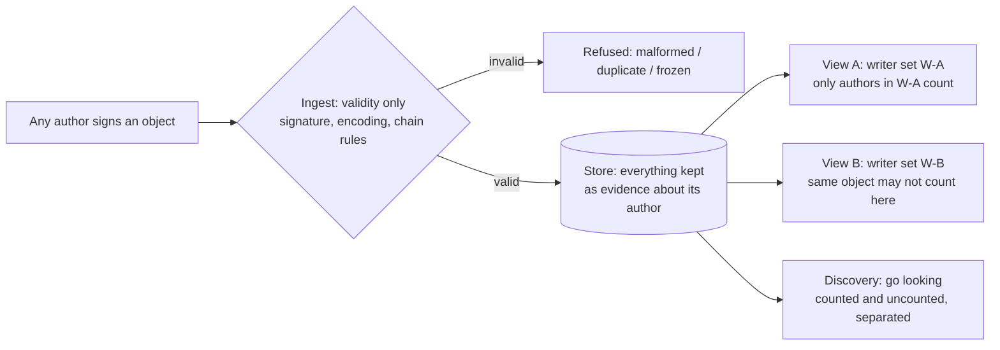

# Investigation: the ID trust/visibility model — accept-all ingest, writer-set views

- **Date:** 2026-10-30
- **Issue:** [#2030](https://github.com/developing-today/code/issues/2030) — LIST 7b,
  "trust/visibility model — servers accept all signed objects; views count only allowed
  writers".
- **Directive:** Drew, 2026-10-28 (ID platform expansion, epic
  [#2056](https://github.com/developing-today/code/issues/2056)); wave-2 write-up ordered
  2026-10-30 ("queue unrun").
- **Prior round:** wave-1 triage (queue task 3346, 2026-10-29) verified the premise
  against the code and recorded this document as the next step. This document is that
  write-up; it does not re-open the triage verdict.
- **Subject system:** `pkgs/id` in developing-today/code — the signed event store
  (`src/event_store/`), membership (`src/membership/`), and groups (`src/groups/`).
- **Method:** every substrate claim below was re-read at `origin/main`
  (`c90fcbc7`, 2026-10-30) and is cited with `path:line`. Design choices are proposals
  for the review round, not settled API. No runtime code was written; per the program
  rule, no permanent feature is built on this investigation without a review round.
- **Companion spec:** the buildable piece is already specified separately —
  [#2238](https://github.com/developing-today/code/issues/2238) (writer-set object
  format, view projection, discovery query), in review as PR
  [#2739](https://github.com/developing-today/code/pull/2739). This document is the
  model that spec implements; where the two disagree, the spec's reviewed text wins
  for implementation and this document wins for intent.

## Verdict up front

The premise is **verified, and it is already the shape of the code**. In `pkgs/id`,
ingest is a *validity* gate, not an *authority* gate, and "stored" is already separate
from "counted":

- `pkgs/id/src/event_store/ingest.rs:60` — the module doc states the Phase 1 rule
  verbatim: the store "has no membership or authority model to void by".
  `EventStore::ingest` (`ingest.rs:222`) refuses only the malformed (canonical
  encoding + signature, via `chain::decode` / `verify_strict`), the duplicate, and
  the frozen (past an author's fork point).
- `pkgs/id/src/event_store/claims.rs:4` — a tag event "is applied like any content
  event: the resolution decides whether it applies, and **the store keeps it either
  way**." `tag_claims()` (`claims.rs:39`) folds only *applied* events.
- `pkgs/id/src/membership/gate.rs:8` — the admission gate "does not validate
  authority"; authority is decided by the group crate at the operation's position,
  not at the door.

So the design is not a new architecture. It names and completes a layer the store
already has:

> **Validity at ingest → everything stored → per-view projection decides what
> counts.**

The missing piece is the writer-set projection, which today exists only implicitly
(applied / not-applied per author chain), not as a per-view, per-owner concept. That
piece is what §3–§5 specify and what #2238 turns into wire format.

## 1. The model: three layers, kept strictly separate

1. **Ingest = validity only.** Signature valid, encoding canonical, chain rules hold
   (sequence / backlink / fork rules as today) → the object is stored, attributed to
   its signer. Ingest never asks "is this author allowed to affect anyone's view?" —
   that question has a different answer per viewer, so it cannot be asked once, at
   ingest, by a server.
2. **Storage = evidence.** Stored objects are signed, attributable, and permanent by
   default (subject to the resource tiering in §4). A stored claim is a fact about
   its author ("X signed this"), never by itself a fact about its subject.
3. **View = projection over a writer set.** Every metric, feed, or aggregate is
   computed by a named view owned by someone (a person, a group, an app). The view
   carries a **writer set**; only objects whose author ∈ the set count. Everything
   else is *uncounted* — present, signed, discoverable, with zero effect on the
   view.

## 2. Writer-set representation

A writer set is itself a signed object owned by the view owner, versioned by the
owner's own chain — so set changes are auditable events, not silent config.

- **Entries** are a union of:
  - explicit IDs (public keys);
  - a **group reference**, resolving through the existing groups layer
    (`pkgs/id/src/groups/`) — "my friends" and "the dog-care group" are live
    references, not copies;
  - the **`public` sentinel** (everyone) — a deliberate per-view choice, never a
    default for metrics.
- **Per-topic scoping:** an entry may be scoped to a topic/tag, so the dog-walker's
  claims count for dog events and nothing else. Unscoped entries are the exception,
  not the rule.
- **Depth rule for group references:** one level only by default. If view → group G
  → group H expanded transitively without limit, one compromised or careless group
  admin silently rewrites many views. A view that wants H names H.
- **Exclusion entries:** a view may exclude a single writer admitted via a group
  reference, without leaving the group (needed by abuse case 6, §6).
- **Set changes apply prospectively by default.** Adding a writer counts their
  *past* stored claims only if the owner explicitly chooses "include history" —
  often exactly right for a friend, exactly wrong to do silently. Removing a writer
  stops future counting immediately; their already-counted past claims stay counted
  unless the owner issues an explicit **rescind**, which excludes that writer's
  claims from a stated point (or entirely) and is itself a visible, signed
  set-version event.
- **No silent history-rewriting.** Two viewers comparing "the same" metric must be
  able to see which set version produced it. Every computed view therefore names
  *(set version, frontier)* alongside its result.

The concrete object format, admission predicate, and slice plan for all of the
above are the subject of #2238 / PR #2739 and are not duplicated here.

## 3. View-time filtering vs ingest-time rejection

|  | Ingest rejection (by writer) | View-time filtering (chosen) |
|---|---|---|
| Who decides? | The server, once, for everyone | Each view owner, per view |
| Same object, two viewers | Must agree, or one is refused service | Counts for one, not the other — the normal case |
| "A stranger claims they walked my dog" | Server must judge a claim it has no standing to judge | Stored, signed, counts nowhere unless I look |
| Reversibility | Rejection destroys evidence | Adding the writer later can count stored history |
| Failure mode | Gatekeeper capture / censorship arguments | Storage cost (§4) |

Filtering wins on the program's own terms. Its honest cost: **filtering makes spam
ineffective, not free** — see §4.

### Where the filter lives, and what it costs

- The filter lives in the **view projection**, not in the store and not in sync.
  Peers and relays replicate the same store; each device/server computes its own
  owners' views over it.
- **Author-indexed projections:** views must never scan the whole store. An
  author → objects index (the store's per-author chains already give this shape)
  means a view's cost is proportional to its writer set, not to global spam
  volume. This is what keeps a Sybil flood from becoming a *compute* DoS on every
  view.
- A view result is reproducible from *(store frontier, set version)*: same inputs,
  same counted set. That reproducibility is what makes a disputed metric
  diagnosable ("counted via group: Dog Care, set v12") instead of an argument.

## 4. The cost side: resource controls, never authority in disguise

Storage and bandwidth for objects nobody counts is the price of the model. It is
paid with *resource* controls, never by quietly turning ingest back into an
authority gate:

- **Per-author and per-topic storage quotas at the relay/server**, enforced as
  resource refusals (over quota → retry-later, per the abuse-controls
  investigation [#2032](https://github.com/developing-today/code/issues/2032),
  closed; its doc is
  `doc/2026-10-29T10-55-00Z_investigation_comms_abuse_controls/`). A quota refusal
  says "no room", never "not allowed", and the object remains valid and storable
  elsewhere. The primitive-building follow-on is
  [#2033](https://github.com/developing-today/code/issues/2033) (open).
- **Retention tiering:** counted objects are hot/permanent; uncounted objects are
  cold, and a server may expire uncounted objects after a published retention
  window unless someone pins, counts, or discovers-and-saves them. Expiry is a
  storage policy, stated up front, not a judgement on the claim. The retention
  design for ephemeral data is
  `doc/2026-10-29T10-45-00Z_investigation_ephemeral_live_data_retention/`.
- **View inputs are retention roots.** The set versions and rescind events a
  served view reads must be retained with the view's counted objects; expiring
  them would make a served projection undefined while keeping its outputs. (This
  point is carried into the #2238 spec, §D7 there.)

## 5. "Going looking" — discovery of uncounted claims

Uncounted must mean *findable*, or the model is just a bin. The discovery surface
(UI and API are the same query):

- **Query by subject/topic, not by author:** "show me all claims about *this dog /
  this event / this entity*" returns counted and uncounted, visually and
  structurally separated. Each uncounted claim shows: author ID (+ petname if
  known), signature status, and **why it is not counted** ("author not in this
  view's writer set").
- **Two promotion actions, deliberately different:** *count this claim* (one-off
  inclusion of a single object, recorded as a view-level exception) vs *add this
  writer* (set change, prospective, optionally with history). Collapsing these
  into one button is how writer sets quietly bloat.
- **No ambient leakage:** uncounted claims never appear inside the counted view
  itself — no greyed-out rows in the metric, no "plus 3 hidden claims" badge that
  functions as an advertisement. Discovery is a place you go, not a nudge. (A
  per-view opt-in "N uncounted claims exist about subjects in this view" indicator
  is acceptable; default off for metrics.)
- **Flood-shaped results:** discovery results are grouped by author with
  per-author counts and are returned paginated under a result cap, so a
  *single-author* flood collapses into one group with a count instead of
  10,000 facts. Per-author grouping is **not** a Sybil defence: an attacker
  controlling 10,000 distinct author keys produces 10,000 groups, and
  neither the grouping nor per-topic storage quotas / cold tiering
  consolidates them. **Sybil-resistant discovery is explicitly unresolved
  in this design** — cross-author clustering (key age, co-claim patterns,
  shared submission infrastructure) is an open problem routed to the
  #2238 discovery-query spec and the #2033 abuse-controls work; until one
  of those lands, the bounded mitigations are the result cap + pagination,
  counted-first default ordering, and the §4 storage quotas (abuse
  case 2, §6).

## 6. Abuse cases walked through

1. **The Montana stranger** claims they walked my dog. Stored, signed by them. My
   did-it view counts only my writer set → the claim has **zero effect** on my
   metrics. If I go looking, I find it, attributed, and can ignore it, count just
   it, or (if it turns out to be my neighbour) add the writer. ✅ Model holds.
2. **Sybil flood:** an attacker mints 10,000 keys and floods claims about my dog
   to pollute discovery. Metrics: unaffected (none are in my set). Discovery:
   per-author grouping does **not** consolidate this attack — 10,000 keys are
   10,000 groups — so discovery degrades to a capped, paginated list in which
   the flood is visible but not summarised; server-side per-topic quotas +
   cold tiering bound the storage, not the result set's shape. Residual risk:
   Sybil-resistant discovery (cross-author clustering) is **unresolved** — it
   is routed to the #2238 discovery-query spec and #2033, not solved here.
   ⚠️ Holds for metrics; discovery under a Sybil flood is an open problem.
3. **Storage exhaustion against a relay:** an attacker submits validly-signed
   bulk to fill a server. This is a resource attack, answered by #2032's budgets
   (per-IP / per-ID / per-topic windows, block lists) and the uncounted-tier
   expiry in §4. Validity is not a storage entitlement. ✅ With #2032/#2033
   controls in place; without them this is the model's real weak point.
4. **Confusion attack:** spam claims crafted to *look* counted (similar petname,
   copied formatting). Defence is presentational and non-negotiable: counted
   status is computed from the set, never displayed from claim-supplied data;
   uncounted claims always render author + "not counted — author not in writer
   set". ✅ If the UI rule holds.
5. **Writer-set poisoning:** I am socially engineered into adding an attacker.
   Their claims now count — correctly, per my set. Mitigations: set changes are
   signed, versioned, and reviewable ("your set changed 3 times this week");
   rescind exists; per-topic scoping limits blast radius. The model cannot fix an
   owner decision; it can make it visible and reversible. ⚠️ Accepted residual
   risk, made auditable.
6. **Group-reference capture:** my view references a group; its admin adds a
   spammer. One-level expansion + the view rendering *which reference admitted
   this writer* ("counted via group: Dog Care") makes it diagnosable; I can
   exclude the single writer with a view-level exclusion entry (§2) without
   leaving the group. ⚠️ Requires the exclusion-entry mechanism — in the #2238
   spec.
7. **Removed writer disputes history:** a dog-walker I removed claims their past
   walks must still count / must be erased. The default rule answers both: past
   stays counted (it was true under the set then), rescind is available to me as
   owner, and the walker's own stored claims remain *their* evidence regardless —
   removal from my view deletes nothing from the store. ✅

## 7. Gates and consumers — what this document unblocks

- **First app — sticky notes / did-it tracker
  ([#2031](https://github.com/developing-today/code/issues/2031), open).** #2031
  was gated on this design. That gate is now addressed: the trust model it must
  implement is the one in §1–§5, and its data model already exists
  (`doc/2026-10-29T13-04-50Z_investigation_didit_tracker_data_model/`). What
  remains before a *permanent* build is the program's review round on the
  writer-set spec (#2238 / PR #2739) — a PoC may proceed against this model, a
  permanent feature may not be built on an unreviewed spec.
- **Boards moderation
  ([#2052](https://github.com/developing-today/code/issues/2052), open).** Boards
  is itself at investigation stage; this model is an input, not a blocker: a
  board is a view whose writer set is its membership, and moderation is
  set-change + rescind with the audit trail of §2.
- **ID core design ([#2028](https://github.com/developing-today/code/issues/2028),
  open).** This investigation is an input to the synthesis. One question is
  explicitly handed to it: whether `public` views need their own moderation
  layer (a public *metric* is an invitation to game it; likely public views
  should be read-only discoveries, not metrics).
- **Abuse controls.** Cost-side controls are owned by #2032 (investigation,
  closed) and #2033 (primitives, open) — cross-referenced in §4, not re-decided
  here, per this task's scope.

## 8. What this investigation does NOT decide

- Concrete wire/storage format for writer-set objects and view definitions in
  `pkgs/id` — that is #2238's spec (PR #2739, in review).
- Uncounted-tier retention window lengths and quota numbers — those belong with
  #2032's budget values, set once, together.
- Whether `public` views need their own moderation layer — handed to #2028 (§7).
- The sticky-notes / did-it PoC itself — #2031 owns it (§7).

## 9. Follow-up routing

No new follow-up issue is filed by this document: the one buildable piece it
identifies — the writer-set / view-projection / discovery spec — was already
filed as #2238 in the wave-1 pass and is actively in review as PR #2739, and the
remaining open questions already have owners (#2028, #2033, #2031). Filing
duplicates for any of them would be exactly the per-repo re-filing the program's
cross-reference rule exists to stop. When PR #2739's review round completes, the
next step is #2238's own slice plan, not a new issue from here.
