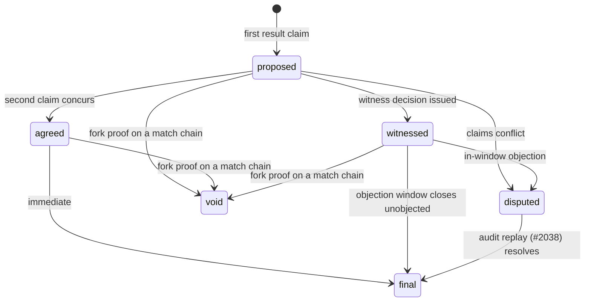

# Match-result attestation — mutual concession, witness adjudication, offline play — investigation

**Date:** 2026-10-30 · **Issue:** developing-today/code#2037 (LIST 10a)
**Question owner:** Drew's "ID match attestation + audit" directive (LIST 10)
**Scope:** Central game tracking that works without Drew's live servers
running every game. Players hold matches themselves; a result counts when
both players agree who won (chess-style: the loser says the other won), or
when both players send their data to a user acting as WITNESS who runs the
witness game logic over both players' messages and decides a winner —
valid as long as neither player objects to the witness's judgment.
Investigate: (1) attestation objects, (2) objection windows and mechanics,
(3) witness selection and trust, (4) how offline results sync and become
valid when a player reconnects. Results may flow peer-to-peer or to a
gatherer (not necessarily Drew) and count when everybody agrees.
**Deliverable asked for:** this investigation/design document, plus
follow-up issues for anything buildable.
**Sibling / consumer:** #2038 (match audit — netcode log format, replay
validation, cheating signals) is the other input; its investigation is
complete (`doc/2026-10-29T10-54-33Z_investigation_match_audit_netcode_replay/`,
issue closed). The gated synthesis **#2039** ("match attestation + audit
v1") merges both investigations. With this document landed, both of
#2039's named inputs exist; this doc is an input to that synthesis, not
the v1 design itself.
**Provenance:** the investigation itself was run in wave 1 (queue task
3350, 2026-10-29) and recorded as a comment on #2037, but never landed as
a repository document. This document is that write (wave-2 queue task
3921): the wave-1 findings, re-verified against current `main`, plus the
worked examples the wave-1 pass did not include.
**Method:** ID codebase as it exists today (`pkgs/id`: signed chained
events in `src/chain.rs`, fork handling in `src/event_store/ingest.rs`),
the #2038 audit investigation, and the program's counting-view model
(#2030). No code was built; nothing here is a permanent feature, and no
permanent feature may be built on the follow-up proof of concept without
a review round.

---

## Verdict

The premise is **sound: the signed-object substrate exists, but the
attestation layer does not — and one substrate prerequisite,
player-signed move capture for world games, is also missing** (third
bullet). Verified against `pkgs/id` (wave 1, 2026-10-29; re-verified
2026-10-30 on `main` c90fcbc7):

- Every object in the event store is a signed, chained event
  (`src/chain.rs`: canonical encoding, `verify_strict` signatures,
  per-author sequence/backlink chains) — the substrate attestation
  objects (agreement, claims, decisions, objections) are built from.
- The event store already treats **equivocation as provable**: a fork
  (two events at one sequence number) produces a kept fork proof and
  voids the author's events from the fork point
  (`src/event_store/ingest.rs`). A player who rewrites a signed chain
  manufactures their own cheating evidence.
- **Missing prerequisite — player-signed move capture (found in review,
  2026-10-30):** the world/game path does *not* produce player-signed
  move chains today. `WorldEvent` (`src/world/mod.rs`) carries only a
  host sequence, a server-assigned participant ID, and a payload — no
  signature, no chain link — and the actor persists game inputs as
  `JournalEntry::Committed` (`src/world/actor.rs`) without signing
  through `chain.rs`. The tic-tac-toe example uses this path. So the
  move-evidence guarantees below (witness replay over *signed* logs,
  fork-proofs voiding a rewritten move history) hold only once game
  inputs are captured as player-signed chained events and integrated
  with the event store. That capture layer is a buildable prerequisite
  of this design, not existing functionality; it is filed as follow-up
  **#2814** and is an explicit input to #2039.
- No attestation, concession, witness, or result object exists in
  `pkgs/id/src` today (code search, 2026-10-30: `witness` — 0 hits in
  `src/`; `attestation` — a single unrelated comment about build
  provenance in `src/world/mod.rs`). This investigation specifies that
  layer; it composes with the audit investigation #2038 (replay of the
  netcode log) and feeds the gated synthesis #2039.

## The objects (all ordinary signed events in the graph)

1. **Match agreement (genesis)** — signed by *both* players before play:
   game/program identity **including the rules/logic hash**, the two
   player IDs, start conditions, the **named witness** (and fallback),
   the objection-window length, and the log-submission rule (below).
   Pre-committing the witness and the logic hash at genesis is the single
   most important design decision in this document: everything after the
   match is mechanical *because* the trust choices were made before
   anyone knew who would lose.
2. **Result claim** (per player, at match end) — `{match, outcome as the
   author asserts it, final-state hash, frontier hashes of both chains}`
   signed by the author. Each player files one; neither player's claim
   alone is a result.
3. **Witness decision** — `{match, logic hash, outcome, evidence}`
   signed by the witness named in the agreement, where `evidence` is
   one of:
   - `complete {claim_a, claim_b, log_hash_a, log_hash_b}` — the normal
     case: issued after running the agreed logic over both submitted
     logs; or
   - `partial {received: [the claim/log hashes actually submitted],
     missing_from: <player>, basis: <the genesis agreement's
     non-submission clause + the submission deadline + the witness's
     signed non-receipt statement>}` — the non-submission case (below):
     the decision rests on the submitted evidence plus the recorded
     absence of the rest.
   A decision whose `evidence` is `partial` is only valid if its
   `basis` checks out against the genesis agreement; that is what keeps
   silence from blocking adjudication without letting a witness invent
   a no-evidence decision (review fix, 2026-10-30: as first written,
   the decision required both claims and both logs, so the
   non-submission rule could never actually be exercised).
4. **Objection** — `{target: claim or decision, grounds, author's
   frontier}` signed by either player within the window. An objection
   never edits anything; it moves the result to *disputed*.
5. **Receipt/frontier evidence** — no new object: objections and claims
   cite chain frontiers, so "when could this author first have seen the
   decision?" is answerable from the chains themselves (used by the
   offline rule below).

## Result states (computed by any viewer from the objects — no server decides)

`proposed` (one claim) → **`agreed`** (both claims concur — the chess
concession case: the loser's signed claim naming the winner *is* the
concession, no separate object needed) → **`final`** (agreed results are
final immediately; witnessed results become final when the window closes
unobjected) · `witnessed` (decision issued, window open) · **`disputed`**
(claims conflict, or an in-window objection exists) · **`void`** (a fork
proof touches a chain the result's evidence depends on — see the
validity rule below for why this is an attestation-layer computation,
not a store behavior).

**Validity rule (attestation layer, required — not a store
guarantee):** the store's fork rule voids the *forked author's own*
events and reaches no other author's events
(`src/event_store/resolve.rs`: "it reaches no other author's events";
content naming a voided event can remain applied). A witness decision
or a counterparty claim that *references* a forked move chain therefore
does **not** collapse on its own. So before a counting view assigns any
state beyond `proposed`, it must verify the whole evidence set: every
object the state depends on (agreement, claims, decision) is itself
valid, **and** every chain those objects reference (move chains, claim
chains) has no fork proof at or before the referenced frontiers. If
any referenced chain is forked, the dependent result is `void` no
matter who authored the dependent objects. Implementing this check is
required attestation-layer work (review fix, 2026-10-30).

A result "counts" only relative to a counting view (the #2030 model): a
casual tracker may count `agreed`; a tournament registry counts only
`final`, and only for matches whose agreement names an acceptable
witness/logic hash. Attestation proves *agreement and process*, never
metaphysical truth — registries set their own bar on top.

## Witness selection and trust

- **Ex ante or never:** the witness is named in the genesis agreement by
  both players. A witness proposed *after* a dispute is witness-shopping
  and the protocol gives it no standing.
- **The witness judges data, not testimony:** they run the agreed logic
  (hash pinned at genesis) over both players' submitted move logs.
  Deterministic logic ⇒ any third party, and specifically the #2038
  auditor, can re-run the same inputs and check the decision. A witness
  whose decision disagrees with a replay has produced signed evidence
  against themselves.
- **Non-submission rule:** if one player withholds their log, the witness
  may decide on the submitted log plus the recorded refusal, with adverse
  inference **only if the genesis agreement says so** (it should, as the
  default template). Silence must never beat submission.
- **Quorum option:** high-stakes templates may name 2-of-3 witnesses; the
  state machine is unchanged (a decision needs the quorum's signatures).
  Keep this a template variant, not the base protocol.
- **Trust accrues publicly:** decisions are permanent signed objects, so
  a witness's track record is computable by anyone (decisions issued,
  how many overturned via audit) — reputation falls out of the graph
  instead of needing a reputation system.

## Objection windows, honestly — including offline

- Window length is a genesis parameter (template default should scale
  with match stakes; hours–days, not minutes — these are async/offline
  games).
- **The offline problem:** a wall-clock window punishes the player who
  was offline when the decision synced. Rule proposed: an objection is
  in-window if (a) signed within the window after the decision, **or**
  (b) the objector's chain frontier shows the objection was among their
  first actions after first syncing the decision — i.e. they objected
  promptly *once they could have seen it*.
- **Honesty limit on (b) (found in review, 2026-10-30):** a frontier
  proves the causal order of what its author *chose to include*, not
  when the author first saw an object. Frontiers are self-authored: a
  player who received the decision on day 1 can omit it from every
  subsequent frontier and first reference it in an objection on day 20,
  and nothing in frontier validation (`ChainExt::validate` checks
  frontier structure, not completeness of the author's knowledge)
  detects the omission. So (b) cannot by itself enforce the short
  window against an online-but-dishonest objector — it protects the
  genuinely-offline player, which is its actual purpose, but it does
  not prove promptness. The synthesis (#2039) must pick one of two
  honest positions: (i) accept objections for the whole outer-cap
  period (the short window becomes a social norm/template default, the
  cap the enforceable bound), or (ii) add independently verifiable
  receipt evidence — e.g. sync receipts countersigned by the peer or
  gatherer who served the decision — so first-receipt is checkable by
  someone other than the objector. Either way, registries should apply
  an outer wall-clock cap (e.g. objections after 30 days never reopen a
  `final` result — finality must eventually be final).
- An objection's only automatic effect is `disputed`. Resolution of a
  dispute is the audit path (#2038): replay decides who is right, and
  the replay outcome, not the objection, is what a registry's view
  should count.

## Offline play and sync

Nothing here needs a live server at any point: agreement, moves, claims,
decisions, objections are all signed events held by whoever has them
(players, witness, any gatherer). On reconnect they sync through the
existing event sync; the result state is a pure function of the object
set, so two peers who have synced the same objects compute the same
state, and a gatherer/registry is just a well-connected store — results
"flow to" it by sync, not by submission to an authority. A match played
entirely offline between two players attests completely with zero
infrastructure; the witness path needs only eventual delivery of both
logs to the witness.

## Worked examples

All four use the tic-tac-toe example world (the same example the proof
of concept, #2248, targets). Players **A** and **B**; witness **W** named
at genesis; objection window 48h with the 30-day outer cap.

### 1. A conceded game

1. A and B co-sign a match agreement: tic-tac-toe program + logic hash,
   witness W, window 48h, non-submission rule on.
2. They play; B's last move completes A's line — A wins on the board.
3. B files a result claim: "A won", final-state hash, both chain
   frontiers. *This signed claim is the concession* — no separate
   concession object exists or is needed.
4. A files a concurring claim. Two concurring claims ⇒ state `agreed`
   ⇒ `final` immediately. No witness involvement, no window wait.
5. Any gatherer that syncs both chains computes `final` on its own.

### 2. A witnessed game

1. Same agreement. The game ends in a position both players read
   differently (a client bug shows B a draw).
2. A claims "A won"; B claims "draw". Claims conflict ⇒ `disputed`
   path is armed, but first the protocol's mechanical step runs: both
   players send their move logs to W, the genesis-named witness.
3. W runs the pinned logic over both logs: the logs agree move-for-move
   and the replayed final state is A's win. W signs a witness decision:
   "A won", citing both log hashes and the logic hash.
4. State `witnessed`; the 48h window opens. B's client, shown the
   replay, does not object.
5. Window closes unobjected ⇒ `final`. A registry counting only `final`
   results with an acceptable witness now counts this match.

### 3. An objected result

1. As in example 2, W issues a decision — but this time the decision is
   wrong (W ran a stale build whose logic hash does *not* match the
   agreement; or W colludes with A).
2. B objects within the window: objection cites the decision, grounds
   ("logic hash mismatch" / "replay contradicts outcome"), and B's
   frontier. State ⇒ `disputed`; the decision no longer counts anywhere
   that requires `final`.
3. Resolution is not argument — it is the #2038 audit: an auditor
   replays both submitted logs under the genesis-pinned logic. The
   replay outcome is the result a counting view uses.
4. W's signed, replay-contradicted decision remains in the graph
   permanently: signed evidence against W, computable into W's public
   track record by any view. The *remedy* for the match itself (beyond
   counting the replay outcome) is registry policy — flagged for #2039.

### 4. An offline game synced later

1. A and B play an entire match offline (same room, local sync only).
   Agreement, moves, and both concurring claims are signed and chained
   on their own devices; the result is already `agreed`/`final` between
   them with zero infrastructure.
2. Three days later B reconnects to a gatherer; A is still offline. B's
   chains sync — including A's signed agreement and claim, which B
   holds as counterparty copies. The gatherer computes the same state
   from the same object set: `final`.
3. Witness variant: had the claims conflicted, W could only decide once
   both logs reach W — whenever that happens. If a decision is issued
   while B is offline again, B's objection is still timely under the
   frontier rule (b): B objects as one of their first actions after
   first syncing the decision, and the objection cites the frontier
   proving it — subject always to the 30-day outer cap.

## Abuse cases

1. **Loser refuses to concede, claims they won** → conflicting claims ⇒
   never `agreed`; witness path (named at genesis) decides from the
   logs. ✅
2. **Loser goes silent (no claim, no log)** → non-submission rule:
   witness decides on the winner's log + recorded silence; registries
   may also simply never count a one-claim match. ✅
3. **Player rewrites their move history after the fact** → fork proof
   voids their own events from the fork point, and under the validity
   rule above any result whose evidence references the forked chain is
   `void`; the proof is the cheating evidence for #2038. ✅ — the
   strongest case in this design: the fork proof itself is free from
   existing store mechanics; propagating it to dependent results is
   the attestation layer's validity check, not the store's.
4. **Witness colludes with one player** → decision is signed; objection
   triggers audit replay (#2038) over the same logs + logic hash; a
   decision contradicted by replay is permanent signed evidence against
   the witness. ⚠️ Detection is strong; *remedy* (what a registry does
   about the match) is registry policy — flagged for #2039.
5. **Witness-shopping after a loss** → no standing: only the
   genesis-named witness (or fallback, on recorded non-response) can
   issue a decision a view should count. ✅
6. **Two players fabricate a match** (fake win to farm a ranking) →
   attestation cannot and does not prevent mutual fiction; it proves
   both agreed. Registries defend at their view layer: require
   witnessed matches, known-opponent sets, or stake. Named explicitly
   so nobody oversells concession as truth. ⚠️ Accepted, bounded by
   registry policy (#2030 counting views).
7. **Bought/coerced concession** → indistinguishable from an honest
   concession in-protocol. Out of scope for the object layer;
   higher-tier registries requiring witnessed + auditable matches are
   the mitigation. ⚠️ Accepted residual risk.
8. **Objection griefing** (object to everything, keep results
   perpetually disputed) → objections are cheap to file and expensive
   only if they win audits; a registry may require objections to cite
   grounds + the objector's log, and audit losses are permanent signed
   record. Rate/abuse controls are #2032's layer. ⚠️

## Not decided here — hand-off to the #2039 synthesis

#2039 was gated on both investigations. #2038's investigation is
complete and this document completes #2037's, so the synthesis is
ungated from this side. Open decisions it inherits from here:

- Wire format and template defaults (window lengths, outer cap,
  adverse-inference wording).
- Objection-window enforcement: accept objections through the outer
  cap, or add countersigned sync-receipt evidence so the short window
  is enforceable (see the honesty limit on the frontier rule, above).
- Witness non-response/fallback timing.
- How registries express "acceptable witness/logic" policy (likely a
  #2030 writer-set cousin — a *witness set* on the registry's view).
- Dispute-remedy policy (abuse case 4).

## Follow-on routing

- **PoC issue #2248** (filed in the wave-1 pass, enqueued as triage task
  3403): mutual-concession attestation over the existing tic-tac-toe
  example — genesis agreement + dual result claims + agreed/final
  states, played and synced offline. It is a **proof of concept** under
  the program rule: it validates the object shapes; no permanent feature
  is built on it unreviewed. Note the prerequisite below: played through
  the world path, its "signed move log" evidence currently rests on
  host-journaled inputs, so the PoC either builds on #2814 or scopes
  its claims to the attestation objects alone.
- **Prerequisite issue #2814** (filed in this pass, from the Codex
  review of this document's PR): player-signed move capture for world
  games — capture each player's input as a player-signed chained event
  and integrate it with the event store, so witness replay and
  fork-proof guarantees have signed move evidence to stand on. It is a
  permanent-feature prerequisite and gets its own review round; it is
  not folded silently into the PoC.
- No other buildable piece is identified ahead of the #2039 synthesis:
  object wire formats and template defaults are synthesis decisions, so
  implementation issues beyond the PoC and its prerequisite wait for
  #2039 by design (a design with no implementation link would be a
  gap — here the links are #2248 for validation, #2814 for the
  prerequisite, and #2039 for the v1 design that spawns the remaining
  implementation issues).
