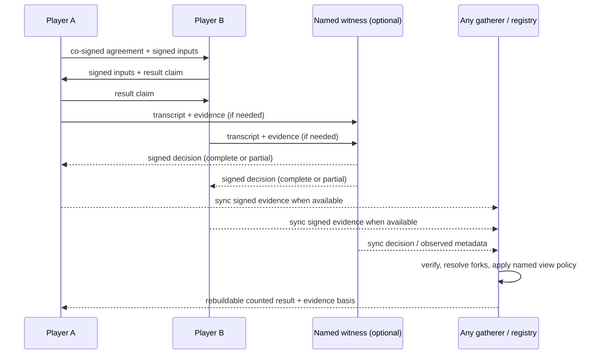

# Design: match attestation + audit v1

- Date: 2026-11-01
- Status: **design** — no production match-attestation or audit feature is specified as already built; implementation is phased in §8.
- Issue: [#2039 — id: design: match attestation + audit v1](https://github.com/developing-today/code/issues/2039), parent epic [#2056](https://github.com/developing-today/code/issues/2056).
- Inputs: [#2037 match-result attestation investigation](2026-10-30T19-20-40Z_investigation_match_result_attestation/2026-10-30T19-20-40Z_investigation_match_result_attestation.md) and [#2038 match-audit investigation](2026-10-29T10-54-33Z_investigation_match_audit_netcode_replay/2026-10-29T10-54-33Z_investigation_match_audit_netcode_replay.md). The review-corrected investigation documents take precedence over their initial issue-comment summaries; PR #2252 merged 2026-10-30. Where the attestation note retains an earlier claim that frontiers establish receipt time, this design follows its later correction at §4, lines 197–215.

## Decision to make

Choose a v1 protocol that lets players agree or dispute a match result, permits a witness and independent replay audit to contribute evidence, and lets a tracker count results without a central live-game server. Specify which signed objects mean what, how evidence is verified, and how a result reaches a tracker while preserving offline play.

**Recommendation:** make the signed event graph the record, not a game server. Both players commit to match identity and rules before play; player-attributed signed input records feed a deterministic, hash-chained transcript; result claims, witness decisions, objections and audit reports are separately signed objects. A tracker is a rebuildable, policy-bearing counting view over synced evidence. It may be hosted by Drew, a tournament, or any gatherer, but it does not run or authorize the match. Keep concession, witness judgment and audit findings distinct: an audit may inform a registry's resolution policy, but it must not silently erase an objection or convert a partial replay into a confirmed result.

This design depends on player-signed move capture, which is **not** in the current live world path. Do not present the existing host journal or the attestation PoC as that prerequisite (§2, §8).

## Context and current state

The issue asks for “attestation flows, witness protocol, audit interface, and how results land in central tracking without central live servers” ([#2039 body](https://github.com/developing-today/code/issues/2039)). Its two inputs are delivered: the attestation investigation identifies the signed agreement/claim/witness model and offline constraints; the audit investigation contributes transcript, replay, metadata and verdict requirements. Earlier queue comments on #2039 that said #2038 was still gated are stale: #2037's correction says #2038/PR #2252 was the last input, and the corrected documents are now present.

### Evidence from `pkgs/id` at this checkout

- **There is a signed-event substrate, not signed live moves.** `chain.rs` describes signed per-author sequences/backlinks and strict signature decoding ([`chain.rs:4–16`](../pkgs/id/src/chain.rs#L4-L16)). By contrast, `WorldEvent` has a host sequence, server-assigned participant ID and payload, with no player signature field ([`world/mod.rs:306–354`](../pkgs/id/src/world/mod.rs#L306-L354)); the live input handler persists `JournalEntry::Committed` and broadcasts it without signing via `chain.rs` ([`world/actor.rs:1132–1171`](../pkgs/id/src/world/actor.rs#L1132-L1171)). The investigation identified player-signed move capture as missing prerequisite #2814 ([attestation investigation:55–67](2026-10-30T19-20-40Z_investigation_match_result_attestation/2026-10-30T19-20-40Z_investigation_match_result_attestation.md#L55-L67)).
- **A narrow attestation PoC exists, not production attestation.** Its module labels itself PoC-only and says no production API is built on it without review ([`attestation.rs:1–24`](../pkgs/id/src/attestation.rs#L1-L24)). It models dual-signed genesis and claims, and only `Proposed`, `Agreed` and `Disputed` states ([`attestation.rs:53–69`](../pkgs/id/src/attestation.rs#L53-L69), [`136–146`](../pkgs/id/src/attestation.rs#L136-L146)); its witness field is unused and objections are absent. The reducer compares agreement, outcome and final-state hash ([`attestation.rs:207–260`](../pkgs/id/src/attestation.rs#L207-L260)). Its tests use hard-coded claims rather than signed moves/replay ([`tests/attestation_poc.rs:48–101`](../pkgs/id/tests/attestation_poc.rs#L48-L101)). Treat it as a shape experiment, not the production contract.
- **Fixture replay is a useful seam, not a full audit.** Fixtures record host-sequenced events and replay under a supplied seed ([`world_fixture.rs:1–9,42–91`](../pkgs/id/src/world_fixture.rs#L1-L9)); the verifier compares replayed records, and explicitly limits its proof to the recorded fixture ([`world_fixture.rs:407–441`](../pkgs/id/src/world_fixture.rs#L407-L441)). It does not prove player authorship, complete live capture or fair play.
- **Existing sync and tracking are not the proposed result registry.** `/id-range-sync/1` synchronizes the event store ([`event_sync.rs:1–20`](../pkgs/id/src/event_sync.rs#L1-L20)), not the world journal. World records are host-written read-only projections and a cache of journal-derived state ([`world_records.rs:1–18`](../pkgs/id/src/world_records.rs#L1-L18)); they are not a multi-author attestation/counting view. The event-store resolver excludes a forked author's events from its fork point and expressly does not propagate that exclusion to another author's events ([`event_store/resolve.rs:1–16`](../pkgs/id/src/event_store/resolve.rs#L1-L16)).
- **Counting must remain separate from storage validity.** The newer writer-set view design states “stored ≠ counted”, makes counting per-view and reversible, and requires a computed view to name its config, writer-set version, frontier and resolution ([writer-set design:30–45](2026-10-30T13-15-00Z_design_id_writer_set_view_projection/2026-10-30T13-15-00Z_design_id_writer_set_view_projection.md#L30-L45)). This match design applies that boundary: signatures establish authorship/integrity, while a registry chooses what evidence counts.

### Source precedence applied

The review-corrected #2037 and #2038 documents supersede their initial findings where they conflict. In particular, do not repeat the original claim that world matches already have player-signed move chains: the corrected #2037 note documents the host-journal gap (§2 above). Do not use a self-authored chain frontier as proof of when an author first received a decision: #2037's later correction explains the omission attack and leaves the honest choices as a receipt mechanism or an outer-cap policy ([attestation investigation:197–215](2026-10-30T19-20-40Z_investigation_match_result_attestation/2026-10-30T19-20-40Z_investigation_match_result_attestation.md#L197-L215)). On audit, use the detailed pipeline's distinction—L1 integrity, L2 replay, L3 plausibility—not the initial TL;DR's conflated “authentic + replay-valid” label ([audit investigation:360–424](2026-10-29T10-54-33Z_investigation_match_audit_netcode_replay/2026-10-29T10-54-33Z_investigation_match_audit_netcode_replay.md#L360-L424)).

## Options considered

| Option | What it does | Advantages | Costs / why not the recommendation |
|---|---|---|---|
| **A. Mutual concession only** | Use the existing PoC shape: two signed claims agree on outcome and state hash; no witness/audit lifecycle. | Smallest protocol; useful for casual games and offline sync. | A player can refuse to concede; claims do not prove that the outcome follows from moves. It does not meet the issue's witness and audit requirements. The PoC does not execute/sign moves or replay a game ([`tests/attestation_poc.rs:48–101`](../pkgs/id/tests/attestation_poc.rs#L48-L101)). |
| **B. Witness is the authority** | A preselected witness decides; a registry accepts its verdict as final. | Simple dispute path; replay can check a witness that runs the pinned logic. | Requires trust in the witness; conflates witness decision and technical audit; does not handle a wrong/colluding witness or partial evidence honestly. The #2037 investigation instead requires signed decisions and an objection/audit path ([attestation investigation:163–184,216–219](2026-10-30T19-20-40Z_investigation_match_result_attestation/2026-10-30T19-20-40Z_investigation_match_result_attestation.md#L163-L184)). |
| **C. Signed evidence graph + explicit counting view (recommended)** | Players sign a pre-play agreement and inputs; claims, witness decisions, objections and audit reports are independent signed evidence. A registry/gatherer materializes a view over synced objects. | Offline-first; independently verifiable; witness-shopping is prevented; audit scope is explicit; registry policy remains visible and reversible; no live central game server. | Needs player-signed input capture, replay determinism, more object types and explicit finality/registry policy. Evidence can be unavailable or partial; the design must say so rather than overclaim. |
| **D. Central authoritative match server** | Server receives moves, determines the outcome and writes the record. | Straightforward live timing, receipt and finality; simple operational UX. | Contradicts the no-central-live-server requirement, fails fully offline play, and makes the server a single authority/trust boundary. Not a v1 option. |

## Recommended protocol

### 1. Before play: shared agreement and evidence contract

Both players sign the same **match agreement** before the first input. It pins:

- match ID; player signing keys and seat/role mapping;
- game/program build hash, rules/config hash, transcript format version and replay-runtime policy;
- RNG algorithm/version and seed commitment (seed reveal is bound by the signed footer);
- named witness and fallback (or an explicit no-witness mode), permitted submission evidence, and any non-submission/adverse-inference clause;
- objection policy and any receipt issuer; and
- stakes/screening profile and metadata privacy-key identifier, if L3 screening is enabled.

The agreement is ex ante: neither side may appoint a witness after a dispute. The agreement's rules hash binds any setting that changes interpretation of a match. One named witness is the v1 default; quorum is a later template variant. This follows the investigation's pre-commitment requirement ([attestation investigation:75–83,163–180](2026-10-30T19-20-40Z_investigation_match_result_attestation/2026-10-30T19-20-40Z_investigation_match_result_attestation.md#L75-L83)).

### 2. During and after play: signed transcript and claims

The transcript has a signed pre-play header; player-attributed, tick-indexed inputs; hash-chained blocks; ordered checkpoints/snapshots; and a signed footer with final state, result claim and seed reveal. Checkpoints are compared as an ascending prefix scan: a mismatch identifies the first mismatching checkpoint **interval**, not an exact tick. The detailed format and its sizing basis are in the audit input ([audit investigation:85–170,144–166](2026-10-29T10-54-33Z_investigation_match_audit_netcode_replay/2026-10-29T10-54-33Z_investigation_match_audit_netcode_replay.md#L85-L170)).

Each player then publishes a signed **result claim** referencing the agreement and transcript/evidence hashes, outcome, final-state hash and relevant frontiers. Matching claims are a mutual concession: no third “concession” object is required. A single claim is proposed, not agreed. Conflicting claims are disputed; they do not disappear because a witness later issues a decision.

**Hard prerequisite:** the live world host's `participant_id` is not an author identity or signature. The implementation must capture each player's input as a player-signed chained event and integrate it with the event store before a transcript can claim authenticated player moves. This is the documented #2814 prerequisite, not something this design treats as already implemented ([attestation investigation:55–67](2026-10-30T19-20-40Z_investigation_match_result_attestation/2026-10-30T19-20-40Z_investigation_match_result_attestation.md#L55-L67)).

### 3. Witness protocol

The genesis-named witness issues a signed **witness decision** containing the match/agreement hash, pinned logic hash, outcome, evidence references, and completeness:

- `complete`: both players' claims/logs were received and the witness replayed them; or
- `partial`: identifies exactly what arrived, what is missing, the agreement clause and deadline permitting a decision, and the witness's signed non-receipt statement.

Partial is a procedural decision based on missing evidence, **not** full replay proof. It may not be represented as a complete audit or inherit full-history guarantees. If neither player objects under the agreed policy, the result can become `witnessed-unopposed`; a conflicting claim or a valid objection remains `disputed` until an explicitly authorized resolution policy acts. A witness cannot bind registries that do not accept that witness/logic profile. This preserves #2037's “valid as long as neither player objects” requirement without making witness judgment equivalent to audit ([#2037 issue](https://github.com/developing-today/code/issues/2037), [attestation investigation:89–109,151,216–219](2026-10-30T19-20-40Z_investigation_match_result_attestation/2026-10-30T19-20-40Z_investigation_match_result_attestation.md#L89-L109)).

### 4. Objections, receipt evidence and finality

An objection is a signed append-only object naming the claim or decision and giving grounds. Its only automatic effect is `disputed`; it does not edit prior objects. A chain frontier proves causal inclusion of objects its author chose to include, **not first receipt**. Do not use it to enforce “object within N hours of first seeing the decision.”

**V1 recommendation:** define any enforceable objection window against an independent, countersigned receipt/closure record named by the agreement (for example, a gatherer that records when it served the decision and a player's acknowledgement). Make the outer cap and its clock source part of the agreement. If no independent receipt/closure evidence exists, display the decision as `witnessed-unopposed / finality unproven`; do not claim a globally final result based only on self-authored frontiers or timestamps. A tracker may choose to count that state under its own policy, but must expose the policy. This costs a receipt issuer for enforceable windows, while allowing the actual match and later sync to remain serverless. The correction and its alternatives are documented at [attestation investigation:197–215](2026-10-30T19-20-40Z_investigation_match_result_attestation/2026-10-30T19-20-40Z_investigation_match_result_attestation.md#L197-L215).

“Final” is never equivalent to immutable evidence: a later fork proof may invalidate a referenced chain. Reducers must recompute validity over all evidence dependencies, including foreign-authored claims/decisions that reference a now-forked move chain. The event-store fork resolver does not propagate a fork to other authors' events ([`resolve.rs:1–16`](../pkgs/id/src/event_store/resolve.rs#L1-L16)); #2037 explicitly assigns this dependency check to the attestation layer ([attestation investigation:127–140](2026-10-30T19-20-40Z_investigation_match_result_attestation/2026-10-30T19-20-40Z_investigation_match_result_attestation.md#L127-L140)).

### 5. Audit interface and verdict vocabulary

An **audit report** is a signed object, separate from the witness decision. It binds the report author/role, match and agreement IDs, exact transcript and evidence hashes, pinned program/rules/runtime, audit-tool version, scope, verdict, checkpoint intervals, metadata references and flags. The auditor reports evidence; it does not award prizes, ban players or change registry policy ([audit investigation:408–424](2026-10-29T10-54-33Z_investigation_match_audit_netcode_replay/2026-10-29T10-54-33Z_investigation_match_audit_netcode_replay.md#L408-L424)).

Keep the audit layers distinct:

1. **L0 — parse/provenance:** supported format and match/program/rules identity.
2. **L1 — integrity:** signatures, hash chain, pre-play header, footer and bindings. Failure is `INVALID RECORD`.
3. **L2 — deterministic replay:** full-history replay may say `RESULT CONFIRMED — full-history`; a divergence says `REPLAY DIVERGES — checkpoint interval [a,b]`; sampled intervals say `PARTIALLY VERIFIED — intervals [...]`, never result-confirmed; missing inputs or runtime limitations say `INCONCLUSIVE — <reason>`.
4. **L3 — plausibility:** observed metadata and statistical flags say `FLAGGED — <flags>` or `NO FLAGS at depth <d>`, with the L2 basis carried through. This is probabilistic screening, not proof of fair human play or guilt.

The corrected pipeline explicitly requires audit basis and sampled interval lists to survive both the L3 report and attestation handoff ([audit investigation:360–424](2026-10-29T10-54-33Z_investigation_match_audit_netcode_replay/2026-10-29T10-54-33Z_investigation_match_audit_netcode_replay.md#L360-L424)). Offline play may still have L1/L2 evidence; absent an observer, L3 is `INCONCLUSIVE — no observed metadata` ([audit investigation:442–447](2026-10-29T10-54-33Z_investigation_match_audit_netcode_replay/2026-10-29T10-54-33Z_investigation_match_audit_netcode_replay.md#L442-L447)).

**Resolution boundary:** an audit report does not automatically supersede a witness decision. A registry can explicitly accept a qualifying full-history audit as an `audit-resolved` basis, but it records that as a distinct basis and keeps the witness decision and objection in the graph. A partial audit can inform review but cannot confirm the result. This separates the original #2037 no-objection rule from the follow-up investigation's suggested audit remedy for objections ([attestation investigation:151,216–219,276–282](2026-10-30T19-20-40Z_investigation_match_result_attestation/2026-10-30T19-20-40Z_investigation_match_result_attestation.md#L151-L161)).

### 6. Observed metadata and privacy

Self-reported latency/path/IP is context, not evidence. For L3, the observing peer, relay or witness countersigns connection path, relevant event-delivery/input-arrival timing, and other collected metadata. RTT alone is not a one-way delivery bound; without independent one-way timing, that reaction-time signal is `INCONCLUSIVE`. Tick-quantized input cannot establish frame-perfect timing; without separately observed sub-tick timing, that signal is also `INCONCLUSIVE` ([audit investigation:269–303,313–341](2026-10-29T10-54-33Z_investigation_match_audit_netcode_replay/2026-10-29T10-54-33Z_investigation_match_audit_netcode_replay.md#L269-L303)).

Keep raw IP in auditor-encrypted metadata. Public continuity identifiers are season-scoped HMAC pseudonyms under a secret auditor key; plain salted hashes are vulnerable to IPv4 enumeration. Pin the metadata/key profile in the agreement and make key custody/rotation explicit. Do not require L3 metadata for an offline match; label its absence honestly. These are corrected #2038 recommendations, not the initial salted-hash proposal ([audit investigation:290–303](2026-10-29T10-54-33Z_investigation_match_audit_netcode_replay/2026-10-29T10-54-33Z_investigation_match_audit_netcode_replay.md#L290-L303)).

### 7. Tracking without central live servers

The match record is the set of signed objects and referenced transcript artifacts. Players exchange directly or sync later; any peer/gatherer that has the same evidence can verify it. A **match registry** is a projection that subscribes to or periodically syncs those objects, validates them, and publishes results with provenance. It is not the authority that accepted inputs or ran the match. There may be multiple registries with different policies; no global count is implied.

Each registry result must identify its view/config version, accepted writer/witness/auditor set, evidence frontier, fork resolution, required audit basis and result policy. This follows the newer writer-set design's explicit view-input contract ([writer-set design:38–45](2026-10-30T13-15-00Z_design_id_writer_set_view_projection/2026-10-30T13-15-00Z_design_id_writer_set_view_projection.md#L38-L45)). A tracker may count `conceded`, `witnessed-unopposed` or `audit-resolved` differently; it must not rewrite the underlying objects or imply that a stored result is counted. The current host-only `world_records` projection is not reused as the protocol or authority ([`world_records.rs:1–18`](../pkgs/id/src/world_records.rs#L1-L18)).

## Invariants

1. **No central live authority:** the game can be played and its objects created offline; a gatherer is optional for play, though some policy decisions (notably independently proven receipt time) require an observer.
2. **Precommit before inputs:** both players sign the same agreement, rules/program identity and witness policy before play; no post-loss witness substitution.
3. **Player-authored evidence:** a host sequence or server-assigned participant ID is never represented as a player signature.
4. **Signed and append-only:** claims, decisions, objections, receipts and audit reports reference immutable IDs; correction is a new object, not mutation.
5. **Evidence closure:** all dependencies are revalidated against forks; a foreign-authored object does not rescue evidence that references voided player history.
6. **Honest scope:** full replay, sampled replay, partial witness evidence and missing observer data have different explicit labels; no partial result is promoted to full confirmation.
7. **Separate judgment:** witness decision, audit verdict, objection state and registry counting policy remain distinct.
8. **Stored is not counted:** each tracker names its view policy and inputs; no global authoritative ranking is inferred from event storage.
9. **Determinism is demonstrated, not assumed:** replay claims require fixed/log-driven time, pinned rules/runtime, versioned RNG and an explicit floating-point policy; do not promise cross-platform equivalence until tested ([audit investigation:212–258](2026-10-29T10-54-33Z_investigation_match_audit_netcode_replay/2026-10-29T10-54-33Z_investigation_match_audit_netcode_replay.md#L212-L258)).

## Acceptance criteria for implementation

- A match cannot enter an auditable state unless both player keys signed the same agreement before any input, and each included move is attributable to a player-signed event.
- The agreement pins program/rules identity, transcript version, RNG/seed commitment and witness/fallback policy; tampering or a mismatched header fails L1.
- A clean full-history replay reproduces each checkpoint and final state; a divergence returns its first mismatching checkpoint interval; replay does not claim an exact tick without per-tick commitments.
- Sampled replay preserves the exact checked-interval list in its audit object and registry handoff and never produces `RESULT CONFIRMED` by itself.
- Two matching player claims produce a concession state; one claim remains proposed; conflicting claims remain disputed unless a separately specified resolution is accepted by the registry.
- A witness decision is signed by the pre-named witness. Complete and partial evidence are distinguishable; partial decisions require the agreement clause, deadline and signed non-receipt basis.
- An objection creates a disputed state. A self-authored frontier alone cannot prove first receipt or close a short objection window. Where receipt/closure proof is absent, the system does not claim protocol-level finality.
- Injecting a fork proof at/before any referenced evidence frontier causes the dependent attestation/audit result to become invalid/void, even if the dependent claim or decision was authored by another player.
- L3 never infers a one-way delivery bound from RTT alone; it reports missing one-way timing or sub-tick observation as inconclusive. Raw IP is not public; public IP continuity uses season-scoped keyed pseudonyms.
- A registry can sync the same signed objects from more than one source and rebuild the same view for the same named config/frontier/resolution. Different view policies may count differently without mutating evidence.
- An offline match can produce concession evidence and later sync it without any central live server; absent independent observation, L3 remains inconclusive rather than blocking L1/L2.

## Open decisions for Drew

These do not block the design record. The implementation must use the recommended defaults below until Drew chooses otherwise.

1. **Objection-window proof and finality.** Options: (a) add a named, countersigning receipt/closure issuer and use it to enforce the agreed short window plus outer cap; (b) accept that without such receipts a result stays `witnessed-unopposed / finality unproven` and let each registry decide whether to count it; (c) trust self-authored frontiers/timestamps. **Recommendation: (a) for registries that need enforceable finality, (b) for offline/no-observer matches; reject (c).** Which receipt burden is acceptable for the first tracker?
2. **What an audit can resolve.** Options: (a) full-history replay accepted by a registry may create a separately labeled `audit-resolved` counting basis; (b) audit remains evidence only and every objection needs a human/registry decision; (c) any witness objection automatically becomes resolved by audit. **Recommendation: (a), explicitly configured by each registry; never auto-convert a disputed state, and never let sampled replay confirm a result.**
3. **Replay portability.** Options: (a) require cross-architecture deterministic floating-point behavior before competitive claims; (b) scope v1 validity to a pinned runtime/build and test that scope first. **Recommendation: (b) for v1, with the limitation in every verdict; later broaden only after cross-architecture checkpoint tests pass.**
4. **Metadata custody.** Options: (a) designated auditor/witness controls season-scoped HMAC and decryption keys; (b) a shared registry key; (c) omit IP-based continuity in v1. **Recommendation: (a), with ciphertext and key-profile identifiers in the evidence contract; choose a concrete role and rotation/retention policy before enabling IP capture.**
5. **Witness availability.** Options: (a) one pre-named witness with pre-named fallback and no quorum in v1; (b) 2-of-3 witnesses from the start; (c) no witness, concession only. **Recommendation: (a), with fallback delay pinned before play; reserve quorum for a higher-stakes template.**

## Phased implementation plan

Each phase should be a separately reviewable/mergeable change with its own tests. The sequence is a dependency order, not authorization to build before the design review required by epic #2056. Existing #2814 is the signed-input prerequisite; the #2037 investigation also names PoC #2248. Do not create implementation issues in this design change; split them after this design receives its review.

| Phase | Scope and dependency | Merge gate |
|---|---|---|
| **1. Determinism proof** | Test a recorded existing example against replay, driven by log/clock rather than sleeping; pin RNG/runtime inputs and document the v1 float scope. Can proceed independently of the match protocol. | Repeatable checkpoint hashes on the declared runtime; cross-architecture results recorded as either pass or explicitly unsupported. Blocks any `RESULT CONFIRMED` claim. |
| **2. Player-signed input capture** | Complete prerequisite #2814: bind authenticated player keys to game inputs, persist/sync them as signed chained events, and define behavior for host/system events. Keep the existing host journal as journal, not as proof of player signature. | Tests show player identity/signature survives persistence and sync, and fork evidence invalidates that player's later inputs. |
| **3. Transcript v1 + L0/L1/L2 verifier** | Define canonical header/blocks/checkpoints/footer; export one turn-based example; verify signatures, chain, seed commitment/reveal, pinned build and full-history replay. Depends on phases 1–2. | Tampered header/block/footer rejected; reproducible clean replay; interval divergence reported; incomplete/sampled logs cannot confirm a result. |
| **4. Attestation reducer v1** | Freeze agreement, claim, witness-decision, objection and audit-report object schemas; implement claim/concession/dispute states and evidence-dependency/fork recomputation. Reuse PoC only where compatible; no production migration implied. | Table-driven reducer tests cover missing/duplicate claims, disagreement, witness issue, objection, fork-at-frontier and foreign-authored references. |
| **5. Witness and receipt flow** | Named witness, complete/partial decisions, signed non-receipt evidence, fallback rules and the selected receipt/closure mechanism. Depends on the shared agreement and evidence schemas from phase 4. | No witness-shopping; partial evidence cannot be mislabeled complete; self-frontier alone cannot establish receipt time; offline behavior is explicit. |
| **6. Audit object + registry handoff** | Sign audit reports with full/sampled basis and interval list; connect full replay to the attestation evidence graph without automatically overriding an objection. Depends on phases 3–4; witness UI/runtime may proceed separately after phase 4. | Report signatures and exact evidence hashes verify; sampled results stay partial through handoff; only a configured registry accepts `audit-resolved`. |
| **7. Rebuildable match tracking view** | Implement a sync-fed projection that names view config, accepted writers/witnesses/auditors, frontier, resolution and counting policy. It can be hosted centrally but has no authority over live play. | Two replicas produce the same view from the same evidence/config; differing policies are visible and do not mutate signed objects. |
| **8. Observed metadata / L3 (optional profile)** | Add countersigned observation, sealed metadata, HMAC pseudonyms, key rotation and stake profiles. This may follow v1's L1/L2 path; it is not a prerequisite for honest offline concession/audit labels. | RTT-only and tick-only inputs yield the documented inconclusive signals; raw IP remains sealed; L3 always retains L2 basis and disclaims proof of fairness. |

## Non-goals

- A central live match server, global authority, or mandatory online service.
- A claim that a signature proves the game was fair, that humans played it, or that a player cheated.
- Automatic prize, ban, ranking or currency consequences from a witness or audit report.
- Treating `WorldEvent` host sequencing, world-records projection, or the existing fixture verifier as player-signed match evidence.
- Requiring observed metadata for offline play or publishing raw IP addresses.
- Turning the existing attestation PoC into a production feature without the epic's review round.
