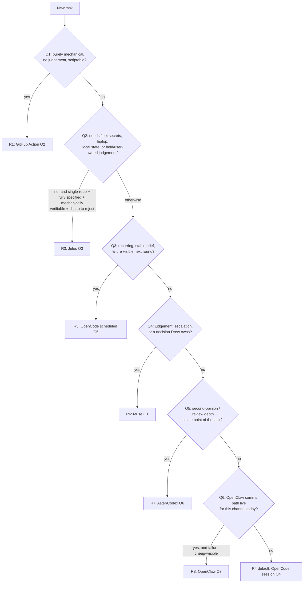

# Design: task-placement framework v1 — decision rules and a shared-pool efficiency model

- **Issue:** #2024 (LIST 5 synthesis, epic #2055)
- **Queue task:** task 8136 (repo-health-code-pilot), lane code-j
- **Status:** v1 for orchestrator review. Per the program pattern, #2024 stays
  open for the review round; this doc is the reviewable artifact, not the
  endpoint.
- **Inputs (all verified fresh 2026-11-03 before writing):**
  - #2022 — placement comparison matrix, comment
    https://github.com/developing-today/code/issues/2022#issuecomment-6494235903
    (seven options, cost pools, Drew's three pointed questions)
  - #2019 — OpenCode scheduled tasks investigation, comment
    https://github.com/developing-today/code/issues/2019#issuecomment-6494101941
    (no native scheduler; OS timer + `opencode run` pattern, worked example)
  - #2020 — Jules scheduled tasks investigation, result comment
    2026-10-29T11:14Z on
    https://github.com/developing-today/code/issues/2020
    (fit matrix, ~100 actions/day Pro account math, registry requirement)
  - #2023 — OpenClaw comms-path design, delivered by merged PR #2303:
    `doc/2026-10-29T12-09-49Z_design_openclaw_comms_path/` (Slack primary,
    direct gateway API phase 2; follow-ups #2300/#2301/#2302, channels #1029)
  - Standing pool rules: the POOL MAP (Drew 2026-10-25, with the
    2026-10-27/29/30 quota rulings), summarised in §3.1 — where this doc and
    the pool map ever disagree, the pool map wins and this doc is the defect.

## 0. The framework in one paragraph

Placement is a two-step decision: **first pick the execution option** from
the decision table in §2 (a one-minute, ordered-question procedure), **then
pick the pool/route** inside that option using the shared-pool model in §3
(burn soonest-expiring capacity first, respect the measurement gate, count
supervision as a cost). Work that fits neither step uses the exceptions
process in §4 — an exception is a recorded, expiring decision, never a
habit. §5 lists every buildable item this design creates, each already
filed or already tracked.

## 1. The seven options (from #2022, unchanged)

| #   | Option                                           | Cost pool                                                             | Supervision owner                                                  |
| --- | ------------------------------------------------ | --------------------------------------------------------------------- | ------------------------------------------------------------------ |
| O1  | **Muse** (Muse cron agent / worker shift)        | Muse subscription tokens — the scarcest pool                          | Self (it is the supervisor class)                                  |
| O2  | **GitHub Action**                                | Actions minutes; no model pool unless the workflow calls one          | Nobody in-loop; failures must be noticed                           |
| O3  | **GitHub Action → Jules**                        | Jules account quota (~100 actions/day, Pro) + trivial Actions minutes | Muse manages schedule, reviews output after the fact               |
| O4  | **OpenCode session** (dispatcher/Muse-triggered) | Shared quota plans by route (see §3.1)                                | Dispatcher + babysitter rounds + Muse review                       |
| O5  | **OpenCode scheduled task**                      | Same quota plans as O4; **zero Muse tokens**                          | Weakest in-loop; needs its own reporting path + babysitter (#2021) |
| O6  | **Aster / Codex**                                | The large ChatGPT plan — **shared with O4/O5 OpenAI routes and O7**   | Drew/Muse via Slack; no fleet telemetry                            |
| O7  | **OpenClaw**                                     | Shares the ChatGPT plan and other plans with OpenCode                 | Least instrumented; comms path is the #2023 design                 |

## 2. Decision table — apply in order, stop at the first matching rule

A dispatcher (human or agent) answers Q1–Q7 in order. The first **yes**
decides. Target: under one minute per task.

| Rule               | Condition (first match wins)                                                                                                                                                                                | Place on                                                                                                                                            | Never use this rule when                                                                                                                                                                         |
| ------------------ | ----------------------------------------------------------------------------------------------------------------------------------------------------------------------------------------------------------- | --------------------------------------------------------------------------------------------------------------------------------------------------- | ------------------------------------------------------------------------------------------------------------------------------------------------------------------------------------------------ |
| **R1**             | The work is deterministic and scriptable end-to-end (format checks, censuses, registry refreshes, quota probes)                                                                                             | **O2 GitHub Action**                                                                                                                                | The script needs a model call or a judgement call mid-run; or a `GITHUB_TOKEN` push must trigger downstream checks (the #2014 finding from #2022)                                                |
| **R2**             | _(guard, applies before all rules below)_ The work needs fleet secrets, Bitwarden/Supabase keys, the laptop, the sandbox, Tailscale, or local services — or touches `held` / `user/owned` / escalated items | **Never O3/O7**; continue to Q3 with O3 and O7 excluded                                                                                             | — (this is a hard exclusion, from #2020's never-fit rows)                                                                                                                                        |
| **R3**             | Single-repo, recurring or one-off, fully self-contained, mechanically verifiable, cheap to reject (Actions version bumps, dependency updates in mainstream stacks, lint/dead-code sweeps, docs-drift fixes) | **O3 Jules** (scheduled for the recurring slice, ad-hoc otherwise)                                                                                  | The task is a cross-repo propagation set (Jules is single-repo); verification needs fleet Nix builds; anyone would need to answer a question mid-task (#2020 one-line rule)                      |
| **R4** _(default)_ | Implementation work: coding, investigation-with-tools, PR-shaped delivery, needing fleet context but not Drew's judgement                                                                                   | **O4 OpenCode session** via the dispatcher                                                                                                          | A fresher rule above already matched; or every route pool for the required tier is at a **known** 100% (see §3.2 — then rotate tier or stop, never fall back to PAYG)                            |
| **R5**             | Recurring work with a stable, fully self-contained brief, a single route, and failure that is visible next round                                                                                            | **O5 OpenCode scheduled task** (OS timer + `opencode run`, per #2019; no native scheduler exists — upstream anomalyco/opencode#41906 is still open) | Judgement is needed at trigger time, cross-session coordination is required, or guaranteed escalation is required — a timer fires and forgets; stall detection stays with the babysitter (#2021) |
| **R6**             | The task _is_ judgement: triage verdicts, placement decisions, synthesis, escalation handling, anything whose output is a decision someone acts on                                                          | **O1 Muse**                                                                                                                                         | The task is volume implementation wearing a judgement costume — that is R4; every O1 placement taxes every other Muse task (#2022)                                                               |
| **R7**             | The deliverable is review depth or a second opinion (design critique, diff review at flagship depth)                                                                                                        | **O6 Aster / Codex**                                                                                                                                | Fleet telemetry or queue claim/bind discipline is required — O6 has neither; remember O6 burn is O4/O7 ChatGPT capacity gone (§3.1)                                                              |
| **R8**             | The #2023 comms path is live for the channel in question (Slack leg first), the work is conversational/lightweight, and its failure is cheap and visible                                                    | **O7 OpenClaw**                                                                                                                                     | Channels are inert for that path (the #1029 state at #2022's writing), the work must not disappear into an unmonitored channel, or it needs queue discipline O7 does not have                    |

**Tie-breakers.** (a) If two rules match, the earlier rule wins — the order
above is deliberate: cheapest sufficient, most supervised first.
(b) If a task matches R3/R5 on shape but its brief is not yet stable,
place it once via R4/R6 to stabilise the brief, then move the recurrence.
(c) Synthesis and ramification-heavy design work is R6-shaped even when a
session could draft it — #2024's own issue text assigns synthesis to the
Specialist/Summit grade, and the review loop is Muse's.

## 3. The shared-pool efficiency model

### 3.1 Pool inventory (the facts the model runs on)

| Pool                                                          | What draws on it                                     | Notes                                                                                                                                                                                                                                                                                   |
| ------------------------------------------------------------- | ---------------------------------------------------- | --------------------------------------------------------------------------------------------------------------------------------------------------------------------------------------------------------------------------------------------------------------------------------------- |
| Muse subscription (Power)                                     | O1 only                                              | **Not a shared pool and not a session route** — the assistant's own plan; sessions never draw on it. Scarcest resource in the fleet; spend it on judgement (R6)                                                                                                                         |
| Meta pool — Muse API High Usage plan                          | O4/O5 Claude routes                                  | **One** pool, **one door**: the OpenCode `meta` provider. The OpenCode `muse` provider is a second door into the same pool and is disabled by Drew's order; the `muse` terminal program reaches the same plan via OAuth. Never describe any route as drawing on "the Muse subscription" |
| ChatGPT plan (large)                                          | O4/O5 OpenAI routes, **O6 Aster/Codex, O7 OpenClaw** | The most contended pool: three options share it, and only O4/O5 contention is visible to the dispatcher. O6/O7 burn must be treated as OpenCode capacity spent                                                                                                                          |
| OpenCode Go / ClinePass / Open Design and similar plan routes | O4/O5 workhorse & specialist tiers                   | Workhorse default: **DeepSeek Flash on high**. Claude routes default Haiku/Sonnet (Opus low/medium; high only for very complex design). OpenAI routes default **Luna Max** (Sol medium only for genuinely complicated work). Astra is gated                                             |
| Jules account (~100 actions/day, Pro)                         | O3 (and Action→Jules triggers)                       | Shared across scheduled runs, ad-hoc sessions, Suggested Tasks (off until the pilot proves out, per #2020), and CI-Fixer retries on Jules' own PRs. Fleet governance cap from #2020: scheduled runs ≤ ~5/day                                                                            |
| GitHub Actions minutes                                        | O2, O3 triggers                                      | No model pool; the cost is minutes and silence risk (R1's caveat)                                                                                                                                                                                                                       |
| DeepSeek direct (api.deepseek.com)                            | **Nothing routinely**                                | PAYG reserve for when every plan is walled. **Never funds:** a 402/quota error is a wall, never a balance fallback                                                                                                                                                                      |

### 3.2 Burn order and gates

- **B1 — Soonest-expiring first.** Among routes that can do the task at
  the required tier, burn the pool whose reset is soonest. Pools are to be
  used all the way to 100% (Drew 2026-10-27): capacity that resets unused
  is capacity destroyed.
- **B2 — OpenAI is the final reserve.** The ChatGPT plan burns last among
  plan routes, because it is the sole door for O6-class review depth and
  is shared with O7.
- **B3 — A pool at a known 100% is CLOSED** until its reset time or until
  a fresh read shows it dropped below 100% (providers sometimes reset
  early). No placements, no continued calls on a closed pool.
- **B4 — Unknown is not closed.** A failed or stale quota read never
  idles a pool and never stops dispatch (Drew 2026-10-30): dispatch
  proceeds on the last known state and the read is retried. B3 applies
  only to a read that actually returned 100%.
- **B5 — Measurement gate.** No placement, switch, or dispatch decision
  without a quota read ≤ 60 minutes old **for that pool** — when a read
  is obtainable (B4 covers when it is not). Burns longer than ~1h
  re-check hourly and at every failover. O5 schedules cannot apply this
  gate at fire time (the schedule was written earlier) — that is a real
  cost of R5, priced into its supervision row below.
- **B6 — One retry, then rotate or stop.** At most one retry on the same
  pool after a quota error; then rotate to the next pool in burn order;
  when every plan is walled, the session **stops** and reports — it never
  reaches for PAYG (the direct DeepSeek reserve is Drew's call, not a
  fallback a session takes on its own).

### 3.3 Supervision cost — the second price of every placement

Pool burn is only half the cost. Every option also charges a
**supervision tax**, paid mostly in Muse tokens or Drew's attention:

| Option                | Supervision tax                                                                                                                                                                           | Paid by                                  |
| --------------------- | ----------------------------------------------------------------------------------------------------------------------------------------------------------------------------------------- | ---------------------------------------- |
| O1 Muse               | ~0 (self-supervising) — but the _whole task cost_ lands on the scarcest pool                                                                                                              | Muse pool                                |
| O2 Action             | Near 0 until it fails silently; then diagnosis at full price                                                                                                                              | Muse / Drew, deferred                    |
| O3 Jules              | Schedule management (web-UI CRUD — API schedule CRUD is not established, #2020) + PR review of every output; never auto-merge until a schedule has a multi-week clean record              | Muse (review), Drew (sign-in challenges) |
| O4 OpenCode session   | Dispatcher (15m cadence) + babysitter rounds (a stalled session waits ≤ ~20m, #2018 evidence via #2022) + Muse review of the PR                                                           | Muse tokens, continuously                |
| O5 OpenCode scheduled | No launch cost, but **no stall detection at all** — the babysitter function (#2021 design) or a reduced-cadence Muse pass must be budgeted, or failures surface only when a human notices | Muse tokens, reduced but non-zero        |
| O6 Aster/Codex        | Tasking and result collection happen in Slack by hand; no telemetry, no claim discipline                                                                                                  | Drew / Muse attention                    |
| O7 OpenClaw           | Highest uncertainty tax today: least instrumented, comms path still landing (#2023 follow-ups)                                                                                            | Drew / Muse attention                    |

**The model's one equation:** total placement cost =
_pool burn (priced by scarcity and expiry, §3.2)_ + _supervision tax
(this table)_. R5 beats R4 on the first term (no Muse trigger cost) and
loses on the second (weaker supervision); R3 beats both on fleet tokens
entirely and loses on review attention per PR — which is why #2020's
pilot criterion is reviewer minutes per PR (< 10), not correctness alone.
A placement that looks free because its pool is idle is expensive if its
supervision tax lands on the scarcest pool.

**Worked example.** The weekly Actions version-bump sweep: as O1 it
would cost scarce-pool tokens every week forever; as O3 (R3) it costs
1 of ~100 daily Jules actions plus ≤ 10 reviewer minutes — the #2265
pilot. The quota probes: as O5 they cost a workhorse-route sliver and no
Muse tokens, and their failure is visible in the next probe round —
R5's textbook fit (#2019 §7). A placement-framework synthesis (this
task): R6 — its output is a decision artifact, its inputs are four
investigations that must be weighed against each other, and its failure
mode (a table that misroutes the fleet for months) is exactly what the
supervision tax exists to catch.

### 3.4 What the model predicts (falsifiable, for the review round)

1. Moving the GO-first recurring classes (#2018's list, via #2019/#2020)
   from O1 to O5/O3 measurably reduces Muse-token spend per week without
   reducing task throughput; if throughput drops, the supervision tax
   was under-priced and R5/R3 conditions tighten in v1.1.
2. ChatGPT-plan contention incidents will correlate with O6 tasking
   volume, not O4 volume — if they instead correlate with O4, B2's
   reserve ordering is wrong and gets revisited.
3. Jules reviewer-minutes per PR stay < 10 on the pilot class; above
   that, R3's "cheap to reject" condition is false in practice and the
   class returns to R4.

## 4. Exceptions process

A task that fits no rule, or fits a rule whose pool is closed, is an
exception — handled explicitly, in this order:

- **E1 — Record it.** Every exception gets a record (issue comment or
  placement record, §5 B1) stating: the task, which rules were tried and
  why each failed, the placement actually chosen, and who chose it.
  An unrecorded exception is a protocol gap.
- **E2 — Nearest rule wins provisionally.** Place by the closest rule's
  option at the lowest sufficient tier, and proceed — an exception is
  not a stop. (B4 applies: a stale read never turns a placement into an
  exception.)
- **E3 — Expiry.** An exception record expires after **one use or 14
  days**, whichever comes first. A recurring exception is not an
  exception any more: it is a missing rule, and the third occurrence of
  the same shape must be filed as a framework-amendment issue against
  this doc instead of re-exceptioned.
- **E4 — Escalate only the genuinely Drew-owned.** Additional accounts
  (a second Jules account is a ToS-shaped decision, #2020), new money
  or PAYG use, sole-door pool conflicts with no alternative route, and
  any placement onto a `held`/`user/owned` item. These escalate with
  the full substance in the message (what, options, ramifications,
  recommendation) — never as a bare label.
- **E5 — Review.** Exceptions are read in the framework's review round
  (with the orchestrator's review of #2024, then in the placement audit
  proposed in B1). Each reviewed exception ends as: rule amended,
  exception renewed deliberately, or placement class retired.

## 5. Buildable items — every one filed or already tracked

| #   | Item                                                                                                                                                                                     | Status                                                                                                                   |
| --- | ---------------------------------------------------------------------------------------------------------------------------------------------------------------------------------------- | ------------------------------------------------------------------------------------------------------------------------ |
| B1  | Machine-readable decision table + **placement record** on fleet dispatches (option, rule, pool-read age, supervision owner); PoC on one dispatch path, reviewed before permanent rollout | **Filed as #4986**                                                                                                       |
| B2  | Unified fleet schedule registry across all three schedule surfaces (Muse cron, OpenCode timers, Jules)                                                                                   | **Filed as #4988**                                                                                                       |
| B3  | OpenCode scheduled-task pattern implementation (systemd timers + `opencode run`, per-job route, job registry, log surface)                                                               | Already tracked: **#2232**                                                                                               |
| B4  | First Jules schedule pilot (weekly Actions version-bump sweep)                                                                                                                           | Already tracked: **#2265** (closed — outcome feeds prediction 3 in §3.4 at review)                                       |
| B5  | Scheduled OpenCode preliminary babysitter (the supervision O5 lacks)                                                                                                                     | Already tracked: **#2021** (design)                                                                                      |
| B6  | OpenClaw comms path build-out (Slack leg first; gateway auth, tailnet route, session inventory)                                                                                          | Already tracked: **#1029**, **#2300**, **#2301**, **#2302**, channel-shape decision **#2170**                            |
| B7  | Quota-plane measured placement (pools consume quota-current; automated pool decisions)                                                                                                   | Already tracked: **#1157**, epic **#1149** — B1 builds the cross-option decision layer above this, not a duplicate of it |

**PoC decision.** This design calls for exactly one PoC: the placement
record on a single dispatch path, inside B1, **after** this framework is
reviewed — building it before review would put a permanent-feature
foundation under an unreviewed design, which the program rule forbids.
No PoC is built by this document task itself, and no permanent feature
is built here.

## 6. Risks and open questions for the review round

- **O6/O7 invisibility.** Aster/OpenClaw burn on the ChatGPT plan is not
  visible to the dispatcher; B1's record only covers fleet-dispatched
  work. Until it does, B2's ordering (OpenAI last) is the only guard.
- **Jules facts move.** Jules is a `v1alpha`-API Google Labs product
  (#2020's caveat): tiers and schedule behaviour must be re-verified at
  B4-style implementation time and quarterly while any Jules schedule
  lives (registry review, B2).
- **O5's stale-brief risk compounds with B5's gate blindness.** A
  scheduled task written last week fires into this week's pool state;
  if the #2021 babysitter lands without a fresh-read step, R5's
  conditions should gain one.
- **Machine pool growth (#2179)** will add a placement dimension (which
  machine, not just which option) that v1 deliberately does not model;
  it belongs in v1.1 once #2179's shape is known.

## 7. Acceptance self-check (against #2024 / task 8136)

- [x] Decision table a dispatcher can apply in under a minute: §2,
      ordered Q1–Q7 / R1–R8 with a flowchart.
- [x] Every placement option in #2022's matrix appears: O1–O7, §1 + §2.
- [x] Shared-pool efficiency model — burn order, expiry, supervision
      cost: §3 (B1–B6, §3.3 equation).
- [x] Exceptions process: §4 (E1–E5).
- [x] Follow-up issues for every buildable item: §5 — #4986 and #4988
      filed by this task; the rest already tracked and cited.
- [x] PoC only where the design calls for one: §5 — one PoC, inside
      B1, gated on this review; none built here.
- [x] Every input artifact cited: header (inputs), #2022/#2019/#2020/
      #2023 + PR #2303.
- [x] Issue stays open for the orchestrator review round: this doc's PR
      references #2024 and does not close it.
