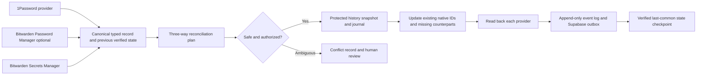
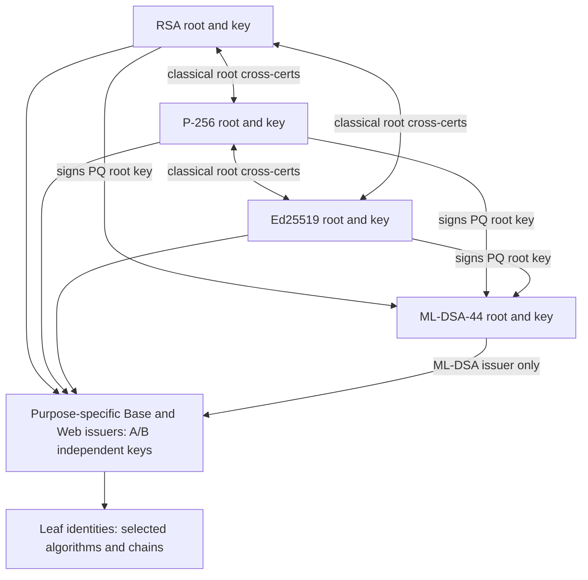

# Fleet: Unified Credential, Secrets, Generation, and PKI System

**Comprehensive design specification — working draft v0.3 (all three inputs reconciled; provider research integrated)**  
**Date:** 2026-11-06  
**Status:** PROPOSED / NOT IMPLEMENTED. All three user input sets, including the architectural perspective, have been reconciled. Additional research covers 1Password/BWS/BW, SOPS/age, OpenBao, fnox, SecureStore, Cloudflare and Cozystack. No live stores, code, deployments or production credentials were modified by drafting this document.  
**Target:** [`developing-today/code`](https://github.com/developing-today/code), principally `pkgs/fleet/`.  
**Audience:** implementing agents, maintainers, future users, reviewers, and automation clients.  
**Document priority:** A design baseline and acceptance contract; not an instruction to overwrite newer repo decisions blindly.

> **Primary assignment.** Extend the existing Rust `fleet` multicall tool into a coherent, secure, high-performance, extensible system for secrets, cryptographic key/certificate/credential generation, issuance, rotation, **daily bidirectional OP/BW/BWS reconciliation**, history and audit, synchronization, packaging, publishing, consumption, and agent integration. Implement the comprehensive PKI and credential functionality in the first two input sets and the integrated third architectural perspective, with v0.3 research decisions and requirements. Preserve the existing fleet contract and integrations; don't create an unrelated second tool. The implementer may refine architecture, commands and defaults, but must meet every numbered minimum capability or document a demonstrably safer/better equivalent with tests. Do not silently drop complex or implied requirements.

## Revision 0.3 — changes that govern the entire document

This revision incorporates **all three user inputs**. The critical secrets/generation input remains normative in §§19–28; the architectural perspective and current researched provider/infrastructure decisions are integrated as §§33–49. Earlier chapters retain valuable original coverage. Where passages differ, use the **conflict-resolution table in §33.2**, the current PKI decision ledger in §24, the existing full synchronization model in §§19–21, and the additional v0.3 provider policy in §§34–43. The standalone research dossier is supporting evidence, not an alternate specification.

**Major changes:** direct intermediate cross-signing supported and required for the reference A/B issuer sets; A and B are independent per-algorithm keys; exact special expiry dates 2050-07-07T12:00:00Z and 2032-07-07T12:00:00Z; explicit root signer source always required for issuance; RSA-2048 requested but gated for long-lived CA use; 1Password↔Bitwarden lossless mapped sync and preservation of existing IDs; tombstones and history; append-only event journal and Supabase schema; strong passwords/IDs, SSH, iroh, multi-output and an expanded roadmap through SPIFFE, SSO, passkeys, OCapN and Fleet `id` integration.

**Document navigation:** §§0–2 objectives/repo state; §§3–7 PKI/CLI baseline; §8 secrets base; §§9–18 engineering/tests/docs; §§19–21 credential model, sync and audit; §§22–23 generators, SSH and iroh; §24 PKI A/B direct cross-signs; §§25–28 command/API/roadmap/acceptance; §29 documentation and agent skills; §30 historical v0.2 decision ledger; §31 atomic second-input requirements; §32 original source research; **§33 third-input conflict resolution; §§34–38 secrets architecture, typed providers, sync, availability and permissions; §§39–43 SOPS/OpenBao/Cloudflare/other tools/CLI; §§44–45 trust and infrastructure; §46 issue-ready research; §47 attachment traceability; §48 new acceptance gates; §49 sources**. Appendix A retains first-input atomic requirements. All input sets retain their requirements until resolved by an ADR and test evidence.

**Status disclaimer:** This is a design specification and handoff package, not working code. The reference commands are proposed syntax. No secret-store inventory, cleanup, sync, systemd timer, real CA keys, website issuance, DNS publication or SSH remote modification has been executed.

### v0.3 research summary and new decision precedence

- **Secrets:** retain authorized 1Password + Bitwarden Secrets Manager now; explicitly separate Bitwarden Password Manager's later vault sweep, add SOPS/age for deployment and offline continuity, and evaluate OpenBao/fnox rather than prematurely building a Cloudflare vault. See §§33–43 and the research dossier.
- **Backend distinctions:** 1Password human items, BWS machine secrets, `bw` password-vault items, SOPS/age encrypted declarations, and OpenBao leased credentials have different data/authorization capabilities. Build typed provider descriptors and never claim global bidirectional mirroring across inaccessible vaults.
- **PKI:** preserve four independent root keys, asymmetric root cross graph and v0.2 reference **A/B direct intermediate cross-signing** (20 CA key pairs, 65 CA cert variants). Allow `roots-only` for later issuer sets, keep PQ-only enforcement on the verifier.
- **Architecture:** library-first with declarative manifests, optional offline signers, fast path, versioned schemas, restricted NixOS/Cozy/Cloudflare research; preserve the existing Fleet multicall and its size-limited variants.
- **Sources:** third input `Pasted text(1).txt` and provider documentation as of 2026-11-06. No live vault access, sync, key generation, or deployment was performed.

## 0. How to use and extend this document

1. Read **all** of this document, the now-supplied third architectural-perspective input, the supporting research dossier, and current code/governing architecture documents before coding.
2. Verify live repository behavior; distinguish observed behavior from original roadmap and proposals. Adopt the repo's established conventions unless a documented reason requires deviation.
3. Produce a repo-grounded implementation plan, decision log, threat model, traceability matrix, test matrix, and migration strategy.
4. Build libraries first, then CLI frontends and adapters, then self-generated reference bundles and their documentation **using fleet itself**.
5. Treat **MUST** as acceptance requirements; **SHOULD** as default expectations requiring justification to diverge; **FUTURE** as explicit backlog with dependency and difficulty assessments, not necessarily part of the first release.
6. Keep edits and generated output out of the public repository if they contain secrets. No code, keys, credentials or production CA should be generated or committed merely because the public repo was inspected.
7. Whenever an assumption could change security or compatibility, perform research and tests rather than silently assuming.
8. Treat the reconciliation in §§33 and 47 as a starting audit. Recheck the three user inputs against live repo state at the feature/acceptance-criterion level; record deviations in ADRs without silently dropping requirements.

### 0.1 Input coverage map

This draft expands the provided requirements for: root and intermediate architecture; algorithm interoperability; purpose-specific issuers; default naming, dates, and profiles; leaf/SAN/wildcard issuance; AIA/CDP/OCSP and publication; multiple encodings and credential families; bundle formats; CLI discoverability; secrets provider synchronization; automation/library ergonomics; long-term replacement; high performance; documentation; agent skills; integration, tests, deployment and future evolution. The critical second input was integrated into normative §§19–28, including full sync, event schema, generators, SSH/iroh, revised CA cross-signing, operating runbooks and future research. The now-supplied third input and provider research are integrated in §§33–49 with source and conflict traceability.

### 0.2 Important vocabulary

- **Root set / root bundle:** one logical managed bundle comprising **four independent root key identities** and four self-signed root certificates plus classical/PQ cross-certificates and metadata. It is **not** one shared private key, a single X.509 certificate, or necessarily one physical archive or secret-store item.
- **Issuer set:** one logical named bundle for one purpose (e.g. `Base`, `Internal Web`, `Public Web`), with a configurable set of per-algorithm intermediate keys and certificates; policy, metadata and published artifacts belong to the set.
- **Algorithm:** canonical registry ID such as `rsa-4096`, `p256`, `ed25519`, `ml-dsa-44`, with aliases and explicitly versioned implementations.
- **Cross-certificate:** a second certificate for an existing CA subject public key, signed by a different CA. It does not share a private key across algorithms.
- **Trust anchor:** a key/certificate intentionally trusted by a verifier. A cross-certificate or an intermediate is normally an *untrusted path-building candidate*, never automatically a new trust anchor.
- **Credential family:** X.509/PKIX, SSH certificates/keys, OpenPGP, JWK/JWKS/JWT, and other systems with distinct semantics. Formats are **not** interchangeable.
- **Generation:** a sequence of replacement identities or certificate epochs (`g1`, `g2`, ...); **partition:** parallel shard/instance (`a`, `b`, ...). Thus `g4b` means generation 4, partition b. Bundle GUID and certificate fingerprints remain the canonical machine identifiers.
- **Private material:** private keys, seed values, HSM credentials, exportable encrypted PKCS#12, access tokens, and other information that requires secret handling.

## 1. Existing fleet: verified baseline and integration obligations

The public repository `developing-today/code` exists. As inspected on 2026-11-05:

- `pkgs/fleet/README.md` documents a Rust multicall binary, registry, config, queue, proxy, dispatch, search, secrets domains, and multiple built variants. See [workspace README](https://github.com/developing-today/code/blob/main/pkgs/fleet/README.md).
- `pkgs/fleet/Cargo.toml` contains an independent Rust workspace, split into `fleet-registry`, `fleet-config`, `fleet-secrets`, `fleet-proxy-proto`, `fleet-queue`, `fleet-dispatch`, `fleet-proxy`, `fleet-search`, and `fleet`. See [workspace manifest](https://github.com/developing-today/code/blob/main/pkgs/fleet/Cargo.toml).
- `fleet-registry` owns the capability list, CLI domain metadata and name-based invocation profiles. Distinguish **compiled**, **invocation-profile**, and **config-enabled** capability sets. Unavailable features have defined exit/status behavior rather than disappearing from help. See [registry](https://github.com/developing-today/code/blob/main/pkgs/fleet/crates/fleet-registry/src/lib.rs).
- `fleet secrets` currently implements `get` and `list` in the binary. `get` resolves broker-first then falls back to Bitwarden Secrets Manager (`bws`); `list` enumerates broker names. It does **not** yet provide the requested `put`, sync, transactions, 1Password integration, or generic secret-object storage. See [secrets command](https://github.com/developing-today/code/blob/main/pkgs/fleet/crates/fleet/src/secrets.rs).
- `fleet-secrets` enforces name-only resolution, hides secret values in errors/debug output, avoids storing secret values, and treats unexpectedly empty resolved values as failure. Preserve or strengthen these invariants. See [secrets platform](https://github.com/developing-today/code/blob/main/pkgs/fleet/crates/fleet-secrets/src/lib.rs).
- An existing [fleet multicall design record](https://github.com/developing-today/code/blob/main/doc/2026-11-04T11-45-48Z_design_fleet_multicall_binary/2026-11-04T11-45-48Z_design_fleet_multicall_binary.md) documents the motivations, profiles, proxy contracts, migration approach, and design constraints. Read the full record before expanding its domain registry or binary variants.

**Integration requirements:** Add `cert`/`pki`, `generate`, extended `secrets`, `skills`, and related capabilities to the *existing* registry, feature matrix, help, config, crates, packaging and smoke tests. Do not break `fleet-connect`'s size budget or change unrelated RPC/wire protocols. The cryptographic generation engine is permitted in the full build and/or an explicitly named featureful variant; avoid dragging OpenSSL or PQ providers into the tiny proxy binary. Preserve the current small-build contract and version/capability introspection. Do not conflate `fleet`'s existing `secrets-broker` network service with a new certificate authority server without explicit design.

**Follow-up repository census (required):** enumerate every pre-existing CLI, domain, alias, feature flag, secret namespace, config key, docs entry, planned-but-unimplemented feature, HSM/storage adapter and automation caller. Confirm Nix packaging, pinned toolchain, concurrency and deployments. Verify source against a pinned commit before implementation. This draft is *not* evidence that all future subsystems exist.

## 2. Product vision and operating modes

A new user, a returning human years later, and an autonomous agent should all be able to create a carefully profiled root set, add an issuer set, issue a leaf, sync securely, publish correct issuer/CRL artifacts, and retrieve an import-ready package with minimal knowledge. Expert operators must retain full control. Production code must be importable as Rust crates and usable with in-memory providers, databases and message streams without subprocesses or temporary files.

### 2.1 Must-work scenarios

1. **Interactive:** `fleet cert root create` creates an appropriately named default root set with safe preflight, root storage policy, immutable manifest, certificate artifacts, instructions, and cross-signs.
2. **Inheritance:** `fleet cert issuer create --root <reference>` inherits org/subject/publishing profile and creates `Base` (or another name) with one command. `--purpose web --name "Public Web"` intelligently restricts usage and derives naming.
3. **Unattended:** all operations work via an explicit config + strict noninteractive flags, files/archives, batch plans, JSON/YAML stdin/stdout, structured result/exit codes, idempotency keys and no interactive prompt surprises.
4. **Library:** one high-level Rust API achieves the same functionality with paths, byte buffers, secret refs, key handles, and stream interfaces; fine-grained APIs support custom pipelines (NATS→DB+Redis, without disk).
5. **Transport:** local directory, compressed bundle, secret store references, default inventory lookup, explicit archives and safe untrusted input are supported uniformly through one resolver.
6. **Fast path:** issue a leaf without invoking a heavyweight packaging pipeline; avoid filesystem writes and network sync unless selected.
7. **Futurity:** regenerate the same structural shape in 20 years, use new algorithms, rotate keys, add partitions, migrate stores, and preserve old trust paths when authorized.
8. **Human handoff:** standard bundles carry their own README, import examples, manifests, provenance, integrity hashes, DNS/publish changes and caveats.
9. **End-to-end proof:** validate cross-algorithm chain construction, revocation, store resolution, output artifacts and representative consumers; no unverified claim of universal AIA/client compatibility.

### 2.2 Profiles (not a profusion of independent flag interpretations)

- `default-org`: `O=developing.today LLC`, `C=US`; optional OU/site/unit. Use canonical Unicode subject strings carefully; derive deterministic ASCII-safe slugs separately.
- `root-default`: four independent algorithms, PKI profiles and cross-sign graph; 20 calendar years in general, special reference expiration 2050-07-07T12:00:00Z, explicit authorized signer; requested RSA-2048 compatibility variant requires security review for long-lived root (§24).
- `base`: general-purpose issuer set for broad internal use, with A/B independent per-algorithm keys in the reference run, risk warnings and narrower leaf profiles. Avoid unrestricted high-value production issuance by accident.
- `internal-web`: website/serverAuth-specific issuer set with A/B independent per-algorithm keys in the reference run, optional DNS name constraints; issuer validity and name override explicit.
- `public-web`: same web-specific certificate mechanics but distinct naming/publication and distribution policy. Do **not** imply a publicly trusted CA: private roots do not become publicly trusted because a domain is public.
- `pq-enforced`: ML-DSA root only and strict all-ML-DSA signature-path verification for applicable X.509 use.
- `compatibility`: all classical paths plus opt-in ML-DSA certificate validation when supported.
- `minimal`: just requested artifacts/metadata, without installation kits and extensive docs.
- `handoff`: extensive import-ready package and human-facing instructions.

Profiles inherit defaults **organization → root set → issuer set → leaf**, with explicit override layers. Provide `fleet cert explain --effective-config ...` to display the resolved configuration and its provenance, without secrets.

## 3. Cryptographic and trust architecture — acceptance contract

### 3.1 Root set: four independent key identities

| ID | Default key | Private key | Self-signed cert | Role |
|---|---|---:|---:|---|
| `rsa-4096` | RSA 4096, RSA/SHA-256 or stronger validated compatible scheme | 1 | 1 | Classical compatibility |
| `p256` | ECDSA P-256 | 1 | 1 | Classical compatibility |
| `ed25519` | Ed25519 | 1 | 1 | Preferred classical performance |
| `ml-dsa-44` | FIPS 204 ML-DSA-44 | 1 | 1 | Post-quantum signature hierarchy |

Do not confuse ML-DSA-44 with the non-byte-compatible pre-standard Dilithium2 scheme. ML-DSA-44 is NIST security category 2, not an RSA or Ed25519 variant. Use the standardized X.509 algorithm identifiers and key encodings in RFC 9881.

### 3.2 Asymmetric root-level cross-sign graph

**Rows are signing roots; columns are root CA public keys being certified.**

| Signing root ↓ / certified root key → | RSA | P-256 | Ed25519 | ML-DSA-44 |
|---|---|---|---|---|
| RSA | Self | Cross | Cross | Cross |
| P-256 | Cross | Self | Cross | Cross |
| Ed25519 | Cross | Cross | Self | Cross |
| ML-DSA-44 | **No** | **No** | **No** | Self |

Inventory: 4 distinct root private keys, 4 self-signed certificates, 6 classical↔classical cross-certificates, 3 classical→ML-DSA cross-certificates = **13 root-level certificates**. Create all root cross-certs with appropriately selected CA certificate extensions and private key protection. No ML-DSA root certificate shall certify a classical root key by default. The cross certificates are alternative chain objects, not trusted roots by themselves.

**Graph rationale:** Any classical root can potentially anchor chains to another classical root, and a classical root can potentially anchor an ML-DSA CA chain for a client that supports its signatures. A PQ-enforced verifier trusts *only* the ML-DSA root and requires ML-DSA signatures throughout the certification path; therefore the classical cross certificates cannot authorize classical roots to that verifier. This separation is a **verifier policy**, not a property of certificate issuance alone. A device that trusts all four unrestricted roots has compatibility, not guaranteed PQ authentication assurance. No cross-sign pattern can grant an unimplemented signature algorithm to a client.

**Compromise model:** A quantum-capable attacker breaking RSA/P-256/Ed25519 could forge paths anchored to affected classical trust anchors; they do not recover the real ML-DSA intermediate key merely because its root key has a classical cross-certificate. The all-ML-DSA path remains distinct on clients with an ML-DSA-only trust policy. Classical↔classical cross-signing deliberately couples their effective trust scope; call this out in threat modeling. Do not misrepresent short-lived Ed25519 certs as post-quantum secure.

### 3.3 Purpose-specific issuer sets: revised partitioned and cross-signable design

Under **v0.2**, the reference `Base` and `Internal Web` sets each contain **A and B independent keys for each of four enabled algorithms**. For maximum opportunistic client interoperability, the reference run generates **directly cross-signed intermediate certificate variants** under all eligible root signers, in addition to root-level cross-signs. This is a policy-controlled graph (`--cross-signing both`) and may be reduced to `roots-only` for future issuer sets when measured client compatibility and operational simplicity justify it. See §24.2 for the exact permitted signatures, updated **20 CA key pairs / 65 CA certificate** reference inventory, and CRL requirements. The ML-DSA root still does not sign classical intermediate keys by default.

Each intermediate CA certificate should have `basicConstraints: CA=true`, `keyUsage: keyCertSign,cRLSign`, distinct issuer+serial, SKI/AKI, correct signed validity, and normally `pathLenConstraint:0` when it issues leaves only. Base and Web are sibling issuer sets signed by authorized root signers, not Web subordinate to Base unless explicitly modeled. Web OU may describe usage, but OU and intermediate EKU are not universally enforced authorization boundaries. Use `serverAuth` on Web leaves; profile-specific name constraints and testable relying-party authorization are required where feasible. Distinguish partition A/B key identity, generation and active leaf signer selection from alternate certificates of the **same key**.

### 3.4 Leaf identity and protocol interoperability

- Generate an independently keyed leaf for each **selected key algorithm**. One X.509 certificate has one subject public key and one issuer signature; bundling three PEMs is not one multi-signed certificate.
- A server may present RSA, P-256 and Ed25519 certificate identities for the *same* SANs, selecting according to client/implementation capability. ML-DSA TLS leaf support requires an explicitly tested provider/stack and is not universal.
- Cross-root trust and TLS signature negotiation are distinct concerns. If two peers truly lack each other's signature implementation, only providing a different chain does not establish a connection.
- Issue purpose-appropriate EKU/keyUsage/SAN, key strength and validity. CN is not a substitute for DNS SAN. No wildcard on a bare registrable suffix; verify IDNA/public suffix and DNS wildcard constraints.
- **Cryptographic separation:** the classical and PQ signing keys are never the same private key. Classical→PQ *root cross-certificate* shares the **same ML-DSA root public key** as the self-signed PQ root; that is intentional and does not expose the PQ private key.
- For SSH, OpenPGP, JWT, etc., create their genuinely native credential objects rather than claiming X.509 conversion; profile eligibility and trust distribution are separate.

### 3.5 Trust-store install bundles

- `roots-all.pem`: the four **self-signed** root certs; compatible but **not inherently PQ-secure**.
- `roots-classical.pem`: the three self-signed classical roots.
- `roots-pq.pem`: **ML-DSA root only**, accompanied by explicit all-ML-DSA path validation requirements.
- `cross-certs.pem`: nine untrusted root cross-certs, never silently added as trust anchors.
- `intermediates/<purpose>/...`: untrusted path-building candidates, optional preloading.
- Device-specific chain bundles can include the correct intermediate, cross-signed CA certificate, and optionally the relevant trust root for inspection, but normal TLS server chains SHOULD omit the self-signed trust anchor unless a consumer explicitly requires it.

For full-trust devices, install four self-signed roots into the appropriate application/system trust store; extra root cross-certificates are unnecessary for direct chains. For one-root devices, proactively provide a suitable chain and retain AIA as best effort. Do not make global four-root trust imply a PQ security claim.

## 4. PKI URI design, AIA, CDP, OCSP and publication

**v0.2 refinement:** three HTTP mirror endpoints, direct cross-signed issuer candidates, `.internal` private-use scope, additional DNS/CAA/CT/ACME separation and immutable signed publication outputs are specified in §24.7–9. Earlier examples below illustrate minimal paths, not the full revised A/B graph.

### 4.1 Default public HTTP distribution namespace

Provision a configurable public-facing distribution hostname, proposed `pki.developing.today`; examples below do **not** assert it already exists. Use HTTP inside X.509 AIA/CDP for broad compatibility (signed objects authenticate themselves). Optionally offer HTTPS with a separately publicly trusted certificate for management and human downloads, but do not require HTTPS or redirect certificate/CRL retrieval paths to HTTPS. Include HTTP reachability tests and content-type checks.

```
http://pki.developing.today/
  certs/
    roots/<root-slug>/<generation-partition>/root.crt
    cross/<certified-root-slug>/<generation-partition>/<signer-slug>.crt
    cross/<certified-root-slug>/<generation-partition>/issuers.p7c
    issuers/<set-slug>/<algo-slug>/<generation-partition>/ca.crt
    chains/<set-slug>/<algo-slug>/<trusted-root-slug>/<generation-partition>.pem
  crl/
    roots/<root-slug>/<generation-partition>.crl
    issuers/<set-slug>/<algo-slug>/<generation-partition>.crl
  ocsp
```

All issued AIA/CDP URLs MUST be immutable or maintained as durable aliases for the entire life of the containing certificates (plus archival needs). Release/publish atomicity, no broken redirects, correct MIME, no authentication barrier, no HTTP TLS bootstrap dependency, and CDN/cache validation are mandatory. Prefer deterministic immutable object URLs; publish a stable human-readable index separately. Do not repoint an old AIA URL to an unrelated new generation.

### 4.2 AIA construction rule (issuer, not subject)

- **Leaf from RSA Web intermediate:** `caIssuers = .../certs/issuers/internal-web/rsa-4096/g1a/ca.crt` (single DER certificate); optional second URI if deliberately tested. Its CDP is the **RSA Web intermediate's CRL**.
- **RSA Web intermediate issued by RSA root:** `caIssuers` points to issuer candidates for the **RSA root key**, preferably `.../certs/cross/rsa-4096/g1a/issuers.p7c` (certs-only CMS with all legitimate root-certificate variants). Provide individual DER alternatives and an explicit self-signed-root fallback; exact AIA ordering selected by measured client behavior. Its CDP points to **RSA root's CRL**.
- **RSA root cross-certified by P-256:** its AIA, if present, points to the **P-256 root certificate**, not to the RSA cross bundle; its CDP points to the P-256 root CRL.
- **ML-DSA intermediate:** points to ML-DSA root issuer candidates. The ML-DSA root itself is self-signed and usually has no AIA/CDP. PQ-only clients use their locally installed ML-DSA root; classical-anchored ML-DSA chains require the appropriate classical→ML-DSA cross-certificate and ML-DSA verification support.
- AIA may contain multiple access methods/URLs; **client retrieval, alternate-path exploration and certs-only CMS support are optional or incomplete in practice**. Never promise a second URL will be fetched if the first one fails. Verify paths by provisioning appropriate intermediates/cross-certs.

Use RFC 5280 HTTP MIME: `application/pkix-cert` for DER X.509, `application/pkcs7-mime` for certs-only CMS (`.p7c`). `.crt`/`.cer` extension alone does not guarantee DER, so manifest must state encoding. PEM and P7C variants should also be exported for humans.

### 4.3 CRLs and OCSP

- Root CRL covers revoked intermediate and **cross-certificates issued by that root**. Intermediate CRL covers its leaf certificates. Identify CRLs by issuing CA key, CRL number, thisUpdate/nextUpdate, signed bytes, and issuer-specific generation.
- Root CRL continuity is especially important with offline roots. Design an offline signing/republishing procedure, overlap scheduling, authenticated publication, alarm thresholds, and explicit stop-issuance on expired/unavailable CRLs when policy requires them. Do not set impossibly short CRL refresh schedules on inaccessible offline keys.
- Generate **real, empty signed CRLs** immediately when CDP is embedded, plus subsequent renewal/updates; never embed a URL to a nonexistent file and call issuance complete.
- OCSP is **optional** and must not be embedded until a live, signing-authorized responder handles each represented issuer. A single `http://pki.developing.today/ocsp` can front multiple issuer responders if it truly implements issuer routing and signed status. Support GET and POST; do not claim all platforms enforce revocation.
- Provide `fleet cert revoke`, `fleet cert crl build|publish|inspect`, optional `fleet cert ocsp ...` (if implemented), and a credential inventory/ledger capable of finding affected leaves. Define revocation reasons, nonce policy where applicable, status freshness, fail-closed/soft-fail docs, tests and monitoring.
- Consider relative CRL distribution, delta CRLs, and OCSP stapling later, only after verified interoperability.

### 4.4 DNS/publication manifest

Each root/issuer/leaf delivery should include `publish-plan.yaml` (canonical normalized schema), `dns.zone` (BIND RFC 1035-format fragment when DNS changes are needed), optional `dns.nsupdate` (when configured), and `PUBLISH.md` containing exact *relative local source paths* and *target HTTP URLs*, deployment order, cache/revocation caveats, validation commands, rollback guidance, and the fact that publishing is not automatically equivalent to DNS changes.

Example illustrative plan:

```yaml
schema: fleet.pki.publish/v1
host: pki.developing.today
records:
  - type: A
    name: pki.developing.today.
    ttl: 3600
    value: "<OPERATOR_SUPPLIED_IP>"
    action: conditional-create
artifacts:
  - source: public/certs/issuers/internal-web/ed25519/g1a/ca.crt
    url: http://pki.developing.today/certs/issuers/internal-web/ed25519/g1a/ca.crt
    media_type: application/pkix-cert
    visibility: public
prerequisites:
  - "Replace placeholder DNS target; never publish a literal placeholder"
```

Require a configured target IP/CNAME to generate executable DNS records. If DNS is already correct, report `no changes`, not fabricated changes. CAA is a *public CA authorization* DNS concept and does not automatically authorize private-CA issuance. A wildcard DNS name in SAN does not require a literal wildcard DNS record. Generate per-provider DNS adapters in future rather than hand-editing undocumented formats.

## 5. Naming, stable identifiers, serial numbers, generations

### 5.1 Human subjects and defaults

- Root `O=developing.today LLC`, `C=US`; auto-generated unscoped `CN` if no identity supplied (for example a product-scoped placeholder root name with strong unique ID, not an ambiguous empty subject).
- Algorithm-specific root names MUST be distinguishable and stable, e.g. `developing.today Root CA — Ed25519 — G1A` and `... ML-DSA-44 ...`; valid names, Unicode/ASCII compatibility and long-term maintainability matter more than exact punctuation.
- Issuer set `Base`, `Internal Web`, or `Public Web` derives full CN: `<org> <purpose> Issuing CA — <algorithm> — G1A` and descriptive OU from usage and supplied name; user overrides via exact `--subject-cn`, `--ou`, `--organization`, `--country`, etc. Avoid concatenating duplicate words.
- Subject identity and display slug are separate properties. Avoid using OU as a machine-readable security boundary. Keep any custom issuer profile reflected in policy OIDs/extensions, not just CN/OU.

### 5.2 Generation and partition

- Human-readable suffix: `g1a` initial, `g2a` first replacement, `g4b` fourth generation's partition b. Make partitions `a..z`, extensible to `aa` etc. Store `{generation:4, partition:"b"}` as structured fields, not only a string to parse later.
- `renew`: reissue a certificate on the **same key** only when policy explicitly allows key reuse; increment a **certificate revision** (e.g. `r2`) without claiming it rotated the key. `rotate`: new private key and new key generation; increments `gN`. `replace`: high-level orchestration (create, distribute, verify, activate, deprecate) and explicit intent. Default root lifecycle SHOULD favor new root keys on substantive replacement, not perpetual reuse of a 20-year secret.
- `shard/partition` is a parallel operational instance (HSM region, issuer fleet, or failover), not a fresh renewal. Preserve shard and increment generation on rotation; create `g1b` for an independent parallel partition.
- Every key, cert, bundle, transaction and issue event carries UUID/ULID, SHA-256 fingerprint, SKI, AKI, serial, generation/partition, parent IDs and provenance. CA serials must be unique per issuer and high-entropy; enforce monotonic or collision-free issuance ledger, not just filename uniqueness.
- Slugs generated via fixed canonical algorithm: lowercase, Unicode normalize/transliterate or reject per policy, hyphenate safe ASCII, strip reserved punctuation, length-limit, detect collisions, and retain original display text in metadata. Never use untrusted display text directly as a filesystem path, DNS label, or vault key.

### 5.3 Paths and secret identifiers

Support multiple path expressions and round-trip resolve them without ambiguity:

```
./bundles/roots/g1a/
./bundles/roots/g1a.tar.zst
./bundles/issuers/internal-web/g1a.zip
secret://pki/developing-today/roots/g1a
secret://pki/developing-today/issuers/internal-web/g1a
op://<vault>/<item>/<field>          # provider-native reference where valid
bws://<project>/<key-or-id>         # provider-native reference where valid
```

Proposed canonical *logical* secret hierarchy (final punctuation/length/provider mapping decided after connector tests):

```
pki/developing-today/root-set/default/g1a/<algo>/<artifact>
pki/developing-today/issuer-set/base/g1a/<algo>/<artifact>
pki/developing-today/issuer-set/internal-web/g1a/<algo>/<artifact>
pki/developing-today/leaf/<profile>/<identity-slug>/g1a/<algo>/<artifact>
```

Include org, optional OU/namespace, key type, role, purpose, generation, partition and artifact identity. Bitwarden's `bws` secret key and 1Password's vault/item/field addressing are *not identical path models*; provider adapters must map a stable logical key to provider-native objects, maintain inverse lookups, and document provider limits. Canonical display paths may be dotted (`pki.developing-today...`) but provider-specific byte encodings and escaping must be tested. `secret://` is a **fleet-level reference**, not a claim that vendor CLIs accept it directly. An offline root may have a public manifest in the inventory and a private key handle that is intentionally **not present** in either online secret store.

### 5.4 Expiration and time grammar

- Root default lifetime: **20 calendar years**, measured explicitly from issue/start date using Gregorian-year arithmetic; check leap-day behavior and clock skew. The date must serialize to precise RFC3339/UTC (`YYYY-MM-DDTHH:MM:SSZ`) on output.
- Accept `20y`, `15 years 7 days`, `1y`, ISO8601 timestamps such as `2050-07-07T12:00:00Z`, and exact `--not-after` / `--valid-for` flags. Never use an ambiguous month/year-second conversion silently. `--at`/`--not-before` and `--time-zone` are advanced options; serialize canonical UTC.
- Base issuer reference notAfter: **`2032-07-07T12:00:00Z`**, explicitly overriding the normal ~5-year issuer default in the demonstration. This is **07:00 Central Daylight Time in Wisconsin** on July 7, not a fixed year-round offset.
- Internal Web issuer: user's exact `--not-after` remains **TBD** until the second input or an explicit command. Offer an explicit override in examples but do not invent a committed date.
- Base leaf demo lifetime **1 calendar year**; default Web leaf SHOULD be short-lived (proposed **90 days**, configurable). Leaf must not outlive issuer; root/issuer rotation and multi-chain validity intersections must be validated.
- `--renew` by one cert or bundle can inspect exact metadata and infer nearest parent set, intended name and next generation/revision, but the command must report whether it is actually reissuing a certificate or creating new keys. Reconstruct from manifest or validated X.509 with explicit report of missing data; a lone certificate cannot reveal lost private keys, original policy, store destination, or all aliases.

## 6. Proposed CLI: discoverable, composable and stable

**v0.2 command surface and flag semantics are expanded in §25; §6 below retains the original compact PKI ergonomics and examples.** Implement the A/B reference and direct cross-sign matrix from §§24/28 instead of treating older one-partition snippets as exhaustive.

**Canonical interface:** `fleet cert ...` for PKI/X.509 lifecycles, with `fleet pki ...` as an optional documented alias; `fleet secrets ...` for secret lookup/sync; `fleet generate ...` for the broader generation domain; `fleet skills ...` for agent integration. Keep these under the existing multicall registry. All subcommands implement `--help`, `--help --json`/machine schema, `--explain`, `--dry-run`, versioned outputs and precise errors where applicable. Help must be complete even for unavailable capabilities, honoring the existing 69/unavailable convention and existing exit-code contracts.

### 6.1 Suggested full command tree

```
fleet
  version | capabilities | help | doctor | config ... | completion ...
  cert
    root create | inspect | validate | renew | rotate | replace | list | export
    issuer create | inspect | list | renew | rotate | replace | restrict
    leaf issue | inspect | list | renew | rotate
    chain build | select | test | inspect | export | graph
    trust install-plan | export | test | inspect
    key inspect | import | export | rotate | convert-public
    revoke | un-revoke? [RESEARCH; generally do not un-revoke X.509 serials]
    crl build | publish | inspect | verify | status
    ocsp status | serve | verify | provision [ONLY WHEN IMPLEMENTED]
    publish plan | stage | check | commit | rollback | status
    dns plan | render | verify
    bundle inspect | pack | unpack | validate | diff | migrate | repair-index
    format list | describe | export | convert
    profile list | show | validate | scaffold
    algorithms list | describe | benchmark | doctor
    renew [high-level compatibility alias, dispatches to root/issuer/leaf]
    batch plan | validate | apply | resume | status
    inventory list | show | search | audit
    explain | doctor | examples
  secrets
    get | list  # ALREADY EXISTS: preserve exact semantics
    put | update | upsert | inspect | delete | restore | compare | sync
    resolve | locate | search | test | doctor | export | import | migrate
    lock | lease | history | audit | schema | path explain
  generate
    key | random | password | passphrase | token | ssh | pgp | jwk | jwt
    config | id | template | batch | formats | profiles [FULL DESIGN §§22–26]
  skills list | install | update | uninstall | doctor | export
  install skills [alias only if unambiguous]
```

Not every leaf of this tree needs to ship in the first milestone; **core root/issuer/leaf/chain/bundle/CRL/publish and secrets synchronization must be implemented before the full workflow is called done**. For user-friendly aliases accept `fleet cert root` = `root create` only when no ambiguity; `fleet cert issuer create Base --root ...`, `fleet cert leaf web developing.today`, `fleet cert leaf issue --type web --name developing.today`, and `fleet cert leaf issue --web developing.today`, all mapping to one validated request model. Aliases must not generate divergent results or conflicting modes. `--client` indicates an auth profile, not an unsafe alias for issuing any arbitrary certificate.

### 6.2 Reference CLI illustration (full v0.2 A/B execution and acceptance in §28.3)

**Important:** The following syntax is a **proposed target CLI contract**, not commands verified to exist in today's `fleet`. Implement the commands and their acceptance tests first. Run them **using the built fleet binary**, not handmade OpenSSL certificates. Use nonproduction identities/test store credentials in CI. Actual production private-root initialization requires authorized operator policy.

**1 — Generate the one logical root bundle:**

```sh
fleet cert root create \
  --name "developing.today" \
  --organization "developing.today LLC" --country US \
  --not-after 2050-07-07T12:00:00Z \
  --profile root-default \
  --private-store <approved-root-key-location> \
  --output ./bundles/roots \
  --sync policy \
  --report json
```

In an environment with a configured default org/root profile, simply `fleet cert root create` must work without special **identity** arguments, generating an unscoped yet uniquely identified root bundle, but root private-key custody and storage authorization must still be supplied or explicitly pre-approved by the configured root-creation policy. The reference run uses `--not-after 2050-07-07T12:00:00Z` to override the general 20-year default, as required in §24. `--sync policy` means follow explicit private-root policy; where root export is prohibited, sync **public metadata only** and record nonexportable key handles. An intentional private-root upload requires explicit policy and an auditable high-risk acknowledgement. The command emits the canonical `bundle_ref`, manifest path, certificate fingerprints, publication plan and redacted status.

**2 — Generate the Base issuer set with fixed reference expiry:**

```sh
fleet cert issuer create Base \
  --root ./bundles/roots/<resolved-root-bundle> \
  --not-after 2032-07-07T12:00:00Z \
  --purpose base --algorithms default --partitions A,B --cross-signing both \
  --output ./bundles/issuers \
  --sync policy
```

`fleet cert issuer create --root <bundle>` with no name defaults to `Base`. `fleet cert issuer create Standard --root <bundle>` performs the same operation with a different name and properly derived subject, slug, path and OU; it **must not reuse the Base issuer private key** unless explicitly requested in a supported re-certification operation. `fleet cert issuer create Base` **must NOT omit the explicit authorized root source** when actual root signing is required, even if the catalog identifies one default root. The tool may resolve public root metadata automatically, but use of a root signer requires `--root <ref>` or an authorized signer handle as described in §24.3.

**3 — Generate the Internal Web issuer set:**

```sh
fleet cert issuer create "Internal Web" \
  --root ./bundles/roots/<resolved-root-bundle> \
  --purpose web --eku serverAuth --partitions A,B --cross-signing both \
  --permitted-dns developing.today \
  --permitted-dns developing-today.com \
  --default-leaf-dns developing.today --default-leaf-dns developing-today.com \
  --default-leaf-wildcard developing.today --default-leaf-wildcard developing-today.com \
  --not-after 2032-07-07T12:00:00Z \
  --output ./bundles/issuers --sync policy
```

This call overrides the OU and CN to describe the named web purpose. `--permitted-dns` is optional but strongly recommended if these names exhaust the intended issuance namespace; show the resulting name constraints and their validation caveats. The shown issuer expiry is the required reference override. Other issuers use the configured default validity unless an exact `--not-after` or duration is supplied. A `Public Web` issuer is a separate named set with the same profile system. An issuer can optionally carry a **leaf request template** (`--default-leaf-dns`, `--default-leaf-wildcard`, `--default-leaf-purpose`, `--default-leaf-lifetime`) so a future call that passes **only the issuer bundle** can emit the desired web SANs. This template is an issuance convenience, not an X.509 name constraint or permission by itself. If no identity/SAN defaults exist, the tool must ask for or require DNS identities rather than guess. Defaults for algorithm eligibility must be documented and validated; generating ML-DSA certificates is not a promise browsers will accept them.

**4 — Issue one-year general leaf kit from Base:**

```sh
fleet cert leaf issue --issuer ./bundles/issuers/base/<resolved> \
  --name "base-test-identity" --valid-for 1y \
  --algorithms default --delivery handoff \
  --output ./deliveries/base-test-identity
```

An unnamed non-web Base leaf may be generated with an explicit auto-generated identity, annotated `not suitable for hostname verification without SAN`. Issuance from Base should require an explicit intended purpose for production, but its *demonstration* must work with only the issuer reference and `1y`, producing a testing/profile-safe leaf. In particular, `fleet cert leaf issue --issuer <base-bundle> --valid-for 1y` must work without `--name`, using a distinctly marked generated identity. Provide a human and machine warning rather than inventing a privileged use.

**5 — Issue a default Web leaf kit for two domains and wildcards:**

```sh
fleet cert leaf issue --issuer ./bundles/issuers/internal-web/<resolved> \
  --type web --name "developing.today websites" \
  --dns developing.today --dns developing-today.com \
  --wildcard developing.today --wildcard developing-today.com \
  --delivery minimal --output ./deliveries/web
```

Expected DNS SANs: `developing.today`, `*.developing.today`, `developing-today.com`, `*.developing-today.com`, each once; no browser-facing certificate lacks SAN. `--wildcard example.com` by default means **both** the apex and `*.example.com`, unless `--wildcard-only` is provided; support `--dns`, `--ip`, `--uri`, and carefully scoped `--email` SANs, validation and dedupe. `--type web`/`--web` maps to `--purpose web`, not an undocumented issuer alias. The web leaf's default validity is the policy value (proposed 90 days). **If the issuer has the default leaf SAN template set in step 3**, the shorter command `fleet cert leaf issue --issuer <internal-web-bundle>` must produce those same four SANs. For users who ask for `--delivery handoff`, produce the full web-tailored guide.

**6 — Verify and publish:**

```sh
fleet cert bundle validate ./bundles/roots/<resolved> --deep
fleet cert chain test ./deliveries/base-test-identity --matrix --report json
fleet cert chain test ./deliveries/web --matrix --report json
fleet cert publish plan ./bundles/issuers/internal-web/<resolved> --format yaml
fleet cert publish check ./bundles/issuers/internal-web/<resolved> --require-live-aia --require-valid-crl
fleet cert inventory audit --root ./bundles/roots/<resolved> --report json
```

Each CLI command should print a compact redacted result and the next useful command. `--dry-run` and `--plan` show meaningful proposed output, expected generated files, approximate entropy/key creation actions, root signing operations, vault writes and DNS publishing steps without opening secret handles or consuming serials unnecessarily.

### 6.3 Unified flag grammar

#### Common flags

- Scope and profile: `--name`, positional name, `--profile`, `--type`/`--purpose`, `--organization`, `--country`, `--ou`, `--subject-cn`, `--subject-dn`, `--issuer`, `--root`/`--root-bundle`, `--bundle`, `--generation`, `--partition`, `--policy-file`, `--config`, `--from`, `--to`, `--default-leaf-dns`, `--default-leaf-wildcard` and other explicit issuer-level leaf template options.
- Algorithms: `--algorithms rsa-4096,p256,ed25519,ml-dsa-44` (replace profile default); `--add-algorithm x` (union); `--remove-algorithm x` (subtract); `--algorithm x` and `--algos` short alias. Use a normalized enum and canonical order. Accept nonambiguous documented aliases `rsa`, `rsa4096`, `ed`, `ed25519`, `ecc`, `ecdsa`, `ec`, `p256`, `p-256`, `secp256r1`, `ml-dsa`, `mldsa44`, `ml-dsa44`, `dilithium2` **only as a deprecated explanatory alias mapping to standardized ML-DSA-44 with warning**; never silently equate prestandard keys. `dsa` alone is ambiguous and **must be rejected with suggestions**. `rsa2048` may be an explicit legacy opt-in, not a secure default. The stand-alone flags `--rsa`, `--p256`, `--ed25519`, `--ml-dsa-44` can serve as additive shortcuts if unambiguous.
- Date/time: `--not-before`, `--not-after`, `--valid-for`, `--lifetime`, `--time-zone`, `--clock-skew`, `--auto-renew-before` with consistent mutual exclusion and bounds.
- Usage: `--eku`, `--key-usage`, `--purpose web|client|code|email|device|general`, `--permitted-dns`, `--dns`, `--wildcard`, `--wildcard-only`, `--ip`, `--uri`, `--email`, `--path-len`, `--policy-oid`.
- Publication: `--aia-base-url`, `--crl-base-url`, `--ocsp-url`, `--no-ocsp`, `--publish`, `--no-publish`, `--dns-provider`, `--dns-manifest`.
- Output: `--output`, `--output-mode none|files|archive|store|stdout|mixed`, `--archive zip|tar|tar.gz|tar.zst`, `--format`, `--formats`, `--delivery handoff|minimal|public-only|key-only`, `--public-only`, `--include-chains`, `--no-chains`, `--no-docs`, `--emit`, `--output-json`, `--output-yaml`, `--stdout`, `--stderr`, `--stdin`, `--write-mode create|merge|replace`, `--force` (separate from hazardous overrides).
- Secrets: `--sync policy|both|bws|op|none`, `--vault`, `--project`, `--secret-prefix`, `--secret-path`, `--offline-root`, `--no-store`, `--require-store-sync`, `--store-consistency strict|eventual`, `--key-provider software|pkcs11|kms|hsm`, `--key-handle`, `--encrypt-to`, `--passphrase-source`.
- Automation: `--dry-run`, `--plan`, `--yes`, `--non-interactive`, `--idempotency-key`, `--job-id`, `--timeout`, `--retry`, `--parallelism`, `--report json|yaml|text`, `--log-file`, `--log-format jsonl`, `--log-level`, `--quiet`, `--verbose`, `--no-color`, `--explain`, `--strict`.

Ensure `--force` only means overwrite behavior. It MUST NOT imply approval to reveal root keys, weaken key algorithms, disable verification, permit PQ downgrade, overwrite existing CA identity, upload plaintext or create a dangerous trust anchor. Use **separate, descriptive opt-ins** for hazardous behavior (`--allow-root-private-export`, `--acknowledge-root-risk`, `--allow-insecure-algorithm`, etc.). Explicitly reject contradictory flags and show the normalized request.

#### Format and protocol flag parsing

Support canonical `--formats pem,der,p7c` and friendly `--pem --der --p7c` aliases, with a central format registry; per-command help states available/unsupported combinations. `--ssh`, `--pgp`, `--openpgp`, `--jwk`, `--jwt`, `--x5c`, `--sec1`, `--did`, `--jsonld`, `--multikey`, `--ipfs`, `--w3c` must **not** be treated as equivalent conversion flags: some select new credential issuance, some key representations, some signed-token generation, some publication identifiers/metadata. Use a semantic taxonomy and meaningful affordances, e.g. `fleet generate ssh cert`, `fleet generate jwk`, `fleet generate jwt`, `fleet cert format export --format pkcs12`, plus easy aliases that **dispatch to these engines**. A tool should say *unsupported for this algorithm/profile* with an actionable alternative rather than emit misleading fake files.

Prefer explicit `--algorithms` replacement semantics plus `--add-algorithm` union semantics. A single undocumented mix of `--crypto` and booleans MUST NOT silently change which keys are generated. Every alias needs equivalence tests. `--all-formats` means all *supported safe exportable representations for this credential*, not every conceivable unrelated credential family.

### 6.4 Library API parity with CLI

Provide a stable `fleet-pki` facade and composable crates (examples below, naming modifiable after repo review). Rust API should achieve CLI parity without invoking its own CLI, while CLI is a thin wrapper over API. Key operations should accept abstract inputs/outputs and signers:

```rust
// Design-level pseudocode, not existing Rust API.
let root = fleet_pki::RootSetBuilder::new(profile)
    .with_algorithms(algorithms)
    .with_signers(key_provider)
    .create(&mut context).await?;

let issuer = fleet_pki::IssuerSetBuilder::from_parent(root.reference())
    .name("Public Web")
    .purpose(Purpose::TlsServer)
    .build(&mut context).await?;

let leaf = fleet_pki::LeafRequest::web(["developing.today", "developing-today.com"])
    .wildcards(true)
    .valid_for("90d".parse()?)
    .issue(&issuer, &mut context).await?;

let artifacts = fleet_pki::render(&leaf, DeliveryProfile::Handoff, output_sink).await?;
```

The low-level API must allow in-memory certificate/key bytes, typed signer handles, CSR inputs, profile and extension customizers, public-object streams, structured manifests, test clocks and deterministic test entropy (test-only), and user-supplied sinks (files, archives, streaming response, S3, NATS, DB, Redis, secret stores). The high-level API does path resolution, inherited config, policy checks, issuance and optional save/sync, with a clear atomicity/report model.

**Suggested crate boundaries:**

```
fleet-crypto-core   algorithm registry, key objects, signing/provider abstraction
fleet-pki           CA/root/issuer/leaf/chain/CRL/profile and typed request API
fleet-credentials   SSH/OpenPGP/JWK/JWT and protocol-specific issuers
fleet-formats       PEM/DER/CMS/PKCS12/JWK/YAML/archive adapters
fleet-bundles       manifests, versioning, paths, archive and provenance
fleet-secrets       EXTEND existing crate, do not replace it
fleet-store         secret-object provider adapters + sync transaction engine
fleet-publish       HTTP object publishing plans, DNS manifests and checks
fleet-generate      generic generation primitives (integrated specification §22)
fleet-skills        skill templates/install/manifests (integrated specification §29)
fleet               CLI and fleet-registry integration
```

These are **candidate** partitions, not mandatory names; avoid unnecessary crate fragmentation or dependency cycles. `fleet-secrets` should remain the single public resolution interface across domains. Dependency direction should be platform primitives → crypto/PKI → higher-level workflow → CLI. Cryptographic signer interface must work with nonexportable HSM keys, asynchronous signing, FFI providers and no-disk streams.

### 6.5 Noninteractive, scripting and batch language

Accept `--input -` for stdin JSON/YAML and `--output -` for **public** stdout. Provide a schema-versioned structured `fleet cert batch apply -f jobs.yaml` where jobs have IDs, dependencies, input references, expected results, per-step preconditions, idempotency keys, safe failure policy, approvals and rollback/compensation. A dry-run DAG displays root→issuer→leaf→publish dependencies and validates all referenced fields. A `--resume` reuses persisted safe receipts and does not reissue accidentally. Do not permit shell expansion or arbitrary host commands in the batch parser unless separately sandboxed and opted in.

```yaml
schema: fleet.batch/v1
jobs:
  - id: roots
    action: cert.root.create
    args: { name: "developing.today", valid_for: "20y", sync: policy }
  - id: base
    depends_on: [roots]
    action: cert.issuer.create
    args: { root: "${jobs.roots.bundle_ref}", name: Base,
            not_after: "2032-07-07T12:00:00Z" }
  - id: test
    depends_on: [base]
    action: cert.leaf.issue
    args: { issuer: "${jobs.base.bundle_ref}", valid_for: "1y",
            name: "base-test-identity" }
```

Interpolation MUST support a constrained typed-reference syntax, not arbitrary code execution. Machine output is always a typed envelope including `schema_version`, `request_id`, `bundle_ref`, status, generated artifact descriptors, secret-store receipts, warnings and policy decisions, with stdout reserved for structured results and stderr for nonsecret diagnostics. For `--output-mode none`, return typed in-memory objects / structured public metadata; if private data is requested, require a secure explicit destination or an acknowledgement. Avoid writing private keys to world-readable logs, processes' command lines or ambient temp directories. If an implementation must use temporary files, use protected directories/permissions, immediate deletion attempts, loudly report cleanup failure, and **never claim secure erase guarantees on SSD, CoW, snapshot or journaled filesystems**.

## 7. Bundle schema, artifacts, handoff kits and portability

### 7.1 Canonical manifest

Every logical root set, issuer set and leaf delivery has a schema-versioned `manifest.json` (machine canonical) plus optional YAML rendering (human). It must describe:

- `schema`, `bundle_id`, `bundle_type`, `bundle_version`, `created_at`, `organization`, display names, subject DN/OU, `purpose`, `parent_refs`, generation/partition, renewal/revision, organization ID/namespace, source/build revision and policy/algorithm provider versions;
- algorithm set, per-algo `key_id`, storage handle, key exportability, X.509 certificate fingerprint/serial/issuer/SKI/AKI, DER/public artifact hashes, validity times, key usage/EKU/policies/name constraints, AIA/CDP URLs, OCSP status;
- cross-cert relationships, trust paths/chain variants, root fingerprints, public distribution references, CRL signatures/freshness, signed publication records;
- file index with `relative_path`, artifact type, encoding/MIME, visibility (public/private), encryption, checksum and semantic role;
- provider sync receipts and logical secret IDs **without plaintext**, canonical secret key path, configured privilege policy, validation results and status;
- creation engine version, config snapshot excluding secrets, cryptographic provider version, feature/algorithm registry revision and warnings; trace to renewal/rotation predecessor bundle;
- audit-signature/attestation where available; preserve forward/backward schema migrations.

Never derive authoritative state solely from directory names; bundle ID and signed/verified metadata are needed. Consider public/private manifest separation, with a public distributable manifest scrubbed of private store paths or sensitive infrastructure if necessary. Bundle read modes: strict schema verification, legacy inference with warnings, and migration to new schema.

### 7.2 Standard root bundle contents (illustrative)

```
root-set-g1a/
  README.md
  MANIFEST.json
  manifest.yaml
  policy.yaml
  CHANGELOG.md
  NEXT-STEPS.md
  PUBLISH.md
  publish-plan.yaml
  dns.zone
  public/
    roots/{rsa-4096,p256,ed25519,ml-dsa-44}/g1a/{root.crt,root.pem}
    cross/<certified-algo>/g1a/{signed-by-<signer>.crt,issuers.p7c,...}
    bundles/{roots-all.pem,roots-classical.pem,roots-pq.pem,cross-certs.pem}
    crl/roots/<algo>/g1a.crl
    formats/...
  private/           # present ONLY when allowed; otherwise handles/refs only
    keys/<algo>/...  # encrypted, permission-guarded; NEVER public upload
  refs/key-handles.json
  chains/...
  tests/{verification-matrix.json,publication-checks.json}
  checksums.sha256
```

Actual on-disk names must be deterministic, readable and collision-resistant. Only root-appropriate secret keys/handles belong in `private/`; never include raw root secrets in a default distributable zip.

### 7.3 Issuer set contents

```
issuer-set-internal-web-g1a/
  README.md, MANIFEST.json, policy.yaml, NEXT-STEPS.md
  PUBLISH.md, publish-plan.yaml, dns.zone, checksums.sha256
  public/certs/<algo>/ca.crt + ca.pem
  public/crl/<algo>.crl
  public/ca-issuers/<algo>.p7c   # where useful
  public/chains/<algo>/<root-anchor>.pem
  private/key-handles.json      # opaque references by default
  private/keys/...              # encrypted only when permitted
  tests/issuer-matrix.json
```

Provide `README.md` with commands for each expected publish step (`cp <generated relative file> <served absolute path>` or API upload), DNS verification, CRL maintenance, parent root/issuer inventory, EKU/name-constraint caveats and exact expected leaf usage. The same format can be created for a wholly unrelated organization/reason; avoid hard-coded Developing Today identifiers in the engine.

### 7.4 Leaf outputs: complete vs minimal

`--delivery handoff` produces an install-ready directory or authenticated/encrypted archive including:

- `README.md` showing purpose, identities/SANs, expiry, password/secret-handle retrieval instructions, capability limitations and exactly which certificate to install in which application;
- public leaf `.crt` DER and `.pem`, public key SPKI, selected JWK/JWKS, chain PEMs per appropriate trust anchor, server/fullchain PEMs, PKCS#7/P7C (certificates only), PKCS#12/PFX if requested and safely encrypted, fingerprints and manifest; `.cer` aliases only where needed;
- private keys **only in protected/encrypted output when explicitly authorized**; default handoff may instead contain private-key store references and a secure import guide;
- `chains/default.pem`, `chains/for-rsa-root.pem`, `chains/for-p256-root.pem`, `chains/for-ed25519-root.pem`, `chains/for-ml-dsa-root.pem` **when a valid compatible path exists**; do not fabricate universal paths or duplicate chains for all roots when unnecessary;
- `install/linux.md`, `install/windows.md`, `install/macos.md`, `install/java.md`, `install/firefox.md`, `install/chrome.md`, `install/nginx.md`, `install/apache.md`, `install/caddy.md`, `install/ssh.md`, `install/email.md`, `install/kubernetes.md`, and other relevant guides selected by credential family; examples must distinguish *trust-store CA import* from *server identity/key deployment*;
- `PUBLISH.md` and `dns.zone` if public artifacts or DNS changes are required, `verify.sh` and `verify.ps1` containing safe reproducible checks, and `NEXT-STEPS.md` for revocation/renewal;
- a public-only distribution variant and an explicitly encrypted credential package; avoid a default unencrypted archive that is safe to email only by accident.

`--delivery minimal` produces the essential requested file objects and a compact manifest; `--delivery public-only` excludes all private material; `--delivery key-only` outputs specified key representations to authorized destinations only. `--no-chains`, `--no-docs`, `--formats`, `--artifact` and `--only` select subsets without disabling security guards.

**Platform-specific accuracy:** Chrome/Firefox may use system and/or application-specific trust stores depending on OS/policy; Java uses configured JKS/PKCS#12 trust stores; Windows/macOS/Linux have platform-specific admin/enterprise root installation. Do not claim one exact command works on every distribution, Java version or browser. Version and test documented commands. For SSH, `known_hosts` and `ssh_config` snippets are relevant only to actual SSH host keys/certificates and trust anchors, not X.509 TLS certificates. SSH certificates cannot simply be derived from X.509 leaf certificates by changing extension.

### 7.5 Formats and adapters

| Class | Examples | Intended capability |
|---|---|---|
| X.509 objects | DER `.crt`/`.cer`, PEM, CMS certs-only `.p7c`/`.p7b` | Baseline, tested |
| Bundled identity | PKCS#12 `.p12`/`.pfx` | Opt-in encrypted import/export with private key |
| Public key | SPKI DER/PEM, JWK/JWKS, SSH public key when algorithm supported | Encoding/representation; public only |
| Private key | PKCS#8 encrypted PEM/DER, supported native SEC1, OpenSSH private key | Explicit policy/protected destination; no default plaintext |
| TLS deployment | Fullchain PEM, Nginx/Apache/Caddy configs, kube secret templates | Profiles; actual private secret deployment guarded |
| SSH | OpenSSH host/user CA certs, public-key formats, known_hosts/ssh config | **Separate** native SSH CA/signing workflow |
| OpenPGP | OpenPGP certificate/key/subkeys and public export | **Separate** PGP semantics and expiration/trust |
| JWT/JWS/JWK/x5c | Claims/signing, JWK metadata, certificate chain embedding | JWT is a signed assertion, not a cert format |
| DID/W3C/JSON-LD/Multikey/IPFS | Exportable descriptors or publication resolvers | Optional adapters requiring concrete trust/resolver profile |
| Archives/objects | zip, tar, tar.gz, tar.zst, zstd, JSON, YAML, JSONC output | Artifact packaging and structured exchange |
| Future | KDL, CBOR, JOSE/COSE, CSV metadata, OCI artifact, S3/NATS | Registry-driven extension |

A new algorithm or format should require **one adapter + registration metadata + profile compatibility declarations + fixture tests**; no global enum explosion or duplicated implementations for each CLI command. Format registry must distinguish `can_export_public`, `can_export_private`, `supports_chain`, `supports_algorithm`, `credential_family`, `mime`, file extension, security/policy requirements and streaming support.

## 8. Secrets: integrate one coherent abstraction, then support writes and synchronization

**Full normative implementation is in §§19–21.** `bw` (Password Manager) and `bws` (Secrets Manager) are separate providers. Canonical field mapping, encrypted sidecars, daily laptop three-way reconciliation, nondeleting `zz.delete` history, item-ID-preserving updates, append-only event journal and SQL schema are now explicit acceptance requirements. This section establishes the original shared provider contract but does not override the newer safety and scope rules.

**The second input set will expand and may supersede details in this section.** These are requirements derivable from the present request and confirmed existing `fleet-secrets` read-only behavior.

### 8.1 Existing constraints to preserve

Existing `fleet secrets get <name>` is broker-first, `bws` fallback, and prints the value only on stdout; `list` enumerates broker cache names. Existing secret resolution must continue working. `fleet-secrets` does not expose values in `Debug`, error details, or logs. New callers must not implement their own shell-outs to Bitwarden or 1Password independently of shared provider modules.

### 8.2 Provider adapters and logical namespaces

Introduce a read/write/list/metadata/revision-aware provider interface. Initial providers: Bitwarden Secrets Manager (`bws`), 1Password (`op`/Connect/API chosen after research), local sealed test store, and nonexportable signer/HSM handles. Normalize logical names to provider-native project/vault/item/field identifiers, object revisions, permissions, and metadata. Store different objects without pretending all providers support the same atomicity, folders, path separators or item model. Support provider discovery and health checks; explicitly validate CLI credentials/capabilities before a write.

Default behavior should honor the user's wish to **sync automatically to both `op` and `bws`** for permitted secret materials, using the same provider library consumed by the `fleet secrets` subcommands. For private root keys, require a declared root key-custody policy: if online export/sync is forbidden or the key is HSM-only, **do not violate it to satisfy a default**; sync public metadata and secret references, and report `private key held offline` clearly. An explicitly authorized encrypted root escrow workflow can target both stores. Intermediate and leaf keys can default to dual-store synchronization under their own policy. `--sync none`, `--sync op`, `--sync bws`, custom vault/project/path, and explicit approval flags must be available. Use dry-run planning for provider writes and permissions.

### 8.3 Reliable dual-store write semantics

1. Resolve credentials and scope; verify provider permissions. Do not retrieve broad secrets unnecessarily.
2. Derive logical canonical name, type, stable ID, expected revision, encryption mode and target mapping.
3. Prepare a manifest with artifact hashes and proposed writes **without** showing values.
4. Write in a documented order with idempotency keys (where provider APIs allow), revision/CAS checks and conflict detection.
5. Re-read/verify exactly what was stored or a cryptographic digest where supported. Never confuse a CLI process exit of zero with durable provider acceptance if its response indicates otherwise.
6. Persist a redacted transaction receipt recording success/failure for each provider, provider IDs, checksums, errors without payloads and recovery state.
7. On partial success, do **not** claim full sync. Offer idempotent retry/repair with the original blob and revision policy, or safe compensating action; use two-phase/finalization semantics where possible while acknowledging that two unrelated vault providers have no shared atomic transaction.
8. Implement concurrent updates, delete/version protections, explicit reconciliation mode, offline retries, provider outages and eventual consistency with clear statuses. `--require-store-sync both` fails the high-level transaction if either target is missing, with an exact recovery receipt.
9. Enforce per-object permissions, least privilege and dangerous-root warnings; encrypt private keys before storage when required by the custody profile. Support credential rotation and store migration without forcing key rotation.

Audit events should capture **what happened** (bundle ID, object fingerprint, action, actor identity where available, provider target, time, outcome) not the secret contents. Structured logs must redact secrets, passwords, private key bytes, SAN values when classified sensitive by policy, HTTP auth headers, token files, raw subprocess output and command-line arguments that might include secrets.

### 8.4 Resolver behavior and absence of local bundles

Every command that accepts `--root`, `--issuer` or `--bundle` should accept:

- filesystem file/directory, archive, stdin descriptor and explicit `secret://` logical reference;
- the same filename without a suffix if unambiguous, with careful canonicalization;
- a public certificate file paired with separately resolved authorized signing-key handle, subject to trust/key-match validation;
- no explicit location for non-sensitive/public discovery, leaf signer lookup where an approved online issuer policy explicitly authorizes it, or tests; **never** for actual root private-key signing, which requires `--root`/`--root-key-ref` or a specifically supplied authorized root signer reference;
- multiple configured read providers with deterministic resolution policy; optionally parallel read/race of **identical logical IDs**, followed by fingerprint/revision reconciliation. Conflicting values fail closed and report conflicts; do not silently choose the fastest provider.

`fleet cert issuer create --root <root cert only>` must fail helpfully if the signer/private key cannot be located; possession of a public cert is not signing authority. Root key offline scenario: support an explicit `plan/export-CSR/sign/import` ceremony and resumable operation rather than trying to extract an offline private key from a secret store.

### 8.5 Default output policy and redaction

- CLI stdout by default: public references/fingerprints and structured status, **not private keys**.
- `fleet secrets get` retains existing output behavior for backwards compatibility; future new code should prefer protected descriptors/FD or in-process result types over environment variables or plaintext argv.
- Private key to file: permissions 0600 file, 0700 directory as applicable; atomic create and symlink/hardlink/path traversal defense.
- Private key to stdout: only when explicitly selected, when stdout is an appropriate sink and appropriate risk acknowledgement policy is met. Do not put material in JSON logs.
- Archive with private keys: encrypted and password/key-management described; ZIP encryption compatibility/security requires researched choice, not unsafe legacy ZipCrypto by default.
- Root materials: stricter exportability, no default web publication, explicit dual control/HSM possibility, separate offline signing workflows and recovery/escrow documentation.

### 8.6 Required secrets API direction

A `SecretStore` trait with `get`, `put`, `delete`, `list`, `metadata`, `compare_and_swap`, `health`, and optional `watch`, `lease`/`lock`, batching and envelope encryption; capability negotiation when providers lack operations. A higher-level `SyncManager` operates on canonical `SecretRecord`, resolves providers, verifies multi-provider status and creates durable receipts. `fleet-secrets` remains the common facade and the command `fleet secrets` is its native CLI, not a sidecar; change its architecture carefully to preserve current immutable read interfaces and existing clients. The underlying implementation must be independently callable by PKI, generic generation, remote services and future adapters (S3, cloud KMS, NATS, local encrypted bundles).

## 9. Performance, provider architecture and long-term cryptographic agility

**See §§22–26 for the fully specified generator, SSH/iroh and shared Rust API implementations introduced in v0.2.**

### 9.1 Main architectural split

Separate (a) policy/default inheritance and validation, (b) expensive signing/key operations, (c) artifacts/format serialization, (d) optional secret synchronization, (e) optional human documentation/rendering, and (f) network publication. The thin leaf path should do only necessary work and return in-memory artifacts. Full handoff generation should reuse the same signed objects rather than regenerating different certificates for each requested export format.

Use independently replaceable `KeyGenerator`, `Signer`, `CertificateEncoder`, `CrlSigner`, `ChainBuilder`, `Verifier`, `CredentialFamily`, `ArtifactWriter`, `ArchiveAdapter`, `SecretStore`, `Publisher`, `DnsProvider` and `Clock` interfaces. Avoid dynamic dispatch on very hot paths if it materially harms performance, but favor predictable public interfaces over premature micro-optimization. Bound concurrency/entropy sources and use provider-specific signing queue limits. Fail if requested algorithm, hash, key provider and format are not actually supported together.

### 9.2 Cryptographic backends to evaluate

- **OpenSSL 3.5+**: baseline external interoperability oracle and optionally a backend. OpenSSL 3.5 introduced support for ML-DSA, ML-KEM and SLH-DSA. Pin provider configuration and test RSA, P-256, Ed25519 and ML-DSA certificate creation/verification, CMS, CRL, PKCS#12 and curve/algorithm identifiers.
- **Rust X.509 generation:** evaluate `rcgen` (strong candidate for classical issuance), `x509-cert`/RustCrypto certificate parsing/DER/SPKI and `signature` ecosystem, plus other maintained backends. Do **not** assume a particular version supports ML-DSA or cross-cert signing without proving it.
- **Rust verification:** independently exercise Rustls/WebPKI + a crypto provider that supports selected algorithms (e.g. appropriate `aws-lc-rs` provider/version), plus OpenSSL path validation. Check path builder's real cross-root behavior; `x509-parser`/`x509-cert` parsing alone does not count as path validation. Use one additional independent validator if practical, such as Windows CryptoAPI, Java PKIX or BoringSSL-derived tooling.
- **PQ:** RFC 9881 and FIPS 204 are normative for X.509 ML-DSA. Browser/server availability is a separate support matrix. TLS hybrid ML-KEM key exchange is **not** the same as ML-DSA certificate signing or end-to-end quantum-safe authentication.
- **HSM/KMS:** PKCS#11, key handle signing, remote signing, algorithm coverage, private-key nonexportability, cancel/timeout and provider version pinning; test in software emulation first.

Performance targets must be **measured**, not invented. Benchmark warmed/cold keygen, certificate signing, CRL signing, ASN.1 and PEM/DER rendering, chain selection, archive generation, secret sync latency and memory allocations by algorithm, payload size, concurrent workers and provider. Report p50/p95/p99 in CI environment, test regressions against thresholds agreed after a baseline, and avoid making network store sync part of the local signing microbenchmark. Favor fast classical Ed25519 leaf issuance by default, but don't sacrifice correct PQ behavior or safety. Root key creation can be deliberately slower/custodial; low-latency leaf issuance is the primary performance path.

### 9.3 ABI and adapter evolution (20-year design)

- Stable IDs for `algorithm`, `profile`, `credential_family`, `format`, `provider`, schema and alias registry. Treat defaults as versioned policy snapshots, not immutable cryptographic assumptions.
- A new algorithm implementation declares generation/signing verification support, permitted key sizes, signing modes, deterministic/random signature properties, ASN.1 OIDs, signer/validator mappings, supported issuer/key combinations, private-key handling and test vectors.
- A new format declares representation class and conversion/issuance capability; a new secret store implements standard traits and capability negotiation. The CLI must not hard-code all algorithms/format combinations.
- `fleet cert algorithms list --json`, `fleet cert algorithms doctor`, `fleet cert formats list --json`, and `fleet cert explain defaults` reveal precisely what the current binary knows.
- Preserve bundle v1 readers and offer explicit manifest migrations. A future v2 algorithm default must not silently reinterpret a 2026 issuance record or replace a root pinned in an already-deployed device.
- Multiple cross-signed root generations require an explicit approved trust migration graph, overlapping validity/distribution and documented downgrade policy. Never quietly connect a PQ-only root to classical trust on renewal.
- Algorithm deprecation timeline, cryptographic provider patch management, reproducible build/SBOM, provenance, lint checks and key-recovery drills belong in maintenance runbooks.

## 10. Error model, validation and safety gates

### 10.1 Dry run/preflight stages

Every issuance/sync/export operation performs: parse → normalize aliases → load effective config → resolve parent without exposing keys → validate parent signing rights and validity → validate permitted algorithms and key strengths → validate SAN/name constraints/purpose → validate output paths and store ACLs → validate required CRL/AIA publication plan → present actions/approvals → acquire locks/reserve safe serials → sign → render/verify → sync/publish → write receipt. If no parent is locatable, fail with usable `fleet cert root list`/`fleet secrets locate` suggestions. Unknown/disabled algorithms and conflicting flags should fail before generation.

### 10.2 High-risk operations and explicit acknowledgement

Require separate hazardous-operation gates for: export/upload root private key; accept compromised/deprecated algorithms; disable required revocation or verify; bypass name constraints; overwrite a key identity; rotate or replace trust anchor; remove root trust; trust an arbitrary intermediate as an anchor; use an unencrypted private-key archive; import unverifiable public certificate; permit classical trust fallback under a PQ-only profile; loosen path constraints; auto-publish CRL or DNS to production endpoints.

Automations cannot type responses; provide an allowlisted preapproved policy/approval token or explicit noninteractive `--ack-*` flags with audit receipts, TTLs and scope, not blind `--force` or all-powerful `--yes`. CI/test fixtures must not accidentally grant production permissions. Deletion/retirement must preserve issued certificate validity, CRL history and audit evidence according to retention policy.

### 10.3 Logs and exit codes

The existing fleet uses specific exit statuses; preserve them and add machine-readable status for new domains. Suggested classification: usage/schema, missing/ambiguous parent, policy denial, unsupported algorithm/format, issuer validity, signer unavailable, revocation unavailable, publication failure, store partial-sync, verification mismatch, archive integrity failure, cancellation/timeouts, and environmental dependency unavailable. The CLI should return stable codes and a structured `error.code`, `message`, `remediation` envelope. Slog/JSONL files go to an XDG state directory with UTC timestamp, run ID and safe rotation; user can redirect or disable. No secret values, private keys, direct credentials or opaque binary dumps in logs or panic traces. Broken-pipe behavior must not accidentally treat a partially delivered private key as success.

### 10.4 Security design review

Threat-model malicious input files/archives, path traversal/symlinks, ZIP bombs, conflicting chain candidates, archive signature/manifest tampering, rogue intermediates, weak keys, CA misissuance, compromised root vs compromised intermediate, stolen HSM token, accidental root online export, revoked/expired CRLs, forged DNS, repository leakage, compromised secret-provider account, rollback/replay, clock skew, PQ downgrade on mixed trust devices, unknown algorithm OIDs, and weak external tools. Define and test mitigations, not just documentation warnings.

## 11. End-to-end test matrix and release gates

**See §28 for the expanded v0.2 security, 20-key/65-certificate PKI, daily sync, history-preservation and self-hosted demonstration gates.**

The implementer must generate an isolated deterministic-profile **test** root set, `Base` issuer, `Internal Web` issuer, one general one-year leaf, and one web SAN/wildcard leaf with the implemented CLI, then test all outputs via CLI and library. Use ephemeral test store providers and local HTTP fixtures for CRL/AIA; do not use production roots or secret-store credentials in CI.

### 11.1 Cryptographic chain matrix (must pass where supported)

Construct paths for every selected issuer set, leaf signature/key algorithm and trusted root:

| Leaf signed by | Trust RSA root | Trust P-256 root | Trust Ed25519 root | Trust ML-DSA root |
|---|---|---|---|---|
| RSA issuer | PASS with suitable root bridge | PASS if RSA+P-256 supported | PASS if RSA+Ed supported | **FAIL** (PQ-only) |
| P-256 issuer | PASS if ECDSA+RSA supported | PASS | PASS if ECDSA+Ed supported | **FAIL** (PQ-only) |
| Ed25519 issuer | PASS if Ed+RSA supported | PASS if Ed+P256 supported | PASS | **FAIL** (PQ-only) |
| ML-DSA issuer | PASS if ML-DSA+RSA supported | PASS if ML-DSA+P256 supported | PASS if ML-DSA+Ed supported | PASS with **all ML-DSA** signatures |

Each PASS is **conditional on the verifier's actual signature support and receipt of the required chain**; a test harness must prove it by explicitly constructing path candidates, not rely on AIA heuristics. A PQ-only trust profile must **reject** all three classical issuer paths, even if a client is capable of those algorithms. With all four roots installed, each matching issuer should validate directly. Add negative tests for injected classical→PQ forbidden reverse trust, expired cross-cert, wrong AKI, mismatched subject public key, revoked CA, invalid/pathLen, unsupported OID and unacceptable EKU.

### 11.2 Independent implementation validation

- OpenSSL (document/pin tested version, e.g. 3.5+) `openssl verify -CAfile ... -untrusted ...` for each root/path, with appropriate policy and CRL checks. Cross-root chains and PQ are exercised explicitly; no fabricated success outputs.
- At least **one independent Rust X.509 path verifier** with actual algorithm support, ideally Rustls/WebPKI and appropriate provider, tested against the same emitted certificate fixtures. Another Rust library (parsing/encoding or crypto backend) can check DER/CSR, but mere parse success does not count as cryptographic chain validation.
- Attempt a third independent implementation (Java PKIX/Windows system validator or similar) where viable; document unsupported ML-DSA rather than counting such cases as regressions.
- TLS handshake tests with RSA/P-256/Ed25519 leaves and certificate selection; test ML-DSA TLS **only when both client and server have verified implementation support**. SSH/OpenPGP/JWT tests have their own native verification suites, not the X.509 matrix.
- CRL issuance and signature validation for each root/issuer; revocation of one leaf and an intermediate; bounded freshness; no phantom OCSP endpoint. AIA HTTP GET, CMS content-type and fallback, single DER HTTP and redirects, reachability and length/timeouts; test clients that skip/stop retrieval.
- All output formats: DER↔PEM certificate bytes consistent, certs-only CMS content/fingerprint inventory, private/public key match, encrypted PKCS#12 import, correct chain order, archive extraction, manifest checksums, no unencrypted private artifact leaks.
- All aliases, flags and conflicts: property/golden tests for `--algorithms` vs additive shortcuts; examples copied directly from docs executed verbatim in fresh environment; `--not-after` vs `--valid-for`, nonexistent defaults, partial bundles, format restrictions, hazardous approvals, root custody, time arithmetic, generation/partition increments, and name-slug collisions.
- Secrets: roundtrip each provider read/write/list/update, source precedence, dual-store partial failure/repair, permission denial, revision collision, offline mode, idempotent rerun, redacted logs, root offline no-export, no shell command key leak.
- Batch/API: in-memory issuer and leaf generation, streaming/no-disk, user-defined sink, stdout JSON, stderr diagnostics, stdin config, valid archives/ZIP/TAR, custom output path semantics, metadata/manifest migration, interrupted batch resume and concurrent serial uniqueness.
- Scale/performance: benchmark algorithms separately; sparse warm path; large serial issuance ledger stress; fuzz X.509/ASN.1, archive traversal/zip bombs, JSON/YAML schema, secret URI parsing, output path normalization, and signing concurrency limits.

### 11.3 Acceptance checklist (not a proposal to skip implementation)

- [ ] Extend existing fleet registry, features, config, build profiles, packaging and help without regressing other domains or the small `fleet-connect` build.
- [ ] Generate one 4-key root set with **13** root-level certificates including the specified asymmetric graph, a verified manifest, public artifacts, proper custody and store receipt.
- [ ] Generate Base and Internal Web **4-key intermediate sets**, one root-signed cert per algorithm per set, with exact parent inheritance and purpose restrictions as supported.
- [ ] `2032-07-07T12:00:00Z` appears exactly as Base issuer `notAfter` in reference output; root supports 20y default and explicit ISO override.
- [ ] Issue Base 1-year leaf package and Web domain/wildcard package with exact SANs and appropriate use profile.
- [ ] Generate PEM/DER/P7C, per-root and fullchain bundles, root trust bundles, encrypted identity formats where requested, readable verified public manifests and delivery docs.
- [ ] Publish plans include meaningful DNS changes, correct relative paths, immutable HTTP AIA/CDP URLs, current signed empty CRLs and safe OCSP behavior.
- [ ] `fleet cert chain test` validates matrix with OpenSSL + real Rust verifier, documents application limitations and confirms PQ-only rejection of classical chains.
- [ ] Files/directory/archives/secret references resolve safely; parent default discovery works or reports ambiguity; offline root signing can be resumed.
- [ ] `op` and `bws` sync adapters behave per declared policy, including partial failure and no private-root export without permission.
- [ ] CLI examples/dry run/help/completions/JSON/automation/batch and library high/low-level workflows are runnable, tested and documented.
- [ ] Renewal vs rotation semantics, generation/shard numbering, long-term replacement rehearsals and trust migration are clearly demonstrated.
- [ ] Generated handoff docs explain real install paths for relevant clients and do not mistake SSH certificates for X.509 or PQ path presence for PQ guarantee.
- [ ] Agent skill installer and AGENTS.md template work in sandboxed test repositories without overwriting user-owned files blindly.
- [ ] Tests and review reports include actual command outputs, cryptographic fingerprints, exceptions and unsupported combinations rather than unverified assertions.

## 12. Documentation system and agent onboarding

Documentation is a first-class deliverable produced alongside code; do not merely create a single help page and consider this done. At a minimum:

```
README.md                                  fleet purpose, why it exists, 60-second intro
pkgs/fleet/README.md                       current architecture and build/usage
pkgs/fleet/docs/architecture.md            source/module/flow diagrams
pkgs/fleet/docs/development.md             how to add subcommands, APIs, adapters
pkgs/fleet/docs/security.md                root custody, threat model, PQ policy
pkgs/fleet/docs/secrets.md                 full logical path + provider semantics
pkgs/fleet/docs/generate.md                general generation [INTEGRATED §§22–23]
pkgs/fleet/docs/certificates.md            root/issuer/leaf/chain lifecycle
pkgs/fleet/docs/formats.md                 algorithm/encoding/container distinctions
pkgs/fleet/docs/cli-reference.md           every flag/subcommand/exit code
pkgs/fleet/docs/configuration.md           config resolution and profile inheritance
pkgs/fleet/docs/automation.md              JSON/YAML batch, stdout, exit/status
pkgs/fleet/docs/howto/                    task-oriented recipes and examples
pkgs/fleet/docs/faq.md                     newcomers' terminology and pitfalls
pkgs/fleet/docs/operations.md              distribution/revocation/rotation/backups
pkgs/fleet/docs/compatibility.md           empirically validated clients/versions
pkgs/fleet/docs/migrations.md              schema/default/key migrations
pkgs/fleet/docs/roadmap.md                 open work, ideas, dependencies
pkgs/fleet/AGENTS.md                       repo-local agent instructions
pkgs/fleet/skills/                        packaged versioned skill templates
```

The maintainer must inventory and consolidate **all existing fleet docs** without erasing historical rationale, current or planned domains. Provide a story of *why fleet was made*, existing capabilities, current in-progress work, future plans, ecosystem boundaries, authentication and operational assumptions; update the document as components arrive. The current public repo contains a previous design record and README that should be cross-linked, not contradicted without an ADR.

### 12.1 CLI help as an API

`fleet --help` explains installed vs unavailable capabilities; subcommand help gives syntax, simple and advanced examples, default values, effective policies, output format matrix, security cautions and next commands; `fleet help cert leaf --examples` plus machine-readable `--help --json` support automatic agent planning. Add Bash, Zsh, Fish and PowerShell shell completion generation (and tests for options and dynamic values). Manpages or Markdown-generated references are acceptable if synchronized from the same registry/schema. Offer `fleet doctor`, `fleet cert doctor`, `fleet secrets doctor`, `fleet cert format list`, `fleet examples`, quick start and glossary.

### 12.2 Generated, contextual docs

Generate `README.md`/`PUBLISH.md` from the actual manifest. Do not emit irrelevant instructions for formats/algorithms not present; show tested platform/version conditions. Base leaf handoff explains client identity, server credentials, application trust, SSH/PGP distinctions; Web handoff emphasizes SANs, Nginx/Apache/Caddy and trust installation; code-signing and SSH issuer future profiles render different sections. Every reference to a relative file must be validated against the actual generated archive index; every sample CLI copied from docs must pass automated smoke tests.

### 12.3 Agent skills and AGENTS.md

Ship an opt-in, non-destructive skills installation system, e.g. `fleet skills list`, `fleet skills install cert --scope repo --target .`, `fleet skills install secrets --scope user`, `fleet skills update --all`, `fleet skills uninstall cert`. Optional convenience aliases `fleet install skills ...`, `fleet install secrets skills ...` must map to the same operation. An agent-platform adapter registry tracks supported install locations and format for Codex, Claude, OpenCode, Gemini and additional agents; do not assume all platforms use one directory or SKILL.md schema. User/project/global scope, dry-run diff, version hashes, conflict backup, exact opt-in and uninstall receipt are mandatory. Include generated skill metadata and human-readable versioned Markdown.

Minimum skills:

- `fleet-orientation`: understand CLI architecture, capability profiles and where tools live.
- `fleet-secrets`: safe resolution, write/sync, default provider behavior, redaction and secret references.
- `fleet-certificates`: choose root/issuer/leaf, purpose, SAN, key algorithms and correct issuance flows.
- `fleet-pki-operations`: CRL/AIA/OCSP, publication, rotation, trust-store migration and PQ policies.
- `fleet-generate`: protocol-specific keys and additional generators (fully specified in §§22–23).
- `fleet-development`: adding subcommands/algorithms/providers/formats, CI and release safeguards.

`AGENTS.md` should instruct implementation agents to inspect the existing code and this design, never print or commit secrets, preserve existing domains, execute tests, cite evidence, prefer libraries to ad hoc shell transformations, use only fleet for final artifact issuance after building it, and explicitly distinguish unsupported library/platform cases. Offer templates to install at repo root or nested location **without overwriting the repository's existing AGENTS.md**; merge with existing agent instructions using a human-reviewable patch.

### 12.4 Example prompts and agent tasks

**Novice:** “Use fleet to create a website certificate for `example.com` including the apex and wildcard names, save the private key only to our approved store, and give me the minimal Nginx files and instructions. First show your plan.”

**Returning maintainer:** “Inspect the default root bundle, tell me its four algorithms, generation and validity, list configured issuers and CRL publication status, and create a new Web-only issuer called `Public Web` using current policy. Explain what would be uploaded.”

**Operator:** “Generate and cryptographically verify a path from an RSA leaf to a device that trusts only the P-256 root. Use an explicit cross-signed root certificate, and show where each certificate comes from.”

**PQ audit:** “Validate the ML-DSA-only trust profile: reject classical trust anchors, classical leaf signatures, classical intermediate signatures, and classical→ML-DSA cross paths as trusted alternatives. Provide exact test evidence.”

**Agent developer:** “Extend the algorithm registry with a test-only algorithm/provider adapter without touching the CLI dispatcher, and document what would be needed for a production algorithm.”

**Secret remediation:** “Compare the canonical issuer bundle's hashes/revisions in OP and BWS. Produce a repair plan without exposing private keys, then apply only if the target revisions match.”

## 13. Implementation phases and dependency gates

**v0.2 changes the dependency order:** read-only OP/BW/BWS provider census and canonical-field/schema design must precede any real initial cleanup; protected journal/checkpoints and conflict recovery must precede automated dual-store writes; A/B issuer manifests and authorized root custody precede reference CA generation. Implementation phases here remain a baseline; §28 defines the revised acceptance sequence.

Sequence work by correctness dependencies, not by perceived UI importance. Keep the implementation testable at every phase; do not mark a phase complete until acceptance evidence exists. Phases need not map one-to-one to PRs or have a predicted calendar duration.

**Phase A — Reconnaissance and design reconciliation (blocking).** Pin repo revision, inventory fleet's current domains and planned changes, inspect secrets/registry/config/proxy/packaging tests, and read the forthcoming second input. Produce a complete requirements-to-test matrix, threat model, decision log, dependency graph, extension point map, and issue/PR plan. Preserve explicit `UNDECIDED` values, never fill unknown policy with guessed production settings.

**Phase B — Shared foundations.** Add typed configuration/profile inheritance, naming/slug generation, RFC3339/time grammar, generation/partition identifiers, parent/bundle manifest schema and migration, format registry, algorithm registry, secret reference resolver and key-handle abstraction. Include test-only in-memory storage and test clock/entropy. Update registry/help with feature gating before shipping operational commands.

**Phase C — Cryptographic issuers and trust graphs.** Prove keygen/self-sign, cross-cert signing, independent issuer keys, CA extensions, serial ledger, CSRs and leaf issuance for classical algorithms and ML-DSA-44. Implement root graph as data/policy, not a hardcoded four×four loop that future algorithms cannot change. Enforce PQ trust policy and validate output in independent libraries. Implement first-class chain construction/graph/matrix tests with meaningful “unsupported by verifier” results.

**Phase D — Artifact formatting and root/issuer bundles.** DER/PEM, certs-only CMS, chain variants, trust bundles, cryptographic manifest and checksums, archive input/output, protected secrets and public export, two-step private-root signing/CSR support. Implement `root create`, `issuer create`, `bundle inspect`, `chain test`, `format export`, `leaf issue` and the minimal no-disk fast path.

**Phase E — Secrets backend integration.** Extend existing read-only `fleet-secrets` to tested write/sync adapters (OP, BWS), canonical path mapping, transaction receipts, conflict handling, default object discovery and strict private-root custody. Add reversible migration, idempotency and failure injection tests before making dual sync the default on authorized operations.

**Phase F — Revocation and distribution.** Signed CRLs by every relevant issuer; immutable AIA/CDP publications and HTTP/MIME; DNS manifests, dry-run publisher, staged/atomic commits, live checks and rollback. OCSP only when a real compatible implementation exists. Test cross-root and PQ retrieval cases and CLI matrices; create a publishing runbook that can be followed even when root key is offline.

**Phase G — Full human/automation experience.** Handoff kits, usage-tailored docs, help and shell completions, batch DAG/recovery, structured logs, `doctor` and `explain`, machine schemas and auto-generated examples. Validate Linux/macOS/Windows/Java/NSS/firefox/Chrome/Nginx/etc guides on supported environments or mark unverified cases explicitly.

**Phase H — Perform reference runbook entirely through fleet.** Use the built CLI to create one four-key root set, Base issuer to 2032-07-07T12Z, Internal Web issuer with explicit/effective date, one-year Base leaf and Web SAN/wildcard leaf. Use `fleet cert` alone for issuance and artifact formatting; use OpenSSL/Rust toolchains only for independent validation. Capture command transcripts, manifests, fingerprints, store receipts, publication plans and PASS/FAIL/UNSUPPORTED matrix. Never upload real production root secrets or publish production DNS without the appropriate preapproved security policy.

**Phase I — Integrate other generation/secrets design.** Incorporate second input set as first-class requirements; complete general generation and additional secret lifecycle features, update docs and skills, perform a new full integration/compatibility/security test sweep. Do not use the second input's less detailed wording as justification to deliver a shallow implementation; derive implied API/CLI/storage/validation operations explicitly.

**Phase J — Production adoption and maintenance.** Establish user-specific approvals, explicit root key custody and recovery ceremony, tested infrastructure endpoints, backups/revocation operation, distribution, alarms and key replacement rehearsals, then perform staged rollout with rollback. Root trust-store insertion on real clients requires deliberate operator authorization; do not silently alter system trust stores.

### 13.1 Evidence package per milestone

Every milestone should leave: `CHANGELOG`/ADR entry; test output summary; reference CLI commands and structured receipts; ability/unsupported matrix; schema changes; security review; size/performance results if affected; migration/rollback notes; example generated artifact and accompanying README; links to source commits/issues. Clearly state `not built`, `built but unverified`, `verified in one implementation`, and `verified across implementations` separately.

## 14. Open decisions, blocked research and design risks

**The historical v0.2 decisions are consolidated in §30; the reconciled v0.3 architecture decisions are in §33.** Where the original risk list assumes missing input 2 or a one-partition issuer default, use that revised ledger.

| Topic | Current proposal | Why not final / what evidence needed |
|---|---|---|
| Root set key custody | Offline/nonexportable preference, policy-based sync | User wants default OP+BWS sync; resolve escrow/HSM approval and root recovery policy without leaking root secrets |
| Exact secret-store naming | Logical slash hierarchy; provider adapters | Inspect actual 1Password vaults/fields and BWS naming/project/permission semantics, confirm secret-size limits and existing fleet names |
| Web issuer expiry | Explicit override or documented default (e.g. 5y) | Special override mentioned without specific timestamp |
| Web issuer scope | EKU serverAuth, optional DNS name constraints | Confirm “Internal Web” name scope vs globally public DNS SANs; test application recognition of CA-level restrictions |
| Leaf default algorithms | All permitted by profile; warn unsupported consumers | Determine which actual TLS/SSH/client stacks can use ML-DSA X.509 and how to select multiple identities |
| Root AIA preference | Candidate `.p7c` plus DER alternatives | Test clients that stop at first retrieval; design proactive distribution as guaranteed path for controlled clients |
| Root-level cross-signing | 6 classical bridges + 3 classical→ML-DSA | Test actual chain builders, pathLen, SKI/AKI, root-subject handling, revocation; root cross-certificates may be handled inconsistently |
| PQ-only policy | ML-DSA root only; require all-ML-DSA signature path | Determine how enforced per application; a global all-roots trust store does not enforce it |
| OCSP | Omit until implemented | Need multi-issuer status DB/responder, signer authorization, caching and live availability |
| CA algorithm variants | RSA4096/P256/Ed25519/MLDSA44 | Verify chosen provider versions, SHA schemes, OIDs, FIPS or compliance needs and library maturity |
| Root renewal after 20 years | `rotate` new keys, staged migration; `renew` reissue semantics | User wants familiar one-command future replacement; explicit trust-store rollout policy needed |
| Short-lived Web | 90-day proposed default | Must align with deployment/renewal tooling and actual client constraints |
| Alias meanings | Registries + deprecation warnings | Avoid `dsa` ambiguity and private-key disclosure across shortcut flags |
| Standalone credentials | Separate SSH/PGP/JWT subsystem | Second input likely defines more; format conversion is not sufficient |
| Secrets and generation domains | Stubs below | **SECOND INPUT NOT YET RECEIVED** |
| On-disk default | Protected local output + store sync where authorized | Decide whether default should be `--output-mode store` vs `mixed`, secret delivery expectations |
| Vault root offline | Manifest-first, key-handle ceremony | Need confirm signing workflow/agent privileges and whether root is actually online at initial creation |
| DNS host/IP | `pki.developing.today` proposed | Must confirm intended hostname, address, hosting, CDN/HTTP and record-management provider before executable DNS changes |
| CLI naming | `fleet cert`, alias `fleet pki` | Confirm conflict-free existing commands and help grammar after repo census |
| Root path selection | Canonical default from inventory/stores | Must detect multiple organizations/roots, stale generations or missing permissions; never silently choose wrong CA |
| BWS/OP conflict | Conditional dual writes with receipts | Confirm credentials and provider operational model; no true distributed atomicity |
| Security/compliance | Modern baseline and isolated PQ policy | Evaluate sector-specific rules, public WebPKI vs private PKI and actual device trust model |

**No need to ask the user to resolve all decisions immediately.** First inspect the next input, research implementation details, surface a prioritized decision checklist and choose safe explicit defaults for non-critical items. Security-critical choices must never be silently filled with assumptions.

## 15. Future roadmap and idea register (no artificial effort ceiling)

**v0.2 expands research to a structured V2–V4 roadmap in §27**, including SPIFFE/SPIRE, Talos/K8s/Cozy/Tailscale, public/private OIDC SSO, WebAuthn/passkeys, OCapN, Fleet `id`, cert-manager and trust-manager; retain this earlier list as additional ideas rather than dropping them.

This section deliberately includes easy follow-ups and much harder research or platform efforts. A listing is not a claim that everything will ship in v1; each item needs a concise implementation/acceptance issue and dependency tracking. Complexity labels are relative only: **S** incremental/isolated, **M** multi-component, **L** major subsystem, **XL** research-intensive or multi-system. No calendar estimates.

### 15.1 Immediate follow-ups / fitting extensions

| Idea | Complexity | Dependency / acceptance direction |
|---|---|---|
| Config and profile inspector (`explain`, `diff`, `validate`) | S–M | Typed config system; show defaults and override source without secrets |
| Complete shell completions including PowerShell | S–M | Registry; dynamically suggest actual profile/algorithm names; test safety |
| Structured secret and bundle search/filter | M | Canonical inventory; never search private values as public metadata |
| Build, inspect, compare, and extract arbitrary bundle artifacts | M | Manifest and format registry; supports byte-level and logical `diff` |
| Quick install/export of trust anchors by OS/browser/app | M | Platform permission model; default to **plan**, not silent install |
| Installation lint and security doctor | M | Detect world-readable keys, expired CRLs, unavailable AIA, wrong MIME |
| Export everything as single audited public kit | M | Export policy excludes private by default; ZIP/TAR reproducibility tests |
| Render docs as static website/manpage | M | Single source of truth for reference/help/examples |
| CSR acceptance and CA signing flow | M | Key-handle/signer API; validates requested SANs and extension policy |
| Mixed profile certificate selection examples | M | Nginx/Caddy/HAProxy/Rustls supported configuration tests |
| Publication artifact checksum index and archival snapshots | M | Immutable object store and reproducible release metadata |
| Default certificate renewal alerts | M | Inventory validity/CRL freshness metrics, automation integration |
| Key rotation visualizer and root-trust graph | M | Cross-certificate graph model; output DOT/Mermaid/SVG/static Markdown |
| Versioned schema migration and import from OpenSSL/step-ca | M–L | Manifest introspection and trust/provenance validation |
| Batch reconciliation and interrupted job replay | M–L | Durable receipts, transactional state machine, idempotency |
| 1Password/BWS migration and mirrored vault audit | M–L | Provider adapters, per-object revisions, value hashing in protected process |

### 15.2 Additional credential, trust and workflow functionality

| Idea | Complexity | Dependency / acceptance direction |
|---|---|---|
| Native OpenSSH CA for user and host certs | M–L | Separate SSH issuer keys/trust, principal policy, expiry and known_hosts templates |
| SSH host key discovery and known_hosts rollout | M–L | Native SSH identity; trust-on-first-use vs controlled CA deployment |
| OpenPGP certificate/subkey issuance and lifecycle | L | Separate Web-of-Trust/trust model; format and key expiry/revocation |
| JWK/JWKS/JWS/JWT signing, rotation and publishing | M–L | Explicit claims schema, audience/scope and key ID; JWT is not cert issuance |
| JOSE/COSE, CWT, CBOR, DID document/Multikey | L–XL | Credential-specific standards and independent validators; no fake mappings |
| SPIFFE/SPIRE identity or workload X.509 SVID adapters | L–XL | Workload ID issuance, short lifetimes, policy enforcement, live control plane |
| ACME-like automatic certificate enrollment (private PKI) | L | Identity proof, enrollment security, order state, challenge and revocation flow |
| EST/SCEP/CMP enrollment for devices | L–XL | Protocol-specific security, authenticators, interoperability test rigs |
| SSH, WireGuard, mTLS, Tailscale, service-mesh deploy adapters | L | Different key/certificate models and host permissions; adopt safe defaults |
| Kubernetes cert-manager issuer and operator | L | API/CRDs, reconciliation, secrets, owner refs, revocation automation |
| Cloudflare, Route53 and other DNS API providers | M–L | Publish plan, credentials and reversible DNS changes |
| S3/R2/OCI/IPFS distribution for public certificate objects | M–L | Publication adapters, integrity pinning, HTTP compatibility URLs |
| Keyless signing (Sigstore, Fulcio/Rekor, attestations) | L–XL | Identity federation, transparency model and verification policies |
| Artifact/code signing certificate policies and timestamps | L | Timestamp authority, long-term validity evidence, signed artifacts tests |
| Trust transparency or append-only CA issuance ledger | L–XL | Signed append-only log, consistency proofs, privacy and audit governance |
| Root/intermediate HSM and PKCS#11 workflow | L | Nonexportable key handles, signing ceremony, multi-party authorization |
| Cloud KMS/TPM/YubiKey/secure enclave adapters | L–XL | Hardware-specific algorithms, attestation, approval and portability |
| Multi-region/high-availability signing service | XL | Authorization server, queue, shared serial ledger, failover consistency |
| Real multi-issuer OCSP service with caching/stapling | L–XL | Revocation DB, delegated signer, operational SLO and compliance |
| Automated managed trust rollouts for enterprise endpoints | XL | OS/browser enrollment APIs, approvals, policy and emergency rollback |
| Post-quantum/hybrid TLS deployment matrix and policy enforcement | XL | Real client/server support, profile negotiation and PQ validation profile |
| Quantum-safe confidentiality/KEM and end-to-end transport posture | XL | Separate from ML-DSA; ML-KEM/hybrid protocol support and threat model |

### 15.3 General fleet/secrets/generation ecosystem

| Idea | Complexity | Dependency / acceptance direction |
|---|---|---|
| Reusable deterministic config/file/ID/password generators | S–M | Second input; strong randomness, security classification and output policy |
| Common output adapters for JSON/YAML/JSONC/TOML/KDL/CSV metadata | M | Typed schema and secret redaction; never print credentials as CSV inadvertently |
| NATS event/command bus and server-side fleet job orchestration | L | Protocol authentication, idempotency, receipts, retry/dead-letter queues |
| Redis/Postgres/Supabase/S3 read/write stream connectors | M–L | Secure library sinks, schema ownership and transaction consistency |
| Remote HTTP/gRPC service exposing authorized fleet operations | XL | Strong auth, RBAC, rate limits, CA signing authority separation |
| Policy-as-code for issuance, store ACL and deployment | L–XL | Typed policy engine, negative tests and transparent decisions |
| Multi-tenant `fleet` organization/OU namespaces | L | Store isolation, quotas, audit and independent root ownership |
| Live reconciliation/monitoring and scheduled root/CRL checks | L | Inventory/events + alerting; safe automatic mitigation |
| Web or TUI fleet explorer and operational dashboard | L | Read-only viewer first, do not introduce independent signing path |
| Reproducible/attested Rust builds and supply-chain checks | M–L | SBOM, signed releases, dependency policy and Nix variants |
| Automatic benchmark and compatibility lab | L–XL | Matrix of OpenSSL, Rust, Java, browsers, SSH and PQ providers |
| Algorithm-policy updater with long-term cryptographic migration | XL | Registry/policies, rollout, backwards compat, no accidental downgrade |
| Encrypted backup, secret sharing, two-person root recovery | L–XL | Physical/offline custody, Shamir/threshold assumptions reviewed |
| Hierarchical/offline signing workflow with air-gapped request packages | L–XL | CSR bundle signing, media hygiene, signature and replay guards |
| External plugin SDK for algorithms, publishers and formats | L–XL | Stable ABI/versioning, sandboxing and trust for downloaded code |
| Automatic skills ecosystem installers for many agents | M–L | Platform detection/validation, source provenance and safe upgrades |
| Documentation-as-tested examples and scenario simulators | M–L | Runner fixtures, snapshot regeneration and drift gates |
| Long-term successor binary/format compatibility 20+ years ahead | XL | Open schemas, reproducible migration, archive tests and key rollover |

### 15.4 Idea-to-issue protocol

Every future item should include: user goal, prerequisite components, public/security implications, full CLI and library surface, versioned data model/format if needed, observable output, failure modes, minimal test, documentation requirements, approximate complexity, priority/sequence and acceptance criteria. High-effort ideas may remain unimplemented but **must not be lost or reduced to vague labels**. Separate research spikes from committed engineering features.

## 16. Third architectural-perspective input: reconciled; historical template retained

The third architectural-perspective input was received and assessed: §33 explicitly resolves conflicting defaults, §47 maps all 20 attachment sections and concluding refinements, §§34–46 promote operational/provider and infrastructure findings into the design, and §48 updates acceptance and implementation gates. The original extraction procedure in this section remains a useful template for future notes. The later user-directed and verified security requirements are not silently overridden by older perspectives.

### 16.1 Requirements traceability record format

```
ID: FLEET-PKI-ROOT-001
Source: user input set 1, root bundle generation
Intent: Generate four independent algorithm root identities as one logical root set
CLI: fleet cert root create
Library: RootSetBuilder / RootSetService
Output: manifest, four self-signed roots, nine cross-certificates, delivery/publication files
Security: no PQ→classical signature, private root custody and authorization
Tests: root graph + fingerprints + OpenSSL/Rust verification + export policy
Documentation: root README, operator procedure, design ADR
Status: proposed / implemented / verified / deferred
```

Maintain unique requirement IDs for all explicit and implied acceptance behavior. Flag each missing implementation as a failure or a deferred item requiring clear approval; do not silently mark optional because it was buried in a paragraph.

## 17. Delivery contract for the implementing agent

**v0.2 additions:** this includes the entire OP/BW/BWS reconciliation and generator design in §§19–31, the laptop timer and initial cleanup evidence, full per-field audit, nondeleting history and all A/B issuer cross-sign variants. See §28 for concrete mandatory acceptance criteria.

**Before coding:** deliver a repo-grounded architecture/impact review, traceability, risk register, root/issuer architecture diagram, concrete data schemas, CLI help prototypes, implementation issues/stages and design decisions needing approval. Verify available algorithms/libraries and capture the relevant commit/versions.

**During coding:** work in the established Rust workspace and tests; small verified increments; independent libraries reusable by callers; preserve working fleet domains/variants and secure secret resolution. All output paths/formats/flags and aliases must have explicit consistency tests. Add docs and release evidence with each increment, not as an afterthought.

**Before any real key generation:** execute `fleet cert doctor`/preflight, verify root storage/approval and uniqueness, review `--dry-run`, and distinguish test keys from production identities. Never produce unencrypted root keys in a publicly shared directory or check them into Git. Use mock stores and nonproduction names in tests.

**Final self-hosted proof:** run the reference commands sequentially with **the built `fleet` tool**, generating the root set, Base intermediate, Internal Web intermediate, Base leaf, and Web leaf. The tool must itself create the certificates/keys/bundles/manifests/publication plans/README/install instructions; OpenSSL and Rust verifiers are used only to inspect and independently check them. Collect actual evidence of valid/invalid paths, dates, SANs, purposes, storage receipt statuses, published HTTP objects and CLI/help behavior. If any required platform is unsupported or a security decision unresolved, report exact limitation and recommended next action without calling the work complete.

**Final repo deliverables:** source implementation + tests; updated `README`, `AGENTS.md` proposal/patch, manual, docs and FAQ; code diagrams; generated reference bundles with **test keys only** or public metadata for real keys; pinned test matrix and review report; roadmap/backlog with complexity; changelog/ADRs; migration notes; prompt and skills installers; safe operational runbook.

### 17.1 Review criteria for any proposed simplification

The implementer has latitude to improve design, even substantially, but must demonstrate that a simplification:

1. Preserves the human's ability to perform the reference 5 creation steps with minimal input and the same security properties.
2. Preserves four algorithm support, the asymmetric cross-root graph, A/B per-algorithm issuer key partitions, configurable direct issuer cross-signing, and purpose-specific issuers where actually supported.
3. Preserves separation of classical vs post-quantum trust enforcement; never weakens PQ-only clients for convenience.
4. Preserves in-memory Rust API parity, automation, provider extensibility, safe defaults, rich docs and migration/rotation behavior.
5. Preserves lossless authorized OP/BW/BWS synchronization, old-value history on both sides, in-place native record edits, durable event trail and verification; improves correctness/compatibility/performance with actual test evidence.
6. Clearly documents any nontrivial omission or deferral as an explicit, reviewable design change.

## 18. Reference sources and standards

**Original v0.2 source updates are in §32; the current provider research dossier and v0.3 sources are in §49.** Authoritative sources reviewed when assembling the initial design; the implementation should verify newer versions and read relevant errata before shipping:

1. [Existing fleet workspace README](https://github.com/developing-today/code/blob/main/pkgs/fleet/README.md), [Cargo workspace](https://github.com/developing-today/code/blob/main/pkgs/fleet/Cargo.toml), [secret resolver](https://github.com/developing-today/code/blob/main/pkgs/fleet/crates/fleet-secrets/src/lib.rs), [secrets CLI](https://github.com/developing-today/code/blob/main/pkgs/fleet/crates/fleet/src/secrets.rs), [registry](https://github.com/developing-today/code/blob/main/pkgs/fleet/crates/fleet-registry/src/lib.rs), and [fleet design record](https://github.com/developing-today/code/blob/main/doc/2026-11-04T11-45-48Z_design_fleet_multicall_binary/2026-11-04T11-45-48Z_design_fleet_multicall_binary.md).
2. [RFC 5280: X.509 PKIX certificates and CRLs](https://www.rfc-editor.org/rfc/rfc5280.html) — extensions, AIA, CRL, constraints, HTTP issuer certificate and certs-only CMS conventions.
3. [RFC 6960: OCSP](https://www.rfc-editor.org/rfc/rfc6960.html) — OCSP requests/responses, authorization and HTTP interactions.
4. [FIPS 204: ML-DSA](https://csrc.nist.gov/pubs/fips/204/final) and [RFC 9881: ML-DSA in X.509 and CRLs](https://www.rfc-editor.org/rfc/rfc9881.html) — standardized PQ signatures and certificate encodings.
5. [OpenSSL 3.5 release](https://openssl-library.org/post/2025-04-08-openssl-35-final-release/) — added PQC ML-DSA/ML-KEM/SLH-DSA support; verify capabilities and exact version in use.
6. [Rustls documentation](https://docs.rs/rustls/latest/rustls/) and [provider design](https://rustls.dev/docs/rustls/index.html) — verification/TLS candidate, not automatic proof of application-wide PQ support.
7. [rcgen](https://docs.rs/rcgen/latest/rcgen/) — candidate Rust X.509 generator; independently prove features and algorithm coverage.
8. [Bitwarden Secrets Manager CLI](https://bitwarden.com/help/secrets-manager-cli/) — CLI operations/project scoping; actual provider constraints and auth flows must be tested.
9. [Smallstep CA template reference](https://smallstep.com/docs/step-ca/templates/) — intermediate CA pathLen, keyUsage, and name-constraint reference patterns.
10. Additional implementation-stage references: current 1Password CLI/API documentation; RFC 5755/PKCS#7/CMS where relevant; RFC 5652 for CMS, RFC 7468 for textual key/certificate encodings, RFC 7517 for JWK, RFC 7519 for JWT, RFC 8446 for TLS 1.3; current SSH/OpenPGP specifications; platform trust-store manuals.

---

**Next revision trigger:** implementation census and ADR review against pinned repo revision, measured provider trials, or new user decisions. The third architectural input has been integrated. Do not confuse this expanded design with completed software.


---

# Integrated second-input design: Secrets, synchronization, generators and operations

The following sections are **normative first-class requirements**, not an optional appendix. They extend §§2–18 and supersede older defaults where explicitly stated in the v0.2 decision ledger. An implementing agent must treat §§19–28 as equal in priority to the PKI design and then apply the v0.3 refinements in §§33–49. `fleet` is still one program and one coherent library ecosystem: certificate issuance, secret reconciliation, password/key generation, and operations share identity, policy, storage, metadata, output, events, providers, and tests.

## 19. Secrets subsystem: canonical model, namespace, classification and provider adapters

### 19.1 Separate product APIs before mapping anything

**Do not conflate Bitwarden Password Manager (`bw`) with Bitwarden Secrets Manager (`bws`).** They are related products with different capabilities:

| Provider | API / CLI | Typical object and functionality | Required treatment |
|---|---|---|---|
| 1Password | `op` CLI / current SDK | Rich login, password, secure note, SSH-key and other item categories, sections, typed fields, URLs, tags, attachments | Preserve native item IDs, structure, auto-fill associations and references; manage through 1Password-approved APIs |
| Bitwarden Password Manager | `bw` CLI / vault APIs | Login items, URI matches, custom fields, folders, collections, 2FA fields and item IDs | **Separate optional adapter** required for lossless login/auto-fill mirroring; discover which vaults are explicitly in scope |
| Bitwarden Secrets Manager | `bws` CLI / SDK | Key, value, note, one project, creation/revision dates, machine-account access | Preserve ordinary `bws secret get` value semantics; use sidecar records for rich fields; cannot claim native login parity |
| Fleet canonical registry | `fleet-secrets-model` / metadata index | Store-neutral typed identity, credentials, fields, attachments, relationships, history, provenance, policy | Source of *semantic identity and conflict history*; **not** automatically a new plaintext secrets database |

As verified in Bitwarden's CLI documentation, `bws secret create` primarily takes `KEY`, `VALUE`, `PROJECT_ID`, optional `--note`; its `edit` interface supports key/value/note/project. 1Password supports additional structured fields/tags and file attachments. Thus “copy all attributes” means **lossless canonical retention**, with native fields when representable and encrypted/secret sidecars when they are not. Full login autofill on the Bitwarden side requires `bw`, not `bws`. No provider's API should be silently approximated as another. Sources: https://bitwarden.com/help/secrets-manager-cli/ ; https://bitwarden.com/help/cli/ ; https://support.1password.com/custom-fields/ ; https://support.1password.com/files/ .

### 19.2 Credential and metadata schema (logical v1)

Every synchronized or generated credential MUST have a durable global identity independent of human-readable name or native provider ID. Normalize into explicit typed records, rather than treating a whole JSON blob as an untyped string:

- `global_item_id`: stable UUID identifying the logical item across providers, generations and names; `canonical_path`: human-searchable `fleet://...` namespace; `item_type`: password/login/api_key/ssh_private/ssh_public/iroh_identity/tls_private/tls_public/x509_cert/opaque/document/totp_reference/host_config/etc.; `record_schema_version`, `policy_version`, `state`, `classification`.
- `display_name`, `description`, `organization`, `project`, `environment`, `purpose`, `service`, `account_username`, `account_email`, `url[]`, `hostnames[]`, `ip_addresses[]`, `host_mac_addresses[]` only where known and appropriate; private network details must never be emitted into public certificates or public artifacts accidentally.
- `fields[]` as ordered, individually typed `{field_id, name, semantic_role, type, sensitivity, native_hint?, value_ref_or_secret, normalized_digest?, provenance, observed_at, modified_at}`. **Include every field**, even unexpected access keys, recovery codes, custom values or attachments. Distinguish absent, inaccessible, null, empty, redacted and unchanged.
- `native_refs[]`: `{provider, account_or_org, vault_or_project, native_id, native_revision, native_title, native_path, access_scope, last_seen_at, last_verified_at}`. Item ID must stay stable when a password changes.
- `attachments[]`: `{id, name, media_type, bytes, protected_object_ref, sha256, platform_limits, provenance}`; never embed secret attachment bytes in event logs.
- `tags` and namespaced `attributes`: arbitrary extensible dictionary with typed values, searchable high-value promoted fields, `tag.fleet.*` / `attr.fleet.*` reserved keys, unrecognized names preserved byte-for-byte.
- `related_items[]`: machine-stable relation edges `{relationship, global_item_id, provider_ref?, note}` (same login, old password, SSH host key, imported file, parent CA, ancestor, successor, deployed host, rotation group, source document).
- `history`: links to provenance/events and `zz.delete` records, not an unbounded copy of all events inside both providers. Compact recent event summary and a stable pointer are mirrored into notes.
- `lifecycle`: `{generation, partition, created_at, updated_at, observed_at, expires_at, rotated_at, supersedes, inherited_policy, last_sync_run, last_sync_state, source_of_authority}`; retain native timestamps separately from canonical reconciliation times.
- `issuer` and `crypto` optional objects for algorithm, signature, fingerprint, key handle, public key, validity and chain lineage. Separate sensitive and non-sensitive fields in the type system.

Normalized metadata may be stored in SQL/files; **raw secret values, TOTP seeds, passkeys, recovery codes and private keys must remain in approved encrypted secret stores or an explicitly approved encrypted payload repository**. No raw values in Git, telemetry, Supabase audit tables, metrics, support bundles or stdout by default. For equality comparisons, derive a keyed cryptographic digest using a separately secured, versioned HMAC key, not an unsalted SHA-256 of a password or low-entropy code.

### 19.3 Paths and naming

Define a versioned canonical path grammar, for example `secrets.developing-today.<environment>.<purpose>.<service>.<identity>.<kind>.g1a`; human slugs are lowercase, ASCII-safe, normalized and stable but may be overridden. The actual canonical **ID** is not path-derived. Store mapping does not change when a user renames an item. Support distinct `fleet://` refs, `op://` native refs, `bws://` refs, and `bw://` refs; never assume colon-delimited URIs can be used verbatim as Bitwarden keys.

- Reserve prefix `zz.delete.` (aliases accepted: `zzdelete`, `zzz.delete` for legacy input, canonical output only `zz.delete`). Use sortable UTC timestamp `YYYY-MM-DDTHH-MM-SSZ` and a short immutable event ID, e.g. `zz.delete.2026-11-05T23-06-00Z.aws.production.token.<eventid>`; do not depend on filename-order uniqueness alone.
- History entries are **active encrypted items with retired status**, not automatically physically deleted, archived, ignored, or made inaccessible; explicitly label risks of intentionally retaining obsolete but usable credentials. Their values remain protected and access should be more restricted where possible.
- Preserve exact original titles, case, field names and native paths in metadata. Do not create two new live items merely because a title changed.
- Avoid making the provider's category or project path the sole identity. Compute standard secret-store labels for each `generation` and `partition` (e.g. `g4b`), and keep independent `rotation_epoch`, `material_version`, `record_revision` and `deployment_version`.
- A newly written record MUST be discoverable by canonical path, stable ID, provider ID, native title, public key fingerprint (where appropriate) and relation edges.

### 19.4 Standard attributes and metadata promotion

A registry defines semantic fields and type-safe provider maps. Illustrative keys: `environment`, `service`, `purpose`, `credential_kind`, `owner`, `principal`, `account`, `username`, `user_id`, `tenant`, `workspace`, `region`, `aws_region`, `endpoint_url`, `host`, `host_ip`, `host_mac`, `issuer`, `audience`, `scope[]`, `permissions[]`, `usage_guidance`, `login_steps`, `mfa_steps`, `pitfalls`, `recovery_instructions_ref`, `created_by`, `created_host`, `creator_user`, `creator_ip`, `creator_mac`, `written_path`, `last_verified`, `expiry`, `rotation_policy`, `origin_provider`, `last_sync_run`, `item_global_id`, `parent_global_id`, `migration_history`, `links[]`. Fields are **not all mandatory** and must not be invented when unknown.

For new/non-standard concepts, allow `attr.custom.<namespace>.<name>` and `tag.custom.<namespace>.<name>` with explicit types/values; record observed prevalence, acceptance and collisions. A reviewed migration can promote frequently used custom attributes to standard fields while preserving reversible mappings. Namespace metadata intended for public propagation (`public`) separately from potentially sensitive inventory metadata (`restricted`) and secrets (`secret`). Do not spread personal IP/MAC data more widely than warranted merely because a field exists.

### 19.5 Store-neutral notes and annotation

Notes MUST read as if the item lives in a global credential registry, not as instructions tied to the OP item or the BWS item currently being edited. Prefer a human-readable heading, identity, purpose/permissions, how to use, access/setup/2FA steps, risk notes, relationships, and a compact machine-readable footer (`fleet-global-id`, schema/version, last sync, event link and recent event IDs). Record why a previous password was saved, when its replacement occurred, and how to find the retired snapshot. Separate provider-specific mapping facts into internal metadata, unless an explicit cross-provider section is clearly identified.

One note field cannot hold unlimited event history. Keep the complete event stream in the append-only event store and only a compact bounded recent summary + permanent pointer in the item. Negotiate observed/provider limits and test escaping/truncation; if full metadata does not fit, use versioned, addressable sidecar items, **not silently chopped text**. A split series (`...meta.0001`, `.0002`) is permitted only with a committed index, size/hash manifest, exact-reassembly tests and idempotent updates.

### 19.6 BWS lossless sidecar strategy

`bws` is not a typed login manager. Store the *primary* machine-consumable secret in the normal `bws` value, keeping backward-compatible access (`fleet secrets get` and existing BWS callers must still return the actual value). Preserve additional canonical fields and relationships in a separate metadata sidecar secret (or approved encrypted attachment store) with a stable global ID, schema version, checksum and reference; compact note points to sidecar. Keep sidecar scoped to a protected dedicated project as required by permissions; document what value is or is not natively searchable. For rich 1Password password/login objects, synchronize to `bw` if configured for native vault fidelity, and optionally to `bws` as an encrypted structured backup/export with an explicit warning that `bws` cannot provide browser autofill.

Test that secrets with two or more confidential fields survive OP→BWS→OP without losing access key, password, OTP seed, URI match rules, attachments or semantics. If the provider cannot represent/retrieve something, fail that item with a `lossless_projection_unavailable` conflict and preserve source data. Never report the item “fully synced” merely because its `password` field matches. No silent forwarding of all personal credentials to machine-account projects; scope selection and per-item policy govern inclusion. User-requested breadth is the target **within authorized, declared provider scopes**.

## 20. Daily bidirectional reconciliation: correctness, safety, lifecycle and execution

### 20.1 Operational objective and scope

Once daily **on the laptop**, reconcile all in-scope 1Password and Bitwarden items: both directions, preserving unmatched items, duplicates, stale credentials, metadata, notes, attachments and relationships. Make the initial deployment a much more thorough full inventory/cleanup than routine runs. Later runs should usually be inexpensive, incremental and idempotent, but must still periodically conduct a complete census to detect missing, changed or newly accessible records. Support OP↔BWS for machine secrets; OP↔BW for rich personal/login records when separately authorized. Never silently imply that an `op` service account can see every personal vault or that a `bws` machine token can see all Bitwarden user items.

The laptop executor MUST be reliable across sleep/reboots and must never run concurrently with itself or an overlapping credential rotation. Recommended `systemd --user` service/timer with `Persistent=true`, a configured daily local time, restart/retry/backoff with lock/lease, `TimeoutStartSec`, environment isolation, resource ceilings and health reporting. Environment-specific deployment manifests and tests are required. Implement as reusable CLI and library operations; the timer only invokes them.

### 20.2 Full initial alignment: staged execution, not blind mutation




1. Enumerate exact authenticated accounts, accessible vaults/projects, item categories, native permissions and rate limits. Report inventory counts and excluded/inaccessible scopes; fetch every field, tag, URL, attachment descriptor and relevant history, not only usernames/passwords.
2. Take verified protected snapshots/exports using approved encrypted storage, record checksums and restore evidence; never copy plaintext credential dumps to normal backups or Git. Create explicit reversible migration run ID and initial reconciliation state.
3. Normalize each item; establish stable pair mappings by provider-native IDs, existing references, unique semantic identity and verified field correspondence. **Title alone is insufficient** to auto-merge or overwrite. Report matches, likely duplicates, collisions, same-name/different-value, missing attributes, inaccessible attachment or OTP and provider-native behaviors.
4. Build a complete plan: safe copies, metadata backfills, in-place updates, prior-value history duplication, uncertain conflicts, tombstone mirror actions, and items requiring manual intervention. Include expected revision/hash preconditions and reversible action summaries.
5. Verify the plan and execute safe additive changes first, with rate limits, bounded retries and per-item commit receipts. High-risk overwrites/retiring active credentials require explicit configured policy and guarded confirmation in the initial ceremony; do not confuse a general force flag with permission to damage logins.
6. Re-fetch both sides after writes, verify every projected field and reference, resolve or retain conflicts with explanations, update event ledger and checkpoints atomically, and emit a documented review report. Repeat until no safe changes remain; do not loop indefinitely on conflicts.
7. Turn on daily reconciliation only after an end-to-end safe dry run, provider capability tests, and a stable cursor/ledger. Mark unresolved items as `needs_review`; continue processing independent items.

The requirement “initial cleanup now” is an implementation-stage operational acceptance step, **not a claim that this drafting session executed any secret-store mutations**. It should run against real stores only when the code, privileged access, audit/rollback system and prechecks are ready. Repository publication never includes production credentials.

### 20.3 Routine reconciliation: three-way merge and polling

Each run MUST compare **current OP state + current BW/BWS state + previously verified last-common state**. Do not simply select whichever native `modifiedAt` is newer. Use native revisions/ETags where provided; timestamp clocks may differ, and a normalization update can make the “stale” item look newer.

- Use a lookback beginning 1–2 hours before the last *successfully completed, verified* sync as a performance hint, not sole deletion/change evidence. Reconcile changed objects by full field inventory; run an explicit periodic full scan (e.g., weekly, plus when a cursor is invalidated or scope changes).
- Source discovery errors, missing permissions, pagination truncation, rate limiting, unavailable attachments, or expired tokens mean **unknown**, not deleted. A complete authoritative snapshot and prior sighting are prerequisites to classifying a missing item as deleted or moved.
- Preserve concurrent updates via per-field change sets. If OP password changed and BWS notes changed, merge safely; if both passwords changed independently, preserve both and flag ambiguity (do not assume newest is correct).
- Distinguish an item moved between vaults/projects or renamed from an item deleted; do not turn a permission-scope change into a tombstone.
- If the same item was added independently on both sides, pair only with strong evidence (stable keys/fingerprints + account/service identity and matching semantics); otherwise retain both with disambiguated paths ending `.op` and `.bws` and linked conflict metadata.
- Loop prevention: each managed write records a causal event/run ID and expected post-write provider revision; next run recognizes its own projections and does not interpret them as a new user edit. Keep source event IDs/field hashes, origin and destination as internal structured data.
- Use deterministic ordering, bounded concurrency, retry+jitter, provider rate-limit budgets, checkpoints, item-level transactional sagas and reconciliation replay. A partial success is **not** a clean run; record which side was committed and resume without duplicating history.
- Sync notes and tags **both ways**, but respect typed semantics; don't replace a whole login to update one field unless the provider's API requires it, and round-trip unknown native fields through the canonical envelope.

### 20.4 State transition matrix

| Observed condition | Default action | Required protections |
|---|---|---|
| New on OP, missing on BW/BWS | Create equivalent in authorized target + link | Verify all fields/sidecars, native semantics, target scope |
| New on BW/BWS, missing on OP | Create equivalent on OP + link | Preserve value, notes, mappings, restrictions |
| Same logical item, equal fields | No-op; optionally backfill missing metadata | Verify canonical semantic hash; no needless revision churn |
| One-sided metadata edit | Merge typed nonconflicting fields to other side | Change history, unknown-field preservation |
| One-sided password/value rotation | Snapshot prior value to `zz.delete` **in both stores**, then edit stale item **in place** | Keep same native login ID, URLs/autofill, verify encrypted history and new value |
| Both sides changed same protected field | Conflict; preserve both current values in linked records; report | No automatic last-writer-wins for password, keys, OTP |
| Same name, different identity | Preserve both under `.op`/`.bws` disambiguation | Don't overwrite by name alone |
| Deletion verified in one complete source | Create matching `zz.delete` history on both; retire mirrored active record under policy | No physical removal; ensure no loss of usable credential before retirement |
| Existing `zz.delete` on one side | Backfill matching history item to other side | Never delete any `zz.delete` entries automatically |
| Reappearance after deletion | Treat as resurrection/new generation requiring history-aware conflict resolution | Do not silently undo a deliberate retirement |
| Renamed/moved item | Update mapping; rename corresponding native item where safe | Preserve native item IDs and references |
| Provider access degraded | Stop destructive/retirement branches; continue independent safe work only if configured | Mark run incomplete and alert; no fabricated deletion |
| 2FA/passkey inaccessible via API | Preserve untouched, mark unsupported/unverified | Never regenerate or overwrite to fabricate parity |

### 20.5 Stale password update procedure (mandatory)

For a verified one-sided password rotation: (a) fetch both full current records and last-common version; (b) check native IDs and revision preconditions; (c) create one immutable retired-value record representing the stale value in **each store**, annotated with source ID, destination ID, date, reason, correlation ID and replacement reference; (d) verify both copies can be recovered; (e) update the **existing stale active item** using its original native item ID (do not rename-to-retire then recreate login); (f) reconcile changed metadata/notes without overwriting new independent edits; (g) read back and compare protected field using keyed checks; (h) commit event and checkpoint. If a write fails, preserve resumable saga state and stop further action on that item. History items are never automatically purged. This deliberately retains historical passwords; require separate protection/access policy and warnings about retained revoked but potentially reusable credentials.

### 20.6 Verified deletions and tombstones

The word “deleted” may mean a user-initiated provider deletion, archiving, item moved out of scope, revoked credential, missing item, or a known-invalid duplicate. Represent each separately. Only a verified delete/revocation or unambiguous invalidity can trigger a `zz.delete` transition; even then automation **renames/retains**, never calls provider delete on managed history. If a source item truly vanishes, reconstruct the tombstone from the other store or last verified protected snapshot and mirror it into both stores, preserving original global ID and relationship. If the source does not allow readback of the deleted value and no verified copy exists, mark `unrecoverable` and alert; never fabricate content.

Default: indefinite protected retention per user's explicit “nothing removes `zz.delete`” rule. Do not add an automated garbage collector. If some future policy requires removal, make it a separate reviewed governance proposal rather than an implicit sync option. Distinguish an inactive superseded item from a compromised secret: old material must not be reused even if retained.

### 20.7 Pair-resolution policy and field-level equivalence

Maintain an explicit versioned `provider_field_map` with native category, path, field role, datatype, visibility, protected/default status, transformations, lossiness and reversibility. For fields with no native target representation, keep a sidecar and expose a warning in the item. Support user-maintained mapping overrides for validated mismatched names/types, but reject ambiguous mappings on write. Treat URI matching rules, 2FA settings, SSH key category, account recovery metadata, attachments, identity fields and access keys as first-class items, not optional footnotes. Detect whether a provider silently reorders/normalizes fields and compare semantically rather than requiring byte-identical JSON.

## 21. Operational data: event model, Supabase schema, local journal, metrics and recovery

### 21.1 Event-sourcing contract

Every meaningful observation and state change creates an append-only, schema-versioned `SecretEvent`, with a stable event ID, causal/run ID and involved items. **Do not mutate historical events**: corrections append compensating events. Retain the original provider-observed timestamps separately from event timestamps. Required event kinds include `discovered`, `adopted`, `paired`, `created`, `copied`, `metadata_backfilled`, `field_changed`, `password_rotated`, `key_rotated`, `conflict_detected`, `conflict_resolved`, `retired`, `tombstone_created`, `deletion_observed`, `resurrected`, `permission_changed`, `attachment_copied`, `validation_failed`, `store_unavailable`, `sync_started`, `sync_completed`, `sync_partial`, `retry_scheduled`, `verification_passed`, `manual_override`, `provider_mapping_changed`, `policy_changed`, `backup_verified`, `restore_tested`.

Example **nonsecret** event payload (names illustrative, to be finalized in schema review):

```json
{
  "schema_version": 1,
  "event_id": "019a5eb0-3276-76d0-b43d-3d56c8cce002",
  "run_id": "019a5eb0-3210-72b1-9f11-33449dd24d51",
  "occurred_at": "2026-11-05T23:06:00Z",
  "actor": {"kind": "systemd-user-unit", "name": "fleet-secrets-reconcile", "host_id": "laptop"},
  "action": "password_rotated",
  "direction": "op_to_bws",
  "outcome": "verified",
  "global_item_id": "019a5ead-9829-7f10-b042-6ba48391aabe",
  "canonical_path": "secrets.developing-today.prod.example.login.g1a",
  "pair_group_id": "019a5eba-99d4-7010-b120-1d41e2bf43ba",
  "source": {"provider": "op", "native_ref": "vault/item", "observed_revision": "example-rev"},
  "target": {"provider": "bws", "native_ref": "project/secret", "observed_revision": "example-rev"},
  "changed_fields": ["login.password", "notes", "tags"],
  "before": {"observed_at": "2026-11-05T22:00:00Z", "field_digest_refs": ["hmac-key-v2:ref-1"]},
  "after": {"readback_verified": true},
  "history_item_refs": ["zz.delete.2026-11-05T23-06-00Z.example.x1"],
  "recent_related_event_ids": ["019a5ea0-3049-79ff-8ea0-6627e852efa4"],
  "metadata": {"environment": "prod", "credential_type": "login"},
  "sensitivity": "restricted-metadata"
}
```

The illustrative IDs are fake, never keys. Permit item collections, e.g. `affected_item_ids`, when one event concerns multiple records. `source`, `target`, `before` and `after` support per-field structured changes, including native value types and timestamps, but raw secret values and unsalted value digests are **forbidden**. The event must retain enough information to reconstruct the decision, not enough to reconstruct the password. The `SecretEvent` schema must support correlation to parent/child key generations, sync set, policy decision, input source and publication/deployment receipts.

### 21.2 Run-level event and daily summary

`SyncRun` records: `run_id`, initiator, host, start/end UTC, trigger (daily/manual/replay/initial), input scopes and access visibility, full vs incremental, previous verified watermark, current proposed watermark, provider capacities, source snapshots, attempted/verified/failed counts, action summaries, quarantines, provider error classification, hash of plan, commit receipts and next actions. Emit concise human output such as `OP→BWS 5 added; BWS→OP 2 added; 1 password updated in place; 2 protected history snapshots; 3 metadata backfills; 1 unresolved conflict; no deletions` (numbers from actual results only). All summary counters must agree with event rows.

Every item note MAY show the 3–5 most recent events plus *all within 35 days* **up to provider-specific size budget**, with a permanent `ledger://` reference for older/full history; do not duplicate thousands of events inside the credential. For human review, additionally create one compact `fleet.sync.run.<UTC-date>.<run-id>` **run-summary credential item mirrored to both authorized stores** (or configurable consolidated daily summaries), referencing the authoritative ledger records and counts; these summaries must be exempt from recursive sync-event generation and follow provider size constraints. Every such summary item is also indexed in the structured local and SQL event stores. Preserve global readable notes across providers. If note capacity is exceeded, spill to verified sidecars with indexes, not uncontrolled `.1`, `.2` truncation. Provide `fleet secrets history <ref>`, `fleet secrets audit <ref>`, `fleet secrets runs list|show`, `fleet secrets diff --run A --run B`, `fleet secrets report --since 35d`.

### 21.3 Recommended database model (Supabase/PostgreSQL)

Use relational tables for identities, references, relationships, run lifecycle and indexed events; JSONB for heterogeneous *nonsecret* field descriptors, provider metadata and structured event diff. Design migrations, RLS, service role boundaries, backups and retention before deploying. Proposed logical schema:

| Table | Primary/important columns | Main purpose |
|---|---|---|
| `fleet_secret_items` | `global_item_id`, `canonical_path`, `item_type`, `state`, `classification`, `schema_version`, `policy_id`, `created_at`, `updated_at` | One logical credential per identity |
| `fleet_secret_store_refs` | `ref_id`, `global_item_id`, `provider`, `account`, `vault_or_project`, `native_id`, `native_revision`, `last_seen_at`, `last_verified_at`, `read_scope` | Many native provider identities per logical item, stable mapping |
| `fleet_secret_field_catalog` | `field_key`, `semantic_role`, `data_type`, `sensitivity`, `definition`, `standard_status` | Standard and evolving metadata taxonomy |
| `fleet_secret_field_maps` | `map_id`, `provider`, `category`, `native_field`, `canonical_field`, `encoding`, `reversible`, `mapping_version`, `last_verified_at` | Validated provider field correspondence |
| `fleet_secret_item_metadata` | `global_item_id`, `attributes_jsonb`, `tags_jsonb`, `related_urls_jsonb`, `public_fingerprints_jsonb`, `updated_at` | Queryable nonsecret metadata and field descriptors |
| `fleet_secret_relations` | `edge_id`, `source_item_id`, `target_item_id`, `relationship`, `created_at`, `event_id` | Old/new key, host, file, signer, pairing, etc. |
| `fleet_secret_sync_runs` | `run_id`, `started_at`, `finished_at`, `trigger`, `host_id`, `scope_digest`, `status`, `cursor_before`, `cursor_after`, `counts_jsonb` | Run control, reconciliation history |
| `fleet_secret_events` | `event_id`, `run_id`, `global_item_id`, `occurred_at`, `actor`, `action`, `direction`, `outcome`, `source_ref_id`, `target_ref_id`, `changed_field_ids_jsonb`, `public_details_jsonb`, `redaction_version` | Immutable event ledger |
| `fleet_secret_conflicts` | `conflict_id`, `global_item_id`, `run_id`, `conflict_type`, `field_ids`, `provider_revision_refs`, `status`, `resolution_event_id` | Explicit unresolved/review cases |
| `fleet_secret_tombstones` | `tombstone_id`, `global_item_id`, `history_item_ids`, `original_refs`, `observed_at`, `reason`, `status`, `event_id` | Protected retirements and deleted-side detection |
| `fleet_secret_sync_checkpoints` | `checkpoint_id`, `scope_id`, `last_complete_run_id`, `watermark`, `snapshot_manifest_ref`, `updated_at` | Recoverable cursors and last verified common state |
| `fleet_secret_operations` | `operation_id`, `run_id`, `global_item_id`, `stage`, `expected_native_revisions`, `provider_receipts`, `idempotency_key`, `retry_after`, `status` | Cross-provider saga WAL and replay |
| `fleet_secret_policies` | `policy_id`, `version`, `scope`, `conflict_strategy`, `retention`, `authorization`, `effective_at` | Reviewable rule versions |
| `fleet_secret_provider_capabilities` | `provider`, `adapter_version`, `tested_at`, `capabilities_jsonb`, `limits_jsonb` | Compatibility and capacity evidence |

Recommended indexes: `(provider, account, native_id)` unique under scope, unique `canonical_path` for active unambiguous items (exceptions explicitly linked), `(global_item_id, occurred_at DESC)` on events, `(run_id, action, outcome)` on events, `(occurred_at DESC)` for monitoring, `(status, detected_at)` conflicts, GIN indexes on selected JSONB attributes/tags, partial unique indexes for active `global_item_id` mappings. FKs and RLS protect isolation; separate read-only report role from admin mutation role. Do not put even encrypted secret values in generic JSONB unless a separate encrypted repository and explicit recovery design approves it.

### 21.4 Local log, secure backups and data delivery

Persist append-only JSON Lines journal under an XDG state path on the laptop (example `~/.local/state/fleet/secrets/events/YYYY/MM/DD/<run-id>.jsonl`, mode 0600 with parent directories 0700); log rotation/compaction must not discard canonical history. Each item includes run ID, event ID, timestamps, checksum-chain/reference to tamper-evident sequence, schema version and redaction classification. Mirror to PostgreSQL via an outbox with monotonic checkpoints, retry/backpressure and deduplication; never claim both durable sinks committed until verified. If Supabase is unreachable, run policy determines whether safe provider sync may continue with a verified durable local journal; never make unjournaled writes.

Backups must cover: journal, schema migration, item/ref mapping, sealed last-common snapshots, operational policy, private encryption/HMAC keys *through separate encrypted backup channels*, and reference exports. Test full restoration, rollback/reconciliation, and source provider outage. Not all backups are Git-tracked; commit only docs/schemas/policies/examples, not live state containing secrets or restricted inventory metadata.

### 21.5 Metrics and observability

Counters/gauges: source inventory by store/scope/type, paired/unpaired items, sync successful/partial/failed, last verified full scan age, per-provider divergence, event processing latency, retry rate, ACL coverage, metadata completeness, missing fields by semantic role, tombstone counts/age, orphaned sidecars, duplicate collisions, secret rotations, password changes, conflict duration, revocation lag, expiring key/cert counts, store/API latency, provider quota/limits, event outbox lag and backup/restore validation. Cardinality controls: item IDs/paths must not become public Prometheus labels; aggregate by provider/type/environment. Alert on repeated failed runs, missing scope, durable-store failures, unexpected bulk deletes/renames, drift growth and unverified credentials.

### 21.6 Schema/limits verification

Implement provider capability probes and fixtures for: long notes, unknown fields, custom-field types, title length, tags, attachments, newline/unicode/emoji, empty/null/absent values, OTP and passkeys, credential types, errors, read/write scopes, item-id stability and timestamp skew. If platform limits are undocumented, do not invent a number: probe safely against dedicated test vaults/projects and record limits by version. Respect the **minimum usable** size among active providers unless a documented sidecar split is in effect. Verify round trips through both directions, not just write acknowledgements.

### 21.7 Safe reconciliation CLI and batch contracts

```bash
fleet secrets providers doctor --json
fleet secrets inventory --stores op,bws --scope machine --full --redacted
fleet secrets reconcile plan --stores op,bws --full --out plan.json
fleet secrets reconcile apply --plan plan.json --approval-file approved-policy.json
fleet secrets reconcile verify --run <run-id>
fleet secrets reconcile run --stores op,bws --since-success --non-interactive
fleet secrets sync status --json
fleet secrets conflicts list --status open
fleet secrets conflicts resolve <conflict-id> --choice preserve-both
fleet secrets history secrets.developing-today.prod.example.login.g1a
fleet secrets audit --since 35d --format jsonl
fleet secrets store-map validate --providers op,bws
fleet secrets tombstones verify --both-stores
```

These are proposed ergonomic commands, not claims of already functioning syntax. Support `--dry-run`, `--report-only`, `--max-changes`, `--max-sensitive-changes`, `--stop-on-conflict`, `--checkpoint`, `--resume`, `--lock`, `--audit-file`, `--scope`, `--format`, `--output`, `--non-interactive`, and separate guard flags for risky changes. Strictly distinguish CLI `reconcile` (state convergence), `copy` (one-way replication), `mirror` (ongoing), `restore`, `adopt`, `rotate`, `get`, `put`, `edit`, `list`, `history`, `doctor`, and `audit`; aliases cannot silently change semantics.

Daily systemd example (template to validate on laptop):

```ini
# fleet-secrets-reconcile.timer
[Unit]
Description=Daily Fleet credential reconciliation
[Timer]
OnCalendar=*-*-* 03:30:00
Persistent=true
[Install]
WantedBy=timers.target
```

```ini
# fleet-secrets-reconcile.service
[Unit]
Description=Fleet credential reconciliation (locked, journaled)
[Service]
Type=oneshot
ExecStart=/usr/bin/env fleet secrets reconcile run --stores op,bws --scope machine --since-success --non-interactive --format json
# Actual binary path, authentication, permissions, network requirements,
# deadlines and sandboxing must be resolved by the deployment agent.
```

Use an actual absolute executable path in the installed unit; `ExecStart=/usr/bin/env ...` is only an illustrative template. Do not embed access tokens in the unit or environment file committed to Git; obtain scoped credentials from approved local service-account facilities. Define `OnCalendar` timezone explicitly in installation docs; verify the local timezone on the laptop. A successful systemd exit only counts if the tool completed readback verification and journal persistence.

## 22. General cryptographic generators: passwords, tokens, encodings, IDs and signing

### 22.1 One generation pipeline shared by all consumers

The generator must be callable by (a) `fleet generate`/`fleet gen` CLI; (b) `fleet secrets create|put|rotate`; (c) `fleet cert` and `fleet ssh`; (d) a high-level Rust `GenerationService`; (e) low-level embedded Rust primitives with provided entropy/signers/writers. All share a typed `GenerateRequest` and `GeneratedArtifact`/`SecretMaterial` result, semantic IDs, deterministic validation, policy, metadata, store writes, output writer and event/audit pipeline. No copy-pasted provider-specific random-key logic. Support `--count N`, repeated `--name`/`--path`, lists from `--input-file`, and one batch invocation with individually meaningful output receipts.

Source entropy from a vetted operating-system CSPRNG; expose an injectable `SecureRng` only for deterministic tests. Fail closed on entropy failure. Cryptographic material must never be generated using timestamp, UUID v1, insecure seeded PRNG, string hashing or predictable per-request counters. Use constant-time comparisons where relevant, memory zeroization for transient sensitive buffers where possible, and avoid noisy tracing of inputs. For remote signers, separate identity creation from exporting private bytes.

### 22.2 Password and random-secret presets

Provide understandable presets rather than a single poorly chosen length. Proposed defaults and overrides:

| Preset | Example command | Suggested size and intended use |
|---|---|---|
| `short` | `fleet generate password --preset short` | 16 random characters for unusual restrictive applications; warn if constrained alphabet |
| `standard` | `fleet generate password` | 32 random characters, with defined strong entropy floor; override policy per application |
| `long` | `fleet generate password --preset long` | 64 random characters for service tokens where accepted |
| `website` | `fleet generate password --preset website` | ASCII US-keyboard-compatible punctuation, letters and digits, configurable exclusions |
| `unrestricted` | `fleet generate password --preset unrestricted` | Expanded Unicode including optional CJK/emoji; warn that websites and CLIs may reject or normalize it |
| `passphrase` | `fleet generate passphrase --words 6` | Curated wordlist with independent uniform choices and optional separator |
| `url-safe` | `fleet generate token --encoding base64url --bytes 32` | Encoded cryptographically random bytes, useful for machine tokens |

User's desired broad default includes printable ASCII symbols and emoji; **preserve that as an explicit supported `unrestricted` / `all-characters` profile**, while recommending `standard`/`website` as a safer universal default for real sites. Unicode grapheme units, normalization, visual ambiguity, and website acceptance require explicit policy. There is no promise that arbitrary emoji is typeable on a standard US keyboard; `--keyboard-safe` excludes it. The implementer may propose a different default after usability/compatibility testing but may not silently omit the requested rich alphabet.

Expose independent inputs:
- **Alphabet / candidate-set selectors**: `--charset alpha`, `alphanumeric`, `digits`, `symbols`, `lower`, `upper`, `ascii-printable`, `website-basic`, `website-super-basic`, `url-safe`, `base16`, `base32`, `base36`, `base58-btc`, `base62`, `base64`, `base64url`, `base85`, `base91`, `base122`, `base32768`, `cjk`, `chinese`, `japanese`, `korean`, `emoji`, `custom`, and combinations (union/intersection/removal). Explicit alphabet-version registry; do not claim arbitrary `baseNN` variants are interoperable standards. `base32768` needs a defined/versioned code-point alphabet; Unicode variants need normalization/mutability testing.
- **Required character-class constraints**: `--require lower`, `upper`, `digit`, `symbol`, `mixed-case`, Unicode class, minimum distinct classes, no repeats, no adjacent repeats, etc. Requirements differ from candidate sets and can be combined. Enforce satisfiability before generation; sample uniformly from the *valid* output space (rejection sampling or a proven unbiased algorithm), never just prefixing a required character predictably.
- **Exclusions and customizations**: `--exclude '0OIl...'`, `--exclude-ambiguous`, `--exclude-chars`, `--include-chars`, `--charset-file`, `--length N`, `--min-entropy-bits`, `--normalize unicode-nfc|none`, `--output-units bytes|scalars|graphemes`, `--separator`, `--no-whitespace`, `--no-emoji`, `--site-compatible`, `--print-entropy`, `--validate-policy`.
- **Output**: private stdout only with explicit `--reveal` or `--output secret-stdout`; machine stdout `--format json|yaml|raw|env` must have explicit sensitivity policy. Default store + short redacted receipt; `--show-public`, `--show-secret`, `--copy`, `--out`, `--private-out`, `--public-out`, `--bundle`, `--archive`, `--store`, `--no-store`, `--dry-run`. Never mix human progress with a parseable stdout response. No secret values in shell command arguments if a private stdin/FIFO/FD alternative exists.

**Encoding vs entropy:** `base64` is an encoding of bytes, not a security algorithm. Report meaningful entropy on raw input, preserve uniformly distributed bits, and use rejection sampling for arbitrary alphabets; `base36`/`base62` tokens may require character-uniform alphabet sampling rather than byte-to-text conversion. RFC UUIDv4 carries 122 bits of random payload; `--uuid` means a dedicated UUID generator rather than “random password becomes UUID”. Other UUID versions are not all secret-safe.

### 22.3 ID and nonce generator (basic now, broad future)

Provide `fleet generate id --kind uuid4` or `--uuid` as an immediately useful alias with canonical parseable output. Roadmap for UUIDv1–v8 where applicable, UUIDv7 sortable IDs, ULID, CUID/CUID2, Nano ID, Snowflake-like IDs, KSUID, base-N and content-addressed hashes. Expose each format's collision properties, clock/randomness/ordering guarantees and information leakage. **Do not expose time-ordered IDs as unpredictability-guaranteed bearer tokens.** Add batch generation and validation/parse features. Keep algorithm version, byte representation, textual encoding and case/normalization separate.

### 22.4 General keypair and signature primitives

Typed operations: `fleet generate key --kind rsa|p256|ed25519|ml-dsa-44|ssh|iroh|openpgp|jwk ...`, `fleet sign file|text --key <ref> --detached`, `fleet verify file|text --signature <ref> --public-key <ref>`, `fleet key inspect|convert|fingerprint|derive-public|export|import|rotate`, with adapters and explicit capability checks. Signature encoding formats (DER, raw, CMS, SSHSIG, JWS, PGP signatures, etc.) are protocol-specific. An RSA public key cannot be used as an Ed25519 private key, nor can an X.509 certificate itself be used to “sign” without access to its corresponding signer. Never derive a TLS X.509 certificate, SSH CA certificate and OpenPGP certification interchangeably by changing only an extension.

All supported generated-key types follow common storage/output rules: named canonical item plus metadata, permitted dual-store writes, optional public-only output, private output only explicitly, write to file(s) or dir, stdout as raw/PEM/JSON/YAML with redaction controls, single or multi-artifact archives, and in-memory Rust results. Support `--count` and `--names` with collision-free output names and partial failure reports. Validate key sign/verify and public-private consistency before saving.

### 22.5 Secrets `put`, `create`, `rotate`, `repair`, `show`

`fleet secrets put <path>` must accept an existing secret from stdin, file descriptor, protected file, `op`/`bw`/`bws` ref, generator or typed JSON/YAML. It should discover/infer accessible metadata, merge only safe known fields, create a new record or update the existing item ID, synchronize permitted providers, journal before/after and verify reads. Full JSON/YAML input may include multiple fields + tags + relations. Support `--value-stdin`, `--field ...`, `--metadata-file`, `--typed`, `--scope`, `--stores`, `--vault`, `--project`, `--policy`, `--no-sync`, `--require-both`, `--if-revision`, `--dry-run`, `--private-output`.

`fleet secrets rotate <ref> --generator password --preset long` or `--new-value-stdin` must invoke the **same protected history + update-in-place** transaction used by reconciliation and produce deployment/consumer update plan, not just store a new value. Local password rotation does **not** change the password on an external website or database; support an integration plugin for actual target update or clearly label the result `stored_only/not_activated`. Handle old/new material activation order, rollback and success verification, service deployment references, and desired rotation expiry. Never state a credential is rotated at its origin service without proof.

Example concepts:

```bash
fleet generate password --preset standard --store both --name "example-api"
fleet generate token --bytes 64 --encoding base64url --count 3 --name deploy-a --name deploy-b --name deploy-c --stores op,bws
fleet secrets put services.prod.api.primary --value-stdin --stores op,bws --require-both
fleet secrets rotate services.prod.api.primary --generator password --preset long --preserve-history
fleet secrets get services.prod.api.primary --field value --reveal
fleet secrets get services.prod.api.primary --field public-key --format json
fleet secrets inspect services.prod.api.primary --redacted --relations
```

All commands above are proposed. Validation must include why/when to use `--reveal`, handling redirected stdout, terminal warnings and noninteractive secret export approvals.

## 23. SSH identities, iroh endpoint identity, adoption, file modification and remote rotation

### 23.1 SSH key generator and policy

Default user SSH signing/authentication key is **Ed25519** for performance and broad support. Offer RSA-3072/4096 for compatibility, ECDSA P-256 where needed, and supported hardware-backed `ed25519-sk` / `ecdsa-sk` modes. Disallow obsolete DSA and short RSA by default with clear errors and explicitly audited legacy opt-in if supported. Document that an SSH key pair is not an X.509 certificate; `ssh-keygen`-compatible OpenSSH private/public format is the default. Support PEM/PKCS#8/other conversions only where valid and verified, not by forcibly serializing unsupported key kinds.

Current OpenSSH enables hybrid post-quantum **key exchange**, but standardized deployment of post-quantum SSH *authentication signatures* is not yet universal. Do not describe an Ed25519 SSH key as quantum-safe because the transport uses ML-KEM. Investigate ML-DSA/composite SSH signature standards and implementations as future adapters; implement only actual interoperable features when available. OpenSSH guidance: https://www.openssh.org/pq.html ; research draft on composite signatures: https://datatracker.ietf.org/doc/html/draft-miller-sshm-composite-sigs-01 .

### 23.2 SSH generation, export, install and metadata

Examples:

```bash
fleet ssh key generate laptop-amd --algorithm ed25519 --store both
fleet ssh key generate fleet-worker --count 3 --algorithm rsa-4096 --store op,bws
fleet ssh key get laptop-amd --public --stdout
fleet ssh key get laptop-amd --private --out ~/.ssh/id_ed25519 --mode 0600 --confirm-private-export
fleet ssh key install laptop-amd --location dotssh --user <user> --with-config
fleet ssh known-hosts add <host> --key-from <verified-reference> --merge
fleet ssh authorized-keys add <identity> --user <user> --merge
fleet ssh config merge --source secret://... --host <host>
fleet ssh key adopt ~/.ssh/id_ed25519 --name laptop-amd --store both
fleet ssh key rotate laptop-amd --remote <host> --preflight --preserve-history
```

Use actual effective/original user detection under `sudo` (prefer `SUDO_USER` only after verifying it is legitimate and identifying the target user), allow explicit `--user`, `--host`, `--system`, `--dotssh` and `--path`. Preflight permissions, symlinks, ACL, path traversal, world-readable secrets, owner UID/GID and target directory exist/permissions; fail before writing if unsafe. Write atomic temp+fsync+rename with mode 0600 for private, 0644 where appropriate for public and config, 0700 for `.ssh` (subject to system policy). Never overwrite `authorized_keys`, `known_hosts` or `config` wholesale: parse existing format, add/remove exact controlled entries, preserve comments/order/user edits, check fingerprints, and write backup/rollback references. Do not trust newly observed SSH host keys without out-of-band verification; prevent an SSH-key bootstrap MITM.

Adopt **both** private/public sides when available; if public key absent, derive and verify; include host/user/IP/MAC of target and creator separately when known (with privacy classification), creator's file path, comment, fingerprint, authorized users, server roles, file permissions, issue/rotation dates, and relationships to `known_hosts`, `authorized_keys` and config items. Attach original files where provider supports them; store each public-key/host entry in normalized fields, keep exact source bytes and fingerprints in protected sidecars where necessary. Support multiple keys, one folder or archive, `--public-out` and `--private-out` separately, `--format json|yaml`, `--out -` and secret refs.

### 23.3 Local and remote key rotation as an operation, not a string replacement

- Stage new key pair and store as a new generation; preserve prior key as protected retired record in both stores. **Existing key stores should preserve their native ID where in-place replacement is necessary for integrations**, while links record underlying cryptographic key ID change; where product semantics make in-place key edit impossible, create new and explicitly relink consumers.
- For remote authorized-key rotation, prove preexisting access; backup remote authorized_keys/config; stage new public key **alongside** old, check remote ownership/permissions, verify a fresh login with new key, only then remove obsolete active authorization if policy allows (history remains in stores). Roll back on failed verification. Never risk lockout by removing the only working key first.
- Remote command must require host and/or known item references, optional target user and verified identity; no remote run without explicit authorization or an approved unattended policy. Remote execution via existing SSH agent/key or `fleet proxy` where appropriate; per-host status, retry and rollback evidence.
- Keep `ssh host cert` and `ssh user cert` issuance as distinct flows with OpenSSH CA keys, principals, validity, signing policy, known_hosts `@cert-authority`, revocation via KRL, and documentation. An X.509 intermediate is **not** automatically an SSH CA.

### 23.4 iroh identity (real feature, not synonym for a TLS certificate)

Native iroh endpoints use their own `SecretKey` whose public key is the `EndpointId` (formerly often called NodeId), rather than a conventional WebPKI certificate chain. Pin and test against the chosen iroh crate version. Examples:

```bash
fleet iroh key generate hatch --store both --public-out hatch.iroh-id
fleet iroh key get hatch --endpoint-id --stdout
fleet iroh key get hatch --secret --out hatch.iroh-secret --confirm-private-export
fleet iroh key inspect hatch --relations --redacted
fleet iroh key adopt <file-or-secret-ref> --name remote-worker
fleet iroh key rotate hatch --preserve-history --publish-update-plan
```

Support seed/private-key generation, official serialization and parsing, public key/EndpointId derivation, validation against native iroh APIs, credential metadata, export/import, signing where the library exposes safe primitives, reference storage, batch and no-disk modes. Do not claim x509-chain interoperability for an `EndpointId`, and do not attempt to switch an active endpoint identity without a peer-discovery/authorization update plan. Current iroh reference: https://docs.rs/iroh/latest/iroh/ .

### 23.5 Adopted host configs and graph of relationships

`fleet ssh adopt <key|authorized_keys|known_hosts|config>` creates/links separate canonical objects with stored source text/bytes as appropriate, parsed entries, fingerprints, host match expressions, usernames, source paths and roles. `fleet ssh config diff|merge|render|install|validate` and corresponding `known-hosts` and `authorized-keys` verbs preserve unrelated entries. Link host configuration to all referenced key items and related certs/identity records, and optionally associate a root/CA with the target device identity. Support user/host-specific and future remote copies, merge conflicts, backup, audit and redacted exports. Long-term inventory can relate SSH configs, TLS endpoints, iroh EndpointIds and machine/service identities without equating their trust models.

## 24. PKI v0.2: reconciled defaults, partitions, direct cross-signing and issuance workflows

### 24.1 Requirements that changed since v0.1

The latest input changes or sharpens the earlier PKI plan. The **design record must not silently keep the earlier numbers**. Changes include:

1. Default algorithm order now requested: `ed25519,p256,rsa-2048,ml-dsa-44` (previously `rsa-4096,p256,ed25519,ml-dsa-44`). For compatibility, output order can follow user input but canonical identities are algorithm IDs. **Security review:** RSA-2048 supplies only roughly 112-bit classical security and is questionable as a **new 20+ year root**. Retain requested RSA-2048 as an explicitly supported compatibility algorithm and flag/legacy profile; proposed safer production default is RSA-4096 (or at least RSA-3072) with a warning/explicit override for 2048-long-lived CA. The agent must surface this precise conflict, not silently substitute or silently downgrade. Leaf/compatibility RSA-2048 may remain a different allowed policy.
2. Root *reference issuance* expiration: **2050-07-07T12:00:00Z** (special explicit override), not simply 20 years from 2026. Default general root lifetime remains 20 calendar years unless changed in config. For intermediates: **2032-07-07T12:00:00Z** for the reference sets, default elsewhere 5 calendar years. Default ordinary leaf 90 days; short-lived identities may be 15 minutes/1 day when purpose policy permits.
3. Each issuer set supports *multiple independent key partitions per algorithm*, **A and B by default** in the reference Base and Internal Web sets. For an algorithm repeated in an explicit list, create distinct keys, not duplicate certificates. Preserve unique keys, canonical names, AKI/SKI and manifest IDs.
4. The user now asks to cross-sign intermediate keys under eligible root keys **as a default**, despite the earlier “cross-sign only at root level” optimization. Implement both strategies through a policy-controlled graph; **the reference generation run must generate direct intermediate variants as requested**. Preserve post-quantum trust asymmetry: the ML-DSA root never signs classical intermediate keys by default.
5. Require triple URL mirrors (two public, one internal) as an explicit supported deployment profile. All actual embedded URIs must be complete resource paths, not bare hosts; use HTTP for AIA/CDP. Don't assume all clients follow mirrors/fallbacks.
6. Root and intermediate identity names end in `G1`, `G2`, etc.; partition labels `A`, `B`, etc. distinguish parallel keys. `g4b` implies replacement generation 4, partition B for automation. Leaf naming separate, service-oriented and SAN-based.
7. Import/adopt existing CAs, CSRs, public certificates and keys; profile controls for pinning/export, CAA/CT/public DNS and future ACME. Root private key usage always requires an **explicit authorized root source** and signing context, even when default root inventory references exist.

### 24.2 Graph and inventory with A/B issuer partitions

Root graph remains exactly as in §3.2: 4 self-signed root certificates + 9 classical-controlled root cross-certificates; no ML-DSA-root-to-classical cross signatures. For each named issuer set, create four algorithm slots × two **independent keys** each = **8 intermediate key pairs**. **Direct cross-sign** under every allowed signer according to this per-partition matrix:

| Signing root ↓ / subject intermediate algorithm → | RSA | P-256 | Ed25519 | ML-DSA-44 |
|---|---:|---:|---:|---:|
| RSA root | Yes | Yes | Yes | Yes |
| P-256 root | Yes | Yes | Yes | Yes |
| Ed25519 root | Yes | Yes | Yes | Yes |
| ML-DSA root | **No** | **No** | **No** | Yes |

Per partition: `(3 classical intermediates × 3 classical signatures) + (1 ML-DSA intermediate × 4 signatures) = 13` intermediate certificates. Two partitions = **26** certificates per issuer set. For `Base` + `Internal Web`: **16 intermediate keys and 52 issuer certificates**. With the four root keys and 13 root-level certificate variants: **20 CA private keys and 65 CA certificates** (all before leaves). Each same-key cross-signed variant shares the subject public key and SKI but has its own issuer, signature, AKI, serial/issuer identity, validity/revocation path, fingerprint and chain metadata. Distinct **A/B** intermediate keys have different SKIs; never reuse or duplicate the same private key merely to satisfy A/B.

**This is deliberately redundant** with root-level cross-signing, but it implements the requested maximum opportunistic path options and tests them independently. Expose a `--cross-signing roots-only|issuers-direct|both|none` policy; `both` for the reference generation, `roots-only` recommended for issuer sets where reducing certificate graph complexity matters. The graph is policy-driven and versioned; custom purposes may disable unsupported edges. Never require an actual device to accept all variants; offer deterministic client-specific chains and proactive provision. AIA (especially `.p7c`) is *opportunistic*, not the only way to distribute variants.



This graph is schematic: the real per-algorithm intermediate signer matrix, *including forbidden ML-DSA→classical edges*, is the authoritative table above. Root-to-root cross-signing is encoded as separate certificates, not by merging root keys.

### 24.3 Root custody, signing flow and generation command

Root generation creates public files, manifests and protected private-key handles. Root keys should be offline/HSM-backed where possible. **Never use a root private key for signing unless the operator explicitly provides an authorized root source** (`--root <bundle-ref>` or `--root-key-ref <approved-handle>` or an authenticated offline signer transaction). No default implicit lookup for signing, even though `fleet cert root list|inspect` may resolve catalog metadata or public roots without a path. `fleet cert root create` is a ceremony and must explicitly authorize secret destinations, key export policy and storage protection, not read some ambient root silently. This fulfills “never use a root CA without store path being specifically passed” while still allowing a named default root **public** inventory and turnkey help.

```bash
fleet cert root create \
  --name "developing.today LLC" --country US \
  --algorithms ed25519,p256,rsa-4096,ml-dsa-44 \
  --not-after 2050-07-07T12:00:00Z \
  --cross-signing roots-only \
  --partitions A \
  --private-store <authorized-root-key-store> \
  --public-out ./artifacts/root-g1
```

User-requested RSA-2048 exact reproduction uses explicit `--algorithms ed25519,p256,rsa-2048,ml-dsa-44 --allow-legacy-root-strength` (name for reviewed guard; may be improved). Do not put private roots into routine OP/BWS sync by default; if authorized dual-store replication is requested, require a distinct root-custody policy acknowledging risk, encryption, escrow and store scope. Public CA artifacts may sync to all stores without private keys.

### 24.4 Issuer set, partition and renewed generation naming

Name scheme examples (human display; actual subject composition must be RFC 5280 compatible):

```text
C=US, O=developing.today LLC, CN=developing.today LLC Root Ed25519 CA G1
C=US, O=developing.today LLC, CN=developing.today LLC Base Issuing Ed25519 CA G1 A
C=US, O=developing.today LLC, OU=Internal Web Services,
  CN=developing.today LLC Internal Web Issuing P-256 CA G1 B
C=US, O=developing.today LLC, OU=Internal Web Services,
  CN=developing.today LLC Internal Web Issuing ML-DSA-44 CA G2 A
```

The displayed `CN` spelling is configurable but must be stable and unambiguous. The user asked for all CA names to end in `G1`; in that interpretation, put the partition **before** `G1` in CN, e.g. `... Ed25519 A G1`, not `... G1 A`. Enforce `G<integer>` as the final token in CA CN; use `a/b` and `g1a/g1b` as machine IDs/paths separately. Preserve `O=developing.today LLC`/`C=US` inherited from root unless explicitly overridden, `OU` as purpose/description but do not rely on OU to enforce purpose restrictions. Roots and issuers need no DNS SAN merely because their issuer URLs are domain names; names must be organizational CA names, not website identities.

Support `--partitions A,B`, `--shards 2` (canonicalized), explicit per-algorithm counts, and duplicate algorithm list. A repeated algorithm has a deterministic partition assignment in input order (`rsa,rsa,rsa,ed25519` → RSA A/B/C + Ed25519 A unless overridden). If both `--algorithms` and `--partitions` are supplied, document Cartesian vs zipped semantics; default explicit `--algorithms ed25519,p256,rsa-4096,ml-dsa-44 --partitions A,B` means every algorithm gets both A and B. Require unique subject and issuer+serial identities and collision checks.

`issuer create --name "Public Web" --purpose web --root <ref>` must infer a full name, OU, valid leaf policy, EKU serverAuth, appropriate name constraints, AIA/CDP/OCSP defaults, README and publication plan. Root refs may be file, directory, archive, encrypted store object or signer handle, but every actual root signature requires an explicit root reference. For `Base`, `--name` may be omitted and inherited. Custom profile may be `device`, `code-signing`, `smime`, `client-auth`, `ssh-ca` (SSH handled separately), and others defined by registry adapter. `pathLen=0` when issuers sign leaf certificates directly; `pathLen` must be reconsidered if design allows subordinate issuing CAs. Mark CA `basicConstraints`/`keyUsage` critical; `EKU` on intermediates is not uniformly enforced across every platform, so target protocol verifiers and policies must be tested.

### 24.5 Issuer set reference commands (A/B, direct cross-signs)

**One-command root-plus-base bundle generation is also mandatory:** `fleet cert bundle create --profile root-plus-base --name "developing.today LLC" --root-not-after 2050-07-07T12:00:00Z --issuer-not-after 2032-07-07T12:00:00Z --partitions A,B --cross-signing both --private-store <approved-root-store> --out <bundle>` must build an *atomic, resumable dependency plan* for the four roots, root cross-certificates, Base issuers, CRLs and manifests, execute with approved signer transactions, and return both root/issuer bundle references. Provide equivalent Rust `create_root_and_base` helper. An ordinary `root create` followed by `issuer create` remains the precise, inspectable sequence for the reference run. The compound command may stage and require approvals rather than silently access offline root keys; idempotency/resume and audit are required. CLI flags may be refined but the single-command user outcome is required.


```bash
# Create Base from explicit root signing source.
fleet cert issuer create \
  --root ./artifacts/root-g1 \
  --name Base --purpose general \
  --algorithms ed25519,p256,rsa-4096,ml-dsa-44 \
  --partitions A,B --cross-signing both \
  --not-after 2032-07-07T12:00:00Z \
  --out ./artifacts/base-issuing-g1

# Create restricted web issuer set as a sibling of Base.
fleet cert issuer create \
  --root ./artifacts/root-g1 \
  --name "Internal Web" --purpose web-server \
  --ou "Internal Web Services" \
  --partitions A,B --cross-signing both \
  --not-after 2032-07-07T12:00:00Z \
  --out ./artifacts/internal-web-issuing-g1

# Create a new independent issuer set later with inherited defaults.
fleet cert issuer create --root ./artifacts/root-g1 \
  --name "Public Web" --purpose web-server

# Reissue certificate(s) with the same key; key replacement is separate.
fleet cert issuer renew --issuer ./artifacts/internal-web-issuing-g1 --preserve-key
fleet cert issuer rotate --issuer ./artifacts/internal-web-issuing-g1 --new-generation G2 --partitions A,B
```

When `issuer create` is run with a root reference but no `--partitions`, reference profile inherits A/B as its intended demonstrator; ordinary configurable default can be A only to control operational cost, subject to explicit instance/profile defaults. `renew` with `G2` behavior must distinguish reissue of certificate with same key vs new key material and no unintended duplication of EKU/subject across generations. `--not-after` must not exceed signing root's validity or policy limit and must be strictly after `not-before` (default start at controlled UTC issuance time with skew allowances). Calendar durations (`1y`, `15m`, `15 minutes`, `20 years 7 days`) are converted to explicit RFC3339 UTC timestamps in manifests with deterministic leap-year/clock policy.

### 24.6 Leaf certificates and modes

A default leaf request from Base produces one **identity** with supported per-algorithm leaf variants, signed by the corresponding appropriate intermediate key (normally active partition A), with all compatible preconstructed chains, public root bundle and optional handoff files. A Web leaf requires explicit domain/SAN (unless Web issuer profile stores validated default domains); default reference Web example includes:

```bash
fleet cert leaf issue --issuer ./artifacts/base-issuing-g1 --valid-for 1y --handoff
fleet cert leaf issue --issuer ./artifacts/internal-web-issuing-g1 \
  --dns developing.today,developing-today.com --wildcard \
  --handoff
fleet cert leaf issue --issuer ./artifacts/internal-web-issuing-g1 \
  --dns developing.today,developing-today.com --wildcard \
  --minimal --algorithms ed25519,p256
```

`--wildcard` on explicitly supplied base DNS names adds **both apex and wildcard** for each name (`developing.today`, `*.developing.today`, `developing-today.com`, `*.developing-today.com`); allow `--wildcard-only` or exact SAN override; warn that `*.example.com` matches one subdomain label, not `a.b.example.com`. Support DNS/IP/URI/rfc822/other name forms appropriate to certificate type. Include `CN` when requested/practical (e.g. first DNS name) but **DNS identity validation is driven by SAN**, and non-DNS code-signing/device certificates need not fabricate a DNS SAN. Subject public keys for RSA/P-256/Ed25519/ML-DSA have algorithm-correct `keyUsage` (ML-DSA cannot perform key encipherment); TLS RSA modern modes generally use digitalSignature, not unconditional obsolete RSA key encipherment.

The requested “sign subject key using SHA-256” should mean **RSA/ECDSA SHA-256 where appropriate, plus SHA-256 for fingerprints and DER integrity checks**. Ed25519 has intrinsic hashing and ML-DSA PKIX signatures must follow RFC 9881 (pure ML-DSA), **not** `sha256WithEd25519` or forced RSA-style digest selection. `fleet cert explain` shows the exact signing algorithm and why an override is rejected.

### 24.7 AIA/CDP/OCSP mirrors and publication rules

Reference distribution profile:

```text
Primary:   http://pki.developing.today/certs/... and /crl/...
Secondary: http://pki.developing-today.com/certs/... and /crl/...
Internal:  http://pki.developing-today.internal/certs/... and /crl/...
OCSP:      http://pki.developing.today/ocsp
```

The user example uses the apex domains; `pki.` is a recommended configurable host/path convention, not forced. `.internal` is reserved for private-use DNS by IANA and must never be expected to resolve publicly. All AIA/CDP URI entries must point to specific published objects and **not** a bare hostname/directory, and must be stable for the whole certificate lifetime. Support ordered list of individual DER issuer URLs and optional certs-only CMS `.p7c` alternate issuer bundles; their MIME types are `application/pkix-cert`, `application/pkix-crl` and `application/pkcs7-mime`, respectively. Clients may stop at the first AIA success or not fetch at all; repeat public mirrors only as supplemental redundancy, never as proof of universal fallback.

AIA for a **leaf** names its actual issuer key/certificate candidates (variants share public key); AIA for a **direct cross-signed intermediate** names the signing root key/cert or its root-cross variants as appropriate; AIA for a **root cross-certificate** names its signer, not itself. The issuer of each certificate has its own CRL; CDP on a leaf must point to the CRL of the leaf-signing intermediate, CDP on a cross-signed intermediate must point to the signing root's CRL, and root self-signed anchor normally omits AIA/CDP. All cross-certificate serials and issuer identities must be tracked in the correct signer CRLs. Root signatures and CRL publication require planned offline signer access if roots are offline. Avoid cycles and path building ambiguity; make alternate chain manifest explicit.

`/ocsp` is one path **only if a functioning multi-issuer responder** (or router over authorized per-issuer responders) is deployed, supplied with the proper revocation state and authorized responder signing certificates. Do not embed nonfunctional OCSP by default. Revocation checker must distinguish `good/revoked/unknown`; soft/hard failure is client-specific. Publish CRLs first, validate and serve correct `thisUpdate`, `nextUpdate`, CRL number, delta strategy if supported, issuer/AKI consistency, MIME and HTTP availability. Publication manifest includes one entry per endpoint: source relative path, destination key/path, content-type, checksum, cache-control, DNS record, published status, independent mirror proof and rollback. Do not redirect HTTP to HTTPS for embedded AIA/CDP/OCSP, although management UI can use Let's Encrypt HTTPS.

### 24.8 CAA, CT, DCV and public ACME

Generate DNS zone-file (RFC 1035-style) text and machine-readable JSON/YAML change records for `A`, `AAAA`, `CNAME`, `CAA`, optional `TLSA`/DNSSEC records where appropriate; never confuse these with a proof of live deployment. Validate FQDNs, TTLs and provider APIs. Explain that **CAA governs publicly trusted CA issuance** (e.g. Let's Encrypt, ZeroSSL) and does not itself constrain a private CA installed as trust anchor. Public Certificate Transparency logs are generally for publicly trusted cert chains; they do **not** accept arbitrary private root chains. Keep a private append-only issuance ledger/monitor for internal CAs instead, with optional export to compatible transparency infrastructure. Confirm DNS domain control validation (HTTP-01/DNS-01/TLS-ALPN-01) only when implementing ACME against a public CA.

Build independent `fleet cert acme`/`fleet tls public` integration for public WebPKI certificates issued by Let's Encrypt and ZeroSSL; consider `cert-manager` in Kubernetes and external-dns/DNS-01 provider adapters. Distinguish ACME account credentials, CAA account URI controls, staging vs production, key algorithm negotiation, renew-before, deploy to ingress/proxy/system service, failure fallback, rate limits, CT notifications and site inventory. SSLForFree is an interface/brand requiring a current provider relationship verification, **not automatically an independent fallback CA**; prove independence of failure domains. Use private CA for internal service identity where appropriate; do not claim a public DNS name under a private CA becomes browser-trusted merely because it has CAA/CT records. This public ACME subsystem can be a staged release but its architecture and acceptance plan belong in Fleet now.

### 24.9 Root bundle and issuer set artifact inventories

Every root package: 4 self-signed roots, 9 cross root certificates (unless policy disabled), canonical manifest, trust-store bundles (all four; classical-only; ML-DSA-only), DER `.crt`/`.cer`, PEM, CMS `.p7c`, public root-chain variants, signed CRL plans, publication/DNS plans, README, verification commands, opaque private key references or separately protected encrypted private payloads, event metadata and linked OP/BWS references. Each issuer set: algorithm×partition keys/handles, all permitted direct cross-signed variants with unique DER files, leaf-signing selection, full provenance and URL inventory, per-signer CRL/OCSP schedule, chain bundles precomposed for each root/signer preference, common Java/Linux/Windows/Firefox/Chrome/browser/mTLS guidance, and a generated policy-specific README. Files can be ZIP/tar/tar.gz/tar.zst with reproducible public-only metadata; private archives always encrypted/approved and never sent to public destinations by default.

After creating a root in 2050 or a new algorithm 20 years later, an operator should issue a new generation by **the same command grammar** with a profile/algorithm registry override. Generation identity changes must be fully manifest-driven rather than handwritten string replacements. Cross-signing changes trigger controlled publication and signed-chain regeneration with compatibility evidence.

## 25. Unified Fleet command model, configuration, output modes and batch composition

### 25.1 Proposed command surface (all commands are designs until implemented)

```text
fleet
├── version | capabilities | doctor | config | completion | help
├── secrets
│   ├── get | inspect | list | search | put | edit | create | adopt | rotate | repair
│   ├── providers doctor|list|capabilities
│   ├── inventory | store-map list|validate|set
│   ├── reconcile plan|apply|run|verify|resume|status
│   ├── sync status|enable|disable|run
│   ├── conflicts list|show|resolve
│   ├── history | audit | report | runs list|show
│   ├── tombstones list|verify|restore
│   └── backup verify|restore-test
├── generate (alias gen)
│   ├── password | passphrase | token | id | key | csr | certificate
│   ├── ssh | iroh | jwk | openpgp | config-template
│   └── inspect | validate | benchmark
├── ssh
│   ├── key generate|adopt|import|get|export|inspect|rotate
│   ├── ca create|issue-host|issue-user|revoke|krl
│   ├── config inspect|diff|merge|adopt|render|install
│   ├── known-hosts inspect|add|remove|adopt|verify
│   ├── authorized-keys inspect|add|remove|adopt|verify
│   └── remote preflight|install|rotate|verify|rollback
├── iroh key generate|adopt|get|export|inspect|rotate
├── cert (alias pki)
│   ├── root create|inspect|list|renew|rotate|cross-sign|publish
│   ├── issuer create|inspect|list|renew|rotate|cross-sign|publish
│   ├── leaf issue|inspect|renew|rotate|revoke|package
│   ├── csr create|inspect|sign|verify
│   ├── key generate|import|adopt|inspect|derive-public
│   ├── crl issue|inspect|publish|check
│   ├── ocsp configure|status|test|serve
│   ├── chain build|select|validate|explain|package
│   ├── trust install|plan|inspect|verify|export
│   ├── publish plan|render|apply|verify|rollback
│   ├── dns plan|render|diff|verify
│   ├── acme account|request|renew|deploy|status (staged)
│   ├── bundle inspect|verify|pack|unpack|convert|adopt
│   └── doctor|explain|policy|benchmark
├── sign file|text | verify file|text | key inspect|convert|fingerprint
├── batch plan|validate|run|resume|report
├── skills list|install|update|remove|doctor
├── docs list|show|generate|serve (future)
└── <existing queue|serve|proxy|dispatch|search|laptop-agent domains unchanged>
```

Avoid gratuitous synonym commands with different semantics; aliases such as `gen`, `pki`, `--algos`, `--crypto`, `--algorithms`, `--web` and `--type web` normalize into one typed AST. Subcommand shell completions, `help --long`, man pages, JSON schemas and versioned example plans are generated from a single command registry. Every command declares available feature builds and backend prerequisites; it must fail meaningfully when omitted in `fleet-connect` rather than increase its binary size.

### 25.2 Common switches and guardrail taxonomy

Common: `--name`, `--purpose`, `--type`, `--algorithm(s)`, `--partitions`, `--generation`, `--valid-for`, `--not-before`, `--not-after`, `--parent`, `--issuer`, `--root`, `--store`, `--vault`, `--project`, `--scope`, `--out`, `--archive`, `--stdin`, `--stdout`, `--format`, `--encoding`, `--public-only`, `--private-out`, `--no-disk`, `--no-sync`, `--sync`, `--dry-run`, `--batch`, `--config`, `--profile`, `--json`, `--yaml`, `--non-interactive`, `--idempotency-key`, `--explain`, `--verbose`, `--log-file`, `--log-format`, `--timeout`, `--limit`, `--if-revision`, `--store-fallback`, `--no-fallback`.

Four distinct hazards (not one `--force`):

1. **Destination collision/overwrite** `--replace-existing-file` / `--force-path` with backup and exact path check.
2. **Private material exposure** `--show-secret`, `--export-private`, `--confirm-private-export`; terminal/TUI/log behavior explicit.
3. **Security policy weakening** `--allow-legacy-crypto`, `--allow-long-root`, `--allow-untrusted-source`, `--allow-downgrade` with machine-readable reasons and approval policy.
4. **Destructive/external state** `--approve-retirement`, `--approve-remote-change`, `--approve-store-overwrite`, `--approve-dns-apply`, `--approve-trust-install`, `--approval-file`. None can be implied by global `--force`.

The user wants unattended automation. Support signed/authorized noninteractive policy documents granting narrowly scoped approval; avoid interactive prompts during automated runs and don't silently assume blanket permission. In interactive mode show plan with summary before protected operations. Secrets should be accepted via stdin/FD/stdin-json under explicit schema rather than CLI arg/ENV where exposure can be avoided. `--quiet` still reports fatal errors and durable receipts.

### 25.3 Uniform input reference and output grammar

Input resolver accepts: direct file path; directory containing `fleet-manifest.json`; archive `.zip/.tar/.tar.gz/.tar.zst`; stdin bytes; structured JSON/YAML (including batch); root/issuer/cert fingerprint; stable logical `fleet://` ID; qualified `op://`, `bws://`, `bw://` secret ref; named default inventory **for non-root-signing operations only**; external hardware signer handle; in-memory object for library callers. No silent guessing between ambiguous matching paths, archives and names. Multiple source candidates must be uniquely identified or disambiguated by a typed selector.

Output matrix: `--out <file|dir|->`, `--output-layout flat|directory|archive|private-separated|public-only`, `--public-out`, `--private-out`, `--include key,cert,chain,manifest,...`, `--exclude`, `--format pem,der,crt,p7c,pkcs8,jwk,...`, `--archive zip,tar,tar.gz,tar.zst`, `--stdout metadata|public|private`, `--log-file`, `--store op,bws`, `--no-store`. A value can go to multiple sinks atomically where possible or via idempotent journaled saga; each sink has a receipt and confidentiality classification. Filesystem partial outputs are committed via staged directory+manifest checksums and atomic rename; bundle archives use safe canonical paths and refuse traversal, symlinks to outside, decompression bombs, malformed manifests and duplicate names.

**No-disk** means the tool generates/handles bytes only in memory and writes to approved sinks; implementations involving OpenSSL subprocesses or provider CLIs must not assume temp files are securely destroyed. If strict no-disk cannot be met, **fail** (or require a specifically permitted encrypted temporary-file mode) rather than falsely asserting deletion. Document hardware signer nonexportability, memfd/pipe behavior, crash/trace/swap considerations and typed writer ownership.

### 25.4 Example reusable batch plan

```yaml
schema: fleet.batch/v1
idempotency_key: reference-pki-g1a-2026
mode: plan-first
operations:
  - id: root
    command: cert.root.create
    with:
      organization: developing.today LLC
      country: US
      algorithms: [ed25519, p256, rsa-4096, ml-dsa-44]
      not_after: '2050-07-07T12:00:00Z'
      root_key_store: '<authorized-offline-store>'
    outputs: {manifest_ref: '@root.manifest'}
  - id: base
    after: [root]
    command: cert.issuer.create
    with:
      root: '@root.manifest'
      name: Base
      purpose: general
      partitions: [A, B]
      cross_signing: both
      not_after: '2032-07-07T12:00:00Z'
  - id: web
    after: [root]
    command: cert.issuer.create
    with:
      root: '@root.manifest'
      name: Internal Web
      purpose: web-server
      partitions: [A, B]
      cross_signing: both
      not_after: '2032-07-07T12:00:00Z'
  - id: web-leaf
    after: [web]
    command: cert.leaf.issue
    with:
      issuer: '@web.manifest'
      dns: [developing.today, developing-today.com]
      wildcard: true
      valid_for: 90d
outputs:
  report: json
  archive: tar.zst
```

This describes dependency DAG execution, typed references, idempotency, validation and compensating actions; it is not permission to execute the reference CA ceremony without authorized key custody. Make a batch format testable with a schema and offline `fleet batch validate`, produce per-operation result objects, and preserve event linkage.

## 26. Rust crate boundaries and API design for all three usage levels

Recommended additive crates (names adjustable to fit existing repo conventions; **do not replace** current fleet crates):

| Crate/module | Responsibility | Public contracts |
|---|---|---|
| `fleet-secrets-model` | Canonical typed items/fields, mapping, relation, sensitivity, namespace | `Credential`, `SecretField`, `FieldMap`, `GlobalItemId`, `SecretReference` |
| `fleet-secrets-sync` | Bi-directional three-way merge, policies, operation saga, cursors, audit | `ReconcileEngine`, `SyncPlan`, `SyncRun`, `Conflict`, `HistorySnapshot` |
| `fleet-secrets-providers` | OP, BW, BWS, mock provider adapters; capability negotiation | `SecretStore` read/list/create/edit/archive, `ProviderCapabilities`, typed pagination |
| `fleet-audit` | Protected event stream, local journal, SQL outbox, reporting | `EventSink`, `SecretEvent`, `RunLedger`, `CheckpointStore` |
| `fleet-crypto` | Algorithm/signing primitives, CSPRNG, key handles, registry | `Signer`, `AlgorithmRegistry`, `SecureRng`, `KeyHandle`, `KeyPair` |
| `fleet-generate` | Password/ID/token/passphrase/keypair policies, high-level generate | `GenerateRequest`, `GenerationService`, `GeneratedArtifact` |
| `fleet-pki` | X.509 roots, issuers, leaves, signers, CRLs, OCSP, chain/CSR verification | `RootBundle`, `IssuerSet`, `CertificateProfile`, `PkixIssuer` |
| `fleet-ssh` | OpenSSH key/CA, config/known_hosts/authorized_keys parsers, remote ops | `SshKey`, `SshConfigPatch`, `SshRotationPlan`, `SshCa` |
| `fleet-iroh` | Native EndpointId and SecretKey identity/serialization/adoption | `IrohIdentity`, `EndpointId`, `IrohSigner` |
| `fleet-io` | Typed source resolver, sinks, manifests, archive, formats and safe file writes | `InputRef`, `ArtifactWriter`, `OutputPlan`, `ArchiveAdapter` |
| `fleet-publish` | HTTP, DNS, store, S3/NATS/SQL future sinks; CT/ACME later | `PublicationPlan`, `Publisher`, `DnsChangeSet` |
| `fleet-docs` / `fleet-skills` | Help schema, generated runbooks, agent skill installers | `DocGenerator`, `SkillManifest`, `Installer` |

Do not make a deeply granular crate per trivial helper if build overhead outweighs boundaries. The code owner must benchmark compile size/time, binary size/profile compatibility, dependency upkeep, unsafe-code surface, supply chain licensing and Rustls/OpenSSL PQ feature gates. Reserve one source of truth for field aliases, algorithm OIDs, key serialization, error codes, secret classification and input schemas. Existing `fleet-secrets` must remain the authoritative secret-by-name **read resolver**, and can be expanded into typed provider orchestration without violating its current redaction properties or breaking `fleet secrets get` callers.

### 26.1 Three equivalent interfaces

1. **Human:** `fleet generate password`, `fleet secrets reconcile`, `fleet cert issuer create`, `fleet ssh key adopt`; excellent help, defaults, prompts and installation kits.
2. **Script/foreign language:** noninteractive CLI accepting exact config/stdin JSON/YAML; structured stdout JSON with durable event/run IDs, stable error/status codes, `--dry-run` and idempotency, retry-safe semantics.
3. **Embedded Rust:** high-level operations taking `Request` and `Context` with optional stores/writers/signers, plus composable low-level `Signer`, `Rng`, `Validator`, `Store`, `Publisher`, `AuditSink`, async resolver and artifact decoders. Equivalent operation semantics to CLI; never require spawn of the Fleet binary.

Pseudocode of high-level API (architecture only, not compiled):

```rust
let ctx = FleetContext::builder()
    .policy(policy)
    .secret_stores(vec![op, bws])
    .signers(signer_registry)
    .event_sink(audit)
    .output_sink(memory_sink)
    .build()?;

let root = ctx.pki().create_root(RootRequest::from_profile("org-root"))?;
let base = ctx.pki().create_issuer(IssuerRequest {
    root: root.authorized_signer_ref(),
    name: "Base".into(),
    partitions: vec!["A".into(), "B".into()],
    ..Default::default()
})?;
let password = ctx.generate().password(PasswordPolicy::preset("standard"))?;
let run = ctx.secrets().reconcile(ReconcileRequest::scoped("machine"))?;
```

A real API should avoid exposing root private material in `RootRequest` unless explicitly authorized and avoid unbounded `Default` structs that omit critical policy. For more complex programs, components can operate entirely in memory (e.g. consume NATS messages, issue cert, emit to DB+Redis, audit) without touching disk and without requiring a terminal. Pin crate version and serialized ABI/wire schema; compatibility regression suites across semver upgrades.

### 26.2 Fast path and benchmarks

Keep a thin hot path for leaf issuance and ephemeral secrets: parse validated request, resolve preloaded nonexportable key handle, sign through chosen provider, encode requested cert/key/record, optionally emit to memory sink. Keep documentation generation/archives/network store sync outside hot path unless explicitly requested. Measure per-algorithm keygen, CSR, sign and verify throughput and latency, p50/p95/p99, key serialization cost, network/store latency, binary startup and memory peak; report `openssl`, `rcgen`, `rustls`, `ring`/`aws-lc-rs`, OpenSSL 3.5 PQ and other Rust candidates with versioned evidence. No model of “fastest tool” should be assumed in advance. Library-backed methods preferable to spawning executables for frequent issuance; maintain command/backend adapters for compatibility cases. CI load and fuzz tests must validate no panic on untrusted certs/archives.

### 26.3 Provider/research discipline

Before implementing a critical adapter, document official product API, version, licensing, auth model, read/write/metadata support, max object sizes, rate limit, item ID stability, incomplete response flags, event timestamps, native history/versioning, TOTP/passkey accessibility, attachment support, and rollback capability. Maintain evidence-backed compatibility chart marked `verified`, `supported unverified`, `unsupported`, or `blocked`. A provider claiming `write` without read-back/version semantics cannot qualify as a fully verified two-way sync provider until compensated by a safe workflow.

## 27. Integration architecture and future investigations: a genuine V2/V3/V4 roadmap

The user explicitly requests not just a list of ideas but **researchable designs and prompts for next-generation systems**. Each issue below must eventually contain: user outcome, prior art/current implementations, relevant standards, alternatives and tradeoffs, threat model/abuse cases, dependency graph, data/credential ownership, safe defaults, concrete CLI and API examples, interoperability lab, rollout/rollback plan, observable acceptance criteria, and decision record. Complexity labels are qualitative (`small`, `moderate`, `large`, `research-intensive`), not estimates of calendar time. Do not pre-commit to building speculative network protocols before verifying maturity.

### 27.1 Immediate foundation: after current mandatory features

| Investigation | Complexity | Definition and next research step |
|---|---|---|
| Provider mapping capability probes | Moderate | Test current `op`, `bw` and `bws` APIs with fixtures for typed fields, attachments, login ID stability, notes, TOTP/passkeys, limits and scope; publish precise compatibility matrix |
| Secrets maintenance tool | Moderate | Build `fleet secrets doctor`, pair resolver, read-only inventory, audit, full initial plan, WAL replay and protected backup restoration; prove no data loss before applying mutations |
| One-command keys and secrets | Moderate | Implement standard tokens/password/SSH/iroh generator with atomic two-store write and typed outputs; add entropy and field-mapping proofs |
| Root/issuer X.509 lab | Large | Implement four algorithm root graph plus A/B issuer partitions, direct and root cross-signs, PQ enforcement and multi-client verification; no live root until offline custody ready |
| Systemd daily sync rollout | Moderate | Install controlled laptop timer, least-privilege auth, journal+DB mirror, health/alerts, initial reconciliation, complete-run watermark, fault injection |
| Trusted deployment kit | Moderate | Generate independently verified trust store instructions and client-specific chain bundles; test Linux/Windows/Java/Firefox/browser/embedded versions |
| Structured documentation registry | Moderate | One command-description/help schema, manpages, runnable examples, skill installer and docs generated from live capabilities/tests |
| PKI publish auditor | Moderate | Verify mirrors, `.crt/.crl/.p7c` content-types, DNS drift, OCSP health, certificate expiry and immutable archives against manifests |

### 27.2 Identity and authorization fabric (V2)

1. **First-class workload identities (large).** Adopt SPIFFE ID and SPIRE's X.509-SVID/JWT-SVID patterns where useful, e.g. `spiffe://developing.today/cluster/prod/ns/system/sa/worker`. Investigate whether Fleet should act as a SPIRE upstream CA, issuance policy adapter, trust-bundle distributor or observer instead of replacing SPIRE. Workload identities must be attested to a real workload (node/pod/agent/container identity), not merely self-declared. Tie short-lived certs, service roles, secret entitlements and audit to that ID. Read https://spiffe.io/docs/latest/deploying/svids/ .
2. **Canonical principal/resource graph (large).** Map `host`, `user`, `container`, `pod`, `namespace`, `node`, `service`, `agent`, `workflow`, `purpose`, `domain`, `credential`, `capability` into typed identities with stable IDs and scoped relations. Bind issuance to attestations, approval policies, lifetimes, least privilege and ownership; expose graph query and impact analysis before rotations. Detect orphaned credentials and stale principals.
3. **Certificate authorization vs certificate validity (large).** Separate X.509 path validation from authorization (RBAC/ABAC/ReBAC/capability grants). Define `who can sign` and `who can use` independently; reject a cryptographically valid cert that lacks required role/purpose in verifier policy. Research Cedar, OPA/Rego, Zanzibar-like tuples, workload identity, CWT/COSE, and protected capability descriptors.
4. **Delegated certificate/key use (moderate/large).** HSM/KMS/PKCS#11 signer handles, per-purpose issuers, scoped key operations, no export, approval and accountable signing receipts. Extend providers without altering the CLI contract. Compare smallstep, Vault PKI, CFSSL, EJBCA and platform CAs on policy enforcement and revocation.
5. **Automated fleet-wide rotation orchestration (large).** Inventory consumers, stage new credentials, monitor readiness, roll workload updates, verify new sessions, revoke old, recovery plan. Cross-host and cross-cluster transaction sagas; no central destructive blind switch.
6. **Passkey/WebAuthn/FIDO2 reconciliation (research-intensive).** Investigate availability of passkey metadata/export/migration across vendors and device-bound nonexportable credentials. Never promise to copy passkey private material if provider prohibits it. Model RP ID, credential ID, discoverable resident/nonresident, attestation, registration verification and replacement enrolment workflow. Only enroll accounts through official user-authorized flows.
7. **TOTP/HOTP and recovery kit (moderate + provider blockers).** Preserve TOTP seeds securely when retrievable, generate time-window-limited codes with configurable display (including optional one-line countdown/spinner), prevent raw OTP seed logging, handle clock drift/time sync, support HOTP counters atomically, history events, and high-risk 2FA enrolment guided flows. Reuse generated access codes only for the valid period; perpetual rendering should stop cleanly and not leak to background logs.
8. **Password change at origin service (large).** Build site/service adapters that actually update password or API key at its origin, test new credential, handle remote API permission changes and rollback; don't confuse vault sync with account rotation. Requires per-service permissions and MFA support.
9. **Personal vault one-time alignment (large, sensitive).** Scoped separate approval, account/vault discovery, rich OP↔BW login mapping with autofill, notes, attachments, cards/identities and passkeys limitations; dry-run risk report and verified encrypted rollback. Do not commingle this with machine service-account bulk sync by default.

### 27.3 Infrastructure integration (V2/V3)

1. **Kubernetes + Talos identity (large).** Study cert-manager issuers, trust-manager root rollover, SPIRE node/workload attestation, Kubernetes service account projected tokens, Talos machine API PKI, Cilium/Istio/Envoy mTLS, workload secret projection. Map safe reconciliation, replace cluster certificate policies only with explicit design. No direct offline root on cluster nodes. Sources: https://cert-manager.io/docs/trust/trust-manager/ and https://spiffe.io/docs/latest/deploying/svids/ .
2. **Cozy stack + ingress and reverse proxy (moderate).** Inventory public/internal services, wildcard issuance strategy, ACME DNS-01 credentials, HTTP/2/3 listeners, internal resolver, secret delivery and multi-host rollout. Define ownership between Fleet, cert-manager, Traefik/Caddy/Envoy/nginx, Cozy services and DNS controllers; avoid two controllers fighting over the same certificate.
3. **Tailscale/tailnet + zero trust (large).** Analyze identity mapping from Tailscale node/user tags to Fleet principals, ACL/grants, SSH certificates and service mTLS, plus expiration/revocation/host replacement. Do not assume tailnet membership implies authorization to every stored secret. Cloud/peer bootstrap uses minimal credential scopes.
4. **Fleet `id` project integration (large).** Research `pkgs/id` actual APIs and product roadmap, then design endpoint/peer identity mapping, secure file handoffs, signed artifacts and trust references. Do not merge repos or replicate crypto without checking product boundaries; propose compatible `IdentityRef`, `ArtifactRef` and capability exchange types.
5. **Agents and ephemeral jobs (large).** Provision per-agent/per-purpose ephemeral credentials, restricted secret access, programmatic attestation, just-in-time token exchange and automatic revocation. Link agent task ID, host/container and capability grant to event log; avoid putting long-lived keys in prompts, tools or workspaces.
6. **NATS, Redis, SQL and cloud artifact sinks (moderate/large).** Build audited `ArtifactSink` / `SecretStore` / `EventSink` plugins with typed delivery guarantees; NATS JetStream durable queues for events and certificate renewals, Redis ephemeral cache only for derived/nonsecret or tightly protected secrets, S3 versioned public PKI artifacts and encrypted private backup, Postgres as audit index. Support backpressure, exactly-once logical effects via idempotency, not promises of globally atomic distributed transactions.
7. **External web PKI ACME operators (moderate/large).** Auto-renew every public site/domain/subdomain from LE/ZeroSSL with cert-manager or native ACME connector, CAA account URI and wildcard DNS-01, dual-issuer failover tested for independence, CT monitoring, expiration alerts, deployment proof; plan for bare-metal/VPS/cloud/cluster hosts.
8. **Private OCSP and CRL serving (moderate/large).** Implement signer isolation, multi-issuer status database, delegated OCSP signing, preproduced responses, responder health, HTTP ingress, stale-response protection and revocation tests; distinguish CRL availability requirements from client enforcement.
9. **PKI trust-bundle controller (large).** Deploy updated trust bundles to devices and app runtimes with versioned acknowledgment and two-phase rollover; keep PQ-only devices distinct from full compatibility trust stores. Use trust-manager for Kubernetes when practical; track Firefox/NSS, Java truststores, Android, Windows, Linux and embedded runtimes separately.
10. **Certificate/credential transparency and inventory (large).** Create private append-only Merkle audit log for issued private PKI identities, detect misissuance and unauthorized CA actions, federate CT monitoring for public CAs. Avoid exposing private DNS names in public CT logs under false assumptions.

### 27.4 Long-term identity networks and federation (V3/V4)

1. **Standalone public SSO platform (research-intensive).** Evaluate hosted OIDC/OAuth2 Authorization Server, OAuth2.1, PKCE, device code, authorization code, token exchange, dynamic client registration, consent, discovery, JWKS rotation, session revocation, auditing, passkeys and cross-account federation. Compare Keycloak, Authentik, Kanidm, Zitadel and managed alternatives before considering a from-scratch server. Support app clients and secure group/role management. Public and private SSO instances may have different policy and availability requirements.
2. **Private SSO and capabilities graph (research-intensive).** Build on existing workload identities and device/agent attestations; discuss identity vs authorization, least privilege, group assignments, capability delegation, policy-as-code, break-glass controls and independent admin recovery. Include federation and structured consent/approval for agents.
3. **OCapN object capability network (research-intensive, experimental).** Study OCapN's CapTP, netlayers, locators and third-party handoffs; prototype capability-safe remote object references over an appropriate authenticated transport (possibly iroh) without making bearer identities globally powerful. Distinguish **authentication keys**, **object capabilities**, **policy decisions** and **transport**. Avoid treating X.509 EKU or SSH fingerprints as a substitute for a capability protocol. OCapN is pre-standardization and its project explicitly restricts AI contributions to official specification/tooling; research for internal integration without submitting AI-generated work to upstream official materials. Sources: https://ocapn.org/ and https://github.com/ocapn/ocapn .
4. **Decentralized peer identities and DIDs (research-intensive).** Investigate multikey/multibase, DID methods, VCs/JSON-LD, COSE/CWT, key history, transparency, revocation, trust semantics and algorithm migration. Avoid meaningless format conversions between incommensurate trust systems; add typed adapters only after concrete relying-party integrations.
5. **Threshold and recovery key custody (research-intensive).** Investigate FROST/threshold signing where algorithm support is mature, hardware quorum, offline multisig ceremonies, M-of-N approvals for CA operations, tamper-evident root backups and quantum-resistant alternatives. Do not implement ad hoc threshold crypto.
6. **Cross-algorithm/migration policy engine (large/research-intensive).** User chooses `prefer ed25519`, `require pq`, `legacy rsa`, or `hardware-bound`, and Fleet constructs valid issuer and client chains, refusing algorithms not supported by target stack. Use measured client capability information, not arbitrary signature cross-combination guesses.
7. **Secure user and device enrollment (large).** ACME/EST/SCEP (where justified), device attestation, TPM/secure element, QR/onboarding workflows, remote certificate rotation, recovery; distinguish BYOD, managed endpoints and disposable workload agents.
8. **Self-service credential portal and dashboard (large).** Secure read-only inventory + privileged approval UI, status/timers, conflicts, drift, audit history, downloadable verified public chains, explicit key-export authorization, deployment health and guided one-click rotation.
9. **Fleet as infrastructure trust API (research-intensive).** Versioned RPC/protobuf/OpenAPI/gRPC for signing and secret resolution, request policy, rate control, tenant isolation, streaming audit and lifecycle, optional attestation. Only expose network services after threat model and authentication/authorization design.
10. **Cross-store durable encrypted archive independent of vendor (large).** Cryptographically protected point-in-time snapshots, append-only ledger, restore simulation, qualified checksums, dual approval for retained old values and provider-independent migration when OP/BW subscription changes.
11. **Automated capability-driven policy repair (research-intensive).** Detect broad grants, stale principals, compromised issuers, unmonitored certs and incompatible algorithms, propose plans rather than applying unreviewed root/trust changes. Model rollbacks and machine-readable compliance proofs.

### 27.5 Research issue template and example prompts

For **every** future item, write an issue: `Goal`, `User story`, `Existing implementation and limitations`, `Prior art and alternatives`, `Protocol/security boundaries`, `Data model`, `CLI and Rust APIs`, `Integration with Fleet/id/K8s/secret stores`, `Dependencies`, `Migration and reversibility`, `Threat/abuse model`, `Performance/compatibility proof`, `Tests/acceptance`, `Unknowns requiring research`, `Complexity`, `Go/no-go decision`.

Example internal research prompts:

- **OP/BW/BWS:** “Research currently supported typed fields, item IDs, TOTP, passkeys, notes, tags, attachments, versioning and rate limits for each provider. Build safe fixture tests and a lossless field-mapping matrix. Propose sidecar semantics for unavailable native fields without disrupting existing secrets retrieval.”
- **SPIFFE:** “Compare a Fleet upstream CA or bundle controller to native SPIRE. Propose short-lived X.509-SVID/JWT-SVID issuance policies for Talos/Kubernetes and non-K8s hosts, identity attestation, ABAC/RBAC binding, upgrade/rollback and integration with Fleet's four-root PQ policy.”
- **OCapN/iroh:** “Evaluate whether iroh EndpointId can form an authenticated OCapN netlayer. Distinguish transport identity from object capabilities, design limited attenuable grants and revocation, compare prior art and pre-standard status. Produce a local proof of concept only.”
- **ACME lifecycle:** “Inventory domains and deployment surfaces, compare cert-manager/step-ca/native ACME, DNS-01 and CAA/DCV controls, select independent public CA fallback, design rolling deployment, CT monitoring and proof of installed certificate.”
- **Passkeys:** “Determine which provider APIs permit reading or writing WebAuthn/passkey metadata, where private keys are nonexportable, and how to migrate through legitimate enrollment instead of copying inaccessible key material. Define user approval, recovery and rollback.”

## 28. Quality gates: explicit current-work acceptance and failure injection

### 28.1 Initial acceptance milestone checklist

**Repository/API:** existing Fleet commands/variants/aliases behave exactly as before; no unauthorized capability in tiny builds; new crates compile independently; CLI and high-level Rust helpers give equivalent outputs and event IDs; in-memory mode proven; command schemas, `--help`, completions and feature discovery regenerated.

**Secrets:** `op`, `bws`, optional `bw` mock/test credentials read and write every supported field; access key and custom fields are not dropped; provider caps verified; standard path/identity mapping stable through rename and rotation; full baseline scan + incremental + periodic full; OP-only→BWS and BWS-only→OP; no conflict data lost; sidecars reconstitute source semantics; two independently changed passwords are retained and flagged; deleted-side scope error does not become tombstone; bona fide delete creates history in both; `zz.delete` is never deleted; previous values are persisted and verified before stale active item is changed; autofill-relevant native item ID remains unchanged; retries are idempotent; prior run cursor advances **only** after verified completion; local journal and SQL outbox reconcile; no secret in logs or events.

**Generation:** CSPRNG tested; field requirement/alphabet constraints satisfiable and uniformly sampled; 16/32/64/variable lengths; ASCII vs Unicode/emoji/CJK; disjoint/colliding custom charsets; base encodings/IDs; `--count` and name lists; streaming, stdout/private guard, archive and store outputs; signatures round-trip with independent verifier for each supported algorithm.

**SSH/iroh:** OpenSSH parses keys and correct formats; public derivation correct; SSH config/authorized_keys/known_hosts merge preserves user edits; host keys require verified trust; `sudo` target user is correct, permission preflight; adopted files and metadata relational links; remote rotation stages+tests new key before removing old and can roll back; native iroh `EndpointId` and `SecretKey` round-trip with pinned iroh crate; no fake X.509 bridge.

**PKI:** 4 independent roots, 9 root-level cross-cert variants, A/B partitions in each of Base/Internal Web, 26 issuer variants per set if `both` policy, 4 public root trust anchors and PQ-only trust profile; notAfter special dates exactly correct; correct issuer/serial/SKI/AKI/X.509 extensions and key usages; no ML-DSA root signatures on classical CAs; correct DER/PEM/CMS chain encoding; all valid paths verify **where library supports algorithms**, negative paths fail; DNS/wildcard SAN match; AIA/CDP/OCSP only publish real objects; CRLs contain correct signer and serials; mirrors HTTP return correct content types; `.internal` not claimed publicly routable; PKI README and manifests auto-generated; root private keys never leaked into general sync.

**Operations:** laptop daily timer install, permission isolation and persistent catchup proven; initial full reconciliation plan/review, successful safe sync and post-write validation; credential event log and Supabase mirror or justified durable fallback; backup/restore tested; metrics and alarms; injection of rate limits, out-of-order changes, paused laptop, network partitions, stale session, provider partial writes, malformed UTF-8, missing items, expired token, incompatible provider field, and failed fsync; no false clean status.

### 28.2 Security and interoperability tests

Require at least: OpenSSL 3.5+ X.509 PKIX/PQ tests, a Rust X.509 verifier with explicitly reported supported algorithms, one additional consumer stack where practical, OpenSSH keygen/ssh client tests, native iroh ID tests, and provider integration tests with isolated test vaults/projects. Use property-based tests for path normalization, alphabet selection, round-trip marshaling and conflict merge; fuzz untrusted ASN.1/PEM/archives/SSH config/JSON input; add cross-platform `cargo test`, Nix build/smoke, feature variant size constraints, linters, SBOM/supply chain scanning and redaction tests.

Threat-model key classes: root compromise, issuer compromise, duplicated old passwords, machine token compromise, read/write overprivilege across OP/BWS, sidecar truncation, service-account scope drift, stale/provider missing mistaken for delete, malicious provider field names/paths, directory traversal, confused-deputy signing, forged AIA and CRL URLs, weak legacy RSA, PQ downgrade, cloud root exposure, remote SSH lockout, synthetic random generator bias, high cardinality event privacy and replay.

### 28.3 Reference demonstration: fully sequential, tool-self-hosted

After implementation (not now), the implementing agent must use **only built Fleet commands** for generation and deployment packaging, then validate with independent tools:

1. `fleet doctor` and read-only `secrets providers doctor`; pin source revision, provider capability matrix, policy and secure output location.
2. `fleet cert root create` with explicit root key storage, four algorithms, root special date 2050-07-07T12:00:00Z, nine asymmetric root cross-certs; verify that ML-DSA does not authorize classical trust.
3. `fleet cert issuer create` for Base G1 A/B, special 2032-07-07T12:00:00Z; generate 8 keys and 26 cert variants with `both` cross-signing; verify all products and CRLs/manifest.
4. `fleet cert issuer create` for Internal Web G1 A/B with web restrictions and same special date; verify EKU, DNS constraints where supported, all variants and signed chains.
5. `fleet cert leaf issue` one year from Base, comprehensive handoff package; validate all conditional chains, failure paths, documents and imports.
6. `fleet cert leaf issue` default 90 days from Internal Web covering `developing.today`, `*.developing.today`, `developing-today.com`, `*.developing-today.com`; minimal output and complete output comparison.
7. `fleet generate password|token|id`, `fleet ssh key generate|adopt`, `fleet iroh key generate`; independently validate formats, secrecy, metadata and batch output.
8. In authorized **test stores**, run OP↔BWS field-matrix tests including password update in place and `zz.delete`; verify event ledger and metrics. Repeat with `bw` only where separate test vault permission exists.
9. `fleet secrets reconcile plan` on actual authorized scopes, produce full initial review report; apply safe approved initial changes only after encrypted backup/rollback and readback criteria are proven. Install laptop timer and observe successful verified runs before claiming operational completion.
10. Produce all user-facing docs, public export artifacts, DNS/HTTP publication plans and separated private key escrow receipts; explicitly distinguish planned, simulated, test and production states.

This is a **release gate**, not permission to put real private-root keys in the public repo or silently mutate all vaults. A plan to do something is not a passed test; record exact command, tool version, fixture identity, file hashes, logs without secrets, observations and verifier outcomes.

## 29. Documentation, agents, support, skill installers and repo integration

Deliver living documentation for **Fleet as a whole** (existing queue, proxy, dispatch, search, secrets, and new generate/cert/ssh/iroh/skills) with truthful feature statuses. Document original purpose, historical choices and why domains were combined; do not replace established `fleet` design record with conflicting new mythology.

Canonical documentation tree proposal:

```text
pkgs/fleet/README.md
pkgs/fleet/AGENTS.md
pkgs/fleet/docs/
  00-overview.md
  architecture.md
  security-threat-model.md
  command-reference.md
  crate-api-reference.md
  configuration-and-naming.md
  secrets/
    provider-capabilities.md
    canonical-schema.md
    field-mapping.md
    op-bws-bw-operations.md
    reconciliation-policy.md
    initial-cleanup-runbook.md
    daily-sync-runbook.md
    history-and-tombstones.md
    event-ledger-and-database.md
    troubleshooting.md
  generate/
    password-charsets.md
    identifiers-and-encoding.md
    entropy-and-key-policy.md
    ssh-and-iroh.md
  pki/
    root-ceremony.md
    cross-signing-and-pq-trust.md
    issuer-purpose-profiles.md
    leaf-and-san.md
    aia-crl-ocsp-distribution.md
    public-acme-and-dns.md
    rotation-and-renewal.md
    compatibility-matrix.md
    import-install-guides.md
  examples/
    root-base-web.yaml
    reconcile-initial.yaml
    ssh-remote-rotate.yaml
    batch-credentials.yaml
  agents/
    AGENTS.template.md
    skills/
      fleet-overview/SKILL.md
      fleet-secrets/SKILL.md
      fleet-secret-reconcile/SKILL.md
      fleet-generate/SKILL.md
      fleet-pki/SKILL.md
      fleet-ssh/SKILL.md
      fleet-iroh/SKILL.md
      fleet-operations/SKILL.md
  dev/
    add-algorithm.md
    add-format.md
    add-provider.md
    add-cli-command.md
    add-secret-field-map.md
    add-policy.md
    add-skill.md
    testing-compat.md
    release-and-backup.md
  decisions/
    ADR-*.md
  roadmap/
    backlog.md
    research-register.md
    migration-plan.md
```

Every `--help` provides compact usage and `--help=long` or `fleet docs show <command>` provides full examples, output layouts, auth requirements, security implications, and related commands. Shell completion for bash/zsh/fish/PowerShell should use the command registry and mask secret values. Generate man pages and offline Markdown; optional website/TUI later. `fleet skills install --scope repo|user|system --agent auto|<target> --skill fleet-secrets` and `fleet skills list|doctor|update` must support known agent ecosystems with explicit paths, install receipts, idempotency, version pinning, atomic writes and safe backups; never overwrite user-authored `AGENTS.md` without merge/approval. Different agent systems may use different skill manifests; adapter-driven output with tests. Document examples of single prompt on/off actions, daily tasks and no-privilege requirements for read-only assessment.

**Companion user guides generated for each bundle**: shortest safe starting commands, current cert/key inventory (including partitions), which files are private, which trust stores to install, how to serve TLS with Nginx/Apache/Caddy/Java, SSH key snippets where relevant, Windows/macOS/Linux NSS/Firefox/Chrome trust notes, cross-chain path choices and PQ caveats, AIA/CRL/OCSP HTTP destinations and content-types, DNS zone changes, verification and rollback. Do not unconditionally tell a person to install all roots on a PQ-only security profile.

Agent docs must stress: inspect before modifying; use dry-run and capability matrix; don't echo credentials; root signing requires explicit authorized parent; no promise of universal cross-algorithm crypto support; no silent deletion of `zz.delete`; provider key/value is not typed login record; create audit receipts and verification; distinguish file generation from actual remote deployment. Include example prompts for daily sync investigation, issuing an intermediate, rotating a remote SSH key, choosing a signing algorithm and reconciling a Bitwarden field mapping.

## 30. v0.2 decision ledger, contradictions and exclusions (historical, supplemented by §33)

| Decision / tension | v0.2 working resolution | What remains to verify |
|---|---|---|
| `bw` vs `bws` identity | **Two separate Bitwarden providers**; BWS machine secrets via sidecars, BW rich personal vault optional/scoped | Exact connected accounts, permissions, versioned API support and intended scope |
| Daily sync vs secret leak | Preserve both-way scope but never blindly expose personal/full root material to broad machine projects; least-privilege scope policy | Authorized vault/project inventory and approval rules |
| `zz.delete` retention | No automated physical deletion, historical value mirrored both sides with immutable event lineage | Operational storage/permission costs and risk acceptance |
| Live item relinking | Edit existing native item ID for password changes; snapshot prior value first | Per-provider edit behavior, 1PW/BW autofill preservation, concurrency semantics |
| New root default RSA-2048 vs previous RSA-4096 | Support both; recommend 3072/4096 for new long-lived roots, RSA-2048 via explicit legacy guard | Final policy decision, compatibility targets and cryptographic risk |
| `2050-07-07T12:00Z` vs 20-year root | Special reference override, general default 20 calendar years | Operational lifetime and root rollover plan |
| Cross-sign roots only vs cross-sign every intermediate | Keep root graph; provide configurable direct issuer variants and generate them for reference A/B sets | Client chain construction, CRL complexity, whether direct default should remain for all new sets |
| PQ root trust direction | Classical→ML-DSA cross-signs allowed, ML-DSA root→classical denied by default; PQ-only verifier explicitly requires ML-DSA root/path | Concrete validator policy implementations per platform |
| A/B meaning | Two independent issuer keys per algorithm, not two certificates sharing one key | Active/standby vs parallel issuance rotation policies |
| All-CN/SAN defaults | Leaf DNS identities SAN+CN as convenience; root/intermediate no fabricated DNS SAN | Per-purpose profile rules and validators |
| “SHA-256 always” | RSA/ECDSA signatures where valid; Ed25519 and ML-DSA have their own exact mandated algorithms; SHA-256 fingerprint supported | Provider implementation matrix |
| “All characters incl emoji” | Explicit unrestricted profile, with conservative website default for compatibility | Whether Unicode-rich output should be unqualified default |
| Private root sync to both | Never automatic; explicit root-custody policy and approval | HSM/offline policy, escrow/backups |
| Append every event to notes | Bounded recent summary + durable full journal/DB and references; split sidecars as needed | Provider size limits and human usability |
| “Change password in stores” vs service rotation | Separate `stored_only` from externally activated credential; origin service adapters later | Actual service APIs and permission scopes |
| SSH post-quantum “fast option” | Ed25519 auth default; hybrid PQ KEX is available; PQ SSH signatures require explicit tested algorithm/protocol support | OpenSSH/other client interoperability and standards maturity |
| CT/CAA for private CA | Publish CAA for public ACME; CT for public WebPKI; private issuance gets its own log | Public ACME provider and DNS control plan |
| Three URL mirrors | Support primary/secondary/public + internal LAN; real full HTTP resource URLs, correct MIME/URI type | Live DNS, reachability from target client classes, client AIA behaviors |
| Initial cleanup now | Implement and verify first, then run full authorized alignment in controlled stages; no unbacked blind live mutations | Access, provider inventory and rollback ability |

### 30.1 Third-input perspective reconciled in §§33–49

The third input was received and reconciled in **§§33–49**. It clarifies portable manifests, algorithm/key adapters, root trust installation, OpenBao/Cloudflare/age/fnox/SecureStore alternatives, and long-term operations, without replacing the specific critical second-input requirements. The decision matrix in §33.2 supersedes conflicts recorded here. Keep future changes requirement-traceable rather than adding ungoverned appendices.

### 30.2 Hard non-goals and explicit blockers

Not in this document's completed software: live production CA keys, actual vault synchronization, deployment of DNS/CRLs/OCSP, issuance by public CA, installed systemd timer, running SSO, implemented SPIFFE/OCapN, remotely rotated SSH keys. Those require source code and authorized runtime execution. Another fundamental limitation: `bws` has no native browser-login autofill semantics; “universal browser autofill in both stores” is blocked until an appropriate Bitwarden Password Manager provider is used. No design can force a client to verify an unsupported cryptographic algorithm, accept an unavailable trust anchor, or fetch alternative cross-certs through AIA. Operational and future sections must retain these distinctions.

## 31. Additional input-2 atomic requirement register and proposed acceptance references

Each row below is an independent baseline, not a substitute for full sections. `M` mandatory in described scope, `P` proposed/safety refinement, `F` future design with issue and acceptance outline. The implementer must merge these with Appendix A into a single machine-queryable requirements table keyed by ID, source sentence(s), code ownership, test and evidence status.

| ID | Level | Atomic outcome | Spec / primary verification |
|---|---|---|---|
| SEC-001 | M | Once-daily laptop bidirectional OP/BWS sync of all authorized machine secrets | §20, timer+mock/provider integration |
| SEC-002 | M | Distinguish BW Password Manager from BWS Secrets Manager | §19, adapter capability proof |
| SEC-003 | M | Initial full-inventory and carefully reviewed reconciliation | §20.2, dry-run/replay/readback |
| SEC-004 | M | Incremental since-success lookback with full periodic census | §20.3, cursor/scope tests |
| SEC-005 | M | Compare every field, tag, URL, attachment and access key | §19, lossless fixture suite |
| SEC-006 | M | Canonical global ID independent of path/native ID | §19.2, rename/relocation |
| SEC-007 | M | Persistent provider-ID pair mapping and typed field equivalence | §19.6, mapping roundtrip |
| SEC-008 | M | Preserve unmatched new items from either side | §20.4, additive-copy scenarios |
| SEC-009 | M | Conflict `.op`/`.bws` naming without clobbering | §20.3, collisions |
| SEC-010 | M | No last-modified-only automatic password choice | §20.3, two-sided edits |
| SEC-011 | M | History copy of stale password to both stores | §20.5, recoverability proof |
| SEC-012 | M | Update stale native login item **in place** | §20.5, native ID unchanged |
| SEC-013 | M | `zz.delete` dated immutable naming and linkage | §19.3, history name codec |
| SEC-014 | M | Never auto-delete `zz.delete` items | §20.6, negative deletion tests |
| SEC-015 | M | Detect genuine deletions from prior confirmed complete scans | §20.6, incomplete scopes fail safe |
| SEC-016 | M | Mirror verified tombstones to previously missing side | §20.6, retry/idempotency |
| SEC-017 | M | Preserve metadata and old values on provider failure | §20.3, journal saga fault injection |
| SEC-018 | M | Store-neutral item notes plus concise recent history | §19.5, OP↔BWS mapping |
| SEC-019 | M | Lossless field sidecars when target cannot represent native field | §19.6, 1PW→BWS→1PW proof |
| SEC-020 | M | Stable map for mismatched field names/types | §20.7, mapping registry tests |
| SEC-021 | M | All store writes journaled, read back, and idempotent | §20.3, partial failure scenarios |
| SEC-022 | M | Each changed item writes an append-only structured event | §21, event schema+storage |
| SEC-023 | M | Run summaries and per-event references with timestamps/reasons | §21.1–2, reconciled counters |
| SEC-024 | M | Durable local log + Supabase/Postgres mirror or documented durable recovery | §21.3–4, outbox fault injection |
| SEC-025 | M | Query/report metrics on adds/edits/rotations/conflicts | §21.5, reporting tests |
| SEC-026 | M | Restrict secrets from SQL logs/events/telemetry | §19, security redaction tests |
| SEC-027 | M | Record user/host/IP/MAC when known and appropriate | §19.4, SSH adoption/privacy |
| SEC-028 | M | Custom attribute registry and promotion process | §19.4, schema migration tests |
| SEC-029 | M | Notes/sidecars handle provider character/size limits | §19.5, boundary tests |
| SEC-030 | M | `fleet secrets put` creates/updates both authorized stores | §22.5, sync and failures |
| SEC-031 | M | `fleet secrets rotate` preserves history and reports activation state | §22.5, origin-service distinction |
| GEN-001 | M | Unified CSPRNG for passwords/tokens/keys/IDs | §22.1, randomness/provider tests |
| GEN-002 | M | Password profiles short/standard/long and unrestricted | §22.2, policy tests |
| GEN-003 | M | Arbitrary length, alphabet and exclusion flags | §22.2, property tests |
| GEN-004 | M | Separate required character classes from candidate sets | §22.2, satisfiability tests |
| GEN-005 | M | ASCII/web/Unicode/emoji/CJK candidate groups and aliases | §22.2, Unicode tests |
| GEN-006 | M | Base-N encoding registry and documented nonstandard cases | §22.2, roundtrip tests |
| GEN-007 | M | UUIDv4 generation alias and expandible ID family | §22.3, format/entropy tests |
| GEN-008 | M | Batch counts and multiple named output targets | §22.1, atomic name collision tests |
| GEN-009 | M | Private/public stdout/file/store/archive outputs with guards | §25, redaction/output tests |
| GEN-010 | M | Generate/inspect/sign/verify using typed key adapter | §22.4, independent verify |
| SSH-001 | M | Generate strong Ed25519 default SSH keys, RSA and P-256 options | §23.1, OpenSSH client tests |
| SSH-002 | M | Write public/private to independent approved paths or no disk | §23.2, file ownership tests |
| SSH-003 | M | Correct dotssh user when sudo and preflight permissions | §23.2, sudo fixture tests |
| SSH-004 | M | SSH key get/adopt/import/export/inspect/rotate | §23.2, roundtrip |
| SSH-005 | M | In-place merge of known_hosts/authorized_keys/ssh_config | §23.2, preserve user bytes |
| SSH-006 | M | Adopt and link SSH config/key/host items and metadata | §23.5, identity relation tests |
| SSH-007 | M | Rotate remote keys without lockout, rollback on failure | §23.3, isolated SSH lab |
| SSH-008 | M | SSH CA principals and KRL planned or implemented by stated scope | §23.3, format/validator |
| IROH-001 | M | Native iroh SecretKey and EndpointId generation | §23.4, native crate tests |
| IROH-002 | M | Iroh key import/export/get/derive-public/rotate and relationship tracking | §23.4, roundtrip |
| PKI2-001 | M | Support requested RSA-2048 as configured algorithm and safe root policy guard | §24.1, negative unsafe default |
| PKI2-002 | M | Root reference expiry exactly 2050-07-07T12:00:00Z | §24.3, ASN.1 inspection |
| PKI2-003 | M | Base/Web reference expiry exactly 2032-07-07T12:00:00Z | §24.5, ASN.1 inspection |
| PKI2-004 | M | A/B independent partitioned keypairs per algorithm | §24.2, fingerprint uniqueness |
| PKI2-005 | M | Duplicate algorithm entries create additional independent keys | §24.4, RSA×3 fixture |
| PKI2-006 | M | Direct intermediate cross-signing under eligible roots | §24.2, 13×2 matrix |
| PKI2-007 | M | PQ root does not certify classical intermediate by default | §24.2, negative path tests |
| PKI2-008 | M | Require explicit authorized root signer source for signing | §24.3, no ambient default test |
| PKI2-009 | M | CA subject naming end with generation token | §24.4, CN tests |
| PKI2-010 | M | Three complete HTTP AIA/CDP distribution mirrors | §24.7, URI/MIME tests |
| PKI2-011 | M | Publish `.crt` DER and `.p7c` certs-only bundles plus PEM chains | §24.7–9, format tests |
| PKI2-012 | M | Web SAN wildcard convenience with apex names | §24.6, host matching tests |
| PKI2-013 | M | Algorithm-correct digest and key usages; no forced SHA256 for Ed/ML | §24.6, RFC 9881 tests |
| PKI2-014 | M | Crt/CSR import/adopt/validate and profile inheritance | §24, command tests |
| PKI2-015 | M | DNS/CAA/CT plan and public ACME future workflow | §24.8, artifact/research review |
| OPS-001 | M | Laptop systemd timer, persistent catch-up, lock and audit | §21.7, systemd integration |
| OPS-002 | M | Test store outage/missing scope must not cause deletion | §20, fault injection |
| OPS-003 | M | Stable structured metrics/event identity and privacy | §21, readback report |
| OPS-004 | M | User-facing CLI help/completions and skills docs for all new domains | §§25,29, snapshots |
| OPS-005 | M | Preserve all preexisting Fleet commands/variants/contracts | §1, smoke matrix |
| OPS-006 | M | Use Fleet itself for reference demos and verify independently | §28.3, command evidence |
| FUT-001 | F | OIDC public/private SSO with MFA roles/group/capabilities | §27.4 issue design |
| FUT-002 | F | Passkeys/WebAuthn and TOTP/HOTP life cycle | §27.2 issue design |
| FUT-003 | F | SPIFFE/SPIRE workload ID and K8s/Talos trust | §27.2–3 issue design |
| FUT-004 | F | OCapN and iroh capability-transport experiment | §27.4 issue design |
| FUT-005 | F | Native ACME/EST/SCEP remote issuance and independent public CA backup | §27.3 issue design |
| FUT-006 | F | Identity graph integration with Fleet `id`, Tailscale and Cozy stack | §27.3 issue design |
| FUT-007 | F | Hardware/threshold root custody, distributed recovery | §27.4 issue design |
| FUT-008 | F | Automated true remote account password rotation | §27.2 issue design |

**Acceptance trace format:** retain each source input snippet hash, requirement ID, design section, code path/function, unit/integration/property/interop tests, fixture, status and evidence link. False-positive “passed” labels for unsupported providers or unexecuted commands are release blockers.

## 32. Reference and research update for input 2

- [Bitwarden Secrets Manager CLI](https://bitwarden.com/help/secrets-manager-cli/): currently documented `bws` operations, key/value/note/project, access scopes, creation and revision timestamps.
- [Bitwarden Secrets Manager product model](https://bitwarden.com/help/secrets/): secret/project and machine-account access semantics.
- [Bitwarden Password Manager CLI](https://bitwarden.com/help/cli/), [custom fields](https://bitwarden.com/help/custom-fields/): rich vault items distinct from `bws`.
- [1Password custom fields](https://support.1password.com/custom-fields/), [file attachments](https://support.1password.com/files/), [developer CLI scripts](https://developer.1password.com/docs/cli/secrets-scripts): rich fields, attachments, scoped service accounts.
- [1Password CLI release notes](https://releases.1password.com/developers/cli/): current API behavior, changes to `op item edit` tags, and JSON template limitations for passkeys must be verified per installed version.
- [RFC 9881](https://www.rfc-editor.org/rfc/rfc9881.html), [NIST FIPS 204](https://csrc.nist.gov/pubs/fips/204/final): ML-DSA in X.509; pure signing mode rather than forced SHA-256.
- [RFC 5280](https://www.rfc-editor.org/rfc/rfc5280.html): AIA, CDP, issuer certificates and CMS certs-only objects.
- [IANA `.internal` special-use domain](https://www.iana.org/domains/root/db/internal): private-use DNS, not public deployment.
- [Chrome CT policy for private CAs](https://github.com/GoogleChrome/CertificateTransparency/blob/main/enterprises.md): browser CT requirements are for publicly trusted roots; arbitrary private PKI not accepted by public CT logs.
- [OpenSSH post-quantum overview](https://www.openssh.org/pq.html): distinguish PQ/hybrid key exchange from SSH signature authentication.
- [iroh crate documentation](https://docs.rs/iroh/latest/iroh/): native `SecretKey` and `EndpointId` API.
- [SPIFFE SVID and Workload API](https://spiffe.io/docs/latest/deploying/svids/), [cert-manager trust-manager](https://cert-manager.io/docs/trust/trust-manager/): workload identities and safe root trust bundle rollover.
- [OCapN working group](https://ocapn.org/) and [OCapN GitHub](https://github.com/ocapn/ocapn): pre-standard capability network research; respect project's contribution policy.

**Evidence state:** These are external source reviews and design proposals, not proof of support in the repository or a deployed environment. The implementer must pin exact tool/library versions and rerun compatibility tests at implementation time.

---

# Integrated third input, architectural research and decision records (v0.3)

**Precedence and purpose.** This section incorporates the subsequently supplied architectural perspective (`Pasted text(1).txt`, approximately 1,796 lines) and the user's explicit additional guidance about secret infrastructure, 1Password/BWS/BW access, latency, alternative storage, Cloudflare, OpenBao, NixOS/Talos/Cozystack and Rust libraries. The earlier **v0.2 user-directed details remain authoritative where an older perspective diverges**. Refinements here update or clarify the prior sections. The external research dossier `SECRETS_BACKEND_RESEARCH_2026-11-06.md` is part of the design package. This is an implementation contract and research record, not evidence of operational changes.

## 33. Source reconciliation and architecture decisions

### 33.1 Three input sets — explicit coverage

1. **Original PKI and Fleet UX:** one logical root bundle; four signature algorithms; classical mutual cross-trust and asymmetrical PQ trust; root-level cross-certificates, optional/direct intermediate cross-signing; Base and Internal Web issuer sets; generated leaves and handoff artifacts; developer-friendly commands; portable manifest; reusable Rust libraries; secret store sync; docs, skills, flags and help; tests, validation and future extension points.
2. **Critical secrets and generation input:** daily on-laptop reconciler, initial vault inventory, 1Password/BWS field normalization, immutable `zz.delete` history, in-place credential updates preserving autofill, Supabase/event history, passwords/IDs/SSH/iroh/PQ generation, import/adopt and rotation, A/B issuer partitions, exact sample expiry timestamps, direct intermediate cross-signing and publication mirrors.
3. **Architectural perspective and current research:** portable versioned root manifest, declarative desired state, separate key generation/partition/cert revision, library-first/fast path, plugin metadata/capabilities, explicit signing providers, trust-installation coverage, external alternatives (OpenBao, SOPS/age, SecureStore, fnox, scrt, pass, Cloudflare), longer-term orchestration/identity integration, and operational recoverability after 20 years.

### 33.2 Specific conflicts and resolution (no silent dropping)

| Topic | Different proposals | Governing v0.3 decision |
|---|---|---|
| RSA length | Earlier user example `rsa2048`; attached perspective `RSA-4096`; previous v0.2 recommends 4096 root | **RSA-4096 root**, allow explicitly authorized RSA-2048 legacy leaf/profile where appropriate; independent `rsa3072`/`rsa8192` adapters optional. Do not silently downgrade long-lived root strength. |
| Default root cross graph | Earlier four-by-four discussion, then asymmetric 13-certificate graph | Four independent roots; six classical reciprocal root cross-certs; three classical→ML-DSA root cross-certs; **no ML-DSA→classical by default**. |
| Intermediate signing | Attached perspective proposes roots-only by default; subsequent critical user input wants direct signing by all roots in A/B sets | Keep **`roots-only` as scalable ordinary profile**; the required reference Base + Internal Web run uses **`both`** (root cross plus direct eligible intermediate cross-certs), reproducing the 20-key / 65-cert reference inventory. Document effect on CRL issuer and revocation. |
| PQ direction | Various statements about trust and cross-signing | Fully PQ clients must explicitly trust ML-DSA root only and reject classical signature paths. Classical→ML-DSA cross-certs aid anchor compatibility, not clients that lack ML-DSA implementation; sharing a cross-certificate never shares private keys. |
| Root-key and CA validity | `20y` default, exceptional `2050-07-07T12:00:00Z`; intermediate `5y`, exceptional `2032-07-07T12:00:00Z` | Default root 20 calendar years; reference root exact **2050-07-07T12:00:00Z**; default intermediate five calendar years; reference Base exact **2032-07-07T12:00:00Z**. The reference run now specifies the **same explicit 2032-07-07T12:00:00Z** expiry for Internal Web; newer purpose-specific issuer sets use the general 5y policy unless independently overridden. Never invent further special dates. |
| SAN, CN and hashing | "Always set CN and SAN" and "SHA256 for all" vs algorithm-specific X.509 standards | SAN required for DNS/IP TLS leaves; CA certificates ordinarily **do not need DNS SAN** and identity is DN/keys. Ed25519 and ML-DSA are not configured as `sign with SHA-256` in the same way as RSA/ECDSA. Encode proper algorithm/OID/profile. |
| AIA | Earlier assumption only one URL; later RFC-compliant multiple AIA / PKCS#7 | Multiple `caIssuers` AccessDescriptions are allowed; `.p7c` certs-only collections are allowed; real clients often don't search all. Publish immutable DER singles and optional collections, plus proactively controlled chains. Correct issuer references every time. |
| CRL/OCSP | Advertise all three regardless of hosting | Do not publish unusable OCSP URLs; initial signed CRLs and scheduled refresh mandatory if CDP embedded; OpenBao 2.7 ML-DSA Go OCSP unsupported. |
| Public Web issuer | Name may imply publicly trusted HTTPS | A private `Public Web` issuer remains **private trust**. Public-facing browser-trusted sites ordinarily use ACME/Let's Encrypt or another WebPKI CA, managed through a separate certificate source. Private CA can coexist for mTLS and internal endpoints. |
| Broad mirroring vs isolation | Previous request to copy all OP/BWS both ways, current desire to limit blast radius | Run **full discovery and field-accurate reconciliation within explicitly authorized overlapping scopes**, but separate private high-risk classes and vaults by policy. Do not silently duplicate root keys or the personal vault. The later second sweep of BW Password Manager/other vaults is authorization-gated. |
| Secrets backend | Dual OP/BWS, possible OP only, OpenBao, Cloudflare, SecureStore | Keep OP+BWS now and introduce provider-neutral capabilities. SOPS/age for declarative copies and offline continuity. Benchmark and pilot OpenBao/fnox; do not rewrite a crypto/security server in Workers as an immediate prerequisite. |
| Deployment | NixOS, Cozystack/Talos/K8s, Lima, mise | Nix remains source of truth for managed hosts; Flux/Helm for Cozystack research baseline; mise optional project tools/tasks; Lima optional dev VMs; KubeVirt for in-cluster VMs; investigate Argo/Tekton/mesh separately. |

### 33.3 No false notion of universal compatibility

Certificate support depends on *leaf key*, *all signature algorithms in the path*, *target trusted anchor*, *purpose restrictions*, *AIA/chain availability*, *TLS/other protocol negotiation*, *revocation policy*, and *actual client implementation*. The manifest must record a verified compatibility matrix by library/version and distinct profiles. A client trusting all four roots is a compatibility client, **not** a post-quantum-assurance client unless it explicitly selects a PQ-only verifier. For signers that are offline or nonexportable, a `bundle` may contain **references/attestations** rather than exportable secrets.

## 34. Secrets topology: keep providers independent but present one API

### 34.1 Recommended near-term arrangement (ADR-SEC-001)

```text
                         people / mobile / browsers
                                  |
                                  v
                       1Password native vaults
                        ^                 ^
                        | approved subset |
                        |                 v
   BWS Secrets Manager <---> Fleet normalized credential registry + reconcile journal
         ^                       |                         |
         |                       +--> fleet-secrets broker / TTL and offline policy
         |                       +--> encrypted, scoped recovery snapshot (age)
         |                       +--> Supabase metadata-only event index
         |                       +--> SOPS/age GitOps ciphertext exporter
         |                       +--> optional future OpenBao provider
         |                       +--> optional future Cloudflare encrypted replica
         v
    scoped machine IDs

   Separately authorized future source: BW Password Manager (`bw`) and
   additional 1Password personal vaults; NOT granted by BWS access.
```

The top arrow represents **only approved fields and items** that exist in authorized sync scopes, not a blanket rule to copy all sensitive bytes into all stores. The registry is logical metadata + references, not a plaintext cloud database. Use `fleet-secrets` as the abstract interface; use the existing broker/resolver where appropriate but add write-capability adapters without breaking the existing safe `get/list` contract.

### 34.2 Data security classes and default replication policy

| Class | Examples | Default storage / sync |
|---|---|---|
| `human-login` | Username/password/URI/autofill, attached TOTP, passkeys | Remain in assigned OP vault; BWS replica only with specific mapping and authorization. Later BW sweep separately approved. |
| `machine-static` | Bot/API token/CI credential | Existing BWS or scoped OP vault; dual-store replication only where policy explicitly lists both and metadata mapping is lossless. |
| `deployment` | NixOS/Flux service credentials | SOPS/age in Git (ciphertext); optionally derive from canonical provider with explicit versions. No plaintext in nix store, repo or logs. |
| `transient` | Short-lived STS/OAuth token/lease | Source-issued, memory only, expire; do not replicate a spent lease to permanent password stores. |
| `ca-root` | Root CA private key / HSM signing identity | Offline/hardware/manual authorized custody. **Never general two-store auto-mirror or worker cache.** Manifest references/ceremony instructions only. |
| `ca-issuer` | Intermediate CA key | Controlled signer store, optional encrypted backup; role-scoped only; store audit and public certificate metadata separately. |
| `leaf-key` | Service SSH/TLS/device key | Scope to identity/host; rotate with service deployment and rollback; avoid copying all private leaf keys indiscriminately. |
| `recovery` | Backup decryption keys, emergency tokens | Independent, documented break-glass custody, tested restore; narrow access, not general daemon cache. |
| `public-artifact` | Root cert, intermediate cert, JWKS, CRL, public key | May be published widely with integrity/provenance; **do not mark them trusted merely by fetching them**. |

Make these **policy-driven classifications**, not inflexible tag heuristics. On first discovery, unknown items are `unclassified` and should not automatically cross to a new provider. Existing authorized overlaps may be reconciled after safe mapping; record intentional exclusions. The user's long-term preservation preference applies to managed credential records, subject to deliberate security policy for private keys and forbidden data.

### 34.3 Native provider IDs remain stable

An OP Login's item UUID, vault identity, URLs and password field are part of useful operational behavior. A BWS machine secret has different native semantics. Preserve `origin.id`, `origin.vault_or_project_id`, native `created_at`, native `updated_at`, and opaque backend references. The normalized model has a separate stable `logical_item_id` and a versioned `replica_binding` table. A rename changes *display/canonical path*, not identity. Record mapping provenance and confidence. Disallow dedupe on title alone. `zz.delete` retention records must not overwrite the active primary item's ID or become normal auto-filled credentials by accident.

## 35. Backend capabilities and library-first contract

### 35.1 Provider descriptors

Every adapter must explicitly declare supported operations, constraints and observed capabilities, e.g.:

```rust
// Pseudocode: precise crate API is implementation-owned.
pub struct BackendCapabilities {
    pub get: bool, pub list: bool, pub create: bool, pub update: bool,
    pub archive: bool, pub delete: bool, pub native_versions: bool,
    pub custom_fields: bool, pub binary_attachments: bool,
    pub passkeys: bool, pub totp: bool, pub lease: bool,
    pub compare_and_swap: bool, pub audit_api: bool,
    pub max_value_bytes: Option<u64>, pub max_metadata_bytes: Option<u64>,
    pub auth_profiles: Vec<AuthMethod>, pub consistency: Consistency,
}

pub trait SecretProvider {
    type ItemRef; type Error;
    fn inspect_capabilities(&self) -> Result<BackendCapabilities, Self::Error>;
    fn get(&self, id: &Self::ItemRef) -> Result<NativeItem, Self::Error>;
    fn list_page(&self, cursor: Option<&str>) -> Result<Page<NativeItem>, Self::Error>;
    fn create(&self, input: NativeWrite) -> Result<WriteReceipt, Self::Error>;
    fn update(&self, id: &Self::ItemRef, guard: VersionGuard, input: NativeWrite)
      -> Result<WriteReceipt, Self::Error>;
    // Optional provider-specific methods are exposed via declared capabilities.
}
```

Implement adapters separately for **BWS Secrets Manager**, **BW Password Manager**, **1Password CLI/service-account**, **1Password Connect if authorized**, **SOPS/age encrypted documents**, **OpenBao**, **local encrypted snapshots**, and later **Cloudflare custom store**. Do not pretend all provider operations have identical semantics. If an adapter lacks atomic compare-and-swap, emulate with a guarded preflight and post-write comparison while explicitly exposing the race window. Avoid making a Rust CLI call a shell command as the only API when a stable native library exists. CLI adapters are permitted and documented where native SDK support is absent or operationally preferable.

### 35.2 High-level interfaces

`fleet::secrets::{resolve, get, list, describe, classify, inventory, put, create, rotate, reconcile, plan, snapshot, restore, benchmark}` must exist conceptually across CLI and library. For readonly operations, promise no mutation. For mutation, **always return a structured effect receipt** (native object references, previous and new version tokens, action IDs, read-back proof, pending peers, and recovery actions). Public and secret field access should be represented as separate capability checks so a caller can request a fingerprint or public certificate without having permission to export a private key.

### 35.3 Standard typed records, not string-only KV

The canonical schema must model `login`, `api_token`, `ssh_key`, `x509_bundle`, `iroh_identity`, `totp`, `passwordless/passkey_reference`, `secure_note`, `config_file`, `key_handle`, `recovery_code`, `opaque_binary`, and `other`, plus an extendable future family registry. Keep fields ordered/typed and preserve all native unknown attributes in a lossless encrypted sidecar. Tags and notes are store-neutral, include provenance and mapped types, and must avoid copying provider-specific instructions incorrectly. Use a registry to promote repeated non-secret custom fields into standard schema fields without losing their original representations. Public metadata can go to Supabase **only when the policy permits**; access endpoints, usernames, host inventory and names can still be sensitive operational metadata.

### 35.4 Resolver and output behavior

- URI syntax: `op://`, `bws://`, `bw://`, `sops://`, `bao://`, `local+age://`, `fleet-secret://` stable logical reference. All references validate against canonical manifest; omitted prefix resolved only if unambiguous.
- Provider selection is **policy**, not `try any provider until something answers`. A preferred replica may fail; a fallback may be allowed with value-age, version and classification constraints. Record the selected source and staleness in the result **without printing secret value**.
- Reuse existing broker and `bws` source. Do not silently change `fleet secrets get` legacy semantics or make a read contact an admin-capable backend.
- Optional `--output json|yaml|raw|file|fd|env|path|ref` with separate explicit `--reveal-private` or `--export-private-key` permissions and noninteractive stdout policy. No default private material in shell history, process command line, debug logs, error messages or ordinary structured results.
- Batch get by provider scope and session, reuse authenticated connections, honor rate limits and `Retry-After`, avoid N+1 queries. For heavy audits, bound concurrency by observed provider constraints.

## 36. Reconciliation, retention and original-item stability — v0.3 updates

The full detailed algorithm remains in §§19–21. The following requirements are **additional gates**, not reductions of the previous mandatory bidirectional reconciliation behavior.

### 36.1 Separate two authorized inventory sweeps

- **Sweep A (current):** user has provided `bws` access; inspect precisely which BWS projects/machine accounts/secrets are available and which OP vaults/service accounts are available. If OP access is not provisioned, plan that minimal step; do not assume an invisible universal OP session. Gather a complete snapshot of all accessible fields, metadata and attachments and report unmapped records before any mass write. Preserve all values and the existing 1PW/BWS history model. First-run cleanup is a substantial **reviewed migration**, not unattended auto-dedupe.
- **Sweep B (later, separately approved):** add Bitwarden Password Manager (`bw`) credentials and the remaining personal OP/BW vaults, including a possible additional authorized user identity. Protect passkeys/TOTP and recovery fields against lossy export. A BWS token does **not** authorize this sweep. Do not claim completeness without a provider scope report.

### 36.2 Three-way field merge and `zz.delete`

Use last verified canonical baseline + live OP record + live BWS/BW record, with both native IDs and version clocks. Changes are per typed field, not simply password equality; compare access keys, attachments, recovery info, TOTP, logins, notes, tags, URI match rules, 2FA fields and unknown native attributes. If one authoritative field changed and peer unchanged, stage a guarded peer update. If both independently changed, record conflict and preserve both; avoid picking by clock alone.

**Password update:** read stale source; create a dated `zz.delete` snapshot/record for historical recovery in every explicitly approved replica; verify history creation and readback; update original stale record **in place** so autofill/native reference survives; read back both. If a provider lacks a history/metadata representation, preserve an encrypted attached sidecar referencing the exact canonical key. **Never physically delete `zz.delete` or ordinary items** during normal reconciliation. For suspected access revocation, mark as `missing / deleted-on-source / inaccessible / unknown` distinctly, and reconcile only after authoritative confirmation.

**Retention risk:** permanent password histories keep invalidated but potentially still useful secrets for longer and widen incident exposure. Implement quarantine scopes, restricted reader roles, separate encryption keys and reports. Do not silently impose deletion against the stated preference; provide future archival/purge analysis as an explicitly separate policy decision.

### 36.3 Event model and causal guarantees

Retain §§21's run/event schema and add `source_auth_scope`, `semantic_field_map_version`, `origin_item_id`, `target_item_id`, `before_version`, `after_version`, `write_receipt`, `verification_state`, `conflict_resolution`, `replica_policy_id`, `causation_id`, `idempotency_key`, `staleness_status`, `classification`, `quarantine_ref`, `snapshot_id`, `recovery_plan_id`, `source_snapshot_hash` (non-reversible/metadata-safe) and `audit_signature`. Track per-field redacted change kinds without logging new/old secret plaintext, unkeyed password hashes or low-entropy values. Event histories in Supabase should not provide another credential database. If signed audit records use crypto keys, those signing keys require custody, rotation and verification policies.

### 36.4 Recovery and scheduling

- Once-daily laptop reconciliation is required after safe first-run cutover; schedule via Fleet's established control plane or systemd user timer, with last-success watermark and bounded backfill overlap. The execution account must be authorized for its scoped sources and receive no broader access than necessary.
- Store audited run state in a local encrypted journal backed up according to the laptop's restore plan and optionally indexed in Supabase. Failed remote journal upload must not silently invalidate prior evidence; queue immutable receipts and retry.
- Observe `source_stale`, `replica_divergent`, `needs_review`, `write_queued`, `write_verified`, `partial`, `completed`, and `restored`. Expose redacted per-backend run totals, conflicts, changed fields, attempted writes, throttles, and duration.
- Routine sync may use last successful snapshot ± a configured lookback window but must periodically perform a full inventory to catch missed changes. Record backend paging and filter coverage. Never infer a deletion from a failed list or an unauthorized subset.

## 37. Performance and availability: measure before selecting infrastructure

### 37.1 Required benchmark harness

Build `fleet secrets benchmark` that measures, against isolated test records and authorized accounts: cold authentication, warm authenticated get, batch get, list page, full list, create/update/read-back, 1/10/100+ items, concurrency curves, cache hit/miss, error rate, p50/p95/p99, bytes transferred, CPU, memory, token/session churn and rate-limit responses. Test BWS CLI vs **official Rust SDK**, OP CLI vs supported SDK/Connect where entitled, broker vs direct, fnox daemon/sync, SOPS local, future OpenBao and Cloudflare. Separate network RTT, CLI startup, login/session and backend service latency. Include a 24h soak with low-concurrency workload before concluding that BWS is intrinsically slow. Gather safe redacted logs; do **not** benchmark passwords from the user's production vault or print values.

### 37.2 Layered availability

1. Normal: authoritative allowed backend live read, versioned response, no stale fallback needed.
2. Warm: current broker's memory cache with bounded TTL and explicit invalidation on successful write.
3. Offline: user/host-scoped encrypted snapshot protected by age/OS credential/TPM or hardware (independent bootstrap), allowed only for policies with a maximum snapshot age and explicit warning. Do not allow it to authorize changes to other backends.
4. Continuity: another independently available provider copy **only if** last-verified equivalence and explicit policy prove safe read fallback. Fail closed on cross-provider conflicts, revocation or insufficient freshness.
5. Recovery: separate disaster recovery archives and root-key recovery procedure. **No loss of all services because one provider has an outage**, subject to the limitations of each service and acceptable offline staleness.

Do not build a daemon that treats provider failure as permission to serve indefinitely cached revoked secrets. Durable snapshots are encrypted and not themselves authority; high-risk and revocable credentials may disallow offline access entirely.

### 37.3 Failure domain model

Inventory what fails together: Internet outage, BWS vendor, OP vendor, Cloudflare edge/control plane, laptop power, local disk, tailnet connectivity, TLS/PKI trust, DNS, hardware key, root signing system, Git host, Supabase, scheduler. A second SaaS vendor may improve availability against one vendor outage but is not independent of a single shared authentication or compromised local agent. Design both a **failure-domain graph** and a **compromise graph**. Calculate recovery requirements (RPO/RTO) per secret class rather than one system-wide SLA.

## 38. Provider adoption policy and security gates

**Immediate provider decisions (not permissions to mutate live accounts):**

- Continue OP + BWS as first-class; prepare a deliberately separate `bw` adapter for future second sweep. BWS Free currently allows 2 users, 3 projects and 3 machine accounts, but no assumption is made about actual user plan, accessible IDs or whether extra machine accounts are already consumed.
- Add a `sops-age` source and artifact adapter for machine configurations, offline snapshots and GitOps. Do not synchronize private keys to Git by default even when encrypted; only explicitly scoped deployment values.
- **Build provider adapters independently:** `get`, `list`, `create`, `update`, versioning, tags, attachments, custom fields, native notes, maximum bytes, costs/rate limits, audit, and consistency are capability-gated. A single `fleet secrets put` can write to both backends **only** if the sync policy and approvals authorize that data class and the relevant fields can be represented losslessly (or encrypted sidecar and reconstruction proof). Return partial success as a recoverable state, never claim atomic multi-provider transaction.
- A **1Password-only** configuration must work. A **BWS-only** machine scope must work. A **SOPS-only** offline configuration must work. Later OpenBao or Cloudflare sources can be added without rewriting consumer code.
- Keep admin-level key material and provider root tokens separate from ordinary synchronization credentials. Use least-privileged machine tokens; separate human approvals and service reconciliation identities.
- Promote tag conventions based on observation, not speculation. `tags.aws_region=us-east-1` is fine as a typed custom attribute; start with extensible namespaced attributes, adopt canonical fields when repeated patterns justify it and migrate without loss.


## 39. Declarative secrets for NixOS and Kubernetes (SOPS/age)

### 39.1 Why add SOPS/age immediately

SOPS is a well-established encrypted structured-document format, and `sops-nix` deploys decrypted values at NixOS activation with declared file owners and permissions. Flux's Kustomization controller supports SOPS decryption, including age. These directly address existing and planned NixOS/Talos/Cozystack infrastructure without creating another online vendor dependency. Ciphertext in Git **is not by itself** a backup of the recipient private keys, does not solve live dynamic credentials, and does not replace browser/mobile login systems.

Supported workflows:

```text
fleet secrets export --scope fleet/deploy/nixos/hatch --provider sops-age \
    --recipients-file ./deploy/recipients.yaml --output ./deploy/secure/hatch.enc.yaml
fleet secrets render --input ./deploy/secure/hatch.enc.yaml \
    --target nixos --manifest-only
fleet secrets verify --input ./deploy/secure/hatch.enc.yaml \
    --profile deployment
fleet secrets adopt --input ./deploy/secure/hatch.enc.yaml \
    --scope fleet/deploy/nixos/hatch --dry-run
```

These are proposed interfaces. Import/export shall not silently copy data to public repositories or print secrets. `--manifest-only` prints **metadata and planned destination paths**, not decrypted values. A `--target` implies schema checks against NixOS service expectations; user/application must explicitly authorize local writing.

### 39.2 Key custodians and bootstrap

- Use one or more age recipients per authorized host/site, not a single public decryption key reused everywhere without reason. Host-generated identities, TPM-bound identities or hardware tokens should be investigated with availability and recovery consequences understood.
- Keep private decryption identities out of Git, Nix derivations/store paths, image layers, CI logs, public build artifacts and agent prompts. Verify NixOS Nix store behavior for every template; render runtime secrets to protected locations rather than interpolating secrets into reproducible store contents.
- When a host is rebuilt from scratch, identify the **minimal out-of-band bootstrap**: host identity/provisioning, recipient enrollment, recovery path, controlled secret fetch. Do not make a root PKI signing key or vendor admin account a routine deployment prerequisite.
- Support age recipient rotations with overlap and audit; test offboarding and a lost-host scenario. Keep historical ciphertext recoverable according to data retention policy.
- For Kubernetes, distinguish values that can be committed encrypted to Flux from values intentionally fetched dynamically by External Secrets Operator, CSI or OpenBao Agent. These have different rotation and compromise models. When a K8s Secret is materialized, etcd encryption, namespace RBAC, pod access and backups remain relevant.

### 39.3 GitOps references

`[sops-nix](https://github.com/Mic92/sops-nix)` and `[Flux decryption](https://fluxcd.io/flux/components/kustomize/kustomizations/)` are existing supported solutions. External Secrets Operator's version-specific provider matrix currently lists **OpenBao, BWS and 1Password providers as alpha**, so the implementation must test actual versions and isolate use from declared support. `trust-manager` distributes root trust bundles; it is **not** a way to distribute CA private signing keys. `cert-manager` supports ACME and CA issuers, but a CA issuer backed by a Kubernetes Secret carries the CA private key into the cluster; prefer a controlled external signing service if that conflicts with root custody.

## 40. OpenBao investigation and staged architecture (ADR-SEC-002)

### 40.1 Maturity assessment as of 2026-11-06

OpenBao is actively maintained under MPL-2.0. Version **2.7.2 (2026-10-26)** is documented in current release notes, with updates for PKI, identity, transit and security. OpenBao's official Kubernetes Helm chart supports dev, standalone, HA, and external Agent/CSI patterns. The standalone default with file/PebbleDB-type persistence is **not an HA production architecture**, and Helm installation does not provide disaster recovery and operational care by itself. OpenBao 2.7 adds external key signing for PKI/Transit (via plugin interfaces) and ML-DSA; its release notes explicitly state that Go OCSP cannot presently serve ML-DSA-typed issuers. Do not hide this limitation behind `fleet cert ocsp` flags. In addition, hardware/HSM integrations can require separately installed plugins and tested versions.

Sources: https://openbao.org/community/release-notes/2-7-0/ ; https://openbao.org/docs/platform/k8s/ ; https://openbao.org/docs/platform/k8s/helm/run/ ; https://openbao.org/docs/secrets/transit/ .

### 40.2 Pilot architecture (nonproduction)

1. Run an isolated standalone instance with synthetic secrets and no root signing keys, with TLS, audit, and minimal auth policies.
2. Test token-based and workload-based auth: AppRole, Kubernetes service accounts, OIDC/JWT, cert auth, Tailscale-reachable endpoint; use short TTL and demonstrated revoke/renew semantics.
3. Test KV v2 history, metadata, exact reads, pagination/list limitations, writes, version CAS, audit redaction and the Fleet adapter contract.
4. Test Transit sign/verify and encryption on supported algorithms, including whether proposed Rust signing-provider adapters work **without exporting CA private keys**.
5. Test PKI issuance under a *synthetic* test root and intermediate; issue X.509 and CRL, test expiration and revocation. For ML-DSA, separately test what the backend supports and document OCSP gap.
6. Measure cold/warm p50/p95 and host failure; restart, seal/unseal, rotate tokens, revoke clients, restore backup and test stolen-token scenarios.
7. Document exact move path to dedicated multi-node Raft / PostgreSQL HA deployment on Cozystack or elsewhere, including failure domains, offsite encrypted snapshots and recovery key custody.

### 40.3 Scale-up to multi-site

A **single server serving multiple sites is possible** but a single powered-off laptop becomes a multi-site outage. If the service becomes critical, require dedicated always-on instances and reviewed cluster topology, Raft voter quorum, cross-site latency, network partitions, membership changes, TLS trust, API access, and validated restores. A majority quorum placed across unreliable sites can be less available than a single-site HA deployment with offsite DR. Prefer manageable placement and clear failure semantics over prematurely spanning every site in one Raft cluster. Kubernetes operators must be vetted for support status; the separate KubeBao operator advertises a pre-GA/v1alpha1 API, not guaranteed production stability.

### 40.4 Potential fit with Fleet

Make `OpenBao` a **pluggable backend** for machine secrets and optional `Signer`/`CertificateAuthority` operations. The core Fleet domain still owns manifests, naming, policies, bundles, lifecycle, publication and test evidence. OpenBao does not have to become the single source of all human passwords, and it must not obtain raw root keys merely to supply a useful API. A future nonexportable key provider should expose a signing handle, public key, key attestation, accepted algorithms, supported operation type, access authorization and audit receipt. Avoid requiring K8s/OpenBao to issue leaf certificates on a disconnected laptop if Fleet's local standalone path can already do so securely.

## 41. Cloudflare: managed bindings versus a custom encrypted service (ADR-SEC-003)

### 41.1 The managed Secrets Store is not the requested high-capacity vault

As of research date Cloudflare's Secrets Store beta documents **100 secrets maximum per account**, **one store per account**, and 65,536-byte string values. Secret values cannot later be retrieved by ordinary dashboard/API read; they are bound into Cloudflare services. This is appropriate for a few Worker runtime bootstrap keys, not thousands of bidirectionally reconciled secret records. Worker environment secrets have their own binding/count/size limits. The presence of a Workers `env` variable does not establish an unlimited, versioned, recoverable credential database. Source: https://developers.cloudflare.com/secrets-store/manage-secrets/ .

### 41.2 If a custom service is ever built, use the right primitives

```text
     Fleet / authorized client with nonexportable or protected decrypt identity
                  |
          mTLS + narrow token/OIDC + policy + replay protection
                  |
       Cloudflare Access / Worker API gateway
                  |
          authz, scoped references, rate limit, audit
                  |
     D1: logical metadata, indexes, revisions, tombstones, version CAS
     R2: opaque immutable envelope-encrypted record blobs/backup parts
     Durable Object (optional): serialization where stronger write ordering needed
     KV (optional): public metadata or deliberate stale cache, never critical CAS
                  |
          independent encrypted archives + recoverability proof
```

- Use **application-level authenticated encryption** (e.g., independently reviewed AEAD design) with a per-record/per-version data key wrapped for explicit recipients or a narrowly controlled KMS. Avoid inventing crypto protocols; libraries and threat model must be reviewed. A Worker-bound single master secret that decrypts *all* stored records recreates a large blast radius.
- Policy should bind identity to `(principal, object, field, action, purpose, host, scope, expiry)`. A hostname in HTTP input is not host attestation. If integrating Tailscale, verify identity at a trusted Tailscale-side endpoint/gateway or through a properly authenticated connector; don't trust arbitrary forwarded `X-Host` headers.
- Support scoped tokens, time-bound capability grants, optionally mTLS client certificates, replay nonces, object version preconditions, idempotency keys, blind read denial, access logs, key rotation, per-user and per-service quotas, authorized migration and enforced no-export secret classes.
- Use D1 primary or session consistency for write-after-read; Cloudflare D1 replicas may lag. KV is eventual and can serve stale values even for recently deleted or newly created keys. Do not use KV to decide whether a password changed/deleted.
- Keep CRL/OCSP/public AIA distribution independent of this private API. Public CA/CRL artifacts can be published as immutable static resources, without releasing any private secrets.
- Preserve mobile/browser 1Password for human users; a Worker API is not a password manager extension or passkey UI.

### 41.3 Costs and operating risk

Cloudflare Workers Free currently includes **100,000 requests/day**, KV Free **100,000 reads/day**, **1,000 writes/day** and **1 GiB storage**, D1 Free approximately **5 GiB storage**, **5 million rows read/day** and **100,000 rows written/day**, and R2 Free **10 GB-month storage** with operation allocations. Workers Paid begins at **$5/month** with overage charges. These figures describe infrastructure allowances, **not** the cost of building, reviewing and maintaining a secure secret service. A bad schema can drive D1 row charges or unexpected read work; a compromised Worker token can be worse than a provider outage. References: https://developers.cloudflare.com/workers/platform/pricing/ ; https://developers.cloudflare.com/kv/platform/limits/ ; https://www.cloudflare.com/plans/ .

### 41.4 Future prototype acceptance

Threat model, isolated synthetic data, benchmark versus BWS/OP/OpenBao, encrypted immutable R2 backup with test restore, D1 replica consistency test, rotation/failure/replay injection, security review, device-bound access test, key separation and disaster recovery must pass. Only then consider adding `cloudflare-vault` as an official Fleet provider. No live credential migration is implied by this research.

## 42. Local encrypted files, `fnox`, SecureStore, `scrt`, `pass` and alternatives

### 42.1 `fnox` is a strong secondary integration candidate

`fnox` is a Rust/MIT provider resolver that already supports 1Password, BWS, Bitwarden Password Manager, age-encrypted config, OpenBao-compatible Vault, other cloud services and local keychain. Its **1Password and Bitwarden human-vault provider adapters are read-only**. It supports `fnox sync` encrypted local cache, a memory-only per-user daemon, and scoped process/agent injection. This could satisfy much of the user's desired fast read/use behavior and limit the need to build a second cache framework; it cannot replace Fleet's *write/reconcile* source-of-truth engine. Compare importing a small `fnox-client` protocol adapter, `fnox exec`, and native Fleet provider resolution on reliability, compatibility, redaction, and security. **Do not make Fleet's entire secrets API depend on an undocumented daemon wire format or experimental mise feature.** Sources: https://fnox.jdx.dev/providers/overview ; https://fnox.jdx.dev/guide/sync ; https://fnox.jdx.dev/guide/daemon ; https://mise.jdx.dev/environments/secrets/fnox.html .

### 42.2 NeoSmart SecureStore warrants an explicit cryptography review

SecureStore has a direct Rust crate and companion CLI, self-contained, encrypted JSON files and cross-language implementations. Its documented v3 cipher design uses AES-128-CBC with HMAC-SHA1 and PBKDF2-SHA1; this does not automatically establish a practical break, but modern SOPS/age has an easier-to-explain recipient model and better infrastructure integration. Investigate (1) KDF parameters and password attack resistance, (2) encryption/authentication order and authenticated metadata, (3) downgrade/rollback and key migration, (4) independent audits, (5) Rust API and MSRV/dependencies, (6) atomic update/merge, (7) file format extensibility and (8) interoperability with Go/JS. Prefer **SOPS/age as the default encrypted-file backend** pending this review. Offer `securestore` as an import/export provider if proven safe and useful. Sources: https://github.com/neosmart/securestore-rs ; https://github.com/neosmart/SecureStore .

### 42.3 Other candidates

- **`scrt` (loderunner):** self-described not production-ready. Study UX and threat model only; do not use as the production secret source without substantially changed evidence. https://github.com/loderunner/scrt .
- **`pass`:** mature GPG/Git store, simple local user choice; useful import/export and portable reference point, not the comprehensive default source. https://www.passwordstore.org/ .
- **Infisical:** capable service platform alternative, but evaluate licensing/edition and project identity costs; separate from free GitOps encryption and human password vault. Current Free pricing offers five identities but excludes some advanced lifecycle features. https://infisical.com/pricing .
- **Vaultwarden:** possible separate investigation for Bitwarden Password Manager UX if self-hosting becomes a priority; not a substitute for Bitwarden Secrets Manager's distinct machine API without a compatibility and security review.
- **HashiCorp Vault:** source BSL policy is relevant, but its API/architecture is a valid basis for reviewing OpenBao-compatible adapters; no need to adopt Vault licensing. https://github.com/hashicorp/vault/blob/main/LICENSE .

### 42.4 Provider disposition rules

Each adapter research issue must list license, project maintainers, recent release evidence, cryptographic design, source implementation language, Rust integration and MSRV, throughput, native item schema, JSON/attachments support, 2FA/passkeys, nonexportable key operations, security reviews, backup format, recovery, access and cost constraints, deploy surfaces, portability, and exit/migration strategy. **Avoid project adoption based on one attractive feature** or unsupported latency anecdotes.

## 43. Fleet commands and library/API changes introduced by v0.3

The following are proposed **canonical examples**, not implemented commands. The CLI design review must integrate these into §25 without creating duplicate command families or ambiguous one-letter switches.

```text
fleet secrets providers list [--json]
fleet secrets providers capabilities <provider> [--json]
fleet secrets providers test <provider> [--scope ...]
fleet secrets providers configure <provider> --config <file> --dry-run
fleet secrets scopes list [--effective]
fleet secrets policy explain <secret-ref> [--action read|write|replicate|export]
fleet secrets inventory --scope <scope> [--provider op|bws|bw] [--json]
fleet secrets benchmark --providers op,bws --fixture-set synthetic --iterations 100
fleet secrets reconcile plan --scope <scope> --since-last-success --output plan.json
fleet secrets reconcile apply --plan plan.json --approval-file approval.json
fleet secrets reconcile status [--last 10]
fleet secrets reconcile recover --run-id <uuid> --dry-run
fleet secrets snapshot create --scope <scope> --recipient <age-recipient> --encrypt
fleet secrets snapshot verify <snapshot-ref>
fleet secrets snapshot restore <snapshot-ref> --dry-run
fleet secrets cache status|clear|warm|verify
fleet secrets get <ref> [--source ...] [--freshness ...]
fleet secrets put <name> --from-stdin --class machine-static --scope ... --dry-run
fleet secrets rotate <ref> --generator password --length 32 --dry-run
fleet secrets adopt --provider bws --project <id> --scope ... --dry-run
fleet cert trust export --profile compatibility|pq-enforced --target java|windows|linux|nss
fleet cert trust explain --profile ... --target ...
fleet cert provider capabilities --algorithm mldsa44 --format x509
fleet cert doctor --publication --trust --issuers --storage
fleet skills install [--scope global|project] [--domain secrets|cert|fleet]
```

**Guardrails:** `reconcile plan` must never mutate; `apply` accepts a validated signed or integrity-bound plan with source-native object/version preconditions and scope-limited approval. `recover` only resumes/verifies compensating actions, not arbitrary rollback of compromised credentials. `get` must still honor existing legacy semantics where invoked in its current form. Reading providers' full inventories requires explicit secret scopes; `--json` must not reveal secret values unless a narrowly scoped, explicitly authorized `--reveal` is used.

### 43.1 Example provider-neutral config (not credentials)

```yaml
schema_version: fleet.secrets.config/v1
organization: developing.today-llc
providers:
  op-engineering:
    type: 1password
    auth: {kind: service_account, token_ref: env:OP_SERVICE_ACCOUNT_TOKEN}
    allowed_vaults: ["Engineering"]
    default_roles: [read, create, update]
  bw-machine:
    type: bitwarden-secrets-manager
    auth: {kind: machine_token, token_ref: env:BWS_ACCESS_TOKEN}
    allowed_projects: ["<configured-project-id>"]
  local-deploy:
    type: sops-age
    path: ./deploy/secrets
    recipients_ref: ./deploy/recipients.yaml
scopes:
  automation-selected:
    classification: machine-static
    authoritative: bw-machine
    allowed_replicas: [op-engineering]
    on_conflict: preserve_and_review
    on_remote_delete: quarantine_and_review
  root-signing:
    classification: ca-root
    authoritative: offline-signer
    allowed_replicas: []
    allow_export: false
read_policy:
  allow_offline: [deployment, machine-static]
  max_offline_age: 24h
  never_offline: [ca-root, recovery, transient]
reconciliation:
  daily_local: true
  initial_mode: inventory_plan_only
  tombstone_prefix: zz.delete
  irreversible_delete: forbidden
  field_mapping_schema: fleet.credential-map/v1
logging:
  emit_values: false
  local_encrypted_journal: true
  supabase: metadata_only
```

A configuration may refer to an env var for the bootstrap token, but the value must never be committed. The implementation must support secure token files/FDs/keychains/managed identity as appropriate; avoid persisting bootstrap values in config or logs. Host- and user-specific secrets must not be implicitly available to all projects.


## 44. Trust installation and certificate consumer interoperability

The attached perspective explicitly requests **all root trust locations**. Existing §3.5 and §13 cover this in principle; v0.3 makes it an acceptance matrix. Public root trust bundles are **distinct from** canonical root-authority objects, cross-sign collections, intermediate stores, and deployed leaf private keys. Full-compatibility clients should be offered all four self-signed root certificates **only if supported by the client**, while PQ-enforced clients install the ML-DSA trust anchor alone and enforce all-ML-DSA path signatures where the application library permits. Installing four anchors is not itself proof that a specific application trusts or understands all four algorithms.

| Consumer / OS | Required generated documentation or tested adapter | Particular caveat |
|---|---|---|
| Debian/Ubuntu Linux | CA bundle update approach (`/usr/local/share/ca-certificates` + `update-ca-certificates` where applicable), PEM/DER conversion and removal | Some distro trust updates expect `.crt` files with particular PEM contents, and apps may use bundled stores. |
| RHEL/Fedora Linux | `update-ca-trust`/anchors path and appropriate system formats | System NSS/OpenSSL and application trust may differ. |
| Alpine/minimal containers | `ca-certificates`, image build/runtime injection, immutable image/test procedures | Do not assume CA path exists in scratch/distroless; avoid baking private leaf keys into images. |
| Windows | LocalMachine vs CurrentUser, enterprise/GPO/MDM install, certutil/PowerShell procedure | Trust placement requires authorization; Windows chain engine and revocation policies vary. |
| macOS | Keychain import and explicit trust policy, managed certificate profile | Import alone may not set intended trust behavior. |
| Java/JVM | `keytool` JKS/PKCS12 truststore example; JVM-specific CA bundles and password handling | Java runtime might not support ML-DSA; classpath/restarts and custom stores matter. |
| Firefox/NSS | `certutil -A`/NSS database, Firefox certificate store/enterprise roots variations | Browser profile and OS integration vary by version. |
| Chrome/Chromium | OS trust versus platform/browser root-store behavior by OS; enterprise policy | Avoid asserting Chrome uses the same store everywhere. |
| Node/Electron/Python | `NODE_EXTRA_CA_CERTS`, OpenSSL/certifi/request contexts; language-specific trust | Added system roots may not affect bundled or pinned CAs. |
| Go/Rust TLS consumers | Rustls/webpki/OpenSSL/native-tls and Go system verification with capability matrix | Algorithms and X.509 extensions differ by library/release; record tested versions. |
| Android/iOS | User vs managed root profiles, app-specific network security configuration, MDM | Some apps do not trust user-installed roots; PQ support may be absent. |
| Kubernetes | `trust-manager` public-root ConfigMaps/Secrets, per-pod mounts, cert-manager private CAs | Do not distribute root private keys using trust-manager. |
| SSH | `@cert-authority` lines, `TrustedUserCAKeys`, host/user principal rules | **Native OpenSSH certs are not X.509**, root X.509 PEMs cannot substitute for SSH trusted CA keys. |
| Firmware/ESP32/embedded | DER-only single cert/chain profiles; root sizing; flash/RAM requirements | Verify each implemented crypto algorithm in target firmware; ML-DSA cert and signatures are substantially larger than Ed25519. |

Generated docs must contain **install, verify, rotate/overlap and remove** commands per consumer, with `--dry-run` and explicit privilege constraints. A full-trust package must not automatically import certs into global OS stores; prefer `fleet cert trust export --target ...` and separate `install` requiring privileged approval. Pair test scripts with expected root fingerprints, `openssl verify` or platform-specific equivalent, and negative trust tests. Provide clean `roots.pem`, per-root files, `roots.der` only when compatible, Java PKCS#12 trust store, and published cross-certificate collections as *untrusted candidates*.

### 44.1 AIA/CRL reference discipline

Keep stable HTTP distribution path shapes: `http://pki.<domain>/certs/...`, `/crl/...`, `/ocsp`. AIA points at issuer cert(s), CDP at the CRL **signed by the actual issuer of that certificate**, and OCSP only if operational. Signed root cross-certs have their **own** issuer relationship and revocation pointer. Triple mirrors can be provided, but clients may stop after the first or ignore retrieval; never use the presence of redundant URLs as proof of recovery. Protect URL immutability across generations and root rotation. DNS proposal files must use valid zone syntax/JSON and distinguish provider-specific external targets from unresolved placeholders. Make all mirrors serve identical expected hashes and audit them. Client-specific chain bundles are the compatibility guarantee where AIA is insufficient.

### 44.2 Root boundary and PQ-specific target testing

For each target test the cases: (a) direct trusted RSA/P256/Ed/ML root, (b) single classical root receiving cross-signed classical issuer, (c) single classical root receiving ML-DSA leaf with supported ML-DSA verification, (d) PQ-only client receiving all-ML-DSA chain, (e) PQ-only client receiving classical leaf or classical-root path (must reject under policy), (f) all-root client with malformed/pathologically ordered bundle. **TLS negotiated certificate type and key-exchange scheme must be tested separately from X.509 path validation.** ML-DSA signatures do not automatically supply quantum-resistant TLS key establishment.

## 45. Cozystack, Talos, NixOS, mise, Lima, Flux/Argo/Tekton and service mesh

### 45.1 Keep infrastructure authority legible

- **Nix** remains the declarative source of host and Fleet binary packaging where already used. The repository itself has a Fleet Nix package/variant matrix and pinned Rust toolchain; do not replace that pipeline with an unreviewed second package manager. `mise` may manage local developer tool versions, repo task descriptions, shell/CI workflows and a convenient `fleet` bootstrap, **as a complement**. If `mise` installs `fnox`, it should not independently replicate the entire Fleet secret registry.
- **Cozystack/Talos/Kubernetes:** Cozystack's published technical review includes Talos-based Kubernetes, Flux, Helm, KubeVirt, cert-manager, External Secrets Operator and OpenBao, among many other services. Treat this as a starting point, **verify against actual deployed chart/version** and do not declare the future cluster topology before inventory. `cert-manager` issues, `trust-manager` distributes public trust, Flux reconciles GitOps, OpenBao can sign and store, Fleet owns overall identity/bundle policy and proofs.
- **Lima:** optional reproducible dev/CI VMs and atypical guest exploration. It supports Linux hosts, but is optimized as a developer VM workflow, not a universal infrastructure planner. For managed NixOS machines or hypervisors, Nix-built VM images and established KVM/libvirt tooling may be simpler. For VMs **inside** Kubernetes, evaluate KubeVirt/Cozystack rather than using Lima as the production scheduling plane.
- **Flux vs Argo CD:** compare existing Cozystack embedding, ownership of cluster/app reconciliation, tenant permissions, failure recovery, Helm integration, policy admission, audit and secret decryption; do not run two competing reconcilers on the same resources. **Tekton is CI/pipeline execution**, not a like-for-like alternative GitOps reconciler; evaluate separately against GitHub Actions and existing runners.
- **Istio vs Linkerd vs no mesh:** decide from workload mTLS, identity, per-service authorization, sidecar/ambient cost, traffic policy and debugging. Service meshes can compound PKI complexity; don't deploy simply to check a feature box.
- **Teleport and Tailscale:** evaluate privileged operator access and machine/agent identity, scoped authorization, device posture and trusted SSH cert handling. No blanket assertion that a Tailscale hostname alone authenticates a Worker client. Prefer short-lived workload identities and certificate-bound access over permanent global bearer tokens where practical.
- **OpenTofu:** optional IaC where appropriate, with explicit state/plan encryption, offsite state backups, state locking, and proof no secrets leak in provider outputs. Do not make it a prerequisite to issue a local PKI leaf.

### 45.2 Avoid overlapping control planes

For each named technology identify `source-of-truth`, `operator`, `desired-state format`, `secret materialization point`, `identity root`, `rotation owner`, `repair path`, and `backups`. A service should not have simultaneously authoritative mutation by Fleet, Flux, ESO, an OpenBao operator, a Worker and a human CLI. Fleet's interfaces can submit desired state to **one chosen owner** and verify the resulting resource; when the actual controller owns a resource, report drift rather than fighting it.

## 46. Issue-ready future research and design programs

No artificial time estimates. The following are independent deliverables, not prerequisites for the near-term Fleet commands unless called out. Each future issue should include a proof-of-concept in an isolated environment, an acceptance matrix, source/benchmark references, a threat model where applicable, a migration path and go/no-go notes. Complexity labels reflect **relative engineering difficulty** only.

### R-SEC-01: Backend measurement and caching (Medium)

**Design task:** Compare BWS CLI/auth, the official Rust Secrets Manager SDK, 1Password CLI/service-account read/write, Connect if entitled, the current Fleet broker, `fnox` daemon and local encrypted snapshot. Measure cold/warm one-secret reads and large listing, batch 1/10/100/1000 records, p50/p95/p99, failures, concurrency, and per-API rate limits. Check provider versioning and read-after-write behavior. **Acceptance:** reproducible synthetic fixtures, redacted measurements, chosen cache/SDK strategy and a clear reason whether replacement backend is warranted. Do not use the user's real passwords for performance experiments.

### R-SEC-02: Authorized comprehensive credential inventory and migration (High)

**Design task:** Map all accessible OP+BWS item types, fields, attachments, tags, native IDs, URI matching, 2FA and notes; map exact field equivalence and missing representations. Distinguish BWS projects from BW Password Manager vaults, and document requirements for the later approved second sweep and possible additional user identity. Model duplicates, independent edits, histories and field conflicts with fixtures. **Acceptance:** lossless round-trip proof for supported types, a redacted human review report, exact access-scope inventory and zero unexpected deletes/replacements.

### R-SEC-03: Credential event journal and forensic recovery (High)

**Design task:** Define event schema and tamper-evidence, metadata classification, causality, last-verified baseline, `zz.delete` preservation, snapshot restoration and Supabase projections. Test replay, duplicate operation IDs, loss of DB connectivity, record limit, redaction and backfill. **Acceptance:** deterministic reproduction of logical current state from local protected events, verified restore after failed cross-provider writes, and no plaintext secret leakage to analytics/logs.

### R-SEC-04: Independent offline bootstrap and secret continuity (High)

**Design task:** Build and evaluate age/TPM/hardware-backed recipient schemes on laptop and future cluster, per-secret policy for allowed offline snapshot, no hidden global master-token dependency, compromise and failover matrix. **Acceptance:** offline host rebuild and read of authorized subset without OP/BWS/Cloudflare connectivity, never using stale material to overwrite current providers, and documented loss-of-recipient-key recovery.

### R-SEC-05: OpenBao pilot and staged HA migration (Very high)

**Design task:** Prototype OpenBao 2.7+ KV v2, Transit, dynamic secrets, AppRole/Kubernetes/OIDC, SSH and PKI, external key signing, ML-DSA and known OCSP gaps; compare official Helm vs operator with pre-GA CRDs; model one laptop node then 3-node HA/quorum/failure domain options. **Acceptance:** measured synthetic workload, tested seal/unseal, encrypted backup restore, key-custody review, least privilege, failover and version-pinned deployment decision.

### R-SEC-06: Cloudflare Worker encrypted vault or continuity relay (Very high)

**Design task:** Document threat model; differentiate built-in 100-secret Secrets Store, Worker env secrets, D1, KV, R2 and Durable Objects. Design per-record envelope encryption, strong client capability identity, replay defense, consistency, recovery, backups, expense, maximum counts, observed latency, independent key custody and secure Rust/WASM interoperability. **Acceptance:** isolated proof with no real credentials, external security review gates, restore test, revocation tests, and a finding on whether it improves availability without unacceptable compromise surface.

### R-SEC-07: SecureStore versus age/SOPS encrypted-file format (Medium)

**Design task:** Read SecureStore v3 protocol/implementation, crypto and KDF details, Rust dependencies, code history, multi-language compatibility and file update semantics; compare age/SOPS for modern authenticated encryption, Git diffability, recipient rotation and Rust API. **Acceptance:** signed design record choosing primary file format and optional importer, with sample cross-language round trip and negative tamper tests.

### R-SEC-08: fnox and mise integration without duplicate authority (Medium)

**Design task:** Test fnox client/daemon versus Fleet broker, provider read-only limitations, fnox age/OP/BWS/Vault source refs, scoped `mise` task secret injection and cache invalidation. Decide whether Fleet should call fnox for resolution, expose Fleet as fnox provider, or use both separately. **Acceptance:** working test that reads an authorized synthetic secret and never lets fnox's read-only provider imply Fleet write authority; clear failure and invalidation semantics.

### R-SEC-09: GitOps deployment-secret supply chain (High)

**Design task:** Map age recipients, NixOS sops-nix runtime files, Talos bootstrap, Cozystack Flux Helm, External Secrets Operator provider version constraints, cert-manager and trust-manager; reconcile who owns rotations and how workloads restart/reload. **Acceptance:** one reproducible NixOS node and one K8s namespace sample, rotation demonstration, rejected unauthorized read, and disaster recovery with keys never added to Nix store/Git plaintext.

### R-SEC-10: Workload identity and dynamic credentials (Very high)

**Design task:** Compare SPIFFE/SPIRE trust domains, SVID rotation, Kubernetes service-account token projected identity, OpenBao JWT/AppRole/Kubernetes auth, Tailscale identity and Cloudflare Access; integrate Fleet identity registry and purpose/capability IDs. **Acceptance:** one container and one non-K8s agent obtains short-lived scoped credentials without a permanent per-service API key and loses access upon revoke; no implicit universal trust among sites.

### R-SEC-11: Future Fleet `id` and OCapN convergence (Research-intensive)

**Design task:** Investigate object-capability identities, delegation and attenuation, stable agent/container/service identity records, revocation, policy-based issuance and asynchronous federation across sites. Preserve the distinct user identity, device identity, workload identity, signing key, and purpose. **Acceptance:** architecture RFC, capabilities graph, targeted prototype and explicit reasons not to integrate the entire ecosystem prematurely.

### R-SEC-12: Cozystack GitOps/CI/virtualization selection (High)

**Design task:** Inspect deployed and upstream Cozystack use of Flux, Helm, KubeVirt and Talos; compare Argo CD as GitOps alternative, Tekton versus existing CI, Istio versus Linkerd versus no mesh, NixOS VM images versus Lima for dev, KubeVirt for guest workloads. **Acceptance:** source-of-truth/controller map and one deployment prototype without dueling reconcilers, with human operations and incident runbooks.

### R-SEC-13: Public and private certificate automation (High)

**Design task:** Compare Let's Encrypt and other ACME issuers, DNS-01/HTTP-01 challenges, ACME EAB/DCV, CAA and CT, cert-manager, private PKI Fleet bundle manifests, root distribution, ML-DSA ecosystem support, AIA/CDP/CRLs, OCSP availability and server selection of RSA/P256/Ed/ML leaf chains. **Acceptance:** test domain and test certificate with real challenge controls only after authorization; working private CA dev/test path; independent verification and no public trust claims for private roots.

### R-SEC-14: Multi-site access: Tailscale, Teleport, Cloudflare and break-glass (High)

**Design task:** Model connections from laptop, agent runner, K8s pod, remote user and Worker to a secrets service; validate TLS/mTLS identity binding, access logs, tailnet ACL/grants, token expiry, device posture, emergency access and out-of-band recovery. **Acceptance:** least-privilege test, theft/replay negative tests, documented network partition behavior and recommendation for the access plane.

### R-SEC-15: Personal vault, passkeys, TOTP, and OTP presentation (Very high)

**Design task:** Audit 1PW/BW APIs for non-exportable passkeys, TOTP and recovery data; preserve autofill/linkage and secret fields across authorized migration. Design secure display of current/next OTP codes with absolute expiration and redaction/TTY controls without recording seeds or codes in logs. **Acceptance:** no assertion of passkey portability unsupported by provider; a user-authorized test and a gap matrix; separate rollout from unattended machine secret sync.

### R-SEC-16: Runtime/long-term crypto providers and post-quantum assurance (Very high)

**Design task:** Evaluate OpenSSL, Rust-native certificate/PKI implementations, HSM/PKCS#11/KMS/OpenBao external signing, ML-DSA-44 encoding/verification and OS/TLS support; write a complete 20-year key/cert generation and migration design. Include cross-signed root versus intermediate path performance, revocation, code-signing policy, and honest PQ-only enforcement. **Acceptance:** validated test matrix with versions and negative tests; isolated root keys and future algorithm adapter proof; recovery ceremony.

### R-SEC-17: Secret metadata provenance and privacy-preserving analytics (High)

**Design task:** Reconcile user goal of very rich annotations with operational privacy: fields for host/user/IP/MAC, tags, roles, name, purpose, owner, scopes, status, paths, prior events and related objects must be classified. Build queryable audit/metrics data without password exposure, secure hashing pitfalls or unlimited personal metadata ingestion. **Acceptance:** schema threat model, read-role policy, sample Supabase indexes, retention and sealed restore, verified redaction.

### R-SEC-18: Tooling, agent skills, documentation and capability discoverability (Medium-high)

**Design task:** Define versioned skill bundles and `fleet skills install`, `fleet capabilities`, rich help and man pages; make a beginner and future returning admin successful without undocumented state. Incorporate generated cert/store-specific runbooks, safe shell completions, JSON schemas, samples, upstream references and precise exit/error classes. **Acceptance:** blind-run acceptance by an agent given only a prompt and `--help`, no silent unsafe mutation, docs built from typed command descriptors, and tests against installed skills for selected agents.

## 47. Input-three attachment crosswalk (20 sections and concluding refinements)

This is an explicit **coverage index**, preventing the architectural perspective from being silently dropped. It is a *user-provided proposal*, not research evidence about implemented software.

| Attachment section | Incorporation and evaluation |
|---|---|
| §1 Mission / authority | Earlier §§0,2,17; current §33. Preserve minimum requirements, implementation autonomy and 20-year operability; never equate autonomy with access to live root keys. |
| §2 Architectural principles | Earlier §§2,7,9,10,26; current §§34–38. Includes library-first, declarative state, planning, high-risk gate, fast path and strict key-class boundaries. |
| §3 Algorithms/adapters | Earlier §§3,9,26 and previous user sample; current §§33,44 and R-SEC-17. Require explicit support/unsupported operations, OIDs, nonexportable signer capabilities, alternate key lengths. |
| §4 Root cross signing | Earlier §3.1–3.3 and §24; current §33 conflicts resolved. Exactly asymmetric classical mutual and classical→ML-DSA root graph. |
| §5 Root expiry/renewal/generation | Earlier §§5,24; current §33. Distinguish key generation, cert revision, partition and chain variant, human durations vs exact RFC3339 UTC. |
| §6 Issuer sets/profiles | Earlier §§3.3,6,24,25; current §33: Base/Internal Web and independent A/B partitions, purpose-aware EKU/issuance policy. |
| §7 Leaf generation | Earlier §§4,6,7,22,24; current §33 and §44 client behavior. Ensure wildcard apex/SAN and safe complete vs minimal handoff. |
| §8 AIA, CDP, OCSP, DNS | Earlier §4 and §24; current §§40,44. Fix any claims about fallback/one URL; no dead OCSP; ML-DSA Go responder caveat. |
| §9 Portable bundle/manifest and stores | Earlier §§5,7,8; current §§34–35,43. Manifest is durable source of lifecycle; stores may contain references, encrypted records and public artifacts. |
| §10 Organization/naming | Earlier §5,§10/§24; current §33. Defaults `developing.today LLC`, US, generational CA names; not a security control. |
| §11 CLI design | Earlier §§6,25; current §43. Explicit flag semantics, aliases, human help, stdio, output, batches, safety gates. |
| §12 Rust library/fast path | Earlier §§9,26; current §35 and R-SEC-17; no heavyweight PKI in tiny Fleet proxy binary. |
| §13 SSH and other credentials | Earlier §23; current §35 typed objects and §44. Native OpenSSH certificates are not X.509; do not fake file conversion. |
| §14 Documentation and installation | Earlier §12; current §44 and R-SEC-18 with OS/browser/language/firmware matrix. |
| §15 Tests | Earlier §§11,28; current §48 test gates. Require negative paths, provider version matrix and independent cryptographic verification. |
| §16 Workflow/phases | Earlier §13,§28; current §48: repo census, design, tested implementations, synthetic artifacts, production only when authorized. |
| §17 Operational correctness | Earlier §§10,20,21,28; current §§36–38. Atomic writes, typed reconciliation, immutable audit, offline signing, bounded concurrency, serial allocation. |
| §18 Minimum acceptance criteria | Earlier §11/§28; current §48 tracked gates. |
| §19 Implementation discretion | Earlier §17; current §33 and §48. Improve architecture, justify deviations, preserve intent. |
| §20 Final instruction | Earlier §17/§28; current §48. Agent must test tool-generated artifacts, not stop at design or compile. |
| Concluding four refinements | Earlier §§3,5,7,24; current §§33–35,44. Avoid universal base issuer, PQ trust policy enforced by verifier, manifest is canonical, distinguish root bundle and public trust bundle. |

## 48. Implementation plan and acceptance gates — v0.3 additive requirements

### 48.1 Phase order and incremental release shape

1. **Census / threat model:** inspect live repository and user-authorized provider scope **without mutating secrets**; compare implemented commands against design; version-pin dependency and toolchain audit; decide provider feature gates, root custody and first sweep boundaries.
2. **Typed canonical model and backend capabilities:** implementation-independent `SecretObject`, `ProviderItem`, replica relations, field adapters, classification, validation, policy inheritance, provenance and public/private formatting. Add a migration/version parser and test fixtures.
3. **Read paths and benchmarks:** preserve the current broker `get/list`; add native BWS Rust SDK adapter if compatible and benchmarked, OP service-account adapter, SOPS/age and optional fnox read-only interop; structured diagnostics, authenticated cache and offline policy.
4. **Write, history, reconciliation:** dry-run/plan first, idempotent create/guarded update/readback, `zz.delete` preserving existing IDs, local encrypted journal, Supabase metadata projection, recovery and conflict UI/CLI; test all failure injection cases before any live first sweep.
5. **Credential generators and adoption:** passwords/IDs/SSH/iroh, raw bytes and keys, signing/verification, output formats, file installation, adoption and strict rotation; verify output parity across CLI/library and strict secrecy rules.
6. **PKI engine and bundles:** profile/manifests, algorithm adapters, four roots, cross-cert graph, A/B issuer sets, issue/renew/rotate, AIA/CDP/CRL, CSR and leaf, chain formats, documentation/trust packages, minimal fast path; PQ and classical separation tests.
7. **System integration:** package full Fleet variants without breaking restricted proxy builds, Nix reproducibility, docs/skills, completion, structured JSON schema, batch/agent workloads and timed daily laptop job **after approved first-run plan**.
8. **Reference generation:** with **synthetic or authorized test signing keys**, use compiled `fleet` itself to generate requested root + Base + Internal Web and both leaf examples. Never use one-off OpenSSL scripts to manufacture supposed Fleet output; use independent libraries to verify it. Production root generation/upload requires explicit root custody decisions and authorization.
9. **Provider/infra pilots:** OpenBao, Cloudflare custom, SecureStore, fnox, Infisical, etc. are research unless a separate adoption decision authorizes more. The entire project must not be blocked on a large HA cluster or implementing a new public SSO.

### 48.2 Minimum additional acceptance tests (v0.3, beyond §§11/28)

| Gate ID | Must be demonstrated |
|---|---|
| V3-S01 | `bws` discovery never presents itself as permission to access `bw` personal vault; both have separate distinct adapter/auth controls. |
| V3-S02 | `fleet secrets providers capabilities` reports exact version/permissions/limits, including provider that cannot write or list a given vault; unsupported never silently treated as success. |
| V3-S03 | Canonical object round-trips all available fields, tags, attachments and unknown types without lossy discard. |
| V3-S04 | A stale password update makes a verified protected `zz.delete` copy then updates the **native original** item ID in place, preserving login/autofill metadata. |
| V3-S05 | If both peers change same field, reconcile flags a conflict and preserves both; timestamps never silently choose winner. |
| V3-S06 | Simulated provider outage/403/partial pagination cannot be treated as delete; last-success watermark does not advance incorrectly. |
| V3-S07 | A divergent or deliberately revoked credential is never served from fallback without explicit policy, version proof and allowed freshness window. |
| V3-S08 | Root private key/seed is rejected by general mirroring/Cloudflare/OP+BWS auto-write without explicit high-assurance custody policy. |
| V3-S09 | Offline encrypted snapshot can restore authorized subset after two providers are down; recovery secret is outside repo and snapshot. |
| V3-S10 | Supabase metadata-only event index and local journal contain no secret plaintext, raw token, low-entropy unkeyed comparisons or sensitive private-key bytes. |
| V3-S11 | Synthetic benchmark measures separate cold/warm OP/BWS/SDK/broker/file paths, reports latency quantiles and actual limitations (no unsupported equivalence claims). |
| V3-S12 | SOPS/age ciphertext and NixOS/Flux deployment snippets are reproducible; no secret plaintext in Nix store, Git, CI logs or image layers. |
| V3-S13 | API returns typed errors for absent provider, insufficient scope, unsupported write, conflict, corrupt vault, age key unavailable, and backend rate limit. |
| V3-S14 | OpenBao/Cloudflare/fnox/SecureStore proposals are isolated behind optional provider capabilities; baseline build does not require those services. |
| V3-S15 | Direct cross and roots-only chain tests pass at eligible algorithms; PQ-only rejects classical-root and classical-leaf paths per verifier. |
| V3-S16 | Explicit negative test for a client whose crypto provider lacks ML-DSA: cross-signing cannot fake that capability. |
| V3-S17 | Trust installation matrix includes Linux variants, Windows, macOS, Java, NSS/Firefox/Chrome, Android/iOS, containers, Rust/Go/Node/Python and embedded DER, with actual platform tests where feasible. |
| V3-S18 | Root bundle manifest includes key identity/generation/revision/partition/cross signer, public hashes, secret references, validity, policies and an explicit archive version. |
| V3-S19 | Renewing same key cert does not rotate key or overwrite unrelated generation; key rotation yields new identity and explicit migration path. |
| V3-S20 | Long-lived RSA root is not silently generated at RSA-2048 when policy demands RSA-4096; aliases/key lengths validate and report security status. |
| V3-S21 | Mixed output formats are genuinely compatible with target protocol, e.g. SSH host cert is not mislabeled X.509 and arbitrary certificate cannot be emitted as an unsupported JWT/PGP identity. |
| V3-S22 | Missing OCSP endpoint never embedded; OpenBao ML-DSA OCSP limitation explicitly detected and either disabled or served by verified compatible responder. |
| V3-S23 | CF beta Secrets Store 100-item limit cannot be advertised as unbounded general vault; custom D1/R2 mode if ever implemented has encrypted data, consistency and recovery tests. |
| V3-S24 | Planned `fleet skills install` writes only agreed project/user scope, validates version and manifest, supports removal/upgrade and doesn't alter unrelated agent config. |
| V3-S25 | With first-run sweep not authorized, all secret modification commands remain dry-run-only/fixtures and the final report says so clearly. |

### 48.3 Evidence deliverables

An implementing agent must attach: pinned source revision; requirements-to-test map; `cargo test`/Nix build and smoke results; provider inventory and permission report (redacted); security threat model; benchmark report; synthetic sync fixture before/after states; backup/restore proof; cross-cert chain matrix and independently verified fingerprints; AIA/CDP/CRL publication checks; recipient/VM/K8s deployment tests; generated docs/skills; and a structured remaining-work register. Each operation has a concrete status: *implemented, verified, partial, unavailable, blocked, deferred*, not an unqualified success claim.

### 48.4 Go/no-go questions that require deliberate review before live change

- Are the OP vaults intended for Sweep A accessible to a narrowly scoped service account? What list/field/attachment rights are granted and which are omitted?
- Are all BWS projects/items within the current machine token scope, and does the extra account seat have a separate role?
- What explicit `replica_policy` authorizes sensitive human passwords and recovery codes to leave their origin vault? Which roots, private-key classes and personal vaults are excluded?
- What password/history retention/visibility scope is appropriate for permanent `zz.delete` entries?
- Where do independent age recovery identities reside if laptop, BWS and OP are unavailable?
- What exact signer custody and export rules govern root CA keys when a production bundle is generated?
- Does the current user authorize a dry-run inventory only, or a controlled first live reconciliation after reviewing the plan? **This specification by itself grants no access.**
- What does “full cross-algorithm support” mean for actual required clients, especially ML-DSA and embedded devices? Which clients are mission critical?
- Which controller owns NixOS/Talos/K8s resources and which areas are merely future research?

## 49. Sources, validation boundaries and document maintenance

**Official/public research citations:** The accompanying source-rich research dossier `SECRETS_BACKEND_RESEARCH_2026-11-06.md` gives provider URLs, documented costs/limits, project release evidence, supported integrations and explicit uncertainty. All quoted 2026 limits/version facts must be reverified at design/implementation time. See attached `Pasted text(1).txt` as the third **user-provided architectural perspective**, not as evidence of existing runtime functionality. The authoritative repository source remains `developing-today/code` and existing `pkgs/fleet/README.md`, `crates/fleet-secrets/`, `crates/fleet-registry/`, `crates/fleet-config/`, `crates/fleet/` and the multicall design note; inspect the checked-out current revision before changing it. The v0.3 author made **no production key, vault, DNS, Kubernetes or repository mutations**.

**Ongoing documentation protocol:** Use a change log at the start of the consolidated specification, version the source file and schemas, assign requirement IDs, preserve older decisions with `superseded-by` references, keep each new research branch in its own issue/dossier, and promote accepted research to an ADR with implementation/verification requirements. Expose future and blocked work as an issue-ready backlog, not as an unexplained paragraph at the end. The goal remains a usable complete Fleet tool, not a perpetual design-only program.

## Appendix A. Input-set-1 atomic requirement register (historical baseline; conflicts overridden by §30 and v0.2 requirements in §31)

This register deliberately makes implicit work visible and is a starting point for the implementing agent's source-to-test matrix. `M` = required outcome, `P` = proposed design choice, `F` = future/follow-on. Full verification must cite concrete tests/commits after implementation; a row here alone proves nothing.

| ID | Class | Atomic user outcome / acceptance requirement | Main sections |
|---|---|---|---|
| PKI-001 | M | Build one logical root set, four independent algorithms/keys | 0, 3 |
| PKI-002 | M | Sign each root's own cert, generate all nine asymmetric root cross-certs | 3 |
| PKI-003 | M | Classical roots mutually bridge each other's trust paths | 3, 11 |
| PKI-004 | M | Classical roots can bridge into ML-DSA root when cryptographically supported | 3, 11 |
| PKI-005 | M | ML-DSA root never signs classical roots by default | 3, 10, 11 |
| PKI-006 | M | PQ-only clients reject classical roots and classical-signed paths | 3, 11 |
| PKI-007 | M | Full-trust clients can install four self-signed roots only | 3, 7 |
| PKI-008 | M | Root-private-key safety not bypassed by default sync | 8, 10 |
| PKI-009 | M | Generate independent Base and Internal Web intermediate sets | 3, 6 |
| PKI-010 | M | Each set can generate each enabled algorithm's issuer from the matching root | 3, 6 |
| PKI-011 | M | Issuers inherit organization, naming, algorithm/default policy from parent | 2, 5, 6 |
| PKI-012 | historical / amended | Original roots-only optimization: intermediate cross-signing not intrinsically needed, but v0.2 reference requires direct issuer variants (PKI2-006) | 3, 24 |
| PKI-013 | M | Add arbitrary new purpose-specific issuer sets with one command | 2, 6 |
| PKI-014 | M | Infer full CN/OU from simple labels such as `Public Web` | 2, 5, 6 |
| PKI-015 | M | Restrict Web issuer purpose and leaf EKU; report limits of enforcement | 3, 6 |
| PKI-016 | M | Explicit name/subject/OU/country overrides remain available | 5, 6 |
| PKI-017 | M | Generate root without name, with safe unique unscoped identity | 5, 6 |
| PKI-018 | M | Default organization `developing.today LLC`, country US | 2, 5 |
| PKI-019 | M | Root default validity 20 calendar years | 5, 6 |
| PKI-020 | M | Parse human durations and exact RFC3339/UTC notAfter | 5, 6 |
| PKI-021 | M | Use `2032-07-07T12:00:00Z` for reference Base issuer | 5, 6 |
| PKI-022 | M | Explicit Web issuer expiry override, no fabricated user date | 5, 6, 14 |
| PKI-023 | M | One-year Base leaf; default Web leaf from an issuer with leaf template | 5, 6 |
| PKI-024 | M | Web SAN supports both developing.today and developing-today.com | 6 |
| PKI-025 | M | Wildcard shorthand generates apex and wildcard SANs by default | 6 |
| PKI-026 | M | Explicit SAN and wildcard override, dedupe, validation and safety | 6, 10 |
| PKI-027 | M | Generate multiple selectable leaf algorithms, each with its own key | 3, 6 |
| PKI-028 | M | Generate all relevant import-ready artifacts for selected credential | 7 |
| PKI-029 | M | Full handoff package and minimal package modes | 7 |
| PKI-030 | M | `--public-only`, `--key-only`, `--no-chains`, `--no-docs` variants | 6, 7 |
| PKI-031 | M | PEM, DER `.crt`, CMS/P7C, chains and safe private import formats | 4, 7 |
| PKI-032 | M | Do not treat SSH/OpenPGP/JWT as mere X.509 encodings | 6, 7 |
| PKI-033 | M | Correct AIA CA Issuers/CRL per issuer; independent OCSP if operational | 4 |
| PKI-034 | M | Publish single DER and multi-cert CMS where supported | 4 |
| PKI-035 | M | Proactively generated specific chains and untrusted cross-certs | 3, 4, 7 |
| PKI-036 | M | Public signed empty CRLs exist before embedding CDP references | 4, 11 |
| PKI-037 | M | Publication plan with real relative file paths and served URLs | 4, 7 |
| PKI-038 | M | Standard BIND zone fragment and structured DNS change manifest | 4 |
| PKI-039 | M | Generated README explains DNS, copy/serve, validation and revocation | 4, 7, 12 |
| PKI-040 | M | Configurable stable HTTP `/certs`, `/crl`, optional `/ocsp` | 4 |
| PKI-041 | M | Stable logical secret paths and safe lowercased hyphenated slugs | 5, 8 |
| PKI-042 | M | Versioned generation/partition (`g1a`, `g4b`) and renewal semantics | 5, 9 |
| PKI-043 | M | Reissue existing cert/key vs rotate new keys distinguished | 5, 9 |
| PKI-044 | M | Long-term root/issuer replacement and trust migration support | 5, 9, 13 |
| PKI-045 | M | `--root`/`--issuer` accepts cert/path/dir/archive/store ref where valid | 5, 8 |
| PKI-046 | M | Can auto-locate one approved canonical parent if path omitted | 6, 8 |
| PKI-047 | M | Ambiguous/missing parent fails, does not silently choose | 8, 10 |
| PKI-048 | M | Support zip, tar, tar.gz, tar.zst and in-memory bundle APIs | 6, 7 |
| PKI-049 | M | Unattended scripts, JSON/YAML stdin/stdout and structured status | 6 |
| PKI-050 | M | Batch multi-step plans with dependencies and resumability | 6 |
| PKI-051 | M | Fast leaf path independent of documentation/network packaging | 2, 6, 9 |
| PKI-052 | M | Composable Rust library for high-level issuance and low-level streams | 6, 9 |
| PKI-053 | M | Selectable store sync (OP, BWS, both, none) using shared interface | 8 |
| PKI-054 | M | Automatic permitted sync with redacted receipts and recovery | 8 |
| PKI-055 | M | Explicit output mode and private/public material policy | 6, 7, 8 |
| PKI-056 | M | Flag aliases through canonical normalization and collision detection | 6, 11 |
| PKI-057 | M | Explainable defaults, dry run, guardrails and separate hazard approvals | 6, 10 |
| PKI-058 | M | Comprehensive help, completers, developer docs and how-tos | 12 |
| PKI-059 | M | Generated Linux/Java/Firefox/Chrome/web server install guides | 7, 12 |
| PKI-060 | M | Integrate with current fleet registry, config, Nix and existing domains | 1, 13 |
| PKI-061 | M | Validate all PKI outputs with OpenSSL and one Rust chain validator | 9, 11 |
| PKI-062 | M | Matrix tests for all conditional positive and strict negative trust paths | 3, 11 |
| PKI-063 | M | Tests of all flags/formats/archives/store failures and script APIs | 11 |
| PKI-064 | M | Generate demonstration bundles using the implemented fleet binary | 6, 11, 13 |
| PKI-065 | M | Maintain roadmap, future ideas, dependency and complexity register | 15 |
| PKI-066 | P | Short-lived 90-day Web leaf default | 2, 5, 14 |
| PKI-067 | P | `fleet cert` canonical, `fleet pki` alias | 6 |
| PKI-068 | M | Four-algorithm Base/Web issuer sets with A/B partitions in reference run | 3, 24 |
| PKI-069 | P | Immutable structured `manifest.json` and JSON/YAML renderers | 7 |
| PKI-070 | P | All-rust thin path plus independent cryptographic provider adapters | 9 |
| PKI-071 | P | Formal secure offline-root ceremony and HSM key handles | 8, 9 |
| PKI-072 | P | Versioned agent skills and `AGENTS.md` installer/templates | 12 |
| PKI-073 | amended | Native SSH and iroh now current requirements (§23); OpenPGP/JOSE/DID/COSE extended adapters remain staged | 7, 22, 23, 27 |
| PKI-074 | F | Cloud KMS/PKCS#11/HSM and externally managed signers | 9, 15 |
| PKI-075 | F | ACME/EST/SCEP/remote signing/transparent issuance systems | 15 |
| PKI-076 | F | NATS, SQL, Redis, S3 and cloud publication adapters | 6, 9, 15 |
| PKI-077 | F | Web/TUI dashboard, monitoring and managed trust deployments | 15 |
| PKI-078 | F | Research and deploy true PQ/hybrid transport and signatures where supported | 3, 9, 15 |

**Integrated:** The additional secrets and generation atomic requirement register is now in §31, ready for source-tagged deduplication with Appendix A into one implementation/test matrix.
