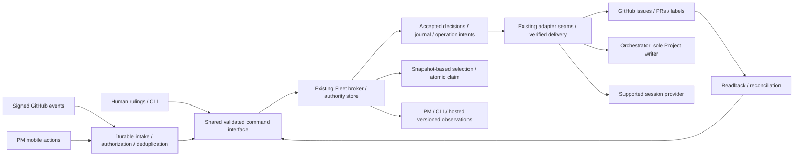

# PM/Fleet orchestration — architecture and shared interface

**Scope:** design decisions for #9196, task 15381. No production authorization.
**Baseline:** `a038f084dbeb525494d7bb928ad91f597db2ac51`. V1 evidence is in
[`census/`](census/); component proposals are not V1 implementation evidence.

## Architectural choice

Keep **one existing Fleet queue/broker as the claim and canonical work-state authority**.
Accept authenticated, field-scoped commands from distributed producers; retain accepted
decisions and durable remote-operation intents; expose versioned observations to consumers.
Derive effective scheduling pressure from an identified snapshot. Do not create another
queue, scheduler, database, Fleet executable, secret resolver, or frontend policy engine.

This combines canonical state with distributed command ingress and replayable observations;
it is neither multi-master priority replication nor a wholesale event-sourcing migration.
The existing creation outbox is evidence of a bounded pattern, **not** an already-general
transactional lifecycle outbox. Its pilot is not expanded by this design pass.

"One authority" is the target interface and existing queue doctrine, **not a claim that
every V1 producer already complies**. Pinned `pm-stack/dispatch/src/queue.ts` still contains
a Supabase/PostgREST enqueue and direct task-PATCH path; #9028 already owns that bypass.
Its deployment liveness is unverified. Consume #9028: reconcile or quarantine that producer
before canonical dispatch cutover. Any temporary compatibility adapter must forward to the
authoritative broker, retain the same operation/dedup identity, verify the returned authority
and binding, and never dual-write stores or roll back to the bypass on broker failure.

V1 also has useful projector substrate: bounded HMAC-verified webhook intake,
delivery-GUID deduplication, remote-activity reconciliation and a hot ledger with issued
high-water marks and monotone consumer acknowledgments. Reuse those mechanisms and fixtures;
do not invent a second webhook service. Its broker-task-export queue view is a read-only
snapshot, not a continuously refreshed canonical claim feed. The `pmp_` projection store
remains disposable/non-authoritative and never becomes the work journal, mutation outbox,
private-note store or Project writer. A projection's `delivery applied` marker does **not**
mean an operational command was durably accepted. Actionable forwarding needs separate
canonical operation identity/durability and result; do not lose a command behind an already
deduplicated projection event or report acceptance from a projection-only acknowledgment.

"Disposable" applies only to rebuildable projection rows, **not deletion of the shared
database or unique human input**. Preserve manually written `pmp_links`, accepted link-write
records and unrelated applications' tables; projector README lines 48–64 explicitly requires
a full backup including those links. A link-registry fact retains its current owner until an
explicit one-home-per-fact compatibility/migration decision, not an implicit copy into Fleet.



Boxes are logical modules, **not** new running services or stores. The interfaces hide
coordination complexity from CLI, browser, webhook and hosted callers. Adapters vary at
the actual seams: source retrieval, remote mutation, artifact persistence and session control.

## Version layers

| Version | Meaning                                                                                                 | Completion evidence                                                                 |
| ------- | ------------------------------------------------------------------------------------------------------- | ----------------------------------------------------------------------------------- |
| V1      | What pinned code, tests, documented authority and separately dated live observations actually establish | Bounded census claim with source/test link; deployment not inferred                 |
| V2      | Reviewed identity, authority, priority, lifecycle, command, hydration and reliability contracts         | Schemas/fixtures, decisions, crosswalk and independent design review                |
| V3      | Dependency-ordered implementation slices over the existing modules                                      | Each issue's tests, migration/rollback evidence, then separately authorized rollout |
| V4      | Same semantics in the hosted PM/Fleet surfaces #9079/#9081                                              | Identical conformance inputs/results, plus separate deployment/live proof           |

Later versions add capabilities; they do not erase V1 limitations or the preserved source
mechanisms. An implementation slice can be useful before the entire program is implemented.

## Identity and authority

1. A work reference is the pair **`(authority_id, work_id)`**, serialized as strings. The
   current queue's decimal task ID remains its ID; no renumbering or new identity store.
   `fleet://work/842` in the source is a local-authority shorthand, not a globally unique
   reference across unrelated hosted authorities. A qualified display URI may use
   `fleet://<authority_id>/work/842`. Resolve a shorthand only with an unambiguous authenticated
   authority context. Cross-target parity compares the **same authority's** items, never
   independent tenant-local row numbers.
2. GitHub `owner/repo#number` is an input/display locator. Retain stable provider resource
   and repository IDs plus kind; repository renames and equal numbers in different repos
   must not merge identities. No ambiguous cross-repo mutation may use inferred defaults.
3. Document precedence is handoff → charter → proposal → recovered original; supplement
   supplies candidates. This is separate from field authority: Fleet owns work state and
   urgency; GitHub owns external issue/PR bodies/discussion; provider owns actual session
   state; the orchestrator remains the sole Project writer. Existing metadata/session
   interfaces #9073–#9076 are consumed, not re-created.
4. Current ratified `expedite=15` / `next-up=25` priority conventions remain intact.
   A **Do Now request** is a separate durable one-shot directive. It bypasses selection
   delay, not authorization, hard dependencies, live leases or applicable concurrency
   limits. Persistent `manual_only` is an eligibility property, not a one-shot directive.

## Shared command and result interface

Component examples are illustrative until resolved into this common interface. Use a
versioned, typed envelope; do not implement a collection of independent CLI backends.
The new shared wire identifiers are `fleet.command/v1` and `fleet.result/v1`; nested
manifests, observations and policy profiles have their own named schema identifiers.

```text
Command {
  schema_version, operation_id, idempotency_key, request_digest,
  work: { authority_id, work_id }, kind, arguments,
  actor_ref, source_ref, source_event_ref?, delivery_id?, source_revision?, session_ref?,
  expected_work_version?, lease_generation?, observed_snapshot_ref?, owner_policy_ref?,
  reason: { code, evidence_refs[], confidence? }, dry_run
}
Result {
  schema_version, operation_id, work, work_version,
  outcome, effects[], warnings[], error?, next_action?, observed_at
}
```

- Authentication supplies the principal and capabilities. A client-provided `actor_ref`
  or `authorized: true` is **not** proof of authorization. Check current field/action
  permission at acceptance and again before delayed consequential delivery. Immutable
  accepted intent records the authenticated principal, exact permitted effect/request
  digest, authority decision and policy version. Re-check revocable permission and target
  preconditions before send; revocation stops future sends, not a request already sent.
  An authenticated broker recorder can retain independently verified late-effect evidence
  for that exact operation after lease expiry/revocation; an old worker's assertion alone
  is not verification or a grant to mutate current work state.
- Parse the complete invocation before side effects. Reject unknown flags, missing values,
  ambiguous targets, invalid ranges and incompatible version/precondition combinations.
- Reusing an idempotency key with the same canonical request returns the original operation;
  a different request digest is a conflict. Separate command identity, transport delivery
  identity, per-item revision, relay lease generation and cross-item read snapshot.
- Deduplicate `delivery_id` independently from `(source_ref, source_event_ref,
source_revision)` and normalized command identity. Broker-assigned accepted item revisions
  are monotone: older observations cannot overwrite newer accepted state; a duplicate of
  the same revision and payload is a no-op, while divergent payloads at that revision are
  a conflict. A missing accepted revision triggers reconciliation. A delayed source event
  without trustworthy causal order requires fresh source read/triage, not timestamp LWW.
  Retain uncertain or unattributable observations rather than silently suppressing them.
- Shared wire names are `snake_case` in the eventual v1 schema. Existing component examples
  using camelCase are design notation, not additional wire spellings. Contract fixtures
  must make serialization, integer/string handling and unknown-version behavior explicit.
- Integer IDs, versions, generations and rank keys cross JSON as canonical decimal strings
  wherever they may exceed JavaScript's exact integer range. Do not coerce through floating
  point. UTC instants and snapshot/policy inputs must be pinned for deterministic replay.
- Work IDs in this queue's contract are canonical unsigned decimal strings. Compare authority
  IDs bytewise, then work IDs by arbitrary-precision integer value (equivalently digit count,
  then lexical digits). This preserves V1 list's numeric ID tie order; it is not lexical
  `"10" < "9"` ordering. Opaque provider/session IDs stay opaque strings, never integers.
- Outcomes distinguish `rejected`, `accepted`, `running`, `pending_sync`, `partial`,
  `conflict`, `uncertain`, and `verified_complete`. A particular read-only operation can
  have a verified result without completing the work item. Effects name their requested,
  observed and verified states separately.
- A timeout returns a resumable operation receipt, not fictional cancellation. Dry-run
  creates no work-state, journal, outbox or remote mutation. Capability discovery advertises
  only the commands and guarantees that target actually supports.

### Digest and serialization contract

Use the [RFC 8785 JSON Canonicalization Scheme](https://www.rfc-editor.org/rfc/rfc8785.txt)
for **new work-command v1** fingerprints, with SHA-256 and a purpose/version domain separator.
This informational RFC is a serialization reference, not a new signing/PKI system or a
change to the existing creation-outbox hash format. Its UTF-16 property-name ordering,
UTF-8 output, unchanged string values and finite-number rules need shared Rust/TS golden
vectors; ordinary language-default JSON sorting is not an equivalent specification.

`request_digest` hashes the validated, default-expanded intent DTO: schema version, canonical
work pair, kind, typed arguments, expected work version, lease generation, observed snapshot
reference, owner-policy reference and reason. Scope the idempotency lookup by authenticated principal and authority;
client actor claims cannot select that scope. Exclude operation/key identifiers, delivery
attempt IDs, receipt times, output formatting, `wait`/timeout and dry-run execution mode from
this intent DTO. Transport/source/session attribution stays durably recorded alongside it.
A replay with the same key and altered **intent/precondition** must conflict; an attempt with
a new delivery ID or wait budget must still recover the original operation. New authorization
is never implied by a matching digest. The command schema defines any set normalization before
hashing; JCS itself preserves arrays and string values and performs no Unicode normalization.
Reject duplicate properties, invalid Unicode, NaN/Infinity and lossy numeric IDs before hashing.

Byte framing is **exactly**:

```text
digest(domain, dto) = "sha256:" + lower_hex(
  SHA256(ASCII(domain) || byte(0x00) || UTF8(JCS(dto))))
```

There is one NUL byte, no length prefix, BOM, newline or other whitespace outside the
canonical JSON bytes. `domain` is selected only from this registry, never arbitrary client text:

| Purpose                      | Exact ASCII domain          | Canonical DTO                                            |
| ---------------------------- | --------------------------- | -------------------------------------------------------- |
| Request fingerprint          | `fleet.command-intent/v1`   | Exact intent object below                                |
| Hydration manifest           | `fleet.context-manifest/v1` | Full manifest, omitting only `integrity.manifest_digest` |
| Cross-target selection order | `fleet.selection-order/v1`  | Exact order object below                                 |

The intent object has **exactly** these top-level keys; nullable fields are present as `null`
and fixed schema defaults are expanded before JCS. Do not inject current wall-clock or newly
fetched state as an implicit default that changes a retry's fingerprint:

```text
{
  schema_version: "fleet.command-intent/v1",
  command_schema_version: "fleet.command/v1",
  work, kind, arguments,
  expected_work_version: string|null,
  lease_generation: string|null,
  observed_snapshot_ref: string|null,
  owner_policy_ref: string|null,
  reason: { code: string, evidence_refs: array, confidence: finite_number|null }
}
```

Arguments and evidence-reference shapes come from the registered command schema. Any
semantically unordered set is normalized there, not by rearranging arbitrary arrays during
JCS. Authorization decisions, resolved runtime observations and source/session attribution
remain in the operation record but do not silently enter this DTO.

The order object has exactly the following keys. Every reference is canonical/authority-issued,
not a target-local database row number. The `ordered_items` array is the **entire** eligible
population, already in canonical comparator order; JCS preserves that array order:

```text
{
  schema_version: "fleet.selection-order/v1",
  authority_id, queue_snapshot_ref, graph_revision, policy_ref,
  taxonomy_ref, comparator_ref, owner_policy_ref, as_of_utc,
  lane_context: {
    capabilities: sorted_unique_string_array,
    filter_contract_ref, filter_ast,
    authorization_scope_ref, fairness_state_ref: string|null
  },
  complete_candidate_set: true,
  eligible_count: canonical_decimal_string,
  ordered_items: [
    { work_id, work_version, effective_urgency, peer_rank, created_at }
  ]
}
```

Work versions, graph/policy/protection references, as-of and lane inputs bind the derivation;
each ordered item carries all comparator keys. Work/version/urgency/rank values use canonical
decimal strings (signed for a profile permitting negative urgency/rank); timestamps are the
authority's canonical UTC strings, preserved without parse/reserialize changes. A partial or
truncated candidate snapshot must not emit a conformant `order_hash`. Comparing only a top-20
display page is not full-order conformance. A matching hash is a fingerprint, not authority,
proof of complete inputs, or a claim grant. Byte/framing golden vectors are in
[`contracts/digest-vectors.json`](contracts/digest-vectors.json); application-schema and
cross-language golden DTO tests remain required implementation work.

For a self-describing hydration manifest, `integrity.manifest_digest` is SHA-256 over its
canonical form with **that digest field omitted**, under a separate manifest-purpose domain
separator. Artifact digests cover the exact stored artifact bytes. Do not require a manifest
to contain the digest of its own complete serialized bytes. See
[`research/canonical-json-evidence.md`](research/canonical-json-evidence.md) for facts,
tradeoffs and required conformance cases. These are design contracts, not code already shipped.

## Ordering and distributed priority

Field precedence and accepted revisions govern commands; arrival timestamps do not.
Preserve intrinsic urgency, nullable importance, derived pressure, workflow, ownership and
directive separately. Historic charter 450/High and 1000/default are a named source profile,
not numbers to transplant into the live queue. The existing dispatch adapter's nearest-value
normalization (`15→10`, `25→20`) is a concrete compatibility gap, not authority to change
the ratified values.

For one fixed authority/lane snapshot, first require **both** the task's requirements of
the claimer **and** the claimer's explicit filter of tasks. "Union of constraints" does
not mean OR eligibility. Default predicates are both true. Then apply hard eligibility;
then compare effective urgency, explicit exact peer rank within equal urgency, creation
time and the authority-qualified numeric work-ID comparator above. Record policy, graph,
item revisions and as-of time.
Claim revalidates current predicates; a projection or sampled candidate cannot grant a lease.
The consistency boundary is the broker's claim transaction: validate item/work version,
graph revision, active policy/profile revision, ownership and relevant eligibility inputs
against the proposed snapshot, and evaluate time-sensitive conditions at broker-authoritative
claim time. A changed input requires recomputation/reselection or a typed stale result.
If the adapter cannot provide that atomic validation, it cannot advertise this capability.
Graph revision validation and edge insertion share a transaction/serialized edit protocol;
two individually valid opposite-edge checks must not both commit.

### Protected owner priority policy

Consume the existing Drew-only protected expedite ruling: #7030 and
`pm-stack/design-reprioritization-2026-11-12.md:11–15,122,207`. The latter file's old numeric
band table does **not** override #7030's ratified `15`/`25` correction. Protection is a
write-authority restriction, not a new score, an execution hold, or a bypass of hard blockers.

The existing policy/configuration authority must expose a versioned
`fleet.owner-priority-policy/v1` observation containing `policy_ref`, `version`, source/evidence
references, the trusted configured Drew owner-principal binding, a canonical protected-membership
snapshot/reference, and protected fields/actions. Membership is owner-accepted policy, not
inferred solely from a mutable label or score. Removing the mirror label cannot unprotect an item.
Resolve issue-level membership to canonical work/task references without conflating equal
issue numbers across repos. This describes an interface over existing policy state, not a new DB.

Every priority-affecting mutation checks the current policy and `owner_policy_ref` atomically
with the work-version mutation. Protected intrinsic score, peer placement, priority-label intent
and membership changes require the specifically authenticated Drew owner action (or delivery
of that exact already-authorized owner operation). A generic maintainer, agent, triage, manual
`priority.write`, `--force` flag, confidence score or hysteresis bypass is **not** that authority.
Automatic aging, clump refinement, label normalization, import/reconciliation, mobile and slash
commands all cross the same gate. An untrusted removal/addition is a conflict/triage observation,
not permission to demote, remove protection or promote an item into the protected set.

Denied mutations return `OWNER_POLICY_PROTECTED` with no score/rank/membership change;
a stale policy reference returns `OWNER_POLICY_VERSION_CONFLICT`. Missing/unverifiable policy
for an affected mutation fails closed. Pure reads and otherwise eligible execution are not
globally blocked by this priority-write restriction. Derived pressure remains separately
explainable and cannot rewrite a protected intrinsic value. Projection repair may restore only
the already-accepted policy value under its service scope; it cannot invent owner intent.

An allowed owner amendment records authenticated principal, exact action/effect, current and
next policy/membership versions, before/after, source evidence and operation ID. Before delayed
delivery, recheck revocable permission/current preconditions; a client-provided owner/actor flag
is never proof. Required oracles exercise **every** mutation path against protected/ordinary
items, unauthorized actors, owner actions, membership changes and stale policy snapshots. This
consumes an existing ruling; it is not a request for Drew to ratify it again.

The source explicitly requests before/after placement: retain that feature, with exact
integer peer ranks and an auditable rebalance contract. A cross-urgency move requires an
explicit urgency change or a clear conflict; it must not secretly override the urgency key.
Equal scores are legitimate. V1 claim/list final-tie divergence remains a named defect.

Cycle-safe hard-dependency pressure is effective-only. With canonical blocker→dependent
edges, inserting `u→v` creates a cycle iff `u=v` or a prior path `v→u` exists. Graph edits
must serialize or validate a graph revision atomically, including the two-opposite-inserts
race. Incomplete evaluation fails closed; a graph budget cannot hide a blocker.

Exploration is optional, feature-disabled until calibrated. Preserve the historic parameter
profile and statistical rationale; do not apply a 200-point distance blindly to live 10–90
values. Freeze eligible population/density and initial mixture masses for a draw, remove
each chosen item, and renormalize the remaining masses without replacement. Persist all
candidate dispositions before extended action; sampling creates no exclusive claims and
does not itself justify score changes. Urgent work requiring the lane suppresses exploration.

## Lifecycle and cross-system reliability

Workflow, lease ownership, execution/session receipt and external issue/PR state are distinct
dimensions. Extend #9178 and #9179; do not declare their unresolved rulings settled here.
Current worker-ID leases are not evidence of secret lease tokens or monotone fences.

An accepted mutation commits canonical state, journal facts and required remote intent in
one local transaction. Never hold that transaction over HTTP. Use effect-specific remote
preconditions and readback; a Fleet fence cannot stop a request already in flight to GitHub.
An expired worker may report the outcome of its already-authorized operation through a
restricted receipt recorder, but cannot create new mutations or overwrite a newer owner.
Unknown remote outcomes require observation before retry, not a second blind POST.

Normal completion verifies the requested PR merge, verifies explicitly designated issue
closures, and directly finalizes the canonical queue item with its receipts. No webhook
or sweep is required on that successful path. Partial effects remain recoverable; do not
undo a successful merge merely because a later issue closure failed. A final read cannot
atomically exclude a new GitHub comment; expose the freshness boundary and residual race.
Closed epics, labels and session shells are not completion or launch proof.

Completion policy names its invalidating activity classes: changed expected PR head,
required check/review/branch-policy failure, newly unresolved hard blocker, authorization
revocation or explicit hold/cancel always stop further consequential effects. An authorized
actionable requirement comment/review observed before local finalization holds the operation
for policy evaluation; routine informational activity need not. Record the final refresh
watermark and the residual read→merge interval, not an absolute "no external changes" claim.
Activity discovered after completion appends evidence and applies an explicit post-completion
triage/reopen policy; it never silently rewrites completion history or undoes a merge.

The source's managed-body feature remains traced. GitHub endpoints without documented
conditional-write support cannot guarantee prevention of human lost updates via a mere
GET-compare-PATCH sequence. Default to private journal plus explicitly mirrored, known-ID
managed comments; any body-section mutation must expose the weaker guarantee or remain
unsupported until an adequate adapter is proven. Never quietly discard the feature.
Default capability for automatic body-section writes is **unsupported without verified
conditional-write support**. A separately approved best-effort mode must disclose lost-update
risk in its preview/receipt and retain before/after evidence; it is not optimistic concurrency.

## Implementation locality and ownership

Concrete default placement is **internal modules of the existing `fleet-queue` crate**,
not an invented crate, daemon, executable or database:

```text
pkgs/fleet/crates/fleet-queue/src/work/
  contracts.rs       # identity, command/result/version semantics
  cli.rs             # strict work-command parsing; no shared registry ownership
  priority.rs        # intrinsic/profile/comparator/triage evaluation
  distribution.rs    # normalized intents, revisions, projection observations
  selection.rs       # eligibility, urgent gate, exploration model
  lifecycle.rs       # composed transitions; consumes primitive interfaces
  context.rs         # immutable bundles and bounded hydration
  activity.rs        # durable page ingestion, cursors, attribution
  relations.rs       # typed graph, readiness, resolution history
  journal.rs         # private notes, corrections, checkpoints, events
  authority.rs       # field permissions and managed-content policy
  operations.rs      # operation intents, relay state, verified effect receipts
  completion.rs      # direct completion/recovery state machine
```

These are **proposed files**, not existing functionality. Keep pure contracts/evaluators
independent of broker/client feature-gated adapters. Storage still belongs to existing
`turso_queue.rs`/broker authority; GitHub uses existing Fleet `gh.rs` and #9016; PM changes
stay in existing aggregator/projector/dispatch modules. One integration slice owns shared
`lib.rs`, CLI `main.rs` and registry registration so parallel implementation does not race
over those files. New module files/tests can otherwise be independent.
The current slice plan names this shared registration work `CLI-13`; `CLI-02` owns the
pure contract/parser, and `CLI-12` separately owns mutating resource-link operations rather
than hiding them in read-only inspect/status. These planning keys do not allocate GitHub IDs.
Placement is a concrete implementation-planning default, not allocation of storage/schema
ownership. Reconcile it with #3424/#8575/#8579 and the QTI provenance disposition before
schema-coupled work. `operations.rs` requires its own scoped mutation-outbox issue; it does
not silently enroll this program as another producer of the bounded creation-outbox pilot.

Future Rust issue done checks use the actual workspace/package, for example:

```text
cargo test --manifest-path pkgs/fleet/Cargo.toml -p fleet-queue --lib \
  --features client,queue-broker pmo_<slice_key>
```

Each builder first adds the named failing test and proves it is listed; a test filter that
runs zero tests is not acceptance. These are future test commands, **not** tests run by
this design pass. Schema/manifest/receipt fixtures, MBT state machines and PBT invariants
need independent reference oracles rather than production code comparing with itself.

## Sequencing and gates

1. Preserve sources and semantically inventory outcomes; census/crosswalk at a pinned commit.
2. Freeze shared identity/command/result/profile/authority and compatibility fixtures.
3. Develop independent pure models and read-only adapters; retain missing subcommands as
   explicit issue work. Do not block an offline fixture on completion of an entire domain epic.
4. Reconcile shared storage/schema against the original Queue Table Improvements work;
   if provenance remains unlocated, keep an explicit research issue and a concrete schema
   compatibility decision gate, not an imaginary equivalence or an indefinite wait for Drew.
5. Implement additive journal/graph/cursor/operation storage and claim guards in dependency
   order; integrate GitHub/PM/session adapters; verify crash/retry and migration/rollback.
6. Expose composed CLI/mobile paths, then separately authorize rollout and live acceptance.
   #6533 remains the existing live launch-and-bind fixture. No duplicate dispatch is launched
   merely to make this design pass look verified.

Native blocker edges point at **granular prerequisite slices**, not entire domain parents
where that would introduce cycles. Shared-file collisions are sequencing edges. Hosted
parity, calibration, deployment and live proof remain explicit future work, not reasons
to discard the larger design or mark the program done.
