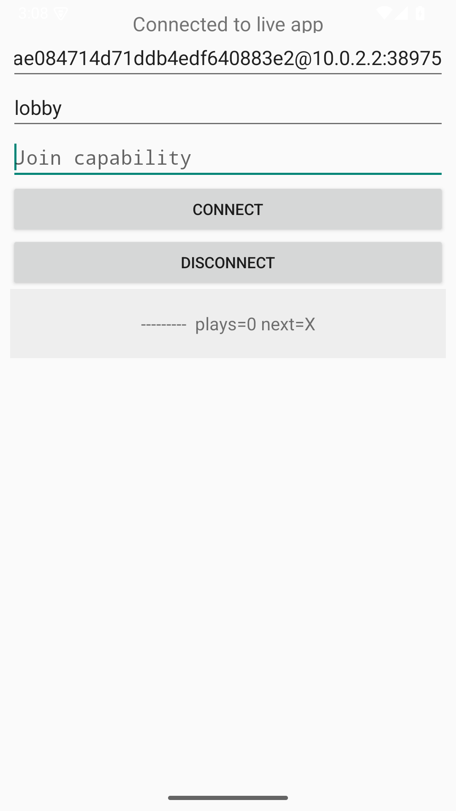

# Android live-host view proof

Captured on the `id-relay` Android 35 x86_64 AVD after connecting the APK to a
local `/id-world/1` host over Iroh using the direct `node-id@10.0.2.2:port`
address form. The host served the tic-tac-toe view `------- plays=0 next=X`.

- Cargo tests: [Fleet run 45579858842](https://github.com/developing-today-forks/fleet/actions/runs/45579858842) — two unit tests and one live-session integration test passed after the review fixes.
- Host demo build: [Fleet run 45574035360](https://github.com/dezren39/fleet/actions/runs/45574035360).
- APK build command: [Fleet run 45580132007](https://github.com/developing-today-forks/fleet/actions/runs/45580132007) passed Gradle `assembleDebug` and `check-android-shell.sh`; the APK artifact was published.
- Pressing Home and returning stops the session and polling; the shell shows its disconnected prompt and requires an explicit reconnect. A UI hierarchy dump confirmed the status and host-view `TextView`s expose their current text without overriding it with `contentDescription`.

This demonstrates the live view path. Android tap, drag, and scroll relay are
not part of this slice.

