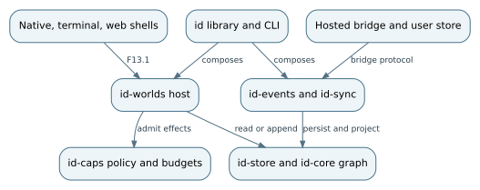
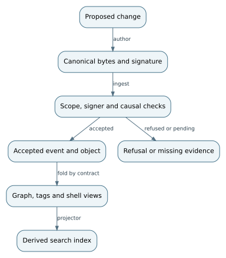
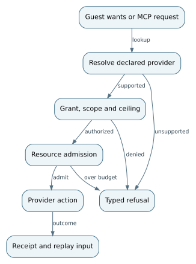
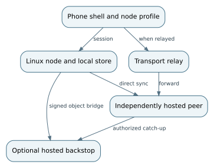
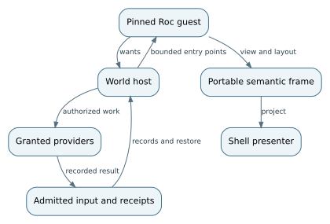

# ID research and platform design

Use the [Current ID issue map](current-issue-map.md) for the latest published issue census and blocker changes.

**Research baseline, November 23, 2026.** Source observations use the commit linked in the chapter or in its evidence. Design proposals and illustrative fixtures describe expected behavior. Issue states, ownership and deployment evidence have their own observation dates. The reference book was delivered by [PR #13358](https://github.com/developing-today/code/pull/13358) for [#13332](https://github.com/developing-today/code/issues/13332). The [combined Pages run](https://github.com/developing-today/code/actions/runs/45191802593) publishes to the [ID section of the shared site](https://developing-today.github.io/code/id/).

Start with the [Integrated implementation plan](implementation-plan.md), the [ID issue map](issue-map.md), or the [World capability catalogue](research-catalogue.md). Read the [ID design history and decisions carried forward](research-archive.md) to distinguish adopted decisions, experiments and unresolved questions.

The research edition checks later code at 7310a957 and reconciles the expanded #2056 family. Start with the [Integrated implementation plan](implementation-plan.md) and [The first ID apps and the #2056 family](research-apps-backlog.md).

A person should be able to keep an application, its data and the ability to use it when a hosted service disappears. A peer can store and serve that same application. Each participant decides which identities to trust, what to replicate and which effects an app may request. An event can travel through several operators without acquiring any of their authority. These principles are the program's recorded direction. The acceptance criteria below are proposed text for the repository charter. [Program tracker](https://github.com/developing-today/code/issues/13240) · [Operating principles](https://github.com/developing-today/code/issues/6304) · [Signed primitives and federation](https://github.com/developing-today/code/issues/9106)

**Source baseline.** Repository observations in these chapters use main commit `4cfceaa8afc08cf2cea88b9d733a2ace14c8ad5a` of November 23, 2026. The issue map records its own collection window. Later merged work is called out where identified. “In source” says a path or behavior is present at that revision. Historical run results are attributed to their issue or record. Proposed policies and acceptance cases remain design work. [Snapshot](https://github.com/developing-today/code/commit/4cfceaa8afc08cf2cea88b9d733a2ace14c8ad5a)

## The relationship with the user

Users carry identities and local content across instances. Application authors supply pure world behavior, a declared set of needed capabilities and at least one usable presentation. Node operators supply implementations for the capabilities they support. Someone running a single node may be all three. Storage, signing, hosting a world, reading it and rendering it each require different authority. Granting storage service alone must never let an operator produce changes on the owner's behalf. [Capability model](https://github.com/developing-today/code/blob/4cfceaa8afc08cf2cea88b9d733a2ace14c8ad5a/doc/2026-11-08T09-15-00Z_design_id_capability_model/2026-11-08T09-15-00Z_design_id_capability_model.md) · [Hosted bridge](https://github.com/developing-today/code/blob/4cfceaa8afc08cf2cea88b9d733a2ace14c8ad5a/pkgs/id/hosted-worker/README.md)

| Program commitment                     | Observable acceptance criterion                                                                                                                                                                                | Evidence owner                           |
| -------------------------------------- | -------------------------------------------------------------------------------------------------------------------------------------------------------------------------------------------------------------- | ---------------------------------------- |
| Local-first                            | An offline user opens authorized material, performs an allowed local action, restarts, and sees the committed result. Reconnection delivers the eventual accepted history and exposes any unresolved conflict. | Storage, client and content-class suites |
| Hostable by anyone                     | A fresh independent host can import the portable state, verify the chain, negotiate its capabilities and serve a peer without contacting Drew's backstop. An authority-bound action gets an explicit outcome.  | Federation and export/import             |
| Peer/hosted equivalence                | Supply identical signed inputs, policy snapshot and causal cut. Compare accepted event IDs, visible projections and refusal class. Clocks, path latency and relay custody have separate measurements.          | Cross-backend fixture                    |
| Least authority                        | An optional effect can be denied or revoked while authorized features continue. The UI names the actor, requested operation, scope and consequence.                                                            | Capability registry and frontend         |
| One application across platforms       | Each host advertises available inputs and outputs. The same recorded actions reach the same state and semantic targets; unsupported actions have a declared fallback or refusal.                               | Guest ABI and shell contract             |
| Portable data and traceable derivation | Verify object bytes and event signatures independent of storage. Drop a derived index, recreate it from its authoritative data and recover the same eligible records at a known frontier.                      | Event, storage and search owners         |

## Architecture

The root package composes the command and library entry points. Shared core types include graph record and query types. The world runtime, capability registry, store and federation layers have separate crates. External embedders need a documented versioned entry point and an executable consumer example before a component can promise compatibility. The manifest survey gives exact direct consumers, including the registry's root caller and the renderer's integration gap. [Crate boundaries and library clients](crates.md) · [Root library](https://github.com/developing-today/code/blob/4cfceaa8afc08cf2cea88b9d733a2ace14c8ad5a/pkgs/id/src/lib.rs)

Signing authenticates a claim. Admission verifies the applicable policy and causal prerequisites. A valid signature alone does not confer permission to append to a namespace. Persist the original bytes and their identifiers wherever the envelope contract requires them. A projected query result has its own visibility and freshness contract. Atlas-native records retain their authoritative sources when published to the ID graph. [Graph navigation, merge, search and the Atlas publication boundary](graph.md) · [Graph record types](https://github.com/developing-today/code/blob/4cfceaa8afc08cf2cea88b9d733a2ace14c8ad5a/pkgs/id/crates/id-core/src/graph/record.rs)

The provider registry and its ceilings describe the effects available to a world. The MCP policy session is a separate entry point that checks granted tools and quotas and maintains an audit chain. The common integration requirement is to prove that both entry points enforce their own policy at the effect boundary. Conformance should submit the same admissible and denied operations through the actual adapters. Hints supplied by a tool must never elevate a grant. [Registry](https://github.com/developing-today/code/blob/4cfceaa8afc08cf2cea88b9d733a2ace14c8ad5a/pkgs/id/crates/id-caps/src/world_caps.rs) · [Policy session](https://github.com/developing-today/code/blob/4cfceaa8afc08cf2cea88b9d733a2ace14c8ad5a/pkgs/id/crates/id-caps/src/mcp_policy.rs) · [MCP follow-up](https://github.com/developing-today/code/issues/7917)

A packet relay forwards traffic. A hosted bridge stores signed objects and fork evidence under a binding. An application-level relay can retain messages under its own stated policy. The sender, custodian and accepting receiver make different claims. A mobile profile in this diagram is a design target whose independently verified capabilities are recorded in the shell matrix. [Federation, protocol conformance and match evidence](federation.md) · [Worker](https://github.com/developing-today/code/blob/4cfceaa8afc08cf2cea88b9d733a2ace14c8ad5a/pkgs/id/hosted-worker/README.md) · [Clients, games and simulation](clients.md)

A guest produces wants and a semantic presentation. The host can meter guest instructions even if the program requests no external effects. Each eligible host operation also has costs for work, memory and I/O. Replay must preserve the relevant inputs for time, randomness and completed effects. A client may re-render at a different cadence while preserving logical ticks and stable action targets. [Guest ABI](https://github.com/developing-today/code/blob/4cfceaa8afc08cf2cea88b9d733a2ace14c8ad5a/pkgs/id/examples/roc-world/ABI.md) · [Roc programs, capabilities and equivalent hosts](roc.md) · [Tokens, trading and metered execution](tokens.md)

## Release and research order

Linux is the first native reference, followed by Android, Web, macOS and Windows. Keep per-platform release tags and identify the precise capabilities verified for each artifact. Include terminal and hardware profiles as explicit feature subsets. The charter does not promote a cross-compiled binary, headless render or emulator observation to physical-device acceptance. [Program direction](https://github.com/developing-today/code/issues/13240) · [Clients, games and simulation](clients.md)

The first construction sequence is the existing store verdict, reconciliation of documentation and fixtures that disagree with main, a working cross-host guest against the existing contract, and the smallest authorized query or publication fixture. Parallel paths include independent design closures with an owner and evidence, and the six application proofs in the client chapter. Match attestation review, the held join benchmark, paid operations and hosted jurisdiction canaries retain their item-specific conditions. [ID issue map](issue-map.md) · [Adopt the IndexedDB request-batch profile](store.md) · [Design review of the 41 open design-labeled ID issues](design-review.md)
