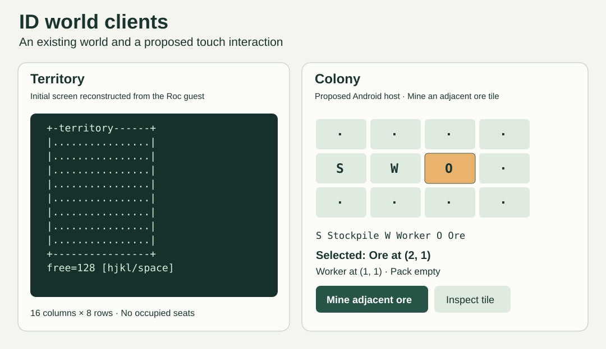

# Clients, games and simulation

*Research snapshot of November 23, 2026. Code and issue observations refer to the cited revisions and collection times.*

The [Six apps a participant can finish, replay or resume](research-playbook.md) add 33 exact transitions to the prior fixtures. The [Playable, accessible and authorable worlds across ID shells](research-clients.md) reconciles widget rendering with input delivery and accessibility.

The first app suite should extend the shipped Roc world platform with six playable or editable fixtures. A person on a terminal can mine the same tile, inspect the same object or rename the same node as a person using a touch screen. The acceptance criterion is the durable world outcome and the set of actions available to the participant. Font choice and frame rate belong to the shell.

This chapter records source inspection at `4cfceaa8afc08cf2cea88b9d733a2ace14c8ad5a`. The six new apps, their fixtures and the touch design below are proposals. None of the new fixtures has been run. The Territory view is a source reconstruction.

## What a player can use today

| Component | Checked behavior and boundary | Evidence |
|---|---|---|
| Tic-tac-toe | Two participants enter digits 0–8. The Roc reducer ignores invalid and occupied cells and publishes board, plays and winner as records. Source and Wasm ship together. | [Guest README][ttt] |
| Territory | Up to eight seats share a 16×8 grid. Arrow keys or hjkl move a cursor. Enter or space claims a cell. Seats persist, claims after the first must touch an existing claim. SSH and web consume the portable screen. The guest produces records, snapshots and a restore path. | [Guest source][territory] · [Usage][usage] |
| Native Bevy shell | The binary installs the grid, scene and audio presentation plugins. The scene plugin builds a 3D entity per node. The audio plugin schedules cue entities and marks sounding cues. Audible device output still needs a backend. Form responses already have their own contract path. | [Entrypoint][native] · [Scene][scene] · [Audio][audio] · [Forms][form] |
| Shell contract | Version 1 revision 15 describes screen, text, form, scene, audio and widget surfaces. Validate known kinds before projection. A presenter can fall back to deterministic text. Agent input can carry a screen revision for a stale-decision refusal. Contract frame support and rich rendering of a frame's payload are different compatibility questions. | [Contract][contract] |
| Pure guest | The Plaza v1 guest is import-free Wasm32. The Roc platform exposes init/update/view and optional layout, records, wants, snapshot and restore at the ABI. The host journals accepted events and supplies capability results as participant zero. Requests for time use the existing capability protocol. | [ABI][abi] · [RocGrid example][grid] |
| Native/terminal conformance | The parity fixture checks screen text and input builders. A separate live-service test plays a game through native and terminal clients and compares the durable outcome. These are existing test definitions. This survey did not run them. | [Scripted fixture][parity] · [Live test][live] |

**Merge since the survey pin.** PR #13244 merged at 12:17:01 UTC on November 23 with native audio cue scheduling. PR #13266 merged at 12:41:04 UTC the same day, after the source pin, with the widget/1 renderer for the rich control surface. Its PR records ordered controls, labels and focus targets. The PR metadata establishes the merge; the resulting binary has not been exercised in this pass. [Audio PR](https://github.com/developing-today/code/pull/13244) · [Widget PR](https://github.com/developing-today/code/pull/13266)

**Documentation discrepancy at the survey pin.** The recorded native shell capability statement and README list three view surfaces and exclude rich surfaces as a group. The capability test checks frame kinds, providers and that the exclusion text is nonempty. Its assertions do not compare the advertised renderer support against the registered scene and audio plugins. Preserve the distinction between form rows and rich widget/1 controls. Document audio cue presentation and device playback separately. On latest main, reread the statement, README, tests and the merged #13266 diff. Whether the discrepancy remains there is unverified. If it persists, route the evidence to the existing owner before claiming a slice. [Statement][statement] · [Native README][nativereadme] · [Capability tests][captest] · [Live follow-on](https://github.com/developing-today/code/issues/12657)

## The lowest-fidelity playable view

The existing #6010 record defines meaning-bearing cell tags and their glyph fallback. #5970 owns sprite and filter policy. #5781 recommends a headless-first ECS projection and a journal append gate for intents. Android already has a thick, local-first Kotlin/Compose design around the Rust client core. These records provide the starting points for the proposed suite. [Semantic cells][cells] · [Asset policy issue](https://github.com/developing-today/code/issues/5970) · [Bevy design][bevydesign] · [Android design][android]



The current guest fills all 128 Territory cells with a period, then paints borders and a free-cell count. The following reproduces the non-padding area at initialization, before a seat has acted. [Territory view][territory] · [Border construction][screen]

```text
+-territory------+
|................|
|................|
|................|
|................|
|................|
|................|
|................|
|................|
+----------------+
free=128 [hjkl/space]
```

A proposed text view for the Colony fixture expresses the same actions as the large touch targets in the illustration. Here the participant selected the ore tile. Cell occupancy, the selected target and adjacency are separate facts.

```text
Colony
. . . .
S W O .
. . . .

S Stockpile   W Worker   O Ore
Worker (1,1)     Pack empty
Ore (2,1)        [Mine] [Inspect]
```

For sprite hosts, resolve each cell through the established asset fallback chain. Measure asset download, decode and draw cost separately. A missing or disallowed asset immediately falls back to the labelled/glyph representation. A sprite, color change or sound cue alone may never convey a rule-changing condition. A shell can inspect the target's text even on a display too small to show the whole board.

## Six apps and their independent test oracles

Each row specifies a smallest complete interaction alongside the design path it unlocks. Coordinates are zero-based from the top left. The fixture pins the app version, seed, admitted events and logical update rule. Tests should assert the hand-computed values below before comparing state digests across hosts.

| App | Play or edit | Smallest named oracle | Full design path |
|---|---|---|---|
| Colony | Designate jobs, move a worker, collect and deliver resources on a grid. | **One ore conserved.** Start on 4×3 with W=(1,1), ore=(2,1), stockpile=(0,1), pack=0. Mine east once, move west once, deposit once. Worker=(0,1), ore removed, pack=0 and stockpile=1. Repeat delivery of the same committed event; total stays one. | Job queue, competing worker reservations, routes and succession saves. Exercise target selection, permission to assign and attribution. |
| Orbit arcade | Move a cannon across lanes and fire at a formation. Each shot and collision advances on a numbered game tick. | **First target hit.** On 7×5, cannon=(3,4); one stationary target=(3,1) through tick 3. Fire at tick 1. Spawn at cannon, move north one cell in that tick and each later tick. At end of tick 3 target and round are gone, score=10. The counter and spoken result agree across hosts. | Subsequent waves move horizontally, descend at edges and use a stable hit-order rule. Pause/resume and frame drops do not mint shots. |
| Burrow | Dig through soil to open tunnels. Solid rock blocks both movement and excavation. | **Blocked east dig.** On 5×3, digger=(0,1), soil=(1,1),(2,1), rock=(3,1). Dig east three times. Digger=(2,1), both soil cells are traversable, rock persists, two successful digs. | Add hazards, enemy pathing, turn-based accessibility mode and cooperative digs. Distinguish attempted moves from successful changes. |
| Cells | Seed a cellular simulation, step it and compare generations. | **Two-generation blinker.** On 3×3 with dead exterior, B3/S23 and synchronous updates, seed (1,0),(1,1),(1,2). Tick one has (0,1),(1,1),(2,1). Tick two restores the seed. Snapshot at one, recreate the ECS, step and compare. | Sparse chunks, alternate rule packs, deterministic batch stepping and a headless observation API. Pin rule ID and boundary conditions. |
| Sketch | Draw, inspect and undo immutable strokes on a shared page. Stroke coordinates use a canonical document grid; viewport zoom is local. | **Offline undo.** A and B add distinct strokes from the same head. A tombstones A's stroke offline. Merge while duplicating B's add. Both views show only B's exact ordered point list. Pointer cancellation before commit and a predicted preview emit no stroke. | Brushes, pressure, shapes, layer ordering, bounded stroke chunks, export. Preserve provenance on delete and restore. |
| Mind map | Add, rename, arrange and relate topics by stable node IDs. Use outline or spatial presentation. | **Stable link.** Root A gains B,C; insert cross-link B→C. Rename C to Water and drag B. Outline still contains B and Water, link target resolves to C, root-reparent attempt fails. Concurrent B→C and C→B parent moves converge to one acyclic tree under every delivery order allowed by their causal dependencies. | Rich labels, arbitrary cross-links, branch sharing and selection/search. Choose the tree CRDT before fixing the exact winner of concurrent moves. Drawing a cross-link must never reparent either endpoint. |

All six should be playable/editable by an authorized user with the required local resources. A terminal on a remote host can drive a world on the same terms. Pure games can start with the existing `update(model,pid,event)` contract. Bind commands to the existing `input` vocabulary and publish state summaries with `records`. Limit `wants` to the granted effects the specific app uses. A hosted `time.tick` is a journaled input and replay feeds those recorded ticks. Wall-clock animation, camera motion and "held key" repeat intervals stay outside the guest. A manual step can exercise the same reducer when the clock subscription is refused. Reuse the ordering of the admitted world journal for simulation. Before contact, devices can retain proposed intents. Merging independent edits to a shared sketch and resolving conflicting game moves have different rules. Preserve these semantics when upgrading or moving a world to the backstop. [Guest ABI][abi] · [Existing game journal test][live] · [Worlds/bevy design][bevydesign]

## Host contracts and transport

| Host | Interaction | Presentation and proof |
|---|---|---|
| Linux CLI / TUI | Commands name actions and stable targets. Direction keys or a menu can issue the colony interaction. | The CLI prints a compact transcript and structured state. The TUI maps visible cells and lists available actions. Test full terminal integration via an in-memory backend if the #1071 choice is ratatui. Retain headless tests of world outcomes without requiring terminal dimensions or color. |
| Linux native | Resolve a pointer hit to a current target; keyboard activation invokes that same target. Keep focus and hover local. | Reuse the Bevy presenter and shell contract. Compare cell text, focus/action and durable journal, then test projective differences such as sprite fallback and audio cue scheduling separately. |
| Android native | Tap to select, then activate a named action. Expose Move, Link, Mine, Undo through Compose semantics for keyboard and assistive services. | Exercise activity recreation, rotation, network loss, process death, local journal recovery and denied provider grants. Restore durable state first, then local viewport/focus when meaningful. Verify the exact user-visible result on a named Android device before claiming device parity. |
| Web | Pointer, keyboard and focusable DOM actions are peers. For sketching normalize coalesced samples once, commit only actual points, discard canceled strokes. | Map interactive canvas regions to focusable controls. Reconnect a read-only participant and check disabled commands and readable labels. Verify that pointer prediction can change the preview without changing the stroke hash. |
| macOS / Windows | After Linux, Android and Web parity, reuse the native contract and platform-specific key, IME, pointer and clipboard adapters. | Run the same app vectors with target-tagged releases. Platform-specific IME commits and composition updates require separate tests to prevent duplicate text inserts. |
| ESP32 / constrained | Advertise measured viewport, controls, memory and supported presentation. A locally executed guest and a remote entity viewer are separate profiles. | A small display can page the grid and select named actions. Designate a world playable on a board only after the physical build demonstrates required input, compute, storage and offline behavior. No Roc or Bevy runtime support is assumed. |

Sources for client behavior and proposed adapters include [the shell contract][contract], [Android design][android], [Android lifecycle](https://developer.android.com/guide/components/activities/activity-lifecycle), [Compose semantics](https://developer.android.com/develop/ui/compose/accessibility/semantics), [HTML canvas fallback](https://html.spec.whatwg.org/multipage/canvas.html), [Pointer Events §10](https://www.w3.org/TR/pointerevents3/#coalesced-and-predicted-events) and [Ratatui TestBackend](https://docs.rs/ratatui/latest/ratatui/backend/struct.TestBackend.html).

## ECS simulation and performance

The native package requires Bevy 0.19 with selected features. Cargo.lock pins Bevy and bevy_ecs to 0.19.1. The game rules in the guest remain authoritative across every client. A headless Bevy integration can rebuild a world projection without desktop rendering features. On input, submit the intent through ID. Once accepted, consume the journal event and advance the derived components. Logical entity IDs remain stable even if Bevy reallocates its entity handles. Build a reverse map on replay. [Package manifest][manifest] · [Lockfile][lock] · [Bevy design][bevydesign]

For the Cells test, first advance the pure reducer on the journal, then update the projection and extract the canonical cell set in coordinate order. A reusable simulation engine exposed through a host capability must have explicit rule version, input encoding, deterministic schedule and result receipt. Fix the tick interval as part of an app's definition. Bevy systems can be parallel with unspecified relative order. Specify ordering for dependent phases, including collision resolution. Independent rendering systems can run concurrently. Limit per-frame catch-up and resume from an accepted world position. A headless loop needs explicit pacing or a test-controlled step. Replaying after render stalls or mobile suspension must consume exactly the admitted events. [Bevy schedule](https://docs.rs/bevy_ecs/0.19.1/bevy_ecs/system/) · [Headless runner](https://docs.rs/bevy/0.19.1/bevy/struct.MinimalPlugins.html) · [Fixed time](https://docs.rs/bevy/0.19.1/bevy/time/struct.Fixed.html)

Measure the same deterministic input trace on each host. Record guest execution fuel, capability calls and bytes, changed cells, presenter latency, maximum resident memory and snapshot size separately. Use fixture state—not a new render from the same implementation—as the oracle. Avoid extrapolating the scale program's one guest frame measurement to palette conversion, text layout, audio or a new simulation. Before running any large grid/soak experiment, check existing results, holds, plan quota and releases. [Scale evidence tracker](https://github.com/developing-today/code/issues/6304)

## Delivery order

1. Refresh main after #13266, then compare the registered scene, audio and widget presenters against the native capability statement and its test. If the documentation still lags and the work is unclaimed, reconcile the statement and README; add an assertion for each actual presenter and its text fallback. This can use the existing contract version.
2. Use Territory and tic-tac-toe as the existing compatibility baseline. Add Colony and Burrow as Roc programs using the current grid, records and snapshot ABI. Run the named normal-entrypoint oracle on Linux via Fleet. Document the tested source, flags, run URL and outcome. Put the same fixtures on Android through #7938.
3. Add Orbit and Cells. Test admitted tick order and refusal/manual step first, then integrate the headless projection in #5781. Use #5970/#6010 for sprite enhancement and asset fallback.
4. Add Sketch and Mind map using versioned edit operations and the program's adopted per-content merge policies. Run restore, duplicate delivery, permission refusal and two-peer partition/merge fixtures. Keep current state distinct from speculative local edits. Implement desktop/web/touch accessibility actions before marking the suite cross-platform.
5. Validate the active hardware profile and release evidence before claiming embedded support. Record unstated platform promises as open design questions. Before any repo claim or merge, reread the owning issue and current comments, check linked PRs and honor existing claims.

[ttt]: https://github.com/developing-today/code/blob/4cfceaa8afc08cf2cea88b9d733a2ace14c8ad5a/pkgs/id/apps/tic-tac-toe/README.md
[territory]: https://github.com/developing-today/code/blob/4cfceaa8afc08cf2cea88b9d733a2ace14c8ad5a/pkgs/id/examples/territory/main.roc
[usage]: https://github.com/developing-today/code/blob/4cfceaa8afc08cf2cea88b9d733a2ace14c8ad5a/pkgs/id/examples/territory/README.md
[native]: https://github.com/developing-today/code/blob/4cfceaa8afc08cf2cea88b9d733a2ace14c8ad5a/pkgs/id/crates/id-native-shell/src/main.rs
[scene]: https://github.com/developing-today/code/blob/4cfceaa8afc08cf2cea88b9d733a2ace14c8ad5a/pkgs/id/crates/id-native-shell/src/scene.rs
[audio]: https://github.com/developing-today/code/blob/4cfceaa8afc08cf2cea88b9d733a2ace14c8ad5a/pkgs/id/crates/id-native-shell/src/audio.rs
[form]: https://github.com/developing-today/code/blob/4cfceaa8afc08cf2cea88b9d733a2ace14c8ad5a/pkgs/id/crates/id-native-shell/src/form.rs
[contract]: https://github.com/developing-today/code/blob/4cfceaa8afc08cf2cea88b9d733a2ace14c8ad5a/pkgs/id/contract/shell-contract.v1.json
[abi]: https://github.com/developing-today/code/blob/4cfceaa8afc08cf2cea88b9d733a2ace14c8ad5a/pkgs/id/examples/roc-world/ABI.md
[grid]: https://github.com/developing-today/code/blob/4cfceaa8afc08cf2cea88b9d733a2ace14c8ad5a/pkgs/id/examples/roc-grid/main.roc
[parity]: https://github.com/developing-today/code/blob/4cfceaa8afc08cf2cea88b9d733a2ace14c8ad5a/pkgs/id/crates/id-native-shell/tests/parity.rs
[live]: https://github.com/developing-today/code/blob/4cfceaa8afc08cf2cea88b9d733a2ace14c8ad5a/pkgs/id/crates/id-native-shell/tests/live_session.rs
[statement]: https://github.com/developing-today/code/blob/4cfceaa8afc08cf2cea88b9d733a2ace14c8ad5a/pkgs/id/crates/id-native-shell/capability-statement.json
[nativereadme]: https://github.com/developing-today/code/blob/4cfceaa8afc08cf2cea88b9d733a2ace14c8ad5a/pkgs/id/crates/id-native-shell/README.md
[captest]: https://github.com/developing-today/code/blob/4cfceaa8afc08cf2cea88b9d733a2ace14c8ad5a/pkgs/id/crates/id-native-shell/tests/capability_statement.rs
[cells]: https://github.com/developing-today/code/blob/4cfceaa8afc08cf2cea88b9d733a2ace14c8ad5a/doc/2026-11-17_design_id6010_semantic_cell_tag_model.md
[bevydesign]: https://github.com/developing-today/code/blob/4cfceaa8afc08cf2cea88b9d733a2ace14c8ad5a/doc/2026-11-08_design_id5781.md
[android]: https://github.com/developing-today/code/blob/4cfceaa8afc08cf2cea88b9d733a2ace14c8ad5a/doc/2026-11-08T22-06-00Z_design_id_android_client/2026-11-08T22-06-00Z_design_id_android_client.md
[screen]: https://github.com/developing-today/code/blob/4cfceaa8afc08cf2cea88b9d733a2ace14c8ad5a/pkgs/id/examples/roc-world/Screen.roc
[manifest]: https://github.com/developing-today/code/blob/4cfceaa8afc08cf2cea88b9d733a2ace14c8ad5a/pkgs/id/crates/id-native-shell/Cargo.toml
[lock]: https://github.com/developing-today/code/blob/4cfceaa8afc08cf2cea88b9d733a2ace14c8ad5a/pkgs/id/Cargo.lock

## Application fixtures

[The machine-readable specifications](evidence/app-fixtures.json) define the six proposed applications and 13 acceptance cases. They contain preconditions, actions and independent expected states for future implementation.
