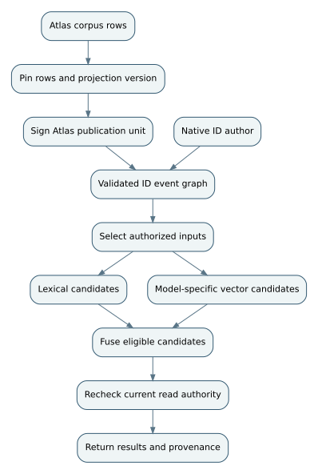

# Graph navigation, merge, search and the Atlas publication boundary

_Research snapshot of November 23, 2026. Code and issue observations refer to the cited revisions and collection times._

The [What a reader can find in the ID graph](research-discovery-search.md) works one query by hand, then changes the confidential corpus and the model generation. [References, schema changes and publication across hosts](research-provenance.md) specify what survives branching and schema migration.

**Surveyed November 23, 2026.** The code observations below use the GitHub REST archive of [main at 4cfceaa](https://github.com/developing-today/code/tree/4cfceaa8afc08cf2cea88b9d733a2ace14c8ad5a). I inspected the code and fixture sources. No test execution or deployed behavior is asserted. Design proposals below need a fresh ownership and approval check before a patch.

## What has a working representation

| Surface           | Inspected behavior                                                                                                                                                                                                                                                                                                                                                                                      | Design consequence                                                                                                                                                                                                                                                                                                                                                                                                                                                                                                                                                                                                                                                             |
| ----------------- | ------------------------------------------------------------------------------------------------------------------------------------------------------------------------------------------------------------------------------------------------------------------------------------------------------------------------------------------------------------------------------------------------------- | ------------------------------------------------------------------------------------------------------------------------------------------------------------------------------------------------------------------------------------------------------------------------------------------------------------------------------------------------------------------------------------------------------------------------------------------------------------------------------------------------------------------------------------------------------------------------------------------------------------------------------------------------------------------------------ |
| Signed graph      | The graph record commits deterministic-CBOR triples and optional provenance. A logical graph ID is allocated independently of its immutable signed record. A particular assertion is addressed by record envelope ID and position. Typed-byte terms retain unknown type tags. Unknown record keys, term kinds and record versions reject.                                                               | A property graph is a typed view over these assertions. Represent edge metadata or parallel edges by explicit assertion or edge identities, preserving provenance. An extension may add a typed value. Changing the record envelope requires a new supported version. [Record and term modules](https://github.com/developing-today/code/tree/4cfceaa8afc08cf2cea88b9d733a2ace14c8ad5a/pkgs/id/crates/id-core/src/graph)                                                                                                                                                                                                                                                       |
| Query and index   | Conjunctive triple patterns have a stable canonical term/assertion order, bounded rows and steps, per-graph read policy, and a cursor tied to the query digest and snapshot frontier. redb stores derived SPO, POS and OSP tables and supports verification and reconstruction. The query and index modules are exported, despite stale headers describing future wiring.                               | A path resolver can compile individual hops against the existing query. Explicitly preserve the external surface's order, budget, continuation and disclosure rules. [Query](https://github.com/developing-today/code/blob/4cfceaa8afc08cf2cea88b9d733a2ace14c8ad5a/pkgs/id/crates/id-core/src/graph/query.rs) · [Index](https://github.com/developing-today/code/blob/4cfceaa8afc08cf2cea88b9d733a2ace14c8ad5a/pkgs/id/crates/id-store/src/graph_index.rs) · [Exports](https://github.com/developing-today/code/blob/4cfceaa8afc08cf2cea88b9d733a2ace14c8ad5a/pkgs/id/crates/id-store/src/lib.rs)                                                                             |
| Native search     | The live-tag search in ID combines exact tag fields, author and subject kind; the materialized claim fold and stable subject/claim ordering have their own public meaning. Atlas already implements lexical and vector fusion, a query embedding cache keyed by normalized text/model/revision, and an isolated Snowflake ONNX embedder with a bit-exact corpus-parity fixture.                         | Keep exact tag matching available offline. Offer hybrid retrieval as an additional authorized capability using the existing Atlas components. A new model must use its own search space and satisfy its acceptance contract. [ID tag search](https://github.com/developing-today/code/blob/4cfceaa8afc08cf2cea88b9d733a2ace14c8ad5a/pkgs/id/crates/id-store/src/search.rs) · [Atlas core](https://github.com/developing-today/code/tree/4cfceaa8afc08cf2cea88b9d733a2ace14c8ad5a/pkgs/atlas-search/crates/atlas-core/src) · [Embedder](https://github.com/developing-today/code/blob/4cfceaa8afc08cf2cea88b9d733a2ace14c8ad5a/pkgs/atlas-search/crates/atlas-embed/src/lib.rs) |
| Atlas publication | The landed #6062 format maps corpus versions to documents, file heads to notes/revisions, relations to attributed tag claims, and batch provenance to attestations. Atlas rows and projection pins are authoritative for those emissions. A native ID object can be referenced without republishing. Atlas chunk content IDs remain distinct from raw iroh BLAKE3 IDs under the pinned profile vectors. | Two directions have distinct authorities. ID-to-search is a rebuildable index over accepted ID material. Atlas-to-ID is a signed publication whose claims can be recomputed from Atlas rows. Do not infer that having the same digest bytes implies the same hash profile. [Publication format §§1–7](https://github.com/developing-today/code/tree/4cfceaa8afc08cf2cea88b9d733a2ace14c8ad5a/doc/2026-11-09T07-20-00Z_design_atlas_id_publication) · [Hash fixture](https://github.com/developing-today/code/blob/4cfceaa8afc08cf2cea88b9d733a2ace14c8ad5a/pkgs/id/crates/id-core/tests/atlas_content_profile_vectors.rs)                                                      |
| CRDTs             | The summit B14 matrix defaults to deferral until conflict reports and representative workloads establish a benefit. The existing ID CLI tag code also describes an iroh-docs-backed tag surface.                                                                                                                                                                                                        | Preserve existing per-surface behavior. Add Loro and Yrs evaluation rows to the existing matrix. An engine becomes a per-content-class ABI only after an accepted evidence result. [B14 decision](https://github.com/developing-today/code/blob/4cfceaa8afc08cf2cea88b9d733a2ace14c8ad5a/doc/2026-11-13T03-40-00Z_design_id-atlas-summit/part-b/B14-research-crdt-matrix.md) · [Tag CLI](https://github.com/developing-today/code/blob/4cfceaa8afc08cf2cea88b9d733a2ace14c8ad5a/pkgs/id/crates/id-cli/src/cli/tag.rs)                                                                                                                                                          |

## Navigation and presentation

[#7612](https://github.com/developing-today/code/issues/7612) already specifies neighbors, backlinks, discussions, history and a bounded path, with the same semantics across CLI, scripts and agent clients. Its cursor orders typed application nodes by creation time and ID. [#9126](https://github.com/developing-today/code/issues/9126) places visualization on the same graph query layer. A canonical triple cursor has a different unit and order. Preserve both contracts by binding the public navigation cursor to operation, normalized arguments, visible snapshot, policy epoch and last public sort key. On an authority change, invalidate the navigation cursor before returning a page. Internal cursor data is a continuation hint and confers no authority.

**Proposed mapping.** A Falcor-style path set is a typed request for a bounded subset of that navigation surface. Field, traversable relation and bounded index/key-set segments lower to a query plan; a typed reader reconstructs a response with provenance. Count dereferences, visited nodes, returned bytes and plan steps against caller and operator ceilings. Deduplicate aliases by immutable identity in a canonical value cache. Keep names, negative hits and permitted fields scoped to the current authority. A read operation can return a reference at the final segment so callers decide whether to continue. Writes and hosted actions pass through the existing signed command/capability surfaces. Conditional writes bind the expected base revision. Retriable effects use request IDs scoped to actor and operation. No new ambient network call follows a reference. [Falcor paths](https://netflix.github.io/falcor/documentation/paths.html) · [Reference semantics](https://netflix.github.io/falcor/documentation/jsongraph.html) · [Data source operations](https://netflix.github.io/falcor/doc/DataSource.html)

The disclosure contract is per policy. The existing local/remote design assigns withheld-result signaling to the serving authority. Apply explicit truncation for authorized results according to #5821, and disclose filtered counts or existence only at a configured disclosure level. An explicit query to a disallowed graph can already yield an authorization error. A low-disclosure caller must receive an identical observable projection whether the unreadable subgraph is empty or full. [Filtering and pagination](https://github.com/developing-today/code/tree/4cfceaa8afc08cf2cea88b9d733a2ace14c8ad5a/doc/2026-11-08T06-45-00Z_design_id_query_local_remote_v1)

**Viewer.** Produce one bounded set of visible nodes, edges, provenance and continuation metadata. Supply a keyboard-accessible table or tree alongside the graphical canvas. Cytoscape.js covers compound nodes and headless graph analysis. Sigma's v3 site is an archive and describes its Graphology/WebGL split. Profile the chosen version using actual ID views before setting a renderer switch point. Keep layout coordinates local unless explicitly saved as presentation data. Paint or keyboard selection of the same node must expose the same visible neighbors and commands. [Cytoscape.js](https://js.cytoscape.org/) · [Sigma v3 archive](https://v3.sigmajs.org/)

**Schemas and media.** Map typed properties with explicit schema/version and distinguish unset, explicit null and a signed removal. The enclosing graph v1 rejects unknown envelope fields. Preserve opaque term bytes for unrecognized type tags; unsupported record versions are quarantined for compatible readers. Add a versioned schema registry. An ordinary succeeds edge joins versions with the same schema. A cross-schema migration creates a separately identified signed derivative with provenance, unless an explicit cross-schema adapter is adopted. JSON-LD interchange uses pinned inline or locally resolved contexts and explicit edge nodes when edge identity or metadata matters. Test two parallel edges between the same endpoints with different claims and a typed byte string that resembles an IRI. Do not derive existing IDs from JSON-LD expansion. Media manifests should reference original bytes and separately addressable renditions. A capability describes source, purpose, allowed range and decode budget. Bound expanded pixels, frames and bytes before allocation. Cache renditions by source identity and transformation profile within the authorized scope; a preview inherits the source access policy. iroh-blobs supports hash-addressed ranges, and the Bao tree can verify transferred ranges. [JSON-LD 1.1](https://www.w3.org/TR/json-ld11/) · [iroh-blobs](https://docs.rs/iroh-blobs/latest/iroh_blobs/) · [Bao range proofs](https://docs.rs/bao-tree/latest/bao_tree/)

## Search contracts

1. Validated native graph events enqueue asynchronous projection under the tenant's index policy. Scope, event identity and projector version form the work identity. Store index outputs with the durable input frontier. A crash between writes must resume idempotently from the last committed unit. Retrieval remains usable during indexing via local tag/lexical support. Historical gaps have explicit pending status; a watermark may advance only over accounted-for units. [Summit Part C, #9138](https://github.com/developing-today/code/blob/4cfceaa8afc08cf2cea88b9d733a2ace14c8ad5a/doc/2026-11-13T03-40-00Z_design_id-atlas-summit/part-c/versioned-design.md)
2. Bind document vector identity to authority domain, original content hash and profile, extraction and chunking revision, chunk identity and embedding profile. Include weights, tokenizer, prompts, pooling, normalization and dimension in immutable profile provenance. Keep multiple logical file memberships separate even for equal bytes. Re-embedding builds a new immutable model generation, measures coverage/quality, and switches a generation pointer. Reapplying identical source/model membership must perform zero logical row rewrites.
3. Choose allowable physical inputs before retrieval. For small or individually scoped graphs, exact-distance scan over authorized rows is the reference and fallback. A tenant/policy-equivalent ANN index is viable where authorization is stable. A global top-k followed by a filter can fill all candidate slots with unreadable objects. Recheck current rights during expansion, hydration, cached replay and paging. Isolate counts, snippets, explanations, facets and cached vector material by permitted audience. Previously downloaded plaintext cannot be recalled from a disconnected client. State what frontier/authority is known locally; a synced decision must invalidate future delivery. Use the existing permission-model paired-world fixtures and their selection-after-ranking/stale-cache negative controls. [Permission oracle](https://github.com/developing-today/code/blob/4cfceaa8afc08cf2cea88b9d733a2ace14c8ad5a/pkgs/atlas-search/crates/atlas-core/tests/permission_model.rs)
4. Atlas's existing rank fusion supplies baseline relevance. Expand visible graph relationships only when the query contract permits expansion. Label provenance of expanded matches. In personalized notes, the accepted #5836 decision grants the user's own version an absolute tier and specifies explainable community and graffiti handling. Never insert an object during personal reranking. Second embedder selection remains with the Atlas search quality decision in #9092. Keep the Snowflake pinned environment's exact parity oracle; use an explicitly named tolerance or ranking oracle only for a separately versioned alternative. [Ranking contract](https://github.com/developing-today/code/tree/4cfceaa8afc08cf2cea88b9d733a2ace14c8ad5a/doc/2026-11-09T01-10-00Z_design_id_search_ranking) · [Existing fusion implementation](https://github.com/developing-today/code/blob/4cfceaa8afc08cf2cea88b9d733a2ace14c8ad5a/pkgs/atlas-search/crates/atlas-core/src/fusion.rs) · [Reciprocal rank fusion](https://cormack.uwaterloo.ca/cormack/cormacksigir09-rrf.pdf)
5. Evaluate libSQL built-in vectors in the adapter. An index operates on a fixed-dimension column. Use a rowid or single primary key and an additional uniqueness constraint for logical identity. The documented index restriction excludes composite primary keys on WITHOUT ROWID tables. Use exact cosine baseline and measure ANN recall@k against it on a fixed authorized fixture; equivalent outcomes do not require identical DiskANN neighborhoods. Record p50/p95, permitted-result cardinality, recall, index bytes, logical writes, and quota units separately. No benchmark or billing change was performed. The upstream SQL examples establish the built-in interface; remote sqld support for loading sqlite-vec was not independently established. [libSQL vectors and index limitations](https://docs.turso.tech/features/ai-and-embeddings)

**Local host numerics.** An optional host capability can accept checked typed buffers with dtype, rank, dimensions and explicit packed byte order. Check dimensions and total bytes before allocation. faer suits larger decompositions, nalgebra supplies low-dimensional geometry, and ndarray supplies strided host-side arrays. A transpose or noncontiguous slice must be repacked for the guest ABI. Pin overflow, precision, unsupported-operation and cancellation behavior. Record numerical provenance and tolerance for general floating math. A replayable core that requires exact simulation state can use specified fixed-point operations or read a previously committed output. FastEmbed's defaults may download models; the existing Atlas embedder consumes caller-supplied runtime/model inputs and is the first adapter candidate. No new numerical dependency follows from this comparison. [faer](https://docs.rs/faer/latest/faer/) · [nalgebra](https://www.nalgebra.rs/docs/user_guide/points_and_transformations/) · [ndarray](https://docs.rs/ndarray/latest/ndarray/doc/ndarray_for_numpy_users/index.html) · [FastEmbed](https://docs.rs/fastembed/latest/fastembed/)

## Merge policy by content class

| Content                                                   | Current decision or candidate for evaluation                                                                                                                  | Independent oracle                                                                                                                                                         |
| --------------------------------------------------------- | ------------------------------------------------------------------------------------------------------------------------------------------------------------- | -------------------------------------------------------------------------------------------------------------------------------------------------------------------------- |
| Immutable media and signed provenance assertions          | Preserve original bytes, competing claims and clear/supersede records.                                                                                        | Recompute original hash in its profile; two arrivals in either order retain their separate statement/provenance identities.                                                |
| Grants, revocations, settlement and scarce-item transfers | Remain subject to their signed authority/state-transition rules. A content CRDT cannot grant authority or settle a concurrent double-spend.                   | Two conflicting offline operations cannot both become final spend transactions. Offline tentative work has an explicit outcome.                                            |
| Shared text and outline/mind-map tree                     | Existing B14 deferral governs. Add pinned Loro and its causal frontier/tree model to a fixture against the existing event-log design and B10/B11 comparisons. | Concurrent Unicode splices, opposing tree moves, delete-versus-move and reconnect converge, preserve attributable signed inputs and satisfy a documented intention rubric. |
| Existing external Yjs documents                           | Evaluate the Rust Yrs adapter if a consumer needs Yjs wire interoperability. Pin lib0 update version per document.                                            | Exchange real JS and Rust fixture updates. Shuffle, duplicate, snapshot and replay. Visible text, marks and relative anchors agree.                                        |
| Structured history with explicit conflicts                | Evaluate Automerge when a consumer specifically requires per-change collaborative history. Existing multi-value conflicts remain inspectable via its APIs.    | Two concurrent property writes retain alternative values and provenance. A CRDT actor ID alone cannot authorize either write.                                              |

Use an event envelope binding the codec/version, document, mutation scope, payload digest and justified causal frontier for an adapter. Validate authorization before hydration/import. An opaque batch supports only whole-document authority unless the host can verify each operation's scope and provenance. Document revocation and concurrent-write semantics explicitly; model stale, causally later and genuinely concurrent writes on isolated peers, then reconcile against the approved policy. Never infer authorization from wall-clock timestamp or arrival order. A codec migration starts a new signed epoch with an immutable source checkpoint and semantic comparison. [Loro tree](https://www.loro.dev/docs/tutorial/tree) · [Loro versioning](https://loro.dev/docs/advanced/version_deep_dive) · [Yjs updates](https://docs.yjs.dev/api/document-updates) · [Yrs encodings](https://docs.rs/yrs/latest/yrs/) · [Automerge conflicts](https://automerge.org/docs/reference/documents/conflicts/) · [Local-first access control research](https://www.inkandswitch.com/keyhive/notebook/)

## Working order and proof

1. For #7612, first check implementation timing, current code, related PRs and last claim. Run one fixture through CLI, script/API and agent surfaces. Compare semantic IDs, edge provenance, order, visible counts, cursor pages, bounded traversal of a cycle and configuration-appropriate withholding. For the internal primitive, reuse the existing independent typed matcher and reconstruction fixtures. [Navigation tracker](https://github.com/developing-today/code/issues/7612) · [Triple-query oracle](https://github.com/developing-today/code/blob/4cfceaa8afc08cf2cea88b9d733a2ace14c8ad5a/pkgs/id/crates/id-core/tests/graph_query_reference.rs) · [Index-rebuild oracle](https://github.com/developing-today/code/blob/4cfceaa8afc08cf2cea88b9d733a2ace14c8ad5a/pkgs/id/crates/id-store/tests/graph_index_rebuild.rs)
2. All five #6062 follow-ons were open in the inspected REST issue records. Follow #11182 for versions/files/relations and #11183 for attestations/runs. #11184 owns input pinning, resumable backfill and atomic publication units. #11185 owns three writer/view presets. #11186 audits recomputation from source rows, exact correction targets and remove-plus-tombstone retirement. Review live claims before picking any. Readiness and freedom from ownership are unverified; the issues each reported one comment at the time of the snapshot. [#6062](https://github.com/developing-today/code/issues/6062) · [#11182](https://github.com/developing-today/code/issues/11182) · [#11183](https://github.com/developing-today/code/issues/11183) · [#11184](https://github.com/developing-today/code/issues/11184) · [#11185](https://github.com/developing-today/code/issues/11185) · [#11186](https://github.com/developing-today/code/issues/11186)
3. For ID search use Part C and coordinate with Atlas #9092 on model/quality decisions. Run the mixed-visibility nearest-neighbor fixture and an interrupted projector with repeated signed input. Compare authorized ranks against exact vectors within each model. Verify index loss leaves primary data intact, model changes keep generations separate, all cache paths recheck revocation, and the ordinary offline app launches without model/network. Keep remote cost measurement item-specific. [Part C tracker](https://github.com/developing-today/code/issues/9109)
4. For CRDTs reproduce a representative conflict and gather a baseline before adapter selection. For graphics profile table, compound inspector and WebGL over the same permitted edge set. For media test forged or truncated ranges, over-budget dimensions and a revoked thumbnail. For numerics reject oversized shapes before allocation and compare a small known linear solve against its residual. None of these proposals changes a current hold.

**One verified docs issue.** The graph/record.rs, term.rs, query.rs and graph_index.rs module headers say their modules await wiring. Compare their exports on the pinned main above. Correct the stale historical notes in the owning issue after checking whether another change already covers them; this finding was sent to the coordinator. No issue creation, PR or test run was claimed by this workstream.

**Second premise pass.** ID already exports `note_links` from its root. Its `LinkProjection::links_from_visible` and `backlinks_to_visible` filter both endpoints and expose the same projected edge set. The board model also implements note backlinks. #7612 should reuse these existing projections and demonstrate parity at its entry points. The B07 conflict report types, redb record store and exchange driver also exist. B14's evidence gate can use real conflict artifacts from that path immediately when a representative, authorized workload is available. No observation of a real workload is claimed here. [Root API](https://github.com/developing-today/code/blob/4cfceaa8afc08cf2cea88b9d733a2ace14c8ad5a/pkgs/id/src/lib.rs) · [Visible backlinks](https://github.com/developing-today/code/blob/4cfceaa8afc08cf2cea88b9d733a2ace14c8ad5a/pkgs/id/crates/id-store/src/note_links.rs) · [Conflict record store](https://github.com/developing-today/code/blob/4cfceaa8afc08cf2cea88b9d733a2ace14c8ad5a/pkgs/id/crates/id-sync/src/federation/record_store.rs)

### Publication and search retain different authorities

An operator can rebuild the search projection from the graph and its pinned model inputs. The source-side oracle independently recomputes an Atlas-originating publication from its pinned corpus rows. A reader can follow the evidence in either direction without redefining native object identity.
