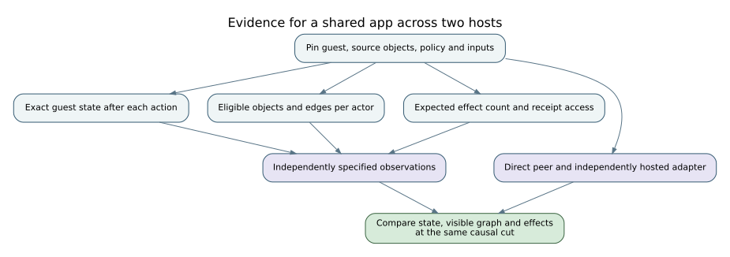

# Integrated implementation plan

Use the [Current ID issue map](current-issue-map.md) for the latest published issue census and blocker changes.

**Evidence date.** The tables below use the November 23, 2026 morning code and issue census. The reference book was delivered by [PR #13358](https://github.com/developing-today/code/pull/13358) for [#13332](https://github.com/developing-today/code/issues/13332). The [combined Pages run](https://github.com/developing-today/code/actions/runs/45191802593) publishes to the [ID section of the shared site](https://developing-today.github.io/code/id/).

Start with one signed app that runs offline and produces the same authorized results through two independent hosts. Use the counter guest, notes/boards code, gallery and hosted bridge already present. Extend that proof to permission changes, interrupted delivery, media and search. This order gives the library, Linux client, Android client and hosted backstop a common acceptance case. The new designs use [main at 7310a957](https://github.com/developing-today/code/commit/7310a95730791e66da98f7b0e13865930058a516). The earlier survey uses [4cfceaa8](https://github.com/developing-today/code/commit/4cfceaa8afc08cf2cea88b9d733a2ace14c8ad5a). The [ID issue map](issue-map.md) has its own census date. Work order below does not establish current ownership or grant approval.

**Membership rechecked at 8:15 a.m. Central on November 23.** Six GitHub Search REST pages returned the same 216 issue IDs as the 7:41 census. The individual label counts were 201 for app/id, 185 for epic/id-program and 35 for epic/id-platform. This comparison confirms membership. Each issue’s blocker, claim and review status still has its own observation time. [Recheck with all returned IDs](evidence/membership-recheck.json)

## Corrections that change the order

- The original 29 investigations in #2056 still have two open members. The parent now has **35 direct children, 29 closed and six open**. The six are #2036, #2039, #5536, #6312, #9106 and #12462. [The first ID apps and the #2056 family](research-apps-backlog.md)
- The sticky-notes/did-it proof already landed. Review its schema, trust and privacy decisions before proposing a permanent first app. The six additional app designs now have independently checked example transitions. [Merged PR #12707](https://github.com/developing-today/code/pull/12707) · [First-app review #3790](https://github.com/developing-today/code/issues/3790) · [Six apps a participant can finish, replay or resume](research-playbook.md)
- Phase 8 recorded causal-validity-only synchronization. Historical cryptographic replay and retained payload availability have their own contracts. Ecosystem V4 records read-only mirroring and local gallery admission separately. Discovery V2 has a decision in a closed issue comment and a separate successor. [ID design history and decisions carried forward](research-archive.md)
- The Linux widget renderer landed. Drawing a widget, activating its current binding and advertising the capability are separate milestones. Xaltha’s [provider-fix PR #13368](https://github.com/developing-today/code/pull/13368) follows the #1374 claim. [Widget PR](https://github.com/developing-today/code/pull/13266) · [Provider claim](https://github.com/developing-today/code/issues/1374#issuecomment-7100174570) · [Playable, accessible and authorable worlds across ID shells](research-clients.md)
- Frame fuel is flat for the measured fixed-state workload. The largest measured hot world had 256 participants. The recorded 89.34 MiB comes from a process-lifetime high-water reading spanning several operations. An isolated allocation cost for compaction remains unmeasured. The morning hold on #13084 was subsequently released and the issue closed with [join benchmark PR #13424](https://github.com/developing-today/code/pull/13424). See the [issue decision](https://github.com/developing-today/code/issues/13084#issuecomment-7105955143) for the authorized result. [What the scale measurements establish and which experiment comes next](research-measurement.md)

## Findings to reconcile first

The currency audit now has a tracking [issue #13542](https://github.com/developing-today/code/issues/13542) and [PR #13565](https://github.com/developing-today/code/pull/13565). [Issue #13540](https://github.com/developing-today/code/issues/13540) owns the cumulative media-retention contract. [Issue #13583](https://github.com/developing-today/code/issues/13583) records the proposed derived graph and search visibility proof and was filed after the live map’s 18:06 UTC census. Recovery after an uncertain effect remains with the [MCP bridge](https://github.com/developing-today/code/issues/7917) and [messaging protocol](https://github.com/developing-today/code/issues/2036).

| Item | Evidence and decision | First authorized repository action |
| --- | --- | --- |
| Currency supply audit | Saturating each unsigned counter before comparison can hide a real difference. With M = 2^127−1, issuer debits M+2 versus holder credits M+1 give an exact difference of one and a reported difference of zero. Reachability in a real ledger is unverified. | Check fresh issues, PRs and ownership. If uncovered, file the arithmetic fixture, then correct reconciliation and test aggregation and backend errors. [Code](https://github.com/developing-today/code/blob/7310a95730791e66da98f7b0e13865930058a516/pkgs/id/src/currency/reconcile.rs#L186) · [Three design records for repository review](research-contracts.md) |
| Media stream retention | The helper checks individual frames and available credit, enlarges its buffer, then applies the total artifact ceiling on finalization. Current evidence concerns the reusable API. Production reachability remains unverified. | Check #2342 and the introducing PR. Define a cumulative byte bound or a bounded streaming sink. Test refusal and state preservation with a small limit. [Source](https://github.com/developing-today/code/blob/7310a95730791e66da98f7b0e13865930058a516/pkgs/id/crates/id-store/src/media.rs#L428) · [PR #10653](https://github.com/developing-today/code/pull/10653) |
| Replication metadata | The native implicit-trust link uses full inventory in greetings, then applies scope to offers. Whether a peer is entitled to object identities and digests depends on its class. | Read #9142 and #5800, specify each class's metadata entitlement, then compare direct and backstop observations. [Source](https://github.com/developing-today/code/blob/7310a95730791e66da98f7b0e13865930058a516/pkgs/id/crates/id-sync/src/federation/exchange_net.rs#L773) · [What a disconnected node can say about the graph](research-graph.md) |
| Search statistics and layout | Shared lexical statistics or a precomputed layout can make private rows influence a reader's visible results. The significance depends on the visibility promised. | Compare two corpora with identical accessible rows. For strict-private ranking, test authorized statistics or a partitioned index and measure recall. Specify visible edges before layout. [What a reader can find in the ID graph](research-discovery-search.md) |

## Build sequence and gates

Rows at the same stage can proceed independently once their specific inputs and ownership checks clear. Hardware, deployed-service and performance claims each need evidence from their intended environment.

| Stage | Slice and existing home | Required input | Observable exit condition |
| --- | --- | --- | --- |
| 0 | Extend the reference book from [PR #13358](https://github.com/developing-today/code/pull/13358) with dated research, evidence and issue routes. | Existing single-site ID book and the documentation contract. | Verify the research section in a build against its branch and in the main-only combined Pages artifact. [Reference deployment](https://github.com/developing-today/code/actions/runs/45191802593) |
| 0 | Reconcile the two library correctness findings above | Current code, newest comments, duplicate and owner check | Each surviving finding has an owning issue with an independent acceptance criterion. The audit cannot falsely report clean. The media bound has a defined refusal. |
| 1 | Pin the guest/library profile in [#5955](https://github.com/developing-today/code/issues/5955) | Existing ABI, compiler dialect, app identity and state codec | Install, execute and replay the counter on a named profile. A separately changed incompatible dependency or codec gets the expected refusal. [From an app directory to a reproducible guest release](research-developer.md) |
| 1 | Reconcile providers, Rust embedding and [MCP #7917](https://github.com/developing-today/code/issues/7917) | Registry, host profile and separate invocation and receipt authority | An adapter advertises its real calls and bounds. A lost reply results in one authorized effect or an explicit uncertain state. [World capability catalogue](research-catalogue.md) · [Whose authority survives disconnection, recovery and retry?](research-authority.md) |
| 1 | Resolve IndexedDB disposition at [#9082](https://github.com/developing-today/code/issues/9082) and [#9110](https://github.com/developing-today/code/issues/9110) | Closed slices and the reserved fixture entry | Record adopt, defer or reject for the exact request-batch profile. A browser proof identifies transaction abort and rollback behavior. [Adopt the IndexedDB request-batch profile](store.md) |
| 2 | Live notes, pinned quotations and successor graph at [#9129](https://github.com/developing-today/code/issues/9129) and [#11419](https://github.com/developing-today/code/issues/11419) | Object kinds, schema rule, grant, causal cut and selector | Inspect competing heads, recover exact quoted bytes, represent a cross-schema migration as a derivative. [References, schema changes and publication across hosts](research-provenance.md) |
| 2 | Direct/hosted parity and custody at [#2036](https://github.com/developing-today/code/issues/2036) and its implementation owners | Signed identity, authorized placement and defined receipt meanings | Compare accepted IDs after lost replies, restart and reordered delivery. A revoked reader receives the defined refusal. [Operating one graph across intermittent peers and hosted backstops](research-operations.md) · [Discovering a world, contacting its members and contesting a result](research-messaging.md) |
| 2 | Linux input parity on the landed widget base; Android second | Stable action identity, fresh binding and accessibility labels | A focus change while a view is replaced cannot invoke a different action. Verify a physical Android accessibility/input path separately. [Playable, accessible and authorable worlds across ID shells](research-clients.md) |
| 2 | Complete one guest loop and extend to the six scenarios | Existing adapters, semantic inputs, target fallback and pure fixtures | Compare each intermediate state and refusal through a normal entry point. Extra presentation frames leave simulation state intact. [Six apps a participant can finish, replay or resume](research-playbook.md) |
| 3 | Atlas publication, backfill and retrieval at [#6062](https://github.com/developing-today/code/issues/6062) and #11182–#11186 | Source identity, authorized corpus, stable chunk IDs and model generation | Interrupt and resume backfill. Compare source membership and ranks with exact eligible rows. Removing the derived index preserves graph operation. [What a reader can find in the ID graph](research-discovery-search.md) |
| 3 | Thumbnails, seeking and media fallback | Cumulative media bound, source reference, decode grant, derivative profile | Check original bytes and derivative provenance independently. Withdrawing a grant changes subsequent serving, and a constrained host gives an accessible alternative. [Media that remains understandable when the renderer changes](research-media.md) |
| 3 | Transfer, offers and host budgets on the existing currency lane | Exact reconciliation, settlement authority, reservation and expiry | Conflicting offline intents settle at most once. Retrying a refused execution cannot spend its budget twice. Keep public-market policy with its recorded owner. [Currency, market offers and execution budgets](research-economy.md) |
| 4 | Discovery, hosted-world chains, physical platforms and scale | Check live dependencies and item-specific approvals. #13084 closed via [join benchmark PR #13424](https://github.com/developing-today/code/pull/13424). | Every deployment or physical run names its environment. Performance records state seed, tier actually reached and measurement boundary. [Discovering a world, contacting its members and contesting a result](research-messaging.md) · [What the scale measurements establish and which experiment comes next](research-measurement.md) · [Platform releases and installation](releases.md) |

## One end-to-end proof

Use a board post containing a pinned sketch and an editable note. Alice can author both. Bea can edit the note and view its sketch. Cy can read the note alone. Give a local node and an independently hosted node the same signed inputs, policy and causal cut. These roles describe one fixture.

1. Alice publishes while the backstop is offline. Recover the post after a local restart. Capture the signed identities and the accepted causal cut.
2. Bea edits the note offline. Alice creates another revision. On reconnection each entitled reader sees the appropriate branches and the original sketch pin. A merge decision has its own provenance. Under the strict-visibility profile, Cy receives no sketch thumbnail or protected edge.
3. Revoke Bea's future media-read grant while she is disconnected. A prior copy can survive on her device. New source, thumbnail, snippet and relay requests use the new policy. Reading any previous receipt requires its own authority.
4. Run one guest action requesting a metered effect and lose the response after the modeled effect commits. Independently count one external effect. Check whether the result is readable under current authority. A provider incapable of resolving a prior result reports uncertainty.
5. Discard and rebuild the authorized search projection. The same source/model generation recovers the same eligible set. Results obey the named rank and tie rules. Compare canonical IDs and authorized observations independently from transport latency.

The first failure identifies a boundary, the evidence available there and the issue that owns the behavior. A small fixed history can settle these semantic questions before any scale run or real-service canary. [Three design records for repository review](research-contracts.md) · [Operating one graph across intermittent peers and hosted backstops](research-operations.md)

## Repository handoff

Use an isolated worktree on verified AMD. Check main, issue premise, active claims and PRs before starting. Push each small slice, dispatch the named oracle through Fleet using GitHub-hosted plan quota, retain handle and run URL, and reread newest comments before merge. Keep deployment on the existing main-only Pages site. Check item-specific approvals where they apply. Fixture arithmetic and source-path checks establish the design baseline. Product, browser, device and performance results require independent execution receipts. [Program tracker](https://github.com/developing-today/code/issues/13240) · [Book delivery](https://github.com/developing-today/code/issues/13332) · [Maintaining and publishing the ID book](landing.md)
