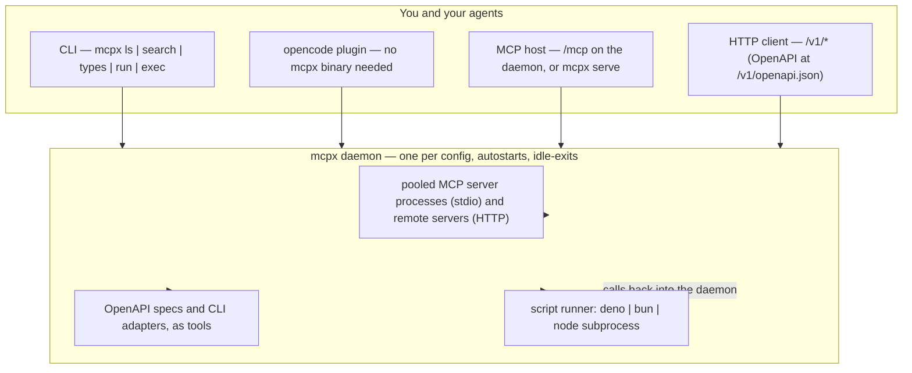

# Overview

> mcpx puts every MCP server you have behind one command, so an agent
> calls tools from the shell — and their schemas stay out of its context
> until it asks for them.

---

## Why install it

### 1. Code mode: tools become shareable, reusable scripts

Instead of one-off tool calls inside a chat, the agent writes a
TypeScript script that calls tools as ordinary async functions. The
script is a file: it can be saved, reviewed, shared and re-run.

```sh
mcpx run shot-flow <url> <outDir>
```

That is `.mcpx/scripts/shot-flow.ts` — screenshot a page, click a link,
wait for the load, screenshot again (the full walk is in
[the story](./story.md)). Written once by an agent that had never heard
of mcpx; reusable by anyone, forever, as `mcpx run shot-flow`.

More: [scripts](./scripts.md) and the level-2 map's script page
([level-2 page map](./level-2-page-map.md)).

### 2. Reclaim context: smarter, cheaper

Tool schemas are the tax. With seven namespaces and 43 tools installed,
discovery costs almost nothing:

```
$ mcpx ls
Seven namespaces, 43 tools, 171 tokens
```

The agent loads signatures only for the one namespace it is about to
use (`mcpx types <namespace>`), so the whole screenshot task above ran
in about 4,600 tokens total — schemas for 27 browser tools included
only when needed, never by default.

More: [the story](./story.md) for the token evidence.

### 3. Tame MCP: one config, every surface, everything corralled

- **One config.** mcpx reads the same `mcpServers` object every other
  MCP host reads. There is no second configuration to keep in sync.
- **Share it with your tailnet.** Run the daemon on one machine and let
  the others talk to it:

  ```sh
  mcpx daemon --address <tailnet-ip> --port 8899
  MCPX_DAEMON_ENDPOINT=http://<host>:8899 mcpx ls
  ```

  Plainly: **the daemon's API is unauthenticated — whatever can route
  to the port can run tools as you.** The network is the access
  control; that is why the example is a tailnet address, not the open
  internet.
- **Corral scripts, APIs and binaries.** Named scripts live in
  `.mcpx/scripts/`; an OpenAPI service becomes tools with
  `mcpx api tools --spec <url>` (served over MCP today); a plain
  command-line program becomes tools through an adapter
  (`mcpx adapter check` says whether each one is installed), and
  adapters are served by the daemon like any other server.

More: [configuration](./configuration.md).

## What it looks like



What is running on your machine, in one breath: clients (the CLI, the
plugin, an MCP host, plain HTTP) talk over a unix socket or a URL to
**one daemon per config**. The daemon owns the pooled MCP server
processes, serves OpenAPI specs and CLI adapters as tools, and runs
your scripts on a real runtime (deno, bun or node) whose tool calls
come back into the daemon. Nothing else is installed and nothing runs
until a command needs it: the daemon autostarts on demand and an
auto-started one exits after 4 hours idle.

## Next

- [Install mcpx](./install.md)
- [Quick start](./quick-start.md) — the loop in under one screen
- [Now what](./now-what.md) — where to go after the quick start
